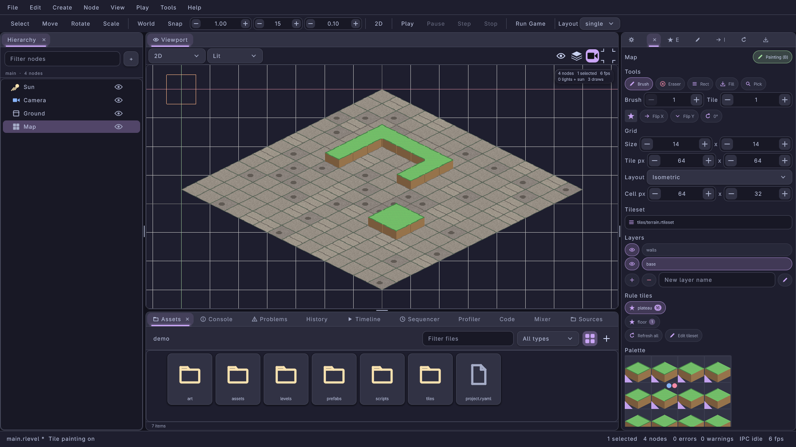
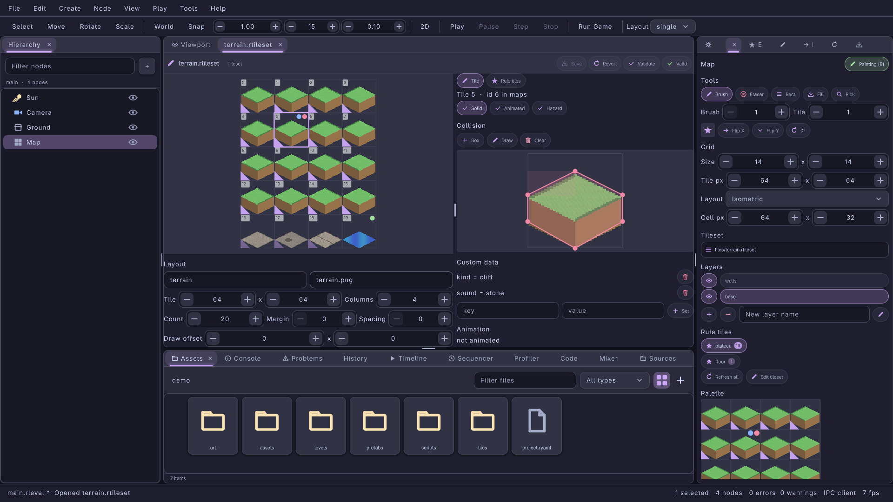
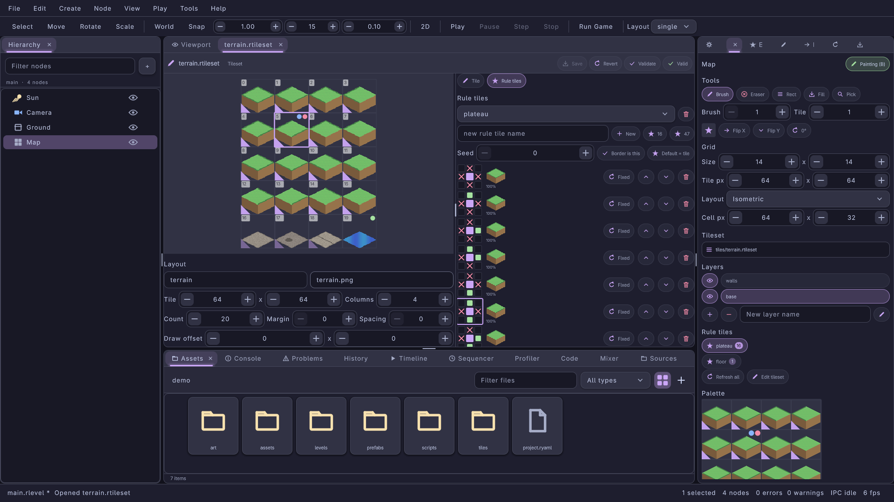
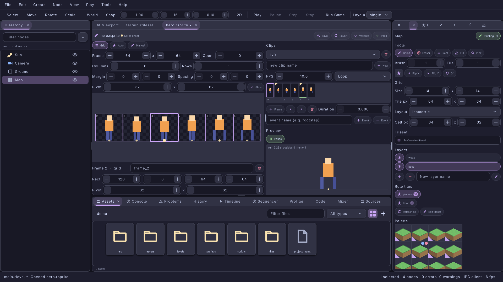

#+title: 2D Tools: Rule Tiles, Tile Transforms, Iso/Hex Grids, Tileset and Sprite Editors
#+description: The 0.9.0 2D tools of lrgeditor: the Tiles panel grown with rule tile painting (autotiling), per-cell flip and rotation, isometric / staggered / hexagonal grids and tile properties; the .rtileset editor (tile sheet, flags, collision polygons, custom data, animation, rule tiles with 3x3 masks, presets and weighted variants, live preview); the .rsprite slicer and frame animation editor; the tiles.*, tileset.* and sprite.* IPC methods
#+authors: Zach Podbielniak
#+categories: libregnum editor tilemap tileset sprite 2d ipc
#+created: 2026-11-07T13:00:00-05:00
#+updated: 2026-11-07T13:00:00-05:00
#+version: 0.9.0

* 2D Tools
:PROPERTIES:
:CUSTOM_ID: editor-2d
:END:
#+begin_quote
*[[file:../index.org][Home]]* > *[[file:overview.org][Editor Module]]* > 2D Tools
#+end_quote

** Overview
:PROPERTIES:
:CUSTOM_ID: editor-2d-overview
:END:
The 0.9.0 engine wave gave the 2D stack its data: tile cells with flip and rotation bits, =.rtileset= tilesets with per-tile collision, custom data and animation, =LrgRuleTile= autotiling brushes, isometric, staggered and hexagonal =LrgTilemap= grids, and =.rsprite= sprite sheets with frame animations (see the [[file:../guides/2d.org][2D guide]]). This page covers the editor tools that author all of it:

| Tool | Where | Edits | Source |
|------+-------+-------+--------|
| Tiles panel | Tab next to the Inspector (Tools > Tiles Panel, action =tilemap.show-panel=) | the selected tilemap node: brush, rule tile brush, transform bits, grid layout, tileset, layers; shows the palette and tile properties | =src/editor/ui/lrg-editor-tiles-panel.{h,c}= |
| Tile painting | The viewport, with paint mode on (B) | the node's cells, one undo step per gesture, autotiled with a rule tile brush | the viewport panel and =LrgEditorTilePainter=, wrapped by the Tiles panel's gesture hooks |
| Tileset editor | A data tab for an =.rtileset= (double-click it in Assets, New > Tileset, =tileset.open=) | the tileset asset, undoable in the document | =src/editor/ui/data/lrg-editor-tileset-editor.{h,c}= |
| Sprite editor | A data tab for an =.rsprite= (double-click it, "Slice Sprite Sheet" on a =.png=, =sprite.open=) | the sprite sheet asset, undoable in the document | =src/editor/ui/data/lrg-editor-sprite-editor.{h,c}= |
| =tiles.*=, =tileset.*=, =sprite.*= IPC | lrgeditorctl, MCP, scripts | everything the tools edit | the three files above |

#+caption: The Tiles panel on an isometric map painted with two rule tiles: a weighted floor and an edges16 plateau whose edges join up (catppuccin-mocha)

** Concepts
:PROPERTIES:
:CUSTOM_ID: editor-2d-concepts
:END:

*** Image tilesets and .rtileset tilesets
:PROPERTIES:
:CUSTOM_ID: editor-2d-tilesets
:END:
A tilemap node's visual asset (the "tileset") is either:
- an *image* (=.png= and the other image formats): sliced by the grid's tile size, as in 0.8.0. Tiles have no properties and there are no rule tiles;
- an *=.rtileset=* (0.9.0): the tileset asset brings the image (relative to the =.rtileset=), the tile size, columns, count, margin, spacing and draw offset, per-tile flags, collision polygons, custom data and animation frames, and its rule tiles. Dropping an =.rtileset= on the panel's tileset zone also sets the grid's tile size to the tileset's.

The editor loads an =.rtileset= without a texture (=lrg_tileset_new_from_asset_file()= with =load_texture= FALSE), keeps one copy per file and parses it again when the file's modification time or size changes: saving it in the tileset editor updates the palette, the rule tile list and the viewport on the next frame. The runtime's =LrgTilemapComponent= takes the same path (it loads =.rtileset= tilesets since 0.9.0), so what the editor shows is what the game draws.

*** Cell values, tile ids and tile indices
:PROPERTIES:
:CUSTOM_ID: editor-2d-ids
:END:
- A *cell value* is what a layer stores: a 1-based tile id in the low 29 bits plus the three Tiled transform bits (=LRG_TILE_FLIP_HORIZONTAL=, =_VERTICAL=, =_DIAGONAL=), 0 for an empty cell.
- A *tile index* is 0-based and is what the =.rtileset= file and the =LrgTileset= API use.
- The Tiles panel and =tiles.*= speak cell values and tile ids (the palette's first tile is 1); the tileset editor and =tileset.*= speak tile indices (the sheet's first tile is 0), as the file does. The tileset editor's tile title shows both ("Tile 4 · id 5 in maps").

*** The brush transform
:PROPERTIES:
:CUSTOM_ID: editor-2d-transform
:END:
The painter's current tile is a full cell value, so the brush carries a transform. While painting (paint mode on and a tilemap selected):

| Key | Action | Effect on the brush |
|-----+--------+---------------------|
| X | =tilemap.flip-x= | mirror left to right (=lrg_tile_flip_horizontally()=) on top of the current transform |
| Shift+X | =tilemap.flip-y= | mirror top to bottom (=lrg_tile_flip_vertically()=) |
| Z | =tilemap.rotate= | a quarter turn clockwise (=lrg_tile_rotate()=) |
| (palette) | =tilemap.rotate-back= | a quarter turn counter-clockwise |
| (palette) | =tilemap.reset-transform= | no transform |

The transform composes: X then Z gives the canonical "mirrored, rotated" pair =lrg_tile_make()= would build. Picking another palette tile keeps the transform; the brush preview next to the Flip X / Flip Y / rotation chips shows the transformed tile (an arrow on a swatch without an image). Every tool paints the bits: brush strokes, rectangles, fills and =tiles.paint=. The eyedropper (Ctrl+click) picks the cell value including its bits.

Y alone stays =tool.toggle-snap=: the canvas keeps one shortcut per chord, so vertical flip is Shift+X (rebind it in Preferences > Keybindings).

*** Rule tile painting (autotiling)
:PROPERTIES:
:CUSTOM_ID: editor-2d-rules
:END:
The Tiles panel lists the rule tiles of the target's =.rtileset= as chips (with their rule counts). Clicking one makes it the brush (clicking it again, or a palette tile, goes back to plain tiles); the palette marks tiles a rule tile owns with a corner triangle (solid for the brush's rule tile). With a rule tile brush every tool autotiles:

1. On press the viewport calls =lrg_editor_tiles_panel_begin_gesture()=: an undo group opens and the painter's tile becomes the rule tile's seed value (its default tile, else its first rule's first output), a tile the rule tile owns.
2. The painter's tool runs as usual (stroke samples, a rectangle on release, a fill). After each stroke sample the viewport calls =lrg_editor_tiles_panel_update_gesture()=: the cells that changed since the last call are found by diffing the layer, =lrg_rule_tile_apply()= re-resolves their bounding box grown by two cells (staggered layouts reach two rows) on a copy, and the resolved cells are one more TILES command inside the group.
3. On release (or right after an instant tool) =lrg_editor_tiles_panel_end_gesture()= resolves the last changes and closes the group.

So one gesture is one undo step whatever the tool, edges join up while the stroke is drawn, and the eraser re-resolves the neighbours of what it erases. Neighbours follow the grid: square grids (orthogonal, isometric) use eight directions, staggered grids map them onto the diamond directions, hexagonal grids use six (see [[file:../modules/tilemap/rule-tile.org::#layouts][grid layouts]]).

*Refresh all* (=tilemap.refresh-rules=, the "Refresh all" chip, =tiles.refresh=) runs every rule tile of the tileset over every layer (=lrg_tileset_apply_rule_tiles()=) as one undo step: use it after editing rules, or after painting plain tiles of a rule tile's range.

*** Grid layouts
:PROPERTIES:
:CUSTOM_ID: editor-2d-grids
:END:
The Grid section's Layout combo sets the node grid's orientation (=lrg_node_tilemap_set_grid()=, one undo step): orthogonal, isometric, staggered or hexagonal; staggered and hexagonal grids show the stagger axis and index, hexagonal grids the hexagon side length, every non-orthogonal grid the cell size (0 follows the tile size; set 64 x 32 for 64 x 64 isometric images). The layout is saved in the =.rlevel= only when it is not the default.

The editor maps the grid's pixel space onto the node's local XY plane: a grid pixel (px, py) is at (px * s, -py * s) with s = the visual's =tile_size= parameter divided by the cell width. One orthogonal cell is therefore =tile_size= world units wide, exactly as in 0.8.0; an isometric diamond is =tile_size= wide and half as tall for a 2:1 cell. Everything uses the same mapping:
- *Picking.* =lrg_editor_tiles_panel_cell_at()= (the viewport's hover and paint cell) inverts the node's world matrix and picks the cell exactly with =lrg_tilemap_world_to_cell()=: diamonds and hexagons, not their bounding boxes. Orthogonal grids keep =lrg_node_tilemap_local_to_cell()= bit for bit.
- *Drawing.* =lrg_editor_tiles_panel_draw_tilemap()= draws the cells in =lrg_tilemap_get_draw_order()= (back to front), each tile placed like =LrgTilemap= places it (the image's bottom-left on the cell box's bottom-left plus the draw offset, mirrored, then turned about its centre); overlapping layouts draw without depth writes so tall tiles stack correctly. The bounds always show; the cell outlines show while the node is painted.
- *Hover.* =lrg_editor_tiles_panel_paint_hover()= outlines the hovered diamond or hexagon in the overlay.

*** Tile properties in the panel
:PROPERTIES:
:CUSTOM_ID: editor-2d-properties
:END:
Below the palette the panel shows the tile under the pointer (else the brush tile, else the rule brush's seed tile): its id and index, the tile magnified with its collision polygons, the flags (solid, animated, hazard) and polygon count, the custom data as =key = value= rows, the animation frames with their total time and the rule tile that owns it. Palette badges summarise the same at a glance: a red dot for collision, a blue dot for data, a green dot for animation. The panel only shows properties; the tileset editor edits them.

** The Tiles panel
:PROPERTIES:
:CUSTOM_ID: editor-2d-tiles-panel
:END:
Sections, top to bottom:

| Section | Widgets (names for tests) | Notes |
|---------+---------------------------+-------|
| Title | =tiles-node=, =tiles-paint= | node name; paint mode (B) |
| Tools | =tiles-tool-brush= ... =tiles-tool-pick=, =tiles-brush=, =tiles-tile= | the five tools, brush size, tile id |
| Transform | =tiles-brush-preview=, =tiles-flip-x=, =tiles-flip-y=, =tiles-rotate= | the brush transform; the rotate chip shows the angle |
| Grid | =tiles-create-grid=, =tiles-width=, =tiles-height=, =tiles-tile-width=, =tiles-tile-height=, =tiles-orientation=, =tiles-stagger-row= (=tiles-stagger-axis=, =tiles-stagger-index=), =tiles-cell-row= (=tiles-cell-width=, =tiles-cell-height=), =tiles-hex-row= (=tiles-hex-side=) | every change is one undo step |
| Tileset | =tiles-tileset= | drop zone for images and =.rtileset= files ("application/x-lrg-asset") |
| Layers | =tiles-layers=, =tiles-layer-N=, =tiles-layer-eye-N=, =tiles-add-layer=, =tiles-remove-layer=, =tiles-layer-name=, =tiles-rename-layer= | as in 0.8.0 |
| Rule tiles | =tiles-rules=, =tiles-rule-<name>=, =tiles-refresh-rules=, =tiles-edit-tileset= | shown for =.rtileset= tilesets; "Edit tileset" opens the tileset editor |
| Palette | =tiles-palette=, =tiles-tile-info= | click picks a tile (and turns paint mode on) |

Actions registered by the panel: =tilemap.rename-layer=, =tilemap.flip-x= (X), =tilemap.flip-y= (Shift+X), =tilemap.rotate= (Z), =tilemap.rotate-back=, =tilemap.reset-transform=, =tilemap.refresh-rules=. The shell's =tilemap.*= actions (paint mode, tools, brush size, layers) are unchanged.

** The tileset editor
:PROPERTIES:
:CUSTOM_ID: editor-2d-tileset-editor
:END:
#+caption: The .rtileset editor's Tile page: the tile sheet with badges and rule ownership, a tile's collision polygon and custom data

#+caption: The Rule tiles page: the edges16 preset's rules, each a 3x3 neighbour mask, its outputs with their shares and its transform

The tab is split in two. Left: the *tile sheet* (the image cut by the tileset's layout; mouse wheel zooms, middle drag pans, a click selects a tile; badges as in the palette, rule ownership triangles, the tile index in the corner) and the *layout* fields (name, image path as written in the file, tile size, columns, count, margin, spacing, draw offset). Right, in a scroll box, two pages switched by the Tile / Rule tiles chips at the top (selecting a rule tile, adding one or =tileset.select= with a =rule_tile= shows the Rule tiles page; =tileset.select= with =page= picks one explicitly):

Tile page:
- *Tile*: the selected tile's title and the Solid / Animated / Hazard chips (=lrg_tileset_set_tile_properties()=).
- *Collision*: "Box" adds a polygon covering the tile, "Draw" enters polygon drawing (click points, click the first point again to close it), "Clear" removes every polygon. On the magnified tile (with a pixel grid when it is big enough) drag a point to move it (one undo step per drag, snapped to whole pixels and clamped to the tile), right-click a point to delete it (a triangle loses the whole polygon). A solid tile without polygons shows a red frame: it collides over its whole cell.
- *Custom data*: =key = value= rows with a remove chip; the key and value inputs and "Set" (Enter in either input) add or change a key (values are text, kept in order).
- *Animation*: one chip per frame ("tile · ms", click to remove); "Frame" appends a frame (the tile itself first, then the next tile of the sheet) with the duration from the ms field.
Rule tiles page:
- *Rule tiles*: the combo picks the rule tile the rules section shows; the trash chip removes it. Type a name and press "New" for an empty rule tile, "16" for the edges16 preset or "47" for the blob47 preset starting at the selected sheet tile (=lrg_rule_tile_new_edges16()=, =lrg_rule_tile_new_blob47()=; the preset must fit the tileset). "Seed" reshuffles the weighted variants, "Border is this" makes cells outside the map count as this rule tile, "Default = tile" makes the selected sheet tile the default.
- *Rules*: one row per rule, in matching order (the selected rule's mask is framed): a 3x3 mask (click a neighbour cell to cycle any -> this (green) -> not this (red cross) -> any; right click cycles back; the centre is the cell itself), the outputs (thumbnails with their share of the total weight; click to select one and edit its weight in the Weight field, right-click to remove it; a rule keeps at least one), and chips for the transform (Fixed, Rotated, Mirror X, Mirror Y, Mirror XY: click cycles), move up, move down and remove. Below: "Rule" adds a rule matching anything after the selected one with the selected sheet tile as its output, "Output = tile" adds the selected sheet tile to the selected rule with the Weight field's weight.
- *Preview*: an 8 x 8 grid; click cells to paint them with the rule tile and see what it resolves to (=lrg_rule_tile_paint()= on a scratch map with square neighbours). The preview is not saved.

Every edit parses the document, changes a fresh =LrgTileset= through the engine API and writes =lrg_tileset_save_to_data()= over the document as one undo step of the tab (Ctrl+Z inside the tab); layout fields the engine has no setters for (tile size, columns, count) are edited as document paths, and tile entries past a smaller count are dropped. Validation adds a warning for a missing image and for rule tiles without rules; parse errors show with their key path. The document saves the engine writer's bytes (comments are not kept).

** The sprite editor
:PROPERTIES:
:CUSTOM_ID: editor-2d-sprite-editor
:END:
#+caption: The .rsprite editor: auto-sliced frames with pivots, a clip's strip with an event flag, and the playing preview

Left: the slicing mode chips with their fields, the image with every frame's rectangle (index label, pivot cross; frames used by the selected clip are outlined in the accent colour, the selected frame thicker with a pivot handle):
- *Grid*: frame size, columns and rows (0: as many as fit the image), count (0: all), margin, spacing and pivot; "Slice" re-slices (=lrg_sprite_sheet_slice_grid()=). Clips keep their frame indices.
- *Auto*: alpha threshold, minimum island size and a pivot as a fraction of each frame (0.5, 1: bottom centre); "Auto-slice" finds the image's opaque islands (=lrg_sprite_sheet_slice_alpha()= on the decoded pixels).
- *Manual*: drag a rectangle on the image to add an explicit frame (pivot at its bottom centre); clicking a frame selects it.
In every mode, drag the selected frame's pivot handle to move the pivot (one undo step per drag). Below the image:
- *Frame*: the selected frame's name (Enter renames; names are unique), rectangle (explicit frames only: a grid frame's rectangle comes from the grid) and pivot; the trash chip removes an explicit frame and drops it from the clips (later frames move down in them).
Right:
- *Clips*: the combo selects a clip, the trash chip removes it, "New" adds one (named from the input, else =clipN=) with the selected frame; FPS and the loop mode (once, loop, ping-pong) edit the clip.
- *Strip*: one cell per clip position, as wide as its duration, with the frame thumbnail and index, an event flag and a green bar under the position playing. Click a position to select it and scrub the preview to it. "Frame" inserts the selected sheet frame after the selected position, the arrows move the position (its events move with it), the trash chip removes it, "Duration" sets its own duration in seconds (0: 1 / fps). The event input with "+ Event" / "- Event" adds or removes named events on the selected position.
- *Preview*: Play / Pause and the playing clip drawn with its pivot on a ground line (=lrg_sprite_animation_sample()= at the preview clock, exactly what =LrgSpriteAnimationPlayer= shows).

Validation warns about a missing image, clips without frames and frames reaching outside the image.

** IPC methods
:PROPERTIES:
:CUSTOM_ID: editor-2d-ipc
:END:
Common parameters: =node= is a node name, path or GUID (default: the tiles target, the primary selection when it is a tilemap node); =path= is an =.rtileset= / =.rsprite= file, absolute or relative to the project (default: the focused editor of that kind, else the first open one). Errors: =invalid-params= for missing or mistyped parameters, =not-found= for a missing target, tile, rule tile, clip, frame or editor, =failed= for engine errors (load, save, schema). Mutating =tiles.*= methods are one undo step in the level history; mutating =tileset.*= and =sprite.*= methods are one undo step in the document's history (=data.undo=).

*** tiles.*
:PROPERTIES:
:CUSTOM_ID: editor-2d-ipc-tiles
:END:
| Method | Params | Result |
|--------+--------+--------|
| =tiles.get= | =node?= | ={node, tileset, tileset_kind ("none", "image", "rtileset"), size, tile_size, grid: {orientation, stagger_axis, stagger_index, hex_side, cell_size}, layout, layers, brush: {tile, id, mirrored, rotation, rule_tile}, rule_tiles: [{name, default, n_rules}], tile: <tiles.tile_info of the brush tile>}= |
| =tiles.grid= | =node?=, =orientation?= (orthogonal, isometric, staggered, hexagonal), =stagger_axis?= (x, y), =stagger_index?= (odd, even), =hex_side?=, =cell_size?: [w, h]= | =tiles.get= |
| =tiles.brush= | =tile?= (id), =rule_tile?= (name or null), =mirrored?=, =rotation?= (0-3), =rotate?= (quarter turns), =flip_x?=, =flip_y?= | the brush (not undoable) |
| =tiles.paint= | =node?=, =cells: [x, y, ...]=, =rule_tile?=, =layer?=, =erase?= | ={changed}=: with a rule tile (the param or the brush) the cells and their neighbours are autotiled, else the brush value with its bits is written |
| =tiles.refresh= | =node?=, =layer?= (default all) | ={changed}= |
| =tiles.cell_at= | =node?=, =local: [x, y]= | ={cell: [x, y], inside, polygon: [[x, y], ...]}= in local units |
| =tiles.tile_info= | =node?=, =tile= (1-based) | ={tile, index, flags, collision: [[x0, y0, ...]], data: {}, animation: [{tile, duration}], rule_tile}= |

*** tileset.*
:PROPERTIES:
:CUSTOM_ID: editor-2d-ipc-tileset
:END:
| Method | Params | Result |
|--------+--------+--------|
| =tileset.create= | =path=, =image?=, =tile_size?= ([16, 16]), =name?= | ={path}=; columns and count from the image's size (8 x 8 without one); refuses to overwrite |
| =tileset.open= | =path= | ={path, panel}= |
| =tileset.get= | =path?= | ={path, dirty, selected, selected_rule_tile, selected_rule, issues, error?, name, image, tile_size, columns, tile_count, margin, spacing, offset, tiles: [{id, flags, collision, data, animation}] (tiles with something only), rule_tiles: [{name, default, seed, border_is_this, match_tiles, rules: [{pattern: [3 rows], transform, tiles: [{tile, weight, rotate, flip}]}]}]}= (tile references are indices) |
| =tileset.set= | =path?=, =name?=, =image?=, =tile_size?=, =columns?=, =tile_count?=, =margin?=, =spacing?=, =offset?= | =tileset.get= |
| =tileset.select= | =path?=, =tile?=, =rule_tile?=, =rule?=, =page?= (tile, rules) | the selection |
| =tileset.tile= | =path?=, =tile= (index), =flags?: [solid, animated, hazard]=, =data?: {key: value or null}=, =animation?: [{tile, duration}]= ([] removes it) | the tile entry |
| =tileset.collision= | =path?=, =tile=, =op= (add, clear, remove, move_point, insert_point, remove_point), =polygon?: [x0, y0, ...]=, =index?=, =point?=, =x?=, =y?= | the tile entry |
| =tileset.rule_tile= | =path?=, =name=, =op= (add, preset, remove, rename, set), =preset?= (edges16, blob47), =first?= (index), =new_name?=, =default?= (index or {tile, rotate, flip}, null: first output), =seed?=, =border_is_this?= | the rule tile |
| =tileset.rule= | =path?=, =rule_tile=, =op= (add, remove, move, set), =index?=, =to?=, =pattern?: [".#.", "-@-", "..."]=, =neighbor?= (n ... nw, all) with =match?= (any, this, not-this), =transform?= (fixed, rotated, mirror-x, mirror-y, mirror-xy), =tiles?: [index or {tile, weight, rotate, flip}]= (replaces the outputs) | the rule tile |
| =tileset.preview= | =path?=, =rule_tile=, =cells: [x, y, ...]=, =size?= ([8, 8]) | ={size, tiles: [cell values]}= (no edit) |
| =tileset.save= | =path?= | ={path}= |

*** sprite.*
:PROPERTIES:
:CUSTOM_ID: editor-2d-ipc-sprite
:END:
| Method | Params | Result |
|--------+--------+--------|
| =sprite.create= | =path=, =image?=, =name?=, =frame_size?: [w, h]= (grid-slices the image) | ={path}=; refuses to overwrite |
| =sprite.open= | =path= | ={path, panel}= |
| =sprite.get= | =path?= | ={path, dirty, selected_frame, selected_clip, playing, time, preview_frame, preview_position, issues, error?, name, image, image_size, grid: {frame_size, columns, count} or null, frames: [{index, name, rect, pivot, grid}], clips: [{name, fps, loop, frames: [{frame, duration}], events: [{frame, name}], duration}]}= |
| =sprite.slice= | =path?=, =mode= (grid, alpha); grid: =frame_size=, =columns?=, =rows?=, =count?=, =margin?: [x, y]=, =spacing?: [x, y]=, =pivot?: [x, y]=; alpha: =threshold?= (0), =min_size?= (2), =pivot?= (fractions, [0.5, 1]) | =sprite.get= |
| =sprite.frame= | =path?=, =op= (add, set, remove, select), =index?=, =rect?: [x, y, w, h]=, =name?=, =pivot?: [x, y]= | the frame (={removed}= for remove) |
| =sprite.clip= | =path?=, =op= (add, remove, set, select), =name=, =new_name?=, =fps?=, =loop?= (once, loop, ping-pong), =frames?: [index, name or {frame, duration}]= (set replaces the list) | the clip |
| =sprite.clip_frame= | =path?=, =clip=, =op= (add, insert, remove, move, set), =index?=, =to?=, =frame?= (index or name), =duration?= | the clip |
| =sprite.event= | =path?=, =clip=, =op= (add, remove), =frame= (clip position), =name?= | the clip |
| =sprite.play= | =path?=, =clip?=, =playing?=, =time?= | ={clip, playing, time, frame, position}= (the preview; not an edit) |
| =sprite.save= | =path?= | ={path}= |

** API reference
:PROPERTIES:
:CUSTOM_ID: editor-2d-api
:END:

*** LrgEditorTilesPanel
:PROPERTIES:
:CUSTOM_ID: editor-2d-api-tiles
:END:
=LrgEditorTilesPanel= (=lrg_editor_tiles_panel_get_type()=, =LRG_TYPE_EDITOR_TILES_PANEL=) is a final =LrgContainer=. =LRG_EDITOR_TILES_ASSET_TYPE= is the drop zone's content type.

| Function | Description |
|----------+-------------|
| =lrg_editor_tiles_panel_new (app)= | the panel; registers its actions, the =tiles.*= methods and installs the tileset / sprite editors' methods |
| =lrg_editor_tiles_panel_find (app)= | the app's panel (transfer none), or NULL |
| =lrg_editor_tiles_panel_get_target (self)= | the tilemap node being edited |
| =lrg_editor_tiles_panel_set_tileset (self, path)= | set an image or =.rtileset= (one undo step; =.rtileset= also sets the tile size) |
| =lrg_editor_tiles_panel_get_tileset (self)= | the target's =.rtileset= (transfer none), NULL for images |
| =lrg_editor_tiles_panel_rename_layer (self, layer, name)= / =lrg_editor_tiles_panel_set_layer_visible (self, layer, visible)= | layer edits (one undo step) |
| =lrg_editor_tiles_panel_get_palette_size (self, &columns, &rows)= | the palette grid |
| =lrg_editor_tiles_panel_set_grid (self, orientation, stagger_axis, stagger_index, hex_side_length, cell_width, cell_height)= | the grid layout (one undo step) |
| =lrg_editor_tiles_panel_get_brush_value (self)= | the brush's cell value with its transform bits |
| =lrg_editor_tiles_panel_set_brush_tile (self, tile_id)= | pick a tile, keeping the transform, leaving rule painting |
| =lrg_editor_tiles_panel_set_brush_transform (self, mirrored, rotation)= | set the transform |
| =lrg_editor_tiles_panel_flip_brush (self, vertical)= / =lrg_editor_tiles_panel_rotate_brush (self, quarter_turns)= | compose a transform |
| =lrg_editor_tiles_panel_get_rule_tile (self)= / =lrg_editor_tiles_panel_set_rule_tile (self, name)= | the rule tile brush (NULL: plain tiles) |
| =lrg_editor_tiles_panel_paint_cells (self, cells, n_values, erase)= | paint with the brush (autotiled with a rule tile), one undo step |
| =lrg_editor_tiles_panel_refresh_rule_tiles (self, layer)= | Refresh all (-1: every layer), one undo step |
| =lrg_editor_tiles_panel_get_info_tile (self)= | the tile the properties box shows |

Hooks for the viewport, the scene renderer and the gizmo painter (public so embedders and tests can use them):

| Function | Description |
|----------+-------------|
| =lrg_editor_tiles_panel_get_geometry (node, &scale)= | the grid's layout as a cached =LrgTilemap= and the pixel-to-local scale |
| =lrg_editor_tiles_panel_local_to_cell (node, local_x, local_y, &x, &y)= | exact picking in the node's plane |
| =lrg_editor_tiles_panel_cell_at (node, world_point, &x, &y)= | exact picking from a world point (what the viewport calls) |
| =lrg_editor_tiles_panel_get_cell_polygon (node, x, y, out_local)= | a cell's outline in local units (4 or 6 points) |
| =lrg_editor_tiles_panel_draw_tilemap (renderer, node, world, show_grid)= | draw a tilemap node with rlgl (what the scene renderer calls; needs GL) |
| =lrg_editor_tiles_panel_paint_hover (list, theme, view, node, x, y, erase, origin_x, origin_y, scale)= | the hover outline of non-orthogonal cells (FALSE: draw the square yourself) |
| =lrg_editor_tiles_panel_begin_gesture (app, node)= / =lrg_editor_tiles_panel_update_gesture (app)= / =lrg_editor_tiles_panel_end_gesture (app)= | the rule tile gesture around a painter gesture |

*** LrgEditorTilesetEditor
:PROPERTIES:
:CUSTOM_ID: editor-2d-api-tileset
:END:
A final =LrgEditorDataEditor= (=lrg_editor_tileset_editor_get_type()=, =LRG_TYPE_EDITOR_TILESET_EDITOR=), registered for =LRG_EDITOR_DOCUMENT_FORMAT_TILESET=. All edits return =FALSE= with a =LRG_EDITOR_DOCUMENT_ERROR= on failure (=NOT_FOUND= for a missing tile, rule tile, rule or output).

| Function | Description |
|----------+-------------|
| =lrg_editor_tileset_editor_new (app, document)= | the editor of a document |
| =lrg_editor_tileset_editor_open (app, path, error)= | open or present a tab |
| =lrg_editor_tileset_editor_create (app, path, image, tile_width, tile_height, name, error)= | write a new =.rtileset= |
| =lrg_editor_tileset_editor_install (app)= | register =tileset.*= |
| =lrg_editor_tileset_editor_get_tileset (self)= / =lrg_editor_tileset_editor_get_parse_error (self)= | the parsed tileset, or the loader's message |
| =lrg_editor_tileset_editor_get_selected_tile (self)= / =lrg_editor_tileset_editor_set_selected_tile (self, index)= / =lrg_editor_tileset_editor_tile_at (self, x, y)= | sheet selection and picking |
| =lrg_editor_tileset_editor_set_layout (self, name, image, tile_width, tile_height, columns, tile_count, error)= / =lrg_editor_tileset_editor_set_spacing (self, margin, spacing, offset_x, offset_y, error)= | layout |
| =lrg_editor_tileset_editor_set_tile_flags (self, index, flags, error)= / =lrg_editor_tileset_editor_set_tile_data (self, index, key, value, error)= / =lrg_editor_tileset_editor_set_tile_animation (self, index, frames, durations_ms, n_frames, error)= | per-tile properties |
| =lrg_editor_tileset_editor_add_collision (self, index, coords, n_coords, error)= / =lrg_editor_tileset_editor_remove_collision (self, index, polygon, error)= | polygons (-1: all) |
| =lrg_editor_tileset_editor_move_collision_point (self, index, polygon, point, x, y, gesture, error)= / =lrg_editor_tileset_editor_insert_collision_point= / =lrg_editor_tileset_editor_remove_collision_point= | points |
| =lrg_editor_tileset_editor_get_selected_rule_tile (self)= / =lrg_editor_tileset_editor_select_rule_tile (self, name)= / =lrg_editor_tileset_editor_get_selected_rule (self)= / =lrg_editor_tileset_editor_select_rule (self, index)= | rule selection |
| =lrg_editor_tileset_editor_add_rule_tile (self, name, preset, first_index, error)= / =lrg_editor_tileset_editor_remove_rule_tile= / =lrg_editor_tileset_editor_set_rule_tile (self, name, new_name, default_tile, seed, border_is_this, error)= | rule tiles |
| =lrg_editor_tileset_editor_add_rule (self, rule_tile, index, output, error)= / =lrg_editor_tileset_editor_remove_rule= / =lrg_editor_tileset_editor_move_rule (self, rule_tile, from, to, error)= | rules |
| =lrg_editor_tileset_editor_set_rule_neighbor (self, rule_tile, index, direction, match, error)= / =lrg_editor_tileset_editor_cycle_rule_neighbor (self, rule_tile, index, direction, backwards, error)= / =lrg_editor_tileset_editor_set_rule_transform= | patterns |
| =lrg_editor_tileset_editor_add_rule_output (self, rule_tile, index, value, weight, error)= / =lrg_editor_tileset_editor_remove_rule_output= / =lrg_editor_tileset_editor_set_rule_output_weight= | outputs |
| =lrg_editor_tileset_editor_preview (self, rule_tile, cells, n_values, width, height)= | resolve a scratch map (transfer full) |

*** LrgEditorSpriteEditor
:PROPERTIES:
:CUSTOM_ID: editor-2d-api-sprite
:END:
A final =LrgEditorDataEditor= (=lrg_editor_sprite_editor_get_type()=, =LRG_TYPE_EDITOR_SPRITE_EDITOR=), registered for =LRG_EDITOR_DOCUMENT_FORMAT_SPRITE=.

| Function | Description |
|----------+-------------|
| =lrg_editor_sprite_editor_new (app, document)= / =lrg_editor_sprite_editor_open (app, path, error)= | the editor |
| =lrg_editor_sprite_editor_create (app, path, image, frame_width, frame_height, name, error)= | write a new =.rsprite= (grid-sliced with a frame size) |
| =lrg_editor_sprite_editor_install (app)= | register =sprite.*= |
| =lrg_editor_sprite_editor_get_sheet (self)= / =lrg_editor_sprite_editor_get_parse_error (self)= | the parsed sheet |
| =lrg_editor_sprite_editor_get_selected_frame (self)= / =lrg_editor_sprite_editor_set_selected_frame (self, index)= / =lrg_editor_sprite_editor_frame_at (self, x, y)= / =lrg_editor_sprite_editor_image_to_canvas (self, image_x, image_y, &x, &y)= | frames on the canvas |
| =lrg_editor_sprite_editor_slice_grid (self, frame_width, frame_height, columns, rows, count, margin_x, margin_y, spacing_x, spacing_y, pivot_x, pivot_y, error)= / =lrg_editor_sprite_editor_slice_alpha (self, threshold, min_size, pivot_x, pivot_y, error)= | slicing |
| =lrg_editor_sprite_editor_add_frame (self, name, x, y, width, height, pivot_x, pivot_y, error)= / =lrg_editor_sprite_editor_set_frame (self, index, name, rect, pivot, gesture, error)= / =lrg_editor_sprite_editor_remove_frame (self, index, error)= | frames |
| =lrg_editor_sprite_editor_get_selected_clip (self)= / =lrg_editor_sprite_editor_select_clip (self, name)= | clip selection |
| =lrg_editor_sprite_editor_add_clip (self, name, frames, n_frames, fps, loop, error)= / =lrg_editor_sprite_editor_remove_clip= / =lrg_editor_sprite_editor_set_clip (self, name, new_name, fps, loop, error)= | clips |
| =lrg_editor_sprite_editor_insert_clip_frame (self, clip, position, frame, duration, error)= / =lrg_editor_sprite_editor_set_clip_frame= / =lrg_editor_sprite_editor_remove_clip_frame= / =lrg_editor_sprite_editor_move_clip_frame (self, clip, from, to, error)= | clip positions |
| =lrg_editor_sprite_editor_add_event (self, clip, position, name, error)= / =lrg_editor_sprite_editor_remove_event (self, clip, position, name, error)= | events |
| =lrg_editor_sprite_editor_set_playing (self, playing)= / =lrg_editor_sprite_editor_get_playing= / =lrg_editor_sprite_editor_seek (self, time)= / =lrg_editor_sprite_editor_get_time= / =lrg_editor_sprite_editor_get_preview_frame (self, &position)= | the preview |

** Worked examples
:PROPERTIES:
:CUSTOM_ID: editor-2d-examples
:END:

*** An isometric plateau from the command line
:PROPERTIES:
:CUSTOM_ID: editor-2d-example-cli
:END:
#+begin_src sh
lrgeditorctl call tileset.create '{"path":"tiles/terrain.rtileset","image":"tiles/terrain.png","tile_size":[64,64]}'
lrgeditorctl call tileset.rule_tile '{"path":"tiles/terrain.rtileset","op":"preset","name":"plateau","preset":"edges16","first":0}'
lrgeditorctl call tileset.save '{"path":"tiles/terrain.rtileset"}'
lrgeditorctl create node Ground --kind tilemap
lrgeditorctl call tilemap.configure '{"node":"Ground","width":18,"height":18}'
lrgeditorctl call selection.set '{"nodes":["Ground"]}'
lrgeditorctl call tiles.grid '{"orientation":"isometric","cell_size":[64,32]}'
lrgeditorctl call tiles.paint '{"cells":[3,3,4,3,5,3,6,3],"rule_tile":"plateau"}'
#+end_src
(Pass the tileset with =tilemap.configure='s tileset parameter, or drop the =.rtileset= on the Tiles panel.)

*** Painting with a rule tile from C
:PROPERTIES:
:CUSTOM_ID: editor-2d-example-c
:END:
#+begin_src C
LrgEditorTilesPanel *tiles = lrg_editor_tiles_panel_find (app);
const gint run[] = { 2, 3, 3, 3, 4, 3 };

lrg_editor_tiles_panel_set_tileset (tiles, "tiles/terrain.rtileset");
lrg_editor_tiles_panel_set_rule_tile (tiles, "plateau");
lrg_editor_tiles_panel_paint_cells (tiles, run, G_N_ELEMENTS (run), FALSE);   /* one undo step, edges join */
#+end_src

*** A walk cycle over IPC
:PROPERTIES:
:CUSTOM_ID: editor-2d-example-sprite
:END:
#+begin_src sh
lrgeditorctl call sprite.create '{"path":"art/hero.rsprite","image":"art/hero.png","frame_size":[128,128]}'
lrgeditorctl call sprite.slice '{"path":"art/hero.rsprite","mode":"grid","frame_size":[128,128],"pivot":[64,120]}'
lrgeditorctl call sprite.clip '{"op":"add","name":"run","fps":10,"frames":[0,1,2,3,4,5]}'
lrgeditorctl call sprite.event '{"clip":"run","op":"add","frame":1,"name":"footstep"}'
lrgeditorctl call sprite.save
#+end_src

** Performance
:PROPERTIES:
:CUSTOM_ID: editor-2d-performance
:END:
- Rule tile painting resolves only the box around what changed (plus two cells), so a stroke stays at the engine's per-cell cost (about 12 µs per painted cell for blob47); the layer diff per stroke sample is linear in the layer (a 256 x 256 layer is 65 536 comparisons, well under a millisecond). Refresh all is the engine's full refresh (14 ms for a 256 x 256 blob47 layer).
- The geometry =LrgTilemap= of a grid is built once per layout change (one empty layer of the grid's size) and reused for picking, drawing and outlines. Exact isometric picking costs about 0.1 µs, hexagonal 0.6 µs.
- The tileset cache stats the =.rtileset= once per call site per frame; parsing only happens when the file changed.
- Non-orthogonal maps draw every cell in draw order with immediate-mode quads; the cell outlines are limited to maps of 128 x 128 cells or less (the border always shows).
- Every tileset / sprite edit re-parses and re-writes the whole document: fine for hand-sized assets (hundreds of tiles, dozens of clips); drags merge into one undo step through gesture ids.

** Pitfalls
:PROPERTIES:
:CUSTOM_ID: editor-2d-pitfalls
:END:
- *Ids and indices.* The panel and =tiles.*= use 1-based ids (the palette starts at 1), the tileset editor and =tileset.*= use 0-based indices (the file's numbering).
- *Rule tile brushes need an =.rtileset=.* An image tileset has no rule tiles; switching a node to another tileset drops a rule brush the new one does not have.
- *Plain tiles of a rule tile's range count as "this".* Painting them by hand is fine, but run Refresh all to resolve them.
- *Y is snap.* Vertical flip is Shift+X; rebind it if you prefer (Preferences > Keybindings), but a duplicate chord makes one of the two actions unreachable.
- *Grid frames have no own rectangle.* Edit the grid (and re-slice) or add explicit frames; removing grid frames means re-slicing.
- *Re-slicing keeps clips* by frame index: check the clips after changing the frame count.
- *The runtime 3D tilemap component draws orthogonal, isometric, staggered and hexagonal cells and honors flip and rotation bits.* =lrg_tilemap_component_get_cell_quad()= is the quad =draw_layer= emits, headless. A dedicated second shortcut that flips a tile vertically without sharing the snap chord is left for a later release. Y while a tilemap stroke is active is the vertical flip that is already registered.

** Using it from code and the runtime
:PROPERTIES:
:CUSTOM_ID: editor-2d-runtime
:END:
What the tools write is plain engine data: =.rtileset= files load with =lrg_tileset_new_from_asset_file()=, =.rsprite= files with =lrg_sprite_sheet_new_from_rsprite_file()=, tilemap nodes become =LrgTilemapComponent=s (with the grid layout and the =.rtileset=) through =lrg_level_instantiate_3d()=, or runtime =LrgTilemap=s through =lrg_node_tilemap_to_runtime()=.

** See also
:PROPERTIES:
:CUSTOM_ID: editor-2d-see-also
:END:
- [[file:../guides/2d.org][2D guide]]
- [[file:../modules/tilemap/tileset-asset.org][Tileset assets (.rtileset)]], [[file:../modules/tilemap/rule-tile.org][Rule tiles]], [[file:../modules/tilemap/iso-hex.org][Isometric and hexagonal maps]]
- [[file:../modules/atlas/sprite-sheet.org][LrgSpriteSheet]], [[file:../modules/atlas/sprite-animation.org][Sprite animations]]
- [[file:editor-tools.org][Editor tools]] (tile painting basics), [[file:data-editors.org][Data editors]], [[file:ipc-protocol.org][IPC protocol]], [[file:lrgeditorctl.org][lrgeditorctl]]
