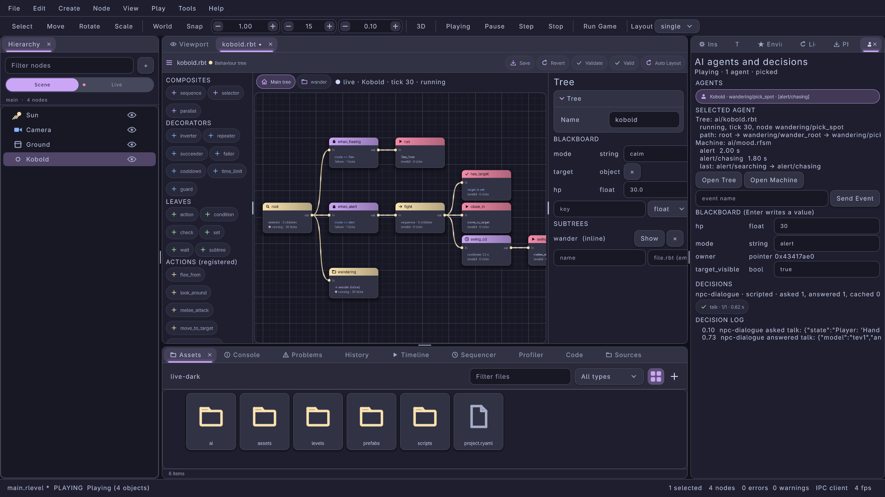
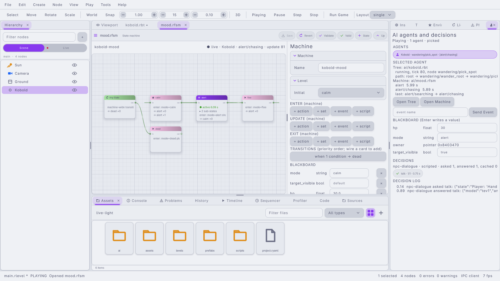
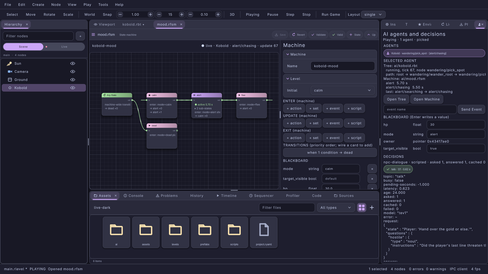

#+title: AI in the Editor: Behaviour Tree Editor, State-Machine Editor and the AI Panel
#+description: The lrgeditor tools for game AI in 0.9.0: the .rbt behaviour tree editor (node graph, palette with registered bindings, blackboard schema, subtrees, validation, live node states while playing), the .rfsm logic state-machine editor (hierarchical states, transitions with events, timers, conditions and actions, live active states and fire counts), the docked AI panel (live agents, editable blackboard, events, the LLM decisions inspector) and the bt.*, fsm.* and ai.* IPC methods
#+authors: Zach Podbielniak
#+categories: libregnum editor ai behaviour-trees state-machines decisions ipc
#+created: 2026-11-07T18:00:00-05:00
#+updated: 2026-11-07T18:00:00-05:00
#+version: 0.9.0

* AI in the Editor
:PROPERTIES:
:CUSTOM_ID: editor-ai
:END:
#+begin_quote
*[[file:../index.org][Home]]* > *[[file:overview.org][Editor Module]]* > AI in the Editor
#+end_quote

** Overview
:PROPERTIES:
:CUSTOM_ID: editor-ai-overview
:END:
libregnum's game AI has three layers that share one blackboard (see the [[file:../guides/ai.org][AI guide]]): behaviour trees in =.rbt= files, logic state machines in =.rfsm= files, and LLM-backed decisions asked through an =LrgDecisionBrain=. An entity runs a tree, a machine or both through an =LrgAiComponent= (registry name =ai=, properties =tree-path=, =machine-path=, =tick-interval=, ...). The editor authors the two file formats and inspects all three layers while the level plays:

| Tool | Where | Edits | Source |
|------+-------+-------+--------|
| Behaviour tree editor | A data editor tab: double click a =.rbt= in the Assets panel, =bt.open=, Assets > New Behaviour Tree | the =.rbt= document | =src/editor/ui/data/lrg-editor-bt-editor.{h,c}= |
| State-machine editor | A data editor tab: double click a =.rfsm=, =fsm.open=, Assets > New State Machine | the =.rfsm= document | =src/editor/ui/data/lrg-editor-fsm-editor.{h,c}= |
| AI panel | A tab next to the Inspector (View > Panels > AI, action =ai.show=) | the live blackboards of the playing level (not files) | =src/editor/ui/lrg-editor-ai-debug-panel.{h,c}= |
| =bt.*=, =fsm.*=, =ai.*= IPC | lrgeditorctl, MCP, scripts | everything the three tools do | the same files |

** Concepts
:PROPERTIES:
:CUSTOM_ID: editor-ai-concepts
:END:
*** The document is the truth
:PROPERTIES:
:CUSTOM_ID: editor-ai-document
:END:
Both editors are =LrgEditorDataEditor= subclasses: they edit an =LrgEditorDocument= through its YAML path API, so every gesture is an undoable command of the file's own history (Ctrl+Z inside the tab, the toolbar's Save / Revert / Validate, the external-change banner). Several writes of one gesture (deleting a node with its positions, a rename that rewrites targets) are one undo step. Saving writes the engine's own serialisation of the document (=lrg_bt_asset_to_data()=, =lrg_logic_machine_to_data()=), so a saved file is byte-stable and loads in the game exactly as the editor validated it. After every change the text is parsed into a fresh engine object (=lrg_editor_bt_editor_get_asset()=, =lrg_editor_fsm_editor_get_machine()=) for validation and for the canvas's kinds and ids; that object is never run.

*** Positions live in the file
:PROPERTIES:
:CUSTOM_ID: editor-ai-positions
:END:
Card positions are kept in a top-level block the engine preserves on save:

#+begin_src yaml
editor:
  positions:
    root: [0, 92]          # .rbt: keyed by node id
    when_alert: [240, 46]
    combat: [480, 0]       # .rfsm: keyed by state path
    combat/attack: [240, 0]
    combat/@owner: [-240, 0]   # the "While in combat" card
#+end_src

Nodes or states without a saved position are placed automatically (tree: depth by column, leaves in rows, parents centred on their children; machine: a four-column grid). Auto Layout in the behaviour tree editor's toolbar (=lrg_editor_bt_editor_auto_layout()=, =bt.layout=) writes positions for the whole shown tree in one undo step.

*** Ids in behaviour trees
:PROPERTIES:
:CUSTOM_ID: editor-ai-ids
:END:
A node's =id:= names it for the editor, the IPC and the live runner. Nodes without one get the id the engine generates (=n0=, =n1=, ...; the same id an =LrgBtRunner= built from the file reports, so live state maps onto them). The first structural edit (add, move, remove, duplicate, layout) writes those generated ids into the file so they stay stable while the tree changes shape; nodes the editor creates always get an explicit id made from their type or binding (=sequence2=, =melee_attack=).

*** Live state and the focus
:PROPERTIES:
:CUSTOM_ID: editor-ai-live
:END:
While the level plays in the editor, every =LrgAiComponent= of the play world is a live agent (=lrg_editor_ai_debug_panel_list_live()=). One of them is the *focus*: the agent picked in the AI panel (=lrg_editor_ai_debug_panel_set_focus()=, =ai.select=), else the agent made from the primary selection's node (=lrg_editor_ai_debug_panel_get_focus_component()=). A tree or machine editor follows the focused agent when it runs the edited file, else the first live agent running it (=lrg_editor_ai_debug_panel_find_for_file()=; component paths resolve against the project directory and match by suffix when relative). Agents are named by the GUID of the level node they were made from, else by the entity's name (=lrg_editor_ai_debug_panel_dup_entity_id()=, =lrg_editor_ai_debug_panel_lookup()=).

** The behaviour tree editor
:PROPERTIES:
:CUSTOM_ID: editor-ai-bt
:END:
*** Layout
:PROPERTIES:
:CUSTOM_ID: editor-ai-bt-layout
:END:
#+begin_example
+------------+--------------------------------------+----------------+
| PALETTE    | [Main tree] [wander]    live: ...    | guard · fight  |
|  sequence  |                                      |  Id, Name,     |
|  selector  |   root ─┬─ when_fleeing ── run       |  Type,         |
|  ...       |         ├─ when_alert ── fight ─┬─   |  Properties,   |
| ACTIONS    |         │                       ├─   |  Parameters    |
|  melee_... |         └─ wandering            └─   |  [+ Param]     |
| CONDITIONS |                                      | BLACKBOARD     |
|  in_range  |                                      | SUBTREES       |
+------------+--------------------------------------+----------------+
#+end_example

- *Canvas.* One card per node, left to right: the parent's =out= port wires to each child's =in= port, children top to bottom in file order. Card headers are coloured by kind (composite, decorator, leaf, subtree; unknown types and nodes without a type stand out), the icon tells the type (arrow for =sequence=, magnifier for =selector=, clock for =cooldown= / =time_limit= / =wait=, lock for =guard=, check for =check= / =condition=), the body summarises the properties (=cooldown 1.2 s=, =hp < 8.0=, =mode = alert=, =melee_attack=, =→ wander (inline)=) and lists the binding parameters. An action or condition whose binding this editor process does not have is shown with =(game)=: the game registers it at run time.
- *Chips above the canvas* switch between the main tree and each inline subtree (=lrg_editor_bt_editor_show_subtree()=, =lrg_editor_bt_editor_get_shown_subtree()=).
- *Palette (left).* The built-in node types grouped by kind, then the actions and conditions registered in this process (=lrg_bt_dup_action_names()=, =lrg_bt_dup_condition_names()=: the binding palette). A click adds the type under the selected node: a composite gets a new last child, an empty decorator its child, a leaf or a full decorator a sibling right after it; with nothing selected, under the shown root. A registered action or condition adds an =action= / =condition= leaf already bound to it.
- *Inspector (right).* For the selected node: Id (renaming moves its saved position), Name (empty removes it: the card shows the id), Type (a combo of every known type; changing it converts =child:= and =children:= between decorators and composites), then the type's properties (=policy=, =count=, =seconds=, =duration=, =key= / =op= / =value= with the declared keys offered, =action= / =condition= / =script= with a Binding switch, =ref= with the declared subtrees; registered custom types show their scalar keys), then the =params:= of the binding typed as written, with Reset removing one and =+ Param= adding one. With nothing selected the inspector edits the tree's name.
- *Blackboard.* The =blackboard:= schema: one row per key (name, type, an editable default; Enter writes it typed by the key, × removes the key), and a row to add one (name, type, =+ Key=). When the schema is not empty, =check=, =guard= and =set= must name declared keys: the validation flags typos on their node.
- *Subtrees.* One row per =subtrees:= entry: a file subtree (=→ walk.rbt=, Open opens it in its own tab) or an inline one (Show switches the canvas to it), × removes it; =+ Subtree= declares one (a file path, or empty for an inline subtree with an empty =selector= root).

*** Canvas gestures
:PROPERTIES:
:CUSTOM_ID: editor-ai-bt-gestures
:END:
| Gesture | Effect |
|---------+--------|
| Drag a card | moves it; the position is saved in =editor: positions:= |
| Drag a wire from a composite or decorator onto a card | re-parents the card's node (with its subtree) as the last child |
| Drop a wire on empty canvas | adds an =action= leaf there under the wire's node |
| Unplug a wire | springs back: a tree has no detached nodes (move by wiring elsewhere, remove with Delete) |
| Delete | removes the selected nodes with everything under them and their positions |
| Ctrl+D | duplicates a node with its subtree right after it, every id fresh |
| Double click a =subtree= card | opens a file subtree in its tab, shows an inline one |
| Ctrl+Z / Ctrl+Shift+Z | undo / redo in the document |

The canvas refuses wires that would make a cycle, a second child for a decorator, or a child for a leaf.

*** Validation
:PROPERTIES:
:CUSTOM_ID: editor-ai-bt-validation
:END:
The issues list (and =bt.validate=) shows, in order: errors from the engine's loader and =lrg_bt_asset_validate()= (wrong values, missing required properties, wrong child counts, undeclared subtrees, undeclared blackboard keys), each located on its node even when the engine names the node instead of a key path (="node 'typo' (check): blackboard key 'hpp' is not declared"=); then one note per binding this process does not have (=lrg_bt_asset_dup_unbound()=: =action:melee_attack=, =script:flee=), as information, since a game registers its bindings at run time; an unknown node type is a warning. Clicking an issue selects its node.

*** Live state
:PROPERTIES:
:CUSTOM_ID: editor-ai-bt-live
:END:
While playing, the toolbar line reads =● live · <entity> · tick N · running= and every card shows its node's last state from the agent's =LrgBtRunner= (=lrg_editor_bt_editor_get_live_runner()=, =lrg_editor_bt_editor_get_live_status()=): header tinted by status (running: warning colour, success: success colour, failure: danger colour; not reached by the last tick: plain), the body's second line =● running · 42 ticks= (=lrg_bt_node_get_tick_count()=), and the wires of the running branch (=lrg_bt_runner_dup_active_path()=) lit. The view refreshes only when the runner ticked. Inside an inline subtree view a card maps to the first expansion of the subtree (=patrol/walk=).

** The state-machine editor
:PROPERTIES:
:CUSTOM_ID: editor-ai-fsm
:END:

*** Layout
:PROPERTIES:
:CUSTOM_ID: editor-ai-fsm-layout
:END:
- *Canvas.* One level of the hierarchy at a time (=lrg_editor_fsm_editor_get_shown()=): the child states of the shown state (the machine's top level at first) as cards, a star on the initial one, a menu icon on states with sub-states; the card body lists the sub-state count and the =enter:=, =update:= and =exit:= actions (=enter: mode=alert shout=, =!event= for raised events, =fn()= for scripts). Transitions are wires from the owner's =out= port to the target's =in= port. On the left, the *owner card* carries the shown state's own transitions: at the top level "Any State" (the machine-wide =transitions:=), inside a state "While in <state>" (they outrank the children's, see [[file:../modules/ai/logic-machine.org#update][one update]]); its id is =LRG_EDITOR_FSM_EDITOR_OWNER_CARD=. A transition whose target lies outside the shown level ends on a small "→ target" card (red when the target does not resolve).
- *Breadcrumbs* above the canvas: the machine's name, then one segment per level (=lrg_editor_fsm_editor_dup_breadcrumbs()=); clicking one goes back up. Toolbar: =+ State= (a free =stateN= in the shown level), Up.
- *Inspector.* A selected state: Name (a rename rewrites every =to:= and =initial:= that reached it and moves its saved positions), Initial; its ENTER, UPDATE and EXIT action lists; its transitions in priority order (click one to edit it). A selected transition: To, Event (empty: event-less), After (Reset removes the timer); its WHEN conditions and DO actions. Nothing selected: the machine's name, the shown level's initial state, the shown state's own action lists and transitions (at the top level, the machine-wide ones).
- *Entry lists.* Every action or condition entry is one line of YAML (=\{action: shout\}=, =\{set: mode, value: alert\}=, =\{event: hurt\}=, =\{key: hp, op: lt, value: 8.0\}=, =\{condition: in_range, params: \{range: 2.5\}\}=): edit it and press Enter; ↑ moves it up, × removes it (an emptied list is removed). The buttons under a list add each kind with a template (actions: =+ action=, =+ set=, =+ event=, =+ script=; conditions: =+ key=, =+ condition=, =+ script=). A malformed line is refused with the parser's message.
- *Blackboard* as in the tree editor; *LIVE*: an event field and Send Event (=lrg_editor_fsm_editor_send_live_event()=).

*** Canvas gestures
:PROPERTIES:
:CUSTOM_ID: editor-ai-fsm-gestures
:END:
| Gesture | Effect |
|---------+--------|
| Drag a wire from a state (or the owner card) onto a state | adds a transition (event-less, no timer: fill it in the inspector) and selects it |
| Drop a wire on empty canvas | adds a state there and a transition to it |
| Select a wire | inspects the (first) transition it stands for |
| Delete on a wire | removes every transition it stands for |
| Delete on a state | removes it with its sub-states, every transition targeting it and its =initial:= mention |
| Ctrl+D | duplicates a state as =<name>_copy= |
| Double click a state | enters its sub-machine (an empty one is where its children go: that is how a state becomes hierarchical) |
| Double click the owner card | goes up a level |
| Double click a "→ target" card | jumps to the target's level and selects it |

Transition targets are written the shortest way the engine resolves to the intended state: the bare name when the engine's rule ([[file:../modules/ai/logic-machine.org#paths-and-targets][paths and targets]]) finds it from the owner, else the absolute =/a/b=.

*** Validation
:PROPERTIES:
:CUSTOM_ID: editor-ai-fsm-validation
:END:
Errors from the loader and =lrg_logic_machine_validate()= (unknown targets and initial states, duplicate names, malformed entries, undeclared blackboard keys) with their key paths, then one note per binding this process lacks (=lrg_logic_machine_dup_unbound()=). Clicking an issue selects the state or transition it is in.

*** Live state
:PROPERTIES:
:CUSTOM_ID: editor-ai-fsm-live
:END:
While playing (=lrg_editor_fsm_editor_get_live_machine()=), the active states of the shown level are tinted (the innermost in the success colour, its active ancestors in the accent colour) and show =● active 2.50 s= (=lrg_logic_machine_get_state_time()=); every card lists its first transitions with their fire counts (=→ alert ×3=, =lrg_logic_transition_get_fire_count()=), the owner card the shown state's; the wire of the last transition taken (=lrg_logic_machine_get_last_transition()=) is lit. The toolbar line reads =● live · <entity> · <innermost state> · update N=.

** The AI panel
:PROPERTIES:
:CUSTOM_ID: editor-ai-panel
:END:

The panel (=lrg_editor_ai_debug_panel_new()=, dock id =LRG_EDITOR_AI_DEBUG_PANEL_ID= ="ai"=, =lrg_editor_ai_debug_panel_find()=) polls the play world a few times a second:

- *Header:* =Stopped=, or =Playing · N agents · picked= / =following the selection=.
- *AGENTS:* one chip per live agent (name · current node · [current state] · paused). Click picks it as the focus; clicking the picked one again goes back to following the selection.
- *SELECTED AGENT:* the tree file, its status, tick and current node and the active path (=root → when_alert → fight → swing=); the machine file, every active state with its time and the last transition. Open Tree / Open Machine open the files in their editors (which then show this agent live). An event field with Send Event (=lrg_ai_component_send_event()=).
- *BLACKBOARD:* one row per key of the agent's live blackboard (name, type, value). Type a value and press Enter to write it into the running game (ints, floats, booleans, strings; objects and pointers are shown, not edited). Values update in place every poll except the field being typed into.
- *DECISIONS:* every watched =LrgDecisionBrain=: its totals (provider and model, asked, answered, cached, failed, input / output tokens, mean latency: =lrg_decision_brain_get_totals()=) and one chip per topic (✓ answered, clock while pending with its seconds, ⚠ after a failure; =answered/asked · latency=). Clicking a topic (=lrg_editor_ai_debug_panel_select_topic()=, =lrg_editor_ai_debug_panel_get_selected_topic()=) shows its state (=lrg_decision_brain_dup_topic_state()=) and its last request JSON pretty-printed.
- *DECISION LOG:* the newest twelve =asked=, =answered= and =failed= signals with their time, brain, topic and payload (the app keeps 200: =lrg_editor_ai_debug_panel_get_log_length()=, =lrg_editor_ai_debug_panel_dup_log_entry()=).

Brains are not discoverable from a running level: a game (or a tool embedding the editor) shows one with =lrg_editor_ai_debug_panel_watch_brain()= and removes it with =lrg_editor_ai_debug_panel_unwatch_brain()=; =lrg_editor_ai_debug_panel_dup_brain_names()= and =lrg_editor_ai_debug_panel_get_brain()= list them. The focus, the brains and the log live on the app, so the =ai.*= methods work whether or not the panel is docked (=lrg_editor_ai_debug_panel_install()= registers them; the tree and machine editors call it too). =lrg_editor_ai_debug_panel_describe()= returns what the panel shows as text.

** IPC methods
:PROPERTIES:
:CUSTOM_ID: editor-ai-ipc
:END:
All methods follow [[file:ipc-protocol.org][the IPC protocol]]; =path= is the =.rbt= / =.rfsm= file (absolute or project-relative) and opens its tab when needed. Errors: =invalid-params= (a missing or wrong parameter, or an edit the editor refuses: a second child for a decorator, a duplicate id), =not-found= (no such file, node, state, transition, agent or brain), =failed= (an engine or document error, an existing file on create, nothing live). lrgeditorctl exposes them as =lrgeditorctl bt|fsm|ai VERB= ([[file:lrgeditorctl.org][lrgeditorctl]]); MCP clients get the same tools.

*** bt.*
:PROPERTIES:
:CUSTOM_ID: editor-ai-ipc-bt
:END:
| Method | Params | Result |
|--------+--------+--------|
| =bt.open= | =path= | =\{path\}= |
| =bt.create= | =path=, =name?= | =\{path\}=; a starter tree (=selector= root) |
| =bt.get= | =path= | =\{path, name, shown, root, nodes:[\{id, explicit, type, kind, name, parent, index, yaml_path, props, params, x, y\}], blackboard, subtrees:[\{name, file\}], selected, dirty, load_error?\}= |
| =bt.palette= | | =\{types:[\{name, kind\}], actions, conditions\}= |
| =bt.add_node= | =path, type, parent?, index?, id?, name?, props?, params?, x?, y?= | =\{id\}= |
| =bt.remove_node= | =path, id= | =\{removed\}= |
| =bt.move_node= | =path, id, parent, index?= | =\{id\}= |
| =bt.set_node= | =path, id, new_id?, name?, type?, props?, params?= (a =null= member removes the key) | =\{id\}= |
| =bt.set_position= | =path, id, x, y= | =\{id\}= |
| =bt.layout= | =path= | =\{nodes\}= |
| =bt.select= | =path, id= (=null= clears) | =\{selected\}= |
| =bt.show= | =path, subtree= (=null=: the main tree) | =\{shown\}= |
| =bt.add_key= / =bt.remove_key= | =path, name, type, default?= / =path, name= | =\{name\}= / =\{removed\}= |
| =bt.set_subtree= / =bt.remove_subtree= | =path, name, file?= / =path, name= | =\{name\}= / =\{removed\}= |
| =bt.open_subtree= | =path, id= | =\{path\}= (file) or =\{shown\}= (inline) |
| =bt.validate= | =path= | =\{ok, issues:[\{severity, path, line, message, node\}]\}= |
| =bt.save= | =path= | =\{path\}= |
| =bt.live= | =path= | =\{playing, attached, entity, status, tick, current, active_path, nodes:[\{id, status, visited, ticks\}]\}= |

*** fsm.*
:PROPERTIES:
:CUSTOM_ID: editor-ai-ipc-fsm
:END:
State paths are ="a/b"= (="" the top level); =from= ="" means the any-state list. Actions and conditions are JSON objects shaped like the file's entries (=\{"action": "shout"\}=, =\{"key": "hp", "op": "lt", "value": 8.0\}=).

| Method | Params | Result |
|--------+--------+--------|
| =fsm.open= / =fsm.create= | =path= / =path, name?= | =\{path\}= |
| =fsm.get= | =path, machine?= (shows that level first) | =\{path, name, machine, breadcrumbs, initial, blackboard, enter, update, exit, states:[\{name, path, initial, children, enter, update, exit, x, y\}], transitions:[\{from, index, to, event, after, when, do, fires\}], selected:\{state, from, index\}, dirty\}= |
| =fsm.enter= / =fsm.up= | =path, state= / =path= | =\{machine\}= |
| =fsm.add_state= | =path, name, parent?, x?, y?= | =\{state\}= |
| =fsm.remove_state= | =path, state= | =\{removed\}= |
| =fsm.rename_state= | =path, state, name= | =\{state\}= |
| =fsm.set_initial= | =path, state= | =\{state\}= |
| =fsm.add_transition= | =path, from, to, event?, after?, when?, do?= | =\{from, index\}= |
| =fsm.set_transition= | =path, from, index, to?, event?, after?, when?, do?= (=null= removes) | =\{from, index\}= |
| =fsm.remove_transition= | =path, from, index= | =\{removed\}= |
| =fsm.set_actions= | =path, state, phase= (=enter= / =update= / =exit=), =actions= | =\{count\}= |
| =fsm.set_position= | =path, state, x, y= | =\{state\}= |
| =fsm.select= | =path, state= or =path, from, index= | =\{state, from?, index?\}= |
| =fsm.add_key= / =fsm.remove_key= | as =bt.*= | |
| =fsm.validate= / =fsm.save= | =path= | as =bt.*= |
| =fsm.live= | =path= | =\{playing, attached, entity, running, active:[\{state, time\}], last_transition, queued, fires:[\{from, index, to, count\}]\}= |
| =fsm.send_event= | =path, event= | =\{sent\}=; =failed= when nothing is live |

*** ai.*
:PROPERTIES:
:CUSTOM_ID: editor-ai-ipc-ai
:END:
| Method | Params | Result |
|--------+--------+--------|
| =ai.show= | | =\{shown\}= |
| =ai.entities= | | =\{playing, selected, entities:[\{entity, name, tree, machine, current_node, current_state, running, keys, focused\}]\}= |
| =ai.select= | =entity= (id or name; =null=: follow the selection) | =\{selected\}= |
| =ai.state= | =entity?= | =\{entity, debug, blackboard:[\{key, type, value\}]\}= (=debug= is =lrg_ai_component_dup_debug_state()=) |
| =ai.set_key= | =entity?, key, value, type?= | =\{key, value\}= |
| =ai.send_event= | =entity?, event= | =\{sent\}= |
| =ai.brains= | | =\{brains:[\{name, provider, model, asked, answered, cached, failed, input_tokens, output_tokens, mean_seconds, topics:[\{topic, busy, pending_seconds, latency, asked, answered, cached, failed, error\}]\}]\}= |
| =ai.topic= | =brain, topic= | =\{brain, topic, state, request\}= (also selects it in the panel) |
| =ai.log= | =brain?, limit?= (default 50) | =\{entries:[\{time, brain, kind, topic, text\}]\}= |

** API reference
:PROPERTIES:
:CUSTOM_ID: editor-ai-api
:END:
*** LrgEditorBtEditor
:PROPERTIES:
:CUSTOM_ID: editor-ai-api-bt
:END:
| Function | Description |
|----------+-------------|
| =lrg_editor_bt_editor_new (app, document)= | the editor of an =.rbt= document, not docked |
| =lrg_editor_bt_editor_install (app)= | registers the =bt.*= methods (once; also =ai.*=) |
| =lrg_editor_bt_editor_open (app, path, error)= | opens or presents the tab of a file |
| =lrg_editor_bt_editor_create (app, path, name, error)= | writes a starter tree and opens it |
| =lrg_editor_bt_editor_get_asset (self)=, =lrg_editor_bt_editor_get_load_error (self)= | the parsed tree, or why it does not load |
| =lrg_editor_bt_editor_get_canvas (self)= | the =LrgNodeGraph= |
| =lrg_editor_bt_editor_get_shown_subtree (self)=, =lrg_editor_bt_editor_show_subtree (self, name)= | which tree the canvas shows |
| =lrg_editor_bt_editor_dup_node_ids (self)= | every node, depth first (main tree, then inline subtrees) |
| =lrg_editor_bt_editor_get_node_path (self, id)=, =lrg_editor_bt_editor_get_node_parent (self, id)= | a node's YAML path, its parent |
| =lrg_editor_bt_editor_add_node (self, parent, index, type, id, error)= | adds a node; returns its id |
| =lrg_editor_bt_editor_remove_node (self, id, error)= | removes a node with its subtree |
| =lrg_editor_bt_editor_move_node (self, id, parent, index, error)= | re-parents or reorders |
| =lrg_editor_bt_editor_set_node_id (self, id, new_id, error)= | renames (the position follows) |
| =lrg_editor_bt_editor_set_node_type (self, id, type, error)= | retypes, converting child lists |
| =lrg_editor_bt_editor_set_node_prop (self, id, key, yaml, error)= | a property (or =name=) as YAML text; =NULL= removes |
| =lrg_editor_bt_editor_set_node_param (self, id, key, yaml, error)= | a binding parameter; =NULL= removes |
| =lrg_editor_bt_editor_set_node_position (self, id, x, y)=, =lrg_editor_bt_editor_get_node_position (self, id, &x, &y)= | card positions (=get= returns whether it is saved) |
| =lrg_editor_bt_editor_auto_layout (self)= | lays the shown tree out and saves the positions |
| =lrg_editor_bt_editor_select_node (self, id)=, =lrg_editor_bt_editor_get_selected_node (self)= | the inspected node |
| =lrg_editor_bt_editor_add_key (self, name, type, default_yaml, error)=, =lrg_editor_bt_editor_remove_key (self, name)= | the blackboard schema |
| =lrg_editor_bt_editor_set_subtree (self, name, file, error)=, =lrg_editor_bt_editor_remove_subtree (self, name)= | subtrees (=file= =NULL=: inline) |
| =lrg_editor_bt_editor_open_subtree (self, id, error)= | what double clicking a =subtree= card does |
| =lrg_editor_bt_editor_get_live_runner (self)=, =lrg_editor_bt_editor_get_live_status (self, id, &visited)= | the followed agent's runner and a node's last status |

*** LrgEditorFsmEditor
:PROPERTIES:
:CUSTOM_ID: editor-ai-api-fsm
:END:
| Function | Description |
|----------+-------------|
| =lrg_editor_fsm_editor_new (app, document)=, =lrg_editor_fsm_editor_install (app)=, =lrg_editor_fsm_editor_open (app, path, error)=, =lrg_editor_fsm_editor_create (app, path, name, error)= | as the tree editor's |
| =lrg_editor_fsm_editor_get_machine (self)=, =lrg_editor_fsm_editor_get_load_error (self)=, =lrg_editor_fsm_editor_get_canvas (self)= | the parsed machine, the load error, the canvas |
| =lrg_editor_fsm_editor_get_shown (self)=, =lrg_editor_fsm_editor_enter (self, state)=, =lrg_editor_fsm_editor_go_up (self)=, =lrg_editor_fsm_editor_dup_breadcrumbs (self)= | navigation |
| =lrg_editor_fsm_editor_dup_state_paths (self)=, =lrg_editor_fsm_editor_get_state_yaml_path (self, state)= | every state; a state's YAML path |
| =lrg_editor_fsm_editor_add_state (self, parent, name, x, y, error)= | returns the new path |
| =lrg_editor_fsm_editor_remove_state (self, state, error)= | with its children and the transitions into it |
| =lrg_editor_fsm_editor_rename_state (self, state, name, error)= | rewrites targets and =initial:=; returns the new path |
| =lrg_editor_fsm_editor_set_initial (self, state, error)= | |
| =lrg_editor_fsm_editor_set_actions (self, state, phase, yaml, error)= | an =enter:= / =update:= / =exit:= list as YAML (=LrgLogicPhase=) |
| =lrg_editor_fsm_editor_set_state_position (self, state, x, y)=, =lrg_editor_fsm_editor_get_state_position (self, state, &x, &y)= | card positions |
| =lrg_editor_fsm_editor_add_transition (self, from, to, event, after, error)= | returns the index (=after= < 0: none) |
| =lrg_editor_fsm_editor_remove_transition (self, from, index, error)= | |
| =lrg_editor_fsm_editor_set_transition_field (self, from, index, key, yaml, error)= | =to=, =event=, =after=, =when=, =do= |
| =lrg_editor_fsm_editor_get_transition_count (self, from)= | |
| =lrg_editor_fsm_editor_add_key (self, name, type, default_yaml, error)=, =lrg_editor_fsm_editor_remove_key (self, name)= | the blackboard schema |
| =lrg_editor_fsm_editor_select_state (self, state)=, =lrg_editor_fsm_editor_select_transition (self, from, index)= | select (showing the right level) |
| =lrg_editor_fsm_editor_get_selected_state (self)=, =lrg_editor_fsm_editor_get_selected_transition (self, &index)= | the selection |
| =lrg_editor_fsm_editor_get_live_machine (self)=, =lrg_editor_fsm_editor_send_live_event (self, event)= | the followed agent's machine; queue an event on it |

*** LrgEditorAiDebugPanel
:PROPERTIES:
:CUSTOM_ID: editor-ai-api-panel
:END:
| Function | Description |
|----------+-------------|
| =lrg_editor_ai_debug_panel_new (app)=, =lrg_editor_ai_debug_panel_find (app)= | the docked panel |
| =lrg_editor_ai_debug_panel_install (app)= | registers =ai.*= and the =ai.show= action |
| =lrg_editor_ai_debug_panel_list_live (app)= | every live =LrgAiComponent= (3D entities in hierarchy order, else 2D objects) |
| =lrg_editor_ai_debug_panel_dup_entity_id (app, component)=, =lrg_editor_ai_debug_panel_lookup (app, entity)= | agent ids |
| =lrg_editor_ai_debug_panel_set_focus (app, entity)=, =lrg_editor_ai_debug_panel_get_focus (app)=, =lrg_editor_ai_debug_panel_get_focus_component (app)= | the focus |
| =lrg_editor_ai_debug_panel_find_for_file (app, path, machine)= | the agent an editor of =path= shows |
| =lrg_editor_ai_debug_panel_watch_brain (app, name, brain)=, =lrg_editor_ai_debug_panel_unwatch_brain (app, name)= | the decisions inspector's brains |
| =lrg_editor_ai_debug_panel_dup_brain_names (app)=, =lrg_editor_ai_debug_panel_get_brain (app, name)= | |
| =lrg_editor_ai_debug_panel_get_log_length (app)=, =lrg_editor_ai_debug_panel_dup_log_entry (app, index)= | the decision log |
| =lrg_editor_ai_debug_panel_select_topic (self, brain, topic)=, =lrg_editor_ai_debug_panel_get_selected_topic (self)= | the topic shown |
| =lrg_editor_ai_debug_panel_describe (self)= | the panel as text |

** Examples
:PROPERTIES:
:CUSTOM_ID: editor-ai-examples
:END:
*** A coward's tree, built through the editor API
:PROPERTIES:
:CUSTOM_ID: editor-ai-example-bt
:END:
#+begin_src C
LrgEditorBtEditor *bt;
g_autofree gchar  *seq = NULL;
g_autofree gchar  *low = NULL;
g_autofree gchar  *flee = NULL;
g_autoptr(GError)  error = NULL;

bt = lrg_editor_bt_editor_create (app, "ai/coward.rbt", "coward", &error);    /* root: selector "root" */
lrg_editor_bt_editor_add_key (bt, "health", "float", "100.0", &error);
seq = lrg_editor_bt_editor_add_node (bt, "root", -1, "sequence", "hurt", &error);
low = lrg_editor_bt_editor_add_node (bt, seq, -1, "check", "low", &error);
lrg_editor_bt_editor_set_node_prop (bt, low, "key", "health", &error);
lrg_editor_bt_editor_set_node_prop (bt, low, "op", "lt", &error);
lrg_editor_bt_editor_set_node_prop (bt, low, "value", "25.0", &error);
flee = lrg_editor_bt_editor_add_node (bt, seq, -1, "action", "flee", &error);
lrg_editor_bt_editor_set_node_prop (bt, flee, "script", "flee_from_target", &error);
lrg_editor_bt_editor_set_node_param (bt, flee, "speed", "6.5", &error);
lrg_editor_bt_editor_auto_layout (bt);
if (lrg_editor_data_editor_validate (LRG_EDITOR_DATA_EDITOR (bt)) == 0)
	lrg_editor_data_editor_save (LRG_EDITOR_DATA_EDITOR (bt), &error);
#+end_src

*** A door machine over IPC
:PROPERTIES:
:CUSTOM_ID: editor-ai-example-fsm
:END:
#+begin_src sh
lrgeditorctl fsm create logic/door.rfsm name=door          # one idle state
lrgeditorctl fsm add-key logic/door.rfsm locked type=bool
lrgeditorctl fsm add-state logic/door.rfsm open
lrgeditorctl fsm rename-state logic/door.rfsm idle name=closed
lrgeditorctl fsm add-transition logic/door.rfsm from=closed to=open event=use
lrgeditorctl fsm add-transition logic/door.rfsm from=open to=closed after=5.0
lrgeditorctl fsm validate logic/door.rfsm
lrgeditorctl fsm save logic/door.rfsm
#+end_src

The equivalent JSON lines carry lists for conditions and actions: ={"method":"fsm.set_transition","params":{"path":"logic/door.rfsm","from":"closed","index":0,"when":[{"key":"locked","value":false}],"do":[{"action":"play_anim","params":{"clip":"open"}}]}}=.

*** Watching a decision brain from a tool
:PROPERTIES:
:CUSTOM_ID: editor-ai-example-brain
:END:
#+begin_src C
/* an embedding tool or a game's editor plugin */
g_autoptr(LrgDecider)       decider = lrg_decider_new (NULL, &error);      /* TypeSafe or Ollama */
g_autoptr(LrgDecisionBrain) brain = lrg_decision_brain_new (decider);

lrg_editor_ai_debug_panel_watch_brain (app, "npc-dialogue", brain);
/* ... ask questions; the panel shows topics, requests, latency and the log ... */
lrg_editor_ai_debug_panel_unwatch_brain (app, "npc-dialogue");
#+end_src

*** Debugging a running agent from a script
:PROPERTIES:
:CUSTOM_ID: editor-ai-example-live
:END:
#+begin_src sh
lrgeditorctl run play.start
lrgeditorctl ai entities                      # every agent, its node and state
lrgeditorctl ai select entity=Kobold          # the editors and the panel follow it
lrgeditorctl ai set-key key=hp value=0.0      # the any-state transition to dead fires
lrgeditorctl fsm live ai/kobold-mood.rfsm     # active states, last transition, fire counts
lrgeditorctl bt live ai/kobold.rbt            # status of every node after the last tick
#+end_src

** Performance
:PROPERTIES:
:CUSTOM_ID: editor-ai-performance
:END:
- Every document change parses the whole file into an engine object (about 2 ms for a 65-node tree, see [[file:../modules/ai/bt-asset.org#performance][bt-asset performance]]) and rebuilds the node index; canvas cards are rebuilt on the next frame only when the change did not come from the canvas.
- Live views read the runner's per-node records only when its tick count (or the machine's update count) changed; a 65-node tree costs one pass over 65 records per tick. Use =tick-interval= on crowds and focus one agent.
- The AI panel polls the play world every 0.2 s and rebuilds a section only when its signature changed (the agent list, the key set, the brain topics); blackboard values are written into the existing rows.
- =lrg_editor_ai_debug_panel_list_live()= walks the world's components (=lrg_world3d_get_components_of_type()=); IPC scripts polling =ai.entities= at high rates pay that walk each call.

** Pitfalls
:PROPERTIES:
:CUSTOM_ID: editor-ai-pitfalls
:END:
- *Bindings come from the game.* The editor process has none of a game's actions and conditions: they show as notes, not errors, and an editor-side preview cannot run them. Register them in a plugin loaded by the editor to get them in the palette.
- *Selectors resume running children.* In the live view, a guard placed before a running =wait= is not re-checked until the =wait= ends: that is the engine's composite rule, not a stale view (use a =guard= around the running branch for reactive behaviour).
- *Component paths are opened as given.* =tree-path= / =machine-path= relative to the process's working directory; the editor matches them to files by resolving against the project directory and by suffix. Absolute paths always match.
- *Generated ids get written.* The first structural edit of a tree without ids adds =id:= keys (the generated ones). That is a one-time diff in version control and keeps live mapping stable afterwards.
- *Renames in machines.* Renaming a state rewrites the transitions that reached it; a target written as an absolute path stays absolute.
- *One machine instance per agent.* The live machine is the component's own instance; sending events from the editor affects only the focused agent.
- *Brains must be registered.* The decisions inspector only shows brains passed to =lrg_editor_ai_debug_panel_watch_brain()=.

** Cross-references
:PROPERTIES:
:CUSTOM_ID: editor-ai-see-also
:END:
- Formats and runtime: [[file:../modules/ai/bt-asset.org][Behaviour tree assets (.rbt)]], [[file:../modules/ai/logic-machine.org][Logic state machines (.rfsm)]], [[file:../modules/ai/ai-component.org][LrgAiComponent]], [[file:../modules/ai/blackboard.org][LrgBlackboard]], [[file:../modules/ai/decision.org][Decisions]], [[file:../guides/ai.org][the AI guide]].
- Editor framework: [[file:data-editors.org][Data editors]], [[file:editor-app.org][the editor application]], [[file:ipc-protocol.org][IPC protocol]], [[file:lrgeditorctl.org][lrgeditorctl]].
- Related editors: [[file:animation-editor.org][the animation graph editor]] (state machines for animation), [[file:navigation.org][navigation]] (the paths AI agents walk).
