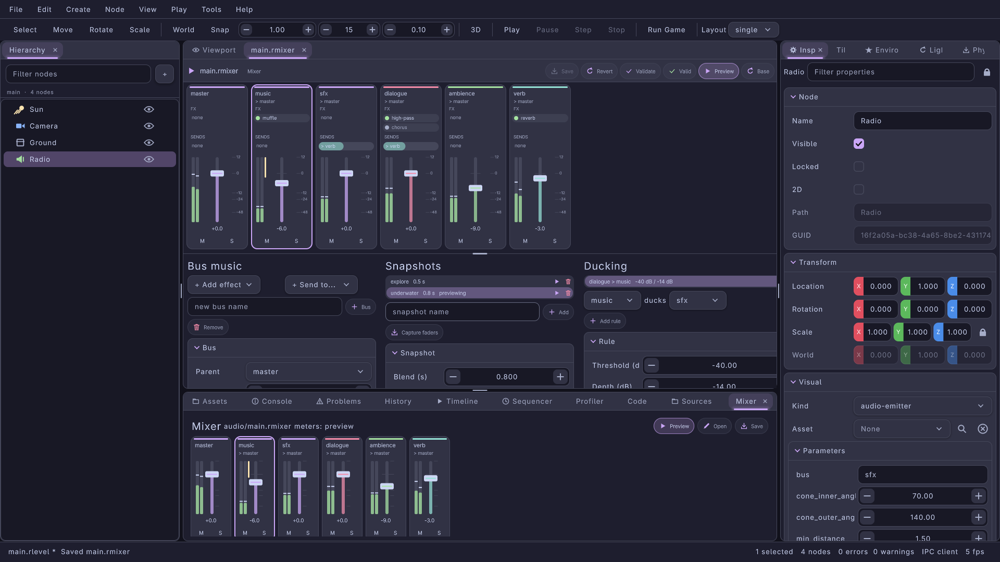
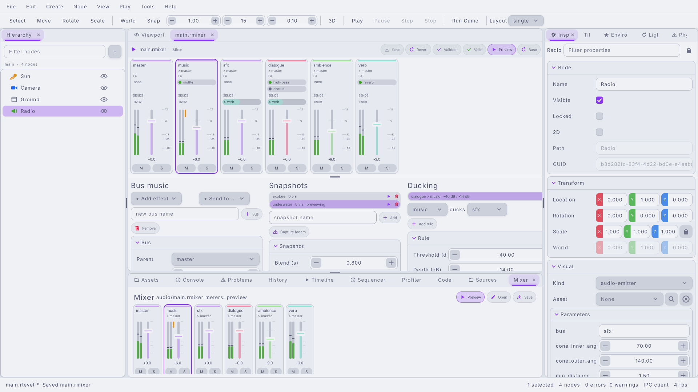
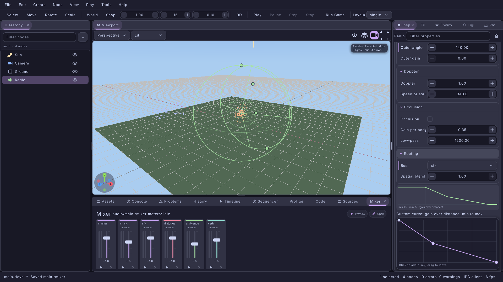
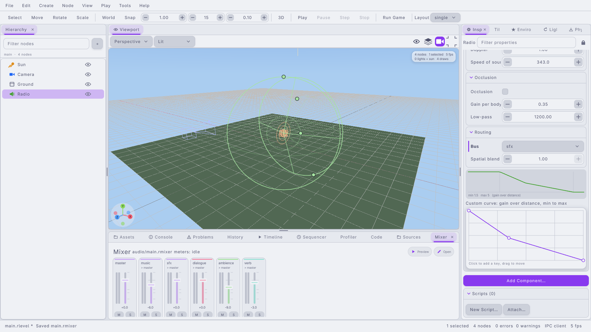

#+title: Audio in the Editor: Mixer Editor, Mixer Panel, Attenuation Gizmo and Audio Source
#+description: The lrgeditor audio tools of 0.9.0: the .rmixer data editor (channel strips, effects, sends, snapshots, ducking, offline preview with meters), the docked Mixer panel for the project's default mixer, the attenuation gizmo of audio emitters, the inspector's Audio Source section with the custom rolloff curve, and the mixer.* / audio.* IPC methods
#+authors: Zach Podbielniak
#+categories: libregnum editor audio mixer gizmo ipc
#+created: 2026-11-07T15:00:00-05:00
#+updated: 2026-11-07T15:00:00-05:00
#+version: 0.9.0

* Audio in the Editor
:PROPERTIES:
:CUSTOM_ID: editor-audio
:END:
#+begin_quote
*[[file:../index.org][Home]]* > *[[file:overview.org][Editor Module]]* > Audio
#+end_quote

** Overview
:PROPERTIES:
:CUSTOM_ID: editor-audio-overview
:END:
A game's mix is a =.rmixer= file ([[file:../modules/audio/mixer-asset.org][LrgMixerAsset]]): buses with faders, mute and solo, sends, effect chains, snapshots and ducking rules. The project names its default mixer in =project.ryaml= (=audio: { mixer: audio/main.rmixer }=) and the game builds its mixer from it with =lrg_audio_manager_load_project_mixer()=. 3D sounds are AUDIO_EMITTER nodes; =lrg_level_instantiate_3d()= turns each into an =LrgAudioSourceComponent= whose distance attenuation, cone, doppler, occlusion and bus come from the node's visual params ([[file:../guides/audio.org::#spatial][Audio guide: spatial sources]]).

The editor tools that author both:

| Tool | Where | Edits | Source |
|------+-------+-------+--------|
| Mixer editor | A data editor tab for every opened =.rmixer= (double-click in Assets, Tools > Open Project Mixer, =mixer.open=) | the whole layout, undoable in the document | =src/editor/ui/data/lrg-editor-mixer-editor.{h,c}= |
| Mixer panel | Docked panel "Mixer" (View > Panels > Mixer, action =mixer.show=) | the project mixer's faders, mute, solo, through its editor | =src/editor/ui/lrg-editor-mixer-panel.{h,c}= |
| Attenuation gizmo | The viewport, for the selected audio emitter | =min_distance=, =radius= (max distance), =cone_outer_angle=, =cone_inner_angle= | =src/editor/ui/lrg-editor-gizmo-paint.{h,c}= (volume gizmo), the viewport panel |
| Audio Source section | Inspector, for one selected audio emitter | every spatial setting, the custom rolloff curve, the bus | =src/editor/ui/lrg-editor-inspector-panel.c= |
| =mixer.*=, =audio.*= IPC | lrgeditorctl, MCP, scripts | everything above | the mixer editor and inspector files |

#+caption: The mixer editor with strips, the selected effect, snapshots and ducking (catppuccin-mocha).

** Concepts
:PROPERTIES:
:CUSTOM_ID: editor-audio-concepts
:END:
- *The document is the truth.* A mixer editor never keeps its own copy of the layout. After every document change it parses the text into an =LrgMixerAsset= (=lrg_editor_mixer_editor_get_asset()=); every edit copies that asset (=lrg_mixer_asset_copy()=), changes the copy through the engine API, which refuses loops, unknown buses and out-of-range values, and =lrg_editor_mixer_editor_commit()= writes =lrg_mixer_asset_to_data()= of the copy over the whole document as one undo group. Saving writes the same engine bytes, so a file saved by the editor loads back to identical text (comments are not kept; unknown keys are).
- *One edit, one undo step.* Clicks (mute, solo, bypass, add, remove) are one step each. Drags (a fader, a send level, a spin box in a grid) carry a gesture id (=lrg_editor_data_editor_new_gesture()=) and merge into one step. Ctrl+Z in the tab undoes in the document; the level's undo stack is not involved.
- *Levels in dB.* Faders and send levels are dB (-144 is silence, +12.04 the mixer's limit). The strips use a fader law (=lrg_editor_mixer_fader_db_to_position()=, =lrg_editor_mixer_fader_position_to_db()=): linear in dB over three segments, =LRG_EDITOR_MIXER_FADER_MIN_DB= (-60 dB) at 5% of the travel, -12 dB at 45%, 0 dB at 75% and +12.04 dB at the top; below 5% is silence.
- *Preview without a device.* The editor never opens an audio device for the mixer. "Preview" builds an offline =LrgAudioMixer= from the layout (=lrg_mixer_asset_create_mixer()=, =LRG_EDITOR_MIXER_PREVIEW_RATE= 48 kHz stereo), starts a looping test signal on every bus without child buses (a tone gated on for 60% of a per-bus period, so ducking engages and releases) and renders the frame time every frame (=lrg_editor_mixer_editor_preview_render()=). What you watch are the meters: peak and RMS per channel, gain reduction and solo state, exactly as the game's mixer computes them.
- *Meters follow the game while playing.* While play-in-editor runs and the audio manager has a game mixer, the strips (editor and panel) meter that mixer instead (=lrg_editor_mixer_editor_get_meter_mixer()= reports "play", "preview" or "none"). When play starts and the game has no mixer, the Mixer panel builds one from the project (=lrg_audio_manager_load_project_mixer()=) and removes it again when play stops.
- *Emitter params are the component's.* The Audio Source section and the gizmo read the =LrgAudioSourceComponent= the level would build (=lrg_level_visual_create_component()=), so unset params show the runtime's defaults (min distance 1, max distance 50, inverse rolloff, no cone), and write through =lrg_level_visual_store_property()=, the inverse map (=max-distance= is stored as =radius=, enums by nick).

** The mixer editor
:PROPERTIES:
:CUSTOM_ID: editor-audio-mixer-editor
:END:
=LrgEditorMixerEditor= is the data editor of =LRG_EDITOR_DOCUMENT_FORMAT_MIXER= documents. Open one by double-clicking a =.rmixer= in the Assets panel, with Tools > Open Project Mixer (action =mixer.open=), Tools > New Mixer (action =mixer.new=: writes =audio/main.rmixer= with =music=, =sfx=, =dialogue= and =ambience= buses and, when the project has none, makes it the default), or =lrgeditorctl= / MCP (=mixer.open=, =mixer.create=). =lrg_editor_mixer_editor_find_for_path()= finds (or opens) the editor of a path; =lrg_editor_mixer_editor_project_mixer_path()= resolves the project's default. =lrg_editor_mixer_editor_new()= builds an editor for a document without docking it.

The tab has the data editor's toolbar (Save, Revert, Undo, Redo, Validate) plus Preview (toggles the offline preview) and Base (ramps the preview back to the base layout, no snapshot).

*** Channel strips
:PROPERTIES:
:CUSTOM_ID: editor-audio-strips
:END:
One strip per bus, in file order, master first, in a row that scrolls sideways. From top to bottom:

| Part | Shows | Mouse |
|------+-------+-------|
| Header (=LRG_EDITOR_MIXER_STRIP_HEADER=) | colour bar, bus name, "> parent" | click selects the bus (the left grid shows it) |
| FX rows (=LRG_EDITOR_MIXER_STRIP_EFFECT=) | the effect chain in processing order, green dot when enabled | click selects the effect; the dot (=LRG_EDITOR_MIXER_STRIP_EFFECT_TOGGLE=) bypasses / enables it |
| SENDS rows (=LRG_EDITOR_MIXER_STRIP_SEND=) | "> target" with a bar filled to the send level (fader law) | drag sideways to change the level (one undo step) |
| Meter (=LRG_EDITOR_MIXER_STRIP_METER=) | peak line and RMS bar per channel (green, yellow above -6 dB RMS, red above 0 dB peak), a yellow gain-reduction bar from the top while ducked, scale ticks at +12, 0, -12, -24, -48 | none |
| Fader (=LRG_EDITOR_MIXER_STRIP_FADER=) | track filled in the bus colour to the level, a cap, the 0 dB line | click jumps there, drag moves it (one step), double-click resets to 0 dB |
| Readout | the level in dB (=-inf= for silence) | none |
| M / S (=LRG_EDITOR_MIXER_STRIP_MUTE=, =LRG_EDITOR_MIXER_STRIP_SOLO=) | red when muted, yellow when soloed | click toggles |

All strips reserve as many effect and send rows as the busiest bus, so faders line up. A strip whose bus is not audible (muted, or another bus soloed) draws its name and level dimmed. The strips widget (=lrg_editor_mixer_editor_get_strips()=) is shared with the Mixer panel; =lrg_editor_mixer_strips_new()= builds one for any host (a layout callback =LrgEditorMixerStripsAssetFunc= and an editor callback =LrgEditorMixerStripsEditorFunc= that opens the editor when an edit is about to be committed) and =lrg_editor_mixer_strips_get_part_rect()= reports where each part was painted, for tests and tools that drive the strips through the canvas. =LrgEditorMixerStripPart= (=lrg_editor_mixer_strip_part_get_type()=) names the parts.

*** Bus and effect column
:PROPERTIES:
:CUSTOM_ID: editor-audio-bus-column
:END:
The left column below the strips edits the selection (=lrg_editor_mixer_editor_select()=, =lrg_editor_mixer_editor_get_selected_bus()=, =lrg_editor_mixer_editor_get_selected_effect()=):

- *A bus*: Parent (a picker of every bus that is not the bus itself or below it; master has none), Volume (dB), Mute, Solo, and one "To <target> (dB)" row per send.
- *An effect*: Enabled, then every writable property of the effect's type (=lrg_mixer_asset_list_effect_types()=: low-pass, high-pass, echo, reverb, chorus, pitch shift, or a registered application effect) with the property's own range, default and type (the reverb =preset= is an enum picker). Parameters stored in the file are marked as overridden; Reset in the row's menu removes them (=lrg_mixer_asset_unset_effect_param()=), so the effect's default applies.

Under the grid: "+ Add effect..." (appends to the selected bus; the id is the type, then =type-2=, ...), "+ Send to..." (adds a send at -12 dB; the engine refuses sends to the bus itself, its parent, from master or loops, and the banner says why), a name field with "+ Bus" (adds a child of the selected bus, else of master; an empty name picks =bus=, =bus1=, ...), up / down arrows that reorder the selected effect, and Remove (the selected effect, else the selected bus; master and buses with child buses stay). =lrg_editor_mixer_editor_get_bus_grid()= returns the grid.

*** Snapshots column
:PROPERTIES:
:CUSTOM_ID: editor-audio-snapshots
:END:
The list shows every snapshot with its blend time, "(default)" and "previewing"; click selects (=lrg_editor_mixer_editor_select_snapshot()=, =lrg_editor_mixer_editor_get_selected_snapshot()=), the play icon previews it with its own blend time, the trash icon removes it. Under the list: a name field, Add (an empty snapshot with a 0.25 s blend) and Capture: =lrg_editor_mixer_editor_capture_snapshot()= stores the base layout's current bus volumes and send levels as the snapshot's overrides (the typed name, else the selected snapshot, else =captured=), keeping its effect-parameter overrides. The workflow: set the faders the way the state should sound, Capture, then set them back.

The grid of the selected snapshot (=lrg_editor_mixer_editor_get_snapshot_grid()=): Blend (s), Default (the snapshot =lrg_mixer_asset_apply()= applies), then "Volumes (dB)" with one row per bus, "Send levels (dB)" with one row per send of the base layout and "Parameters" with one row per numeric effect parameter (=bus/effect/param=). A row shows the snapshot's override when it has one (marked overridden) and the base value otherwise; editing a row creates the override, Reset removes it.

*** Ducking column
:PROPERTIES:
:CUSTOM_ID: editor-audio-ducking
:END:
The list shows each rule as "trigger > target  threshold / depth" with a trash icon; click selects. Add a rule with the two pickers ("<trigger> ducks <target>") and Add (threshold -30 dB, depth -12 dB, attack 0.05 s, release 0.5 s); rules where the target feeds the trigger, the trigger is master or both are the same bus are refused. The grid (=lrg_editor_mixer_editor_get_duck_grid()=) edits Threshold, Depth, Attack and Release of the selected rule. Below it a status line counts buses, snapshots and rules and says whether the preview runs.

*** Preview
:PROPERTIES:
:CUSTOM_ID: editor-audio-preview
:END:
| Function | Description |
|----------+-------------|
| =lrg_editor_mixer_editor_set_previewing()= / =lrg_editor_mixer_editor_get_previewing()= | start / stop the offline preview |
| =lrg_editor_mixer_editor_get_preview_mixer()= | the preview =LrgAudioMixer= while it runs |
| =lrg_editor_mixer_editor_preview_render()= | render N seconds now (the tab does the frame time every frame) |
| =lrg_editor_mixer_editor_preview_snapshot()= | ramp the preview to a snapshot (=NULL=: the base layout), negative blend = the snapshot's own |
| =lrg_editor_mixer_editor_preview_blend()= | ramp to a weighted mix of snapshots (=lrg_mixer_asset_blend_snapshots()=) |
| =lrg_editor_mixer_editor_get_preview_snapshot()= | the snapshot last previewed |
| =lrg_editor_mixer_editor_get_meter_mixer()= | the mixer the strips meter now: the game's while playing, else an editor's preview |

Edits apply to the running preview at once (=lrg_mixer_asset_apply()=, voices keep playing; a changed bus tree builds a new preview mixer); a previewed snapshot is re-applied after every edit. Re-applying rebuilds effect chains, so reverb and echo tails restart on each edit; that is the engine's documented behaviour.

*** Other API
:PROPERTIES:
:CUSTOM_ID: editor-audio-api
:END:
| Function | Description |
|----------+-------------|
| =lrg_editor_mixer_editor_new()= | an editor for a document, not docked |
| =lrg_editor_mixer_editor_install()= | registers the =mixer.*= IPC methods and the =mixer.new= / =mixer.open= actions (the Mixer panel, the Assets panel and every mixer editor call it; idempotent) |
| =lrg_editor_mixer_editor_get_asset()= / =lrg_editor_mixer_editor_get_load_error()= | the parsed layout, or why the text does not load |
| =lrg_editor_mixer_editor_commit()= | write an edited copy as one undo step (validated first) |
| =lrg_editor_mixer_editor_find_for_path()= / =lrg_editor_mixer_editor_project_mixer_path()= | find or open an editor; the project's default mixer |

** The Mixer panel
:PROPERTIES:
:CUSTOM_ID: editor-audio-mixer-panel
:END:
=LrgEditorMixerPanel= (dock id =LRG_EDITOR_MIXER_PANEL_ID=, "mixer") shows the project's default mixer as compact strips (name, meters with gain reduction, fader, M, S), for watching and riding the mix while the level plays. Its header has the mixer's project-relative path, the meter source ("meters: game", "meters: preview" or "meters: idle"), Preview (opens the editor if needed and toggles its preview), Open (the full editor tab), Save (when the editor is open) and, without a project mixer, New Mixer. Without a project mixer the panel shows a short explanation and New Mixer.

The strips show the open editor's layout (unsaved edits included) or, while no editor is open, the file as last read; the panel re-reads the project setting and the file's modification time once a second (=lrg_editor_mixer_panel_reload()= does it at once). Any edit from the panel's strips opens the mixer's editor tab and is committed there, so it is undoable and saved with the file.

| Function | Description |
|----------+-------------|
| =lrg_editor_mixer_panel_new()= | the panel's content; registers =mixer.show= and installs the =mixer.*= methods |
| =lrg_editor_mixer_panel_find()= | the app's panel |
| =lrg_editor_mixer_panel_get_path()= | the absolute path of the mixer shown |
| =lrg_editor_mixer_panel_get_asset()= | the layout the strips show |
| =lrg_editor_mixer_panel_get_strips()= | the compact strips widget |
| =lrg_editor_mixer_panel_reload()= | re-read the project setting and the file |

#+caption: The Mixer panel docked under the viewport while previewing (catppuccin-latte).

** Attenuation gizmo
:PROPERTIES:
:CUSTOM_ID: editor-audio-gizmo
:END:
Selecting an AUDIO_EMITTER node shows its attenuation in the viewport, through the volume gizmo (=lrg_editor_volume_has_gizmo()= is true for emitters; the viewport's volume handling does the rest):

- the *silent sphere* at the max distance (the =radius= param) as a solid camera-facing circle plus a ground ring;
- the *full-volume sphere* at =min_distance=, thinner;
- the *half-volume distance* as a dashed ground ring: where the rolloff (inverse, linear, logarithmic or the custom curve, computed by the engine's =lrg_audio_source_component_get_distance_gain()=) falls to 0.5;
- with a cone (=cone_outer_angle= below 360), the *outer cone* (solid) and the *inner cone* (dashed) along the node's local -Z, as rays with their rims at the max distance.

| Handle | Param | Where | Drag |
|--------+-------+-------+------|
| =LRG_EDITOR_VOLUME_HANDLE_MIN_DISTANCE= | =min_distance= | right of the emitter (camera right) | distance from the emitter in the camera plane, clamped to the max |
| =LRG_EDITOR_VOLUME_HANDLE_MAX_DISTANCE= | =radius= | above the emitter (camera up) | distance in the camera plane, at least the min |
| =LRG_EDITOR_VOLUME_HANDLE_AUDIO_CONE= | =cone_outer_angle= | on the outer cone's surface | twice the angle between the cone axis and the pointer, at least the inner angle |
| =LRG_EDITOR_VOLUME_HANDLE_AUDIO_INNER_CONE= | =cone_inner_angle= | on the inner cone, the other side | the same, at most the outer angle |

A drag is one undo step ("Resize radius"); Escape puts the old value back; Ctrl snaps distances to tenths and cone angles to whole degrees. The hovered handle names its param and value in a chip. =lrg_editor_volume_handle_get_param()= maps a handle to its param, =lrg_editor_volume_get_handle_position()=, =lrg_editor_volume_hit_test()= and =lrg_editor_volume_drag_value()= are the headless hooks, =lrg_editor_gizmo_paint_volume()= paints it.

#+caption: An emitter with min / max spheres, the half-volume ring and a 120 degree cone; its Audio Source section on the right.

** Audio Source section (Inspector)
:PROPERTIES:
:CUSTOM_ID: editor-audio-inspector
:END:
With exactly one audio emitter selected (and no live object inspected) the inspector shows "Audio Source" after the Physics section:

| Group | Rows (component property, visual param) |
|-------+------------------------------------------|
| Distance | Rolloff (=rolloff-mode=: linear, inverse, logarithmic, custom), Min distance (=min_distance=), Max distance (=radius=), Steepness (=rolloff=, of the inverse curve), Curve keys (=rolloff_curve_keys=, "t:gain" pairs) |
| Cone | Inner angle, Outer angle (360: no cone), Outer gain |
| Doppler | Doppler (=doppler_factor=, 0 turns it off), Speed of sound |
| Occlusion | Occlusion (physics rays), Gain per body, Low-pass (Hz) |
| Routing | Bus (a picker of the project mixer's buses; empty plays as a device voice), Spatial blend |

Each row is the component property itself (its type, range and default); a row stored in the node is marked overridden and Reset removes the param. Every write is one undo step in the level ("Set max-distance"); a spin drag merges into one. Under the grid a plot draws the gain over distance (0 to 1.1 x max) with the min and max marked, from the engine's own evaluation, so every rolloff mode shows what the game will hear. With the custom rolloff an =LrgCurveEdit= appears: drag keys, click to add, Delete removes; the keys are written to =rolloff_curve_keys= (and the mode to custom) while dragging and the whole drag is one undo step ("Edit rolloff curve"), Escape restores the old curve.

#+caption: The Audio Source section with the custom rolloff curve editor.

** IPC methods
:PROPERTIES:
:CUSTOM_ID: editor-audio-ipc
:END:
Every =mixer.*= method takes an optional ="path"= (a =.rmixer=, project-relative or absolute); without it the project's default mixer is used (=NOT_FOUND= "No mixer: pass "path" or set the project's default mixer"). Edits go through that file's editor (opened as a tab when needed), so each call is one undo step in its document and leaves it dirty until =mixer.save=. Errors: =INVALID_PARAMS= (missing or mistyped parameters), =NOT_FOUND= (bus, effect, snapshot, rule or file), =FAILED= (the engine refused: the message is the =LrgMixerAsset= error, a routing loop for example).

The layout object ("mixer") the editing methods return: ={path, name, default_snapshot|null, dirty, buses: [{name, parent|null, volume, mute, solo, sends: [{target, level}], effects: [{id, type, enabled, params: {name: value}}]}], snapshots: [{name, blend, volumes: {bus: dB}, sends: [{source, target, level}], params: {"bus/effect/param": n}}], ducking: [{trigger, target, threshold, depth, attack, release}]}=.

| Method | Params | Result |
|--------+--------+--------|
| =mixer.show= | ={}= | ={panel: "mixer", shown}= |
| =mixer.open= | ={path?}= | ={path, panel}= (the editor tab) |
| =mixer.create= | ={path, buses?: [names], set_default?}= | mixer (a new file: master and the named buses) |
| =mixer.set_default= | ={path or null}= | ={mixer: path or null}= (=project.ryaml= =audio.mixer=, saved) |
| =mixer.get= | ={path?}= | mixer |
| =mixer.effect_types= | ={}= | ={types: [{name, gtype, params: [{name, type, default, min?, max?, values?}]}]}= |
| =mixer.add_bus= / =mixer.remove_bus= | ={path?, name, parent?}= / ={path?, name}= | mixer |
| =mixer.set_bus= | ={path?, name, volume?, mute?, solo?, parent?}= | mixer |
| =mixer.set_send= / =mixer.remove_send= | ={path?, source, target, level}= / ={path?, source, target}= | mixer |
| =mixer.add_effect= / =mixer.remove_effect= | ={path?, bus, type, id?}= / ={path?, bus, id}= | mixer |
| =mixer.move_effect= | ={path?, bus, id, index}= | mixer |
| =mixer.set_effect= | ={path?, bus, id, enabled?, params?: {name: value or null}}= | mixer (null unsets) |
| =mixer.add_snapshot= | ={path?, name, blend?, capture?}= | mixer |
| =mixer.remove_snapshot= | ={path?, name}= | mixer |
| =mixer.set_snapshot= | ={path?, name, blend?, default?, volumes?: {bus: dB or null}, sends?: [{source, target, level or null}], params?: {"bus/effect/param": n or null}}= | mixer |
| =mixer.capture_snapshot= | ={path?, name}= | mixer |
| =mixer.set_duck= / =mixer.remove_duck= | ={path?, trigger, target, threshold?, depth?, attack?, release?}= / ={path?, trigger, target}= | mixer (an existing rule keeps the values not given) |
| =mixer.preview= | ={path?, playing?, snapshot?, snapshots?: [names], weights?: [n], blend?}= | ={playing, snapshot or null, source}= |
| =mixer.meters= | ={path?}= | ={source: "play", "preview" or "none", buses: [{name, peak, rms, peak_db, rms_db, duck_gain, audible}]}= |
| =mixer.save= | ={path?}= | ={path, saved: true}= |
| =audio.get= | ={node}= (GUID or path) | ={node, kind: "audio-emitter", params: {min_distance, max_distance, rolloff_mode, rolloff, rolloff_curve_keys, cone_inner_angle, cone_outer_angle, cone_outer_gain, doppler_factor, speed_of_sound, occlusion, occlusion_gain, occlusion_cutoff, bus, spatial_blend, volume}}= |
| =audio.set= | ={node, params: {same keys: value or null}}= | as =audio.get=; one undo step; null resets to the default |
| =audio.curve= | ={node, samples?}= (2 .. 256, default 32) | ={min, max, mode, points: [[distance, gain], ...]}= over 0 .. 1.1 x max |
| =audio.buses= | ={}= | ={mixer: path or null, buses: [names]}= |

#+begin_src sh
lrgeditorctl call mixer.create '{"path":"audio/main.rmixer","buses":["music","sfx","dialogue"],"set_default":true}'
lrgeditorctl call mixer.add_effect '{"bus":"music","type":"low-pass","id":"muffle"}'
lrgeditorctl call mixer.add_snapshot '{"name":"underwater","blend":0.5}'
lrgeditorctl call mixer.set_snapshot '{"name":"underwater","volumes":{"music":-12},"params":{"music/muffle/cutoff":800}}'
lrgeditorctl call mixer.set_duck '{"trigger":"dialogue","target":"music","depth":-10}'
lrgeditorctl call mixer.preview '{"playing":true,"snapshot":"underwater"}'
lrgeditorctl call mixer.meters
lrgeditorctl call mixer.save
lrgeditorctl call audio.set '{"node":"Radio","params":{"min_distance":2,"max_distance":20,"bus":"sfx","cone_outer_angle":120}}'
#+end_src

=lrgeditorctl= verbs and MCP tools for these methods are listed in [[file:lrgeditorctl.org][lrgeditorctl]] and [[file:ipc-protocol.org][the IPC protocol]].

** Worked examples
:PROPERTIES:
:CUSTOM_ID: editor-audio-examples
:END:

*** Editing a mix from C (an editor plugin or a test)
:PROPERTIES:
:CUSTOM_ID: editor-audio-example-c
:END:
#+begin_src c
g_autoptr(GError)          error = NULL;
g_autofree gchar          *path = lrg_editor_mixer_editor_project_mixer_path (app);
LrgEditorMixerEditor      *ed = lrg_editor_mixer_editor_find_for_path (app, path, TRUE, &error);
g_autoptr(LrgMixerAsset)   mix = NULL;

if (ed == NULL || lrg_editor_mixer_editor_get_asset (ed) == NULL)
	return;
/* edit a copy through the engine API, then commit it: one undo step */
mix = lrg_mixer_asset_copy (lrg_editor_mixer_editor_get_asset (ed));
lrg_mixer_asset_set_bus_volume (mix, "music", -8.0);
lrg_mixer_asset_add_effect (mix, "music", "low-pass", "muffle", NULL);
if (!lrg_editor_mixer_editor_commit (ed, mix, "Darker music", 0, &error))
	g_warning ("mixer: %s", error->message);

/* watch it: preview, render a quarter second, read the music meter */
lrg_editor_mixer_editor_set_previewing (ed, TRUE);
lrg_editor_mixer_editor_preview_render (ed, 0.25);
{
	gdouble peak = 0.0, rms = 0.0;

	lrg_audio_mixer_get_bus_meter (lrg_editor_mixer_editor_get_preview_mixer (ed), "music", -1, &peak, &rms);
}
lrg_editor_data_editor_save (LRG_EDITOR_DATA_EDITOR (ed), &error);
#+end_src

*** Driving the strips in a canvas test
:PROPERTIES:
:CUSTOM_ID: editor-audio-example-test
:END:
#+begin_src c
LrgWidget *strips = lrg_editor_mixer_editor_get_strips (ed);
gfloat     x, y, w, h;

lrg_canvas_record (lrg_editor_app_get_canvas (app));   /* the parts are laid out while painting */
lrg_editor_mixer_strips_get_part_rect (strips, "music", LRG_EDITOR_MIXER_STRIP_MUTE, 0, &x, &y, &w, &h);
/* click (x + w / 2, y + h / 2): music is muted, one undo step */
lrg_editor_mixer_strips_get_part_rect (strips, "sfx", LRG_EDITOR_MIXER_STRIP_FADER, 0, &x, &y, &w, &h);
/* drag inside the fader: the level follows lrg_editor_mixer_fader_position_to_db (1 - (py - y) / h) */
#+end_src

=tests/test-editor-app-audio.c= covers all of this through the canvas and IPC.

** Performance
:PROPERTIES:
:CUSTOM_ID: editor-audio-performance
:END:
- An edit parses and writes the whole layout (a few hundred lines at most): well under a millisecond; a fader drag commits once per pointer move and merges into one undo step.
- The preview renders the frame time per frame through the engine mixer: about 0.39 ms per 2048 frames for a layout with 4 buses and 32 voices ([[file:../modules/audio/mixer-asset.org::#performance][engine numbers]]), so a 60 Hz frame costs about 0.15 ms with the handful of test voices. Stop the preview when you are done; the tab keeps rendering while it runs.
- The gizmo and the Audio Source section build a throwaway =LrgAudioSourceComponent= per paint of the selected emitter (a GObject and a few property sets); the half-volume ring bisects the rolloff in 24 evaluations.

** Pitfalls
:PROPERTIES:
:CUSTOM_ID: editor-audio-pitfalls
:END:
- *Comments do not survive.* The editor writes the engine's canonical text on every edit and save. Keep notes in unknown keys (they round-trip), not in YAML comments.
- *Re-applying restarts effect tails.* Every edit re-applies the layout to the preview mixer, rebuilding effect chains; a long reverb restarts. Snapshots ramp without that.
- *Preview is not sound.* The editor renders offline and never plays the preview through a device; use play-in-editor to hear the game's mixer.
- *Default max distance.* An emitter without a =radius= param plays with the component's default max distance (50), which is what the gizmo, the Audio Source section and the suggested Visual value show. =lrg_editor_node_source_get_suggested_double()= reads that suggestion; for an audio emitter and ="radius"= it returns 50.
- *Cones point down local -Z.* Rotate the emitter node to aim the cone; angles are full angles (360: no cone), and the inner angle never exceeds the outer one.
- *A bus that the game does not have.* An emitter routed to a bus the project mixer lacks plays nothing at runtime; the bus picker only lists the project mixer's buses, but a typed name is accepted.

** See also
:PROPERTIES:
:CUSTOM_ID: editor-audio-see-also
:END:
- [[file:../modules/audio/mixer-asset.org][LrgMixerAsset and .rmixer]] (the format, snapshots, ducking, solo)
- [[file:../modules/audio/mixer.org][LrgAudioMixer]] (meters, ramps)
- [[file:../guides/audio.org][Audio guide]] (the whole stack, spatial sources, the project mixer)
- [[file:../modules/world3d/components.org::#audio-source][LrgAudioSourceComponent]]
- [[file:data-editors.org][Data editors]] (the base class: toolbar, undo, external changes)
- [[file:editor-app.org::#editor-panel-mixer][Editor application: Mixer panel]]
