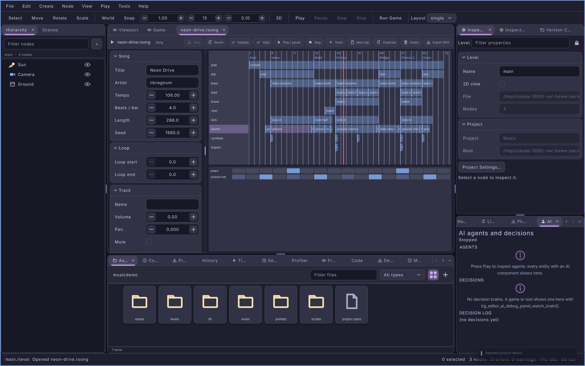
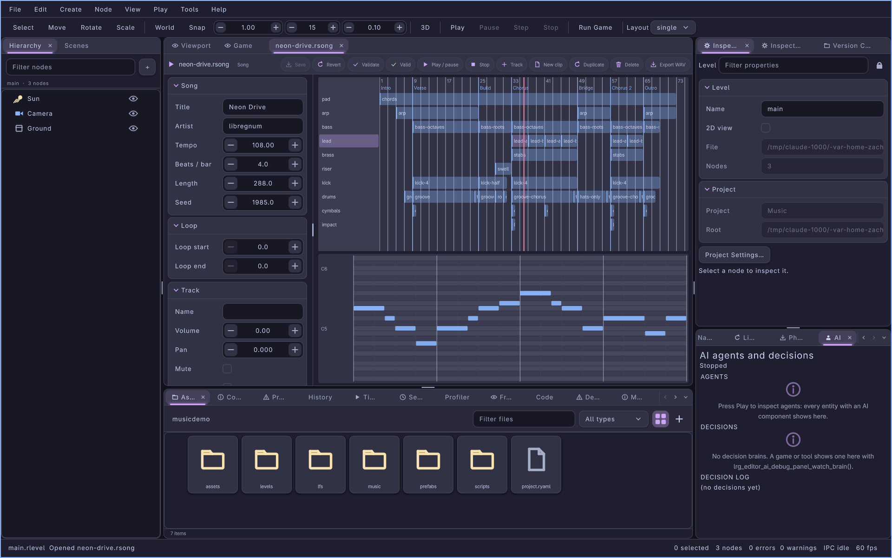
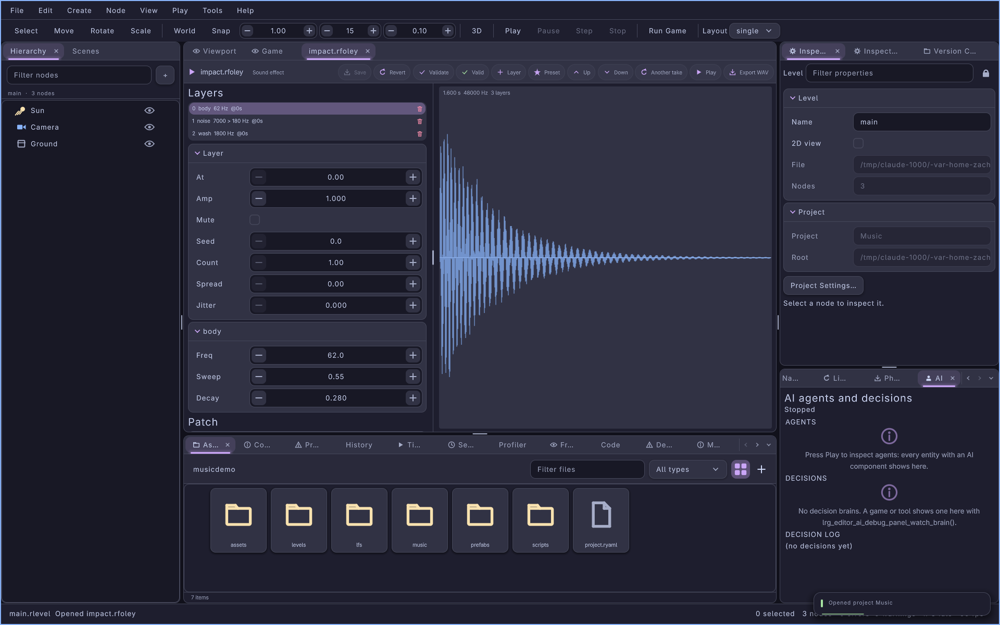

#+title: Music in the Editor: Song Editor and Foley Designer
#+description: The lrgeditor music tools of 0.10.0: the .rsong song editor (arrangement, step grid, piano roll, instrument parameters, live preview, export) and the .rfoley Foley designer (layers, patch settings, waveform, presets, preview, export), the shared edit model, and the song.* / foley.* / audio.formats IPC methods an agent composes with
#+authors: Zach Podbielniak
#+categories: libregnum editor audio music song foley ipc mcp
#+created: 2026-11-08T17:00:00-05:00
#+updated: 2026-11-08T18:00:00-05:00
#+version: 0.10.0

* Music in the Editor
:PROPERTIES:
:CUSTOM_ID: editor-music
:END:
#+begin_quote
*[[file:../index.org][Home]]* > *[[file:overview.org][Editor Module]]* > Music
#+end_quote

** Overview
:PROPERTIES:
:CUSTOM_ID: editor-music-overview
:END:
lrgeditor creates sound as well as placing it. Two data editors do it, each the editor of one engine file format: the *song editor* edits =.rsong= songs ([[file:../modules/music/song.org][LrgSong]]: tempo, markers, instruments, patterns, tracks, clips, automation and an embedded mixer), a small DAW; the *Foley designer* edits =.rfoley= sound-effect patches ([[file:../modules/audio/foley.org][LrgFoleyPatch]]: layered synthesis of footsteps, impacts, rain and anything else made from bodies, grains, washes, beds, tones and noise). Both play on the audio device while they are edited, render offline and export to every audio format the build can write ([[file:../modules/audio/encoder.org][LrgAudioEncoder]]: WAV, AIFF, FLAC, MP3, Ogg Vorbis, Opus, AAC, ALAC, WavPack).

Everything a person does with the mouse an agent can do over IPC (=song.*=, =foley.*=, =audio.formats=), from lrgeditorctl (=song=, =foley=, =audio formats=) or over MCP (=song_*=, =foley_*=, =audio_formats=). A person and an agent can compose the same song at the same time: both edit the document, and both see every change.

| Tool | Where | Edits | Source |
|------+-------+-------+--------|
| Song editor | A data editor tab for every opened =.rsong= (double-click in Assets, New Song, =song.new=, =song.import_midi=, =song.import_audio=) | the whole song, undoable in the document | =src/editor/ui/data/lrg-editor-song-editor.{h,c}= |
| Song operations | Shared by the editor's UI, every =song.<op>= method and =song.apply= | one JSON op table on an =LrgSong= | =src/editor/ui/data/lrg-editor-song-ops.c= |
| Foley designer | A data editor tab for every opened =.rfoley= (double-click in Assets, New Sound Effect, =foley.new=) | the whole patch, undoable in the document | =src/editor/ui/data/lrg-editor-foley-editor.{h,c}= |
| =song.*=, =foley.*=, =audio.formats= IPC | lrgeditorctl, MCP, scripts | everything above | the two editor files |

The Assets panel shows songs with the glyph =Sg= and sound effects with =Fo=; its New menu has /New Song/ (a starter loop: an 808 drum machine and a =synthwave-bass= synth on a bar-long beat and bass line, looped over four bars) and /New Sound Effect/ (a short tone). =asset new song= and =asset new foley= make the same files from the CLI.

** Concepts
:PROPERTIES:
:CUSTOM_ID: editor-music-concepts
:END:
- *The document is the truth.* Neither editor keeps its own copy. After every document change the editor parses the text into an =LrgSong= or =LrgFoleyPatch=; every edit takes a fresh copy (=lrg_editor_document_dup_object()=), changes it through the engine API and commits it (=lrg_editor_document_commit_object()=), which writes the engine's own YAML over the document. Saving writes the same bytes, so a saved file loads back to identical text.
- *One edit, one undo step.* Each operation is one step of the document's undo history (=data.undo=, =data.redo=, Ctrl+Z). A drag or a slider drag is one gesture: its many small changes merge into one step.
- *Batches.* =song.apply= runs a list of operations on one copy and commits once: one undo step for the whole batch, and nothing changes when any operation fails (the error names the failing index, =ops[3] (add_clip): ...=). This is how an agent builds a whole section at once.
- *Edits must load back.* Before a song edit is committed the copy is written to YAML and loaded again. A model call can accept what the loader refuses (for example a duck whose target bus feeds its trigger); such an edit is refused with ="The edit would not load back: ..."= and the document never becomes unloadable.
- *Live preview follows edits.* While the song plays, every new version of the document is compiled and swapped into the player at the beat it is at (=lrg_song_player_set_song()=): change a note, a fader or a synth parameter and hear it on the next pass, without stopping. If a version does not compile (a missing file), the player keeps the last good one.
- *The device opens on the first play, never before.* Opening a song or a patch, rendering and exporting never touch the audio device; only Play does. Tests and headless editors never open it (see =preview_render= below).

** The song editor
:PROPERTIES:
:CUSTOM_ID: editor-music-song
:END:
#+caption: The song editor on Neon Drive: the arrangement with markers, the step grid of the drums' groove clip and the track's instrument parameters.

#+caption: The lead-a clip in the piano roll.

*** Layout
:PROPERTIES:
:CUSTOM_ID: editor-music-song-layout
:END:
The tab is split in two. On the left, in a scroll box, two property grids: the *song settings* (title, artist, tempo, beats per bar, length, loop start and end, seed) and the *selected track* (name, volume in dB, pan, mute, solo, bus) followed by every numeric parameter of the track's instrument, grouped by their prefix (=osc1=, =filter=, =amp=, ... for a synth; one group per drum piece for a drum machine). The instrument grid is built from a real instance of the instrument with the song's overrides applied, so it shows the values the song plays. Changing a parameter stores an override in the song (=set_instrument= with =params=); dragging a slider is one undo step.

On the right, the *arrangement* above the *pattern editor*.

*** The arrangement
:PROPERTIES:
:CUSTOM_ID: editor-music-arrangement
:END:
A bar ruler across the top (bar numbers above, marker names below, the loop range shaded, markers as lines down through the lanes), one lane per track below it with the track's name on the left (=M= and =S= flags for mute and solo), clips as boxes labelled with their pattern or file, and the playhead as a red line.

| Input | Does |
|-------+------|
| Click on the ruler | Moves the playhead to that beat (=song.seek=) |
| Click on a track name or an empty lane | Selects the track (its grid shows on the left) |
| Click on a clip | Selects it; the pattern editor shows its pattern |
| Drag a clip | Moves it, snapped to whole beats; one undo step |
| Drag a clip's right edge (the last 6 pixels) | Changes its length, snapped to beats, at least one beat |
| Right-click a clip, or Delete with a clip selected | Removes the clip |
| Wheel | Scrolls through the song |
| Ctrl+wheel | Zooms (1 to 200 pixels per beat), starting from the whole song fitted |

When a song opens the arrangement zooms to fit the whole song in the lane width; Ctrl+wheel zooms from there. The arrangement repaints every frame while the song plays on the device.

*** The pattern editor
:PROPERTIES:
:CUSTOM_ID: editor-music-pattern
:END:
The pattern of the selected clip, in one of two views. A pattern with drum lanes shows the *step grid*; a pattern of notes shows the *piano roll*. Audio clips and an empty selection show a hint.

The *step grid* has a row per lane (a drum piece such as =kick=, =snare=, =closed-hat=, or a note) and a cell per step; a cell's brightness is its velocity. A click cycles the step through =.= (rest) → =x= (0.8) → =X= (accent, 1.0) → =o= (soft, 0.5) → =g= (ghost, 0.3) → =.=; a right-click clears it. The lane is written back in groups of four (=x... x... x... x...=).

The *piano roll* has a row per key (black keys darker, every C labelled), from three keys below the lowest note to three above the highest and at least two octaves, and vertical lines per step (stronger every four). Notes are bars whose brightness is their velocity.

| Input | Does |
|-------+------|
| Click on an empty cell | Adds a note one step long, velocity 0.8 (and sounds it when the song plays) |
| Drag a note | Moves it in time (snapped to steps) and pitch; one undo step |
| Right-click a note | Deletes it |

*** Toolbar
:PROPERTIES:
:CUSTOM_ID: editor-music-song-toolbar
:END:
| Chip | Does |
|------+------|
| Play / pause | Plays from the playhead on the audio device (opened on first use); again pauses |
| Stop | Stops and returns the playhead to beat 0 |
| Track | Menu: Drum machine (808), Bass synth, Pad synth, Lead synth, Pluck synth, Init synth, Audio track; adds the instrument and its track and selects it |
| New clip | On the selected instrument track: a new one-bar pattern (drum tracks get kick, snare and closed-hat lanes) as a clip at the bar of the playhead |
| Duplicate | The selected clip again, right after itself |
| Delete | The selected clip, or the selected track when no clip is selected |
| Export WAV | Writes the mixdown next to the =.rsong= with the same name and =.wav=, at -14 LUFS integrated and -1 dBTP; =song.export= writes every other format, stems and ranges |

*** Playback and preview
:PROPERTIES:
:CUSTOM_ID: editor-music-song-playback
:END:
The editor owns one =LrgSongPlayer= (created on first need). =lrg_editor_song_editor_play()= starts a device stream (=lrg_song_player_start_output()=) and plays; =lrg_editor_song_editor_stop()= closes the stream and keeps the playhead. =lrg_editor_song_editor_preview_render()= renders the next frames headless, exactly as the device would hear them, and advances the playhead: tests and captures use it, and it refuses while a device stream runs. Without a stream the editor's own playhead is the truth (a seek waits for the next render); with one, the player's beat is.

*** Export
:PROPERTIES:
:CUSTOM_ID: editor-music-song-export
:END:
=lrg_editor_song_editor_export()= renders the song with =lrg_song_render()= (default: loudness-normalised to -14 LUFS with a -1 dBTP ceiling) and encodes it in the format of the file's extension, tagged with the song's title and artist; the folder is created when missing. =song.export= adds several formats at once, a beat range, the normalisation mode and target, the bitrate and bit depth, and one lossless stem per track (=<name>.<track>.wav=; normalised with the gain of the full mix, so the stems add up to it). =song.export_midi= writes the notes as a Standard MIDI file, and =song.import_midi= turns a =.mid= into a new song.

** The Foley designer
:PROPERTIES:
:CUSTOM_ID: editor-music-foley
:END:
#+caption: The Foley designer on impact.rfoley: the layer list on top, the selected layer's grid and the waveform.

*** Layout
:PROPERTIES:
:CUSTOM_ID: editor-music-foley-layout
:END:
On the left, in a scroll box: the *layer list* first (one row per layer: index, type, its main frequency or range, start time, a repeat mark and =(muted)=; a trash button on each row), then the *selected layer's grid* (=at=, =amp=, =mute= (a checkbox), =seed=, =count=, =spread=, =jitter= and the parameters of its type, each with its range and meaning), then the *patch settings* (name, duration, sample rate, seed, variation, loop, loop tail, fade, normalise, peak). On the right, the *waveform* of the current render with its length, rate and layer count; it re-renders after every change.

A click on a row selects the layer; a click on its trash button removes it. Every grid change is one undo step (a slider drag merges into one).

*** Toolbar
:PROPERTIES:
:CUSTOM_ID: editor-music-foley-toolbar
:END:
| Chip | Does |
|------+------|
| Layer | Menu of the layer types (body, grain, wash, bed, tone, noise); appends one and selects it |
| Preset | Menu of the built-in kinds (footstep-dirt, footstep-stone, ..., armor-clink, rain-loop); replaces the whole patch with the kind's recipe (one undo step) |
| Up / Down | Moves the selected layer |
| Another take | Raises =variation= by one: the same design, different noise (round-robin takes) |
| Play | Plays the render on the audio device (opened on first use) |
| Export WAV | Writes the render next to the =.rfoley= with the same name and =.wav=; =foley.export= writes any format |

** Composing with an agent
:PROPERTIES:
:CUSTOM_ID: editor-music-agent
:END:
An agent cannot listen, so the IPC gives it numbers: =song.instruments= says what exists, =song.apply= builds, =song.render= measures and =song.export= delivers. A typical session (lrgeditorctl shown; the MCP tools take the same JSON):

1. *Discover.* =song.instruments= lists the instrument types (synth presets with descriptions, drum kits and pieces with their MIDI keys, every parameter with its range and default), the effect types with their parameters, the Foley kinds, the step and note syntax, the automation targets and the op names. =audio.formats= lists the file formats and which can be written here.
   #+begin_src sh
   lrgeditorctl song instruments -o json | yq '.instrument_types.synth.presets'
   lrgeditorctl audio formats
   #+end_src
2. *Create.* =song.new= writes the file and opens it (=empty=true= for no tracks).
   #+begin_src sh
   lrgeditorctl song new music/night.rsong empty=true
   lrgeditorctl song set bpm=108 title='Night Drive' time_signature=4/4
   #+end_src
3. *Build in batches.* One =song.apply= per section: instruments, patterns (drum lanes and notes), tracks, clips, buses, effects and ducking, all one undo step.
   #+begin_src sh
   lrgeditorctl song apply 'ops=[
     {"op":"set_instrument","id":"drums","type":"drums","source":"808"},
     {"op":"set_instrument","id":"bass","type":"synth","source":"synthwave-bass"},
     {"op":"add_pattern","id":"beat","length":4,"lanes":{"kick":"x... x... x... x...","snare":".... x... .... x...","closed-hat":"..x. ..x. ..x. ..x."}},
     {"op":"add_pattern","id":"bassline","length":4,"notes":[[0,"A1",0.5,0.9],[0.5,"A2",0.5,0.7],[1,"A1",0.5,0.9],[1.5,"A2",0.5,0.7]]},
     {"op":"set_bus","name":"kick"},{"op":"set_bus","name":"synths"},
     {"op":"add_track","id":"drums","instrument":"drums","bus":"kick"},
     {"op":"add_track","id":"bass","instrument":"bass","bus":"synths","volume":-4},
     {"op":"add_clip","track":"drums","source":"beat","start":0,"length":32},
     {"op":"add_clip","track":"bass","source":"bassline","start":0,"length":32},
     {"op":"set_duck","trigger":"kick","target":"synths","depth":-5,"release":0.18},
     {"op":"set_marker","name":"Verse","beat":0}]'
   #+end_src
4. *Measure.* =song.render= with =tracks=true= returns the mix's peak, true peak, RMS, integrated LUFS, loudness range and a coarse envelope, plus the same numbers for every track alone. Balance by numbers (a bass 6 dB under the kick, a pad 10 dB under the lead), look for clipping (=clipped_samples=) and silence (an envelope of zeros), then adjust with more ops and render again.
   #+begin_src sh
   lrgeditorctl song render end=32 tracks=true -o json | yq '.tracks | to_entries | .[] | [.key, .value.integrated_lufs]'
   lrgeditorctl song set-track bass volume=-6
   #+end_src
5. *Validate and export.* =song.validate= checks every reference; =song.export= writes the formats asked for (=formats= replaces the file's extension) and the stems.
   #+begin_src sh
   lrgeditorctl song validate
   lrgeditorctl song export out/night.wav 'formats=["wav","flac","mp3","ogg"]' stems=true
   #+end_src

=song.play=, =song.seek= and =song.state= let the agent play the song for a person in the room and report the playhead and master meters; =song.select= shows a track or clip in the editor while explaining it. =foley.*= works the same way for sound effects: =foley.layer_types= to discover, =foley.new= with a =kind= to start from, =foley.add_layer= / =foley.set_layer= to shape, =foley.render= to measure, =foley.export= to deliver.

*** Importing a recording
:PROPERTIES:
:CUSTOM_ID: editor-music-import
:END:
=song.import_audio= (0.10.2) turns a recording (WAV, FLAC, MP3, Ogg, Opus, M4A, anything =lrg_audio_decode_file()= reads) into a new =.rsong= with =lrg_song_import_audio()=. The recording is resampled to the song's rate, its tempo, beat phase and downbeats are found (or =bpm= is used), silence is put in front so a bar starts at beat 0, and the result is written as =audio/<name>.wav= beside the =.rsong= and played by one clip on the audio track =original= (bus =original=). Sections become markers, and the key is estimated. With =transcribe=true= the recording is also estimated as music on four *muted* instrument tracks on the bus =remake=: =drums= (808 steps for kick, snare and hats), =bass= (=synthwave-bass=), =melody= (=synthwave-lead=) and =chords= (=synthwave-pad=). They are estimates: dense mixes transcribe less well than sparse ones. The method refuses a =.rsong= that already exists; it saves the song and opens it in the song editor. The engine side: [[file:../modules/music/import.org][Importing recordings]].

An agent's session:

1. *Import.* The reply is the report: =bpm=, =bpm_detected=, =confidence= (0 .. 1), =alternative_bpm= (half or double time when it fits nearly as well, else 0), =first_beat=, =lead_in=, =duration=, =source_rate=, =key=, =audio_file= and the counts =sections=, =drum_hits=, =bass_notes=, =melody_notes=, =chords=. When =confidence= is below about 0.3 the grid is a guess, and a non-zero =alternative_bpm= means the tempo octave is ambiguous: import again with =bpm= given (or a narrower =min_bpm= / =max_bpm=), to a new =path= or after removing the first =.rsong=.
   #+begin_src sh
   lrgeditorctl song import-audio ~/music/track.flac music/track.rsong transcribe=true -o json
   #+end_src
2. *Read it.* =song.get= shows the markers (the sections), the tracks and the transcribed patterns.
   #+begin_src sh
   lrgeditorctl song get path=music/track.rsong section=tracks -o json
   #+end_src
3. *Unmute or edit.* Unmute an estimate to hear it with the recording, fix its notes and lanes with the ordinary edit methods, mute =original= to keep only the remake, or cut and layer the =original= clip; everything lines up with the bars.
   #+begin_src sh
   lrgeditorctl song set-track drums mute=false
   lrgeditorctl song set-track original volume=-6
   #+end_src
4. *Export.* =song.render= to measure, =song.export= to deliver, as for any song.
   #+begin_src sh
   lrgeditorctl song export out/track.wav 'formats=["wav","mp3"]'
   #+end_src

The examples =song-import= (=examples/song-import.c=: the same import from the command line, =--bpm=, =--transcribe=, =--no-sections=, ...) and =song-render= render the result without the editor.

** IPC methods
:PROPERTIES:
:CUSTOM_ID: editor-music-ipc
:END:
Registered by =lrg_editor_song_editor_install()= and =lrg_editor_foley_editor_install()= (the Assets panel and every song or Foley editor call them). Every method takes an optional =path= (a =.rsong= or =.rfoley= file, absolute or project relative, opened as a tab when needed); without it the focused editor of that kind is used, else =not-found=. The full tables: [[file:ipc-protocol.org::#ipc-song][Song methods]], [[file:ipc-protocol.org::#ipc-foley][Foley methods]].

The song edit methods are the shared operations, one per method (=song.add_clip= is the =add_clip= op). Each returns the op's own results (=add_clip= its =index=, =set_notes= the note count) plus the editor state: =beat=, =playing=, =selected_track=, =selected_clip=, =length_beats=, =duration=. Arguments accept what an agent naturally writes: keys as note names (="A2"=, ="C#4"=, C4 = 60) or MIDI numbers; notes as =[beat, key, length, velocity]= arrays, ={beat, key, length, velocity}= objects or ="beat key length velocity"= strings (velocity defaults to 0.8); booleans as =true=/=false= or =0=/=1=; numbers as JSON numbers or numeric strings.

** C API
:PROPERTIES:
:CUSTOM_ID: editor-music-api
:END:
| Function | Does |
|----------+------|
| =lrg_editor_song_editor_create (app, path, empty, &error)= | Writes a new =.rsong= (the starter loop, or empty) |
| =lrg_editor_song_editor_open (app, path, &error)= | Opens (or finds) the editor of a song |
| =lrg_editor_song_editor_apply (self, ops_json, label, &error)= | Runs a JSON array of ops as one undo step; returns the results as JSON |
| =lrg_editor_song_editor_select (self, track, clip)= | Selects a track and clip |
| =lrg_editor_song_editor_play (self, from_beat, &error)= / =_stop (self)= / =_get_beat (self)= | Device playback and the playhead |
| =lrg_editor_song_editor_preview_render (self, frames, &n, &error)= | Headless live preview: stereo float samples |
| =lrg_editor_song_editor_export (self, path, options, &error)= | Renders and writes one file |
| =lrg_editor_foley_editor_create (app, path, kind, &error)= | Writes a new =.rfoley= (from a kind, or a tone) |
| =lrg_editor_foley_editor_add_layer / remove_layer / move_layer / set_layer_param / set_global / load_kind= | The designer's edits, one undo step each |
| =lrg_editor_foley_editor_render (self, &n, &error)= / =_export= / =_play= | The cached render, export and device preview |

** Tests
:PROPERTIES:
:CUSTOM_ID: editor-music-tests
:END:
=tests/test-editor-app-music.c= drives both editors headless: Foley IPC (create from a kind, add a layer, undo, a refused parameter, render, export, the catalogue), the layer list on the canvas, song IPC (the starter, markers, a four-op batch undone and redone, a failing batch that changes nothing, buses, sends and a kick-bus duck, validation, discovery), render with per-track numbers, export with stems, MIDI out and back in, the headless live preview across an edit, and the canvas (select a clip, toggle a step, add a note in the piano roll, drag a clip and undo it). =tests/editorctl-smoke.sh= composes a loop and exports it over lrgeditorctl alone. No test opens the audio device.

** See also
:PROPERTIES:
:CUSTOM_ID: editor-music-see-also
:END:
- [[file:../modules/music/index.org][Music module]]: instruments, songs, the player, MIDI
- [[file:../modules/audio/foley.org][Foley]]: the patch format and layer types
- [[file:../modules/audio/encoder.org][Audio encoder]] and [[file:../modules/audio/analysis.org][Audio analysis]]
- [[file:../examples/synthwave-song.org][Neon Drive]]: a 2:40 synthwave song made in code, which opens in the song editor
- [[file:audio.org][Audio in the Editor]]: the mixer editor and the attenuation gizmo
