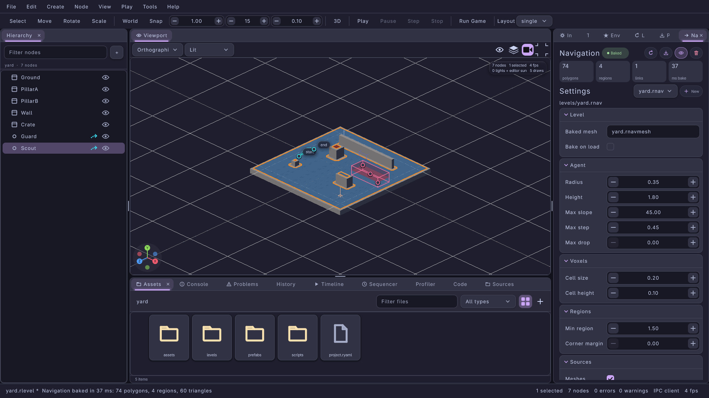

#+title: Navigation in Levels: Navigation Panel, Navmesh Overlay and Handles
#+description: The lrgeditor tools that author a 3D level's navigation in 0.9.0: the Navigation panel (the level's navigation: block, the .rnav bake settings form, area types with boxes, off-mesh links, Bake / Cancel / Save / Clear, the play crowd's agents and debug agent), the viewport navigation overlay, the area-box and link-endpoint handles, the hierarchy badge and the nav.* IPC methods
#+authors: Zach Podbielniak
#+categories: libregnum editor navigation pathfinding ipc
#+created: 2026-11-07T12:30:00-05:00
#+updated: 2026-11-07T12:30:00-05:00
#+version: 0.9.0

* Navigation in Levels
:PROPERTIES:
:CUSTOM_ID: editor-navigation
:END:
#+begin_quote
*[[file:../index.org][Home]]* > *[[file:overview.org][Editor Module]]* > Navigation in Levels
#+end_quote

** Overview
:PROPERTIES:
:CUSTOM_ID: editor-navigation-overview
:END:
A 3D level's navigation is two files next to the level and three keys in its =navigation:= block (see [[file:yaml-format.org::#navigation][the .rlevel format]]):

- =settings:= a =.rnav= file, the bake settings (=LrgNavBake=, [[file:../modules/pathfinding/nav-bake.org][Navigation bake settings]]): the agent the mesh is baked for, the voxel size, region filtering, which geometry counts, area types with their boxes and off-mesh links;
- =data:= the baked mesh (=lrg_nav_poly_mesh_save()= bytes, conventionally =.rnavmesh=, [[file:../modules/pathfinding/nav-poly-mesh.org][LrgNavPolyMesh]]);
- =bake_on_load:= bake when the level loads if there is no data (prototypes, procedural levels).

=lrg_level_instantiate_3d()= loads the data, gives it the settings' area costs and puts it on the world (=lrg_world3d_set_navigation()=); entities with an =LrgNavAgentComponent= (component type ="nav-agent"=) walk it ([[file:../modules/pathfinding/nav-agent.org][LrgNavAgent, LrgNavCrowd]]).

The editor tools that author and inspect it:

| Tool | Where | Edits | Source |
|------+-------+-------+--------|
| Navigation panel | Tab next to the Inspector (View > Panels > Navigation, action =nav.show=) | the level's =navigation:= block and its =.rnav= settings, undoable with the level; Bake, Save, Clear | =src/editor/ui/lrg-editor-nav-panel.{h,c}= |
| Navigation overlay | Each viewport's overlays menu, "Navigation" section; the panel's eye chip | nothing (a view setting) | the panel (drawn from the scene renderer's 3D overlay hook) |
| Area-box and link handles | The viewport, for the panel's selected box and link | box corners and position, link start and end | the panel, called by the viewport panel |
| Agents list | The panel, while playing | the crowd's debug agent | the panel |
| Navigation badge | Hierarchy rows of nodes with a =nav-agent= component | nothing | =src/editor/ui/lrg-editor-hierarchy-panel.c= |
| =nav.*= IPC | lrgeditorctl, MCP, scripts | everything the panel edits | the panel |

#+caption: The Navigation panel next to a baked courtyard: polygons by region, the mud area's box with its handles, a ladder link.

** Concepts
:PROPERTIES:
:CUSTOM_ID: editor-navigation-concepts
:END:
- *The settings live in memory until saved.* The panel loads the level's =.rnav= (or starts from =lrg_nav_bake_new()='s defaults when the level references none) into one =LrgNavBake= (=lrg_editor_nav_panel_get_settings()=). Edits change it in memory and are undoable with the level; Save writes it (=lrg_editor_nav_panel_save()=), and saving the level writes it too when the level already references a =.rnav=. =lrg_editor_nav_panel_get_dirty()= says whether the in-memory text differs from the file (both normalised through =lrg_nav_bake_to_data()=, so a file written by hand is not "dirty" just for its layout).
- *One state, one undo step.* The panel's undo state is one string: the level's =navigation:= block plus the =.rnav= text. Every edit (a form row, an area, a box, a link, a handle drag, New, Open, Save, Clear) changes the live objects and records "before, after" as one set-property command on a private proxy object; undo and redo re-apply the string (the level block is rewritten, the settings re-parsed when their text differs). A property-grid gesture (a slider drag, a typing session) merges into one step; a viewport handle drag commits once, at the release; an IPC =nav.set= with several values is one step.
- *The mesh is a result, not state.* Like the lighting bake, the baked mesh is not part of the undo state; its =data:= reference is. Undoing a Save removes the reference and, unless a newer bake is unsaved, the panel drops the mesh it loaded from that file. Clear drops the mesh and the reference (undoable; the file stays on disk).
- *Areas and links are lists.* An area is a unique name, a unique nonzero tag and a cost; its boxes mark the floor inside them. A link joins two points, optionally both ways, with an extra cost and optionally an area's tag. The engine API adds and removes entries; the panel's "set" operations (rename, retag, move a box, change a link) rebuild the lists on a copy of the settings and install it only when the engine accepts every entry, so a failed edit changes nothing. Renaming an area renames it in the links that name it. Unknown keys inside a rewritten area or link entry of a hand-written =.rnav= are not kept (top-level and section unknown keys are).
- *Colours.* An area's swatch in the panel, its box in the viewport and its polygons with "Colour by Area" use the same colour, derived from its tag (the engine's debug palette); links are cyan, or their area's colour.
- *What gets baked.* Bake instantiates the level into a private =LrgWorld3D= (the level's directory is the base for relative references; every mesh asset is resolved to an absolute path because the bake reads glTF geometry headless), with the level's own =navigation:= block switched off for that instantiation (no bake on load inside the bake), and runs =lrg_nav_bake_bake()= on a copy of the settings. So the editor bakes exactly what =lrg_level_instantiate_3d()= builds at runtime: mesh renderers and static colliders, filtered by the =sources= section.

** Navigation panel
:PROPERTIES:
:CUSTOM_ID: editor-navigation-panel
:END:
=LrgEditorNavPanel= (dock id =LRG_EDITOR_NAV_PANEL_ID=, ="navigation"=) follows the open level. =lrg_editor_nav_panel_find()= returns an app's panel.

*** Layout
:PROPERTIES:
:CUSTOM_ID: editor-navigation-panel-layout
:END:
- *Header*: "Navigation", a status pill (Not baked, Baked, Unsaved, Baking, Bake failed, Playing), *Bake* (*Cancel* while a bake runs), *Save* (a =*= badge when the settings or the mesh are unsaved), an eye chip (the overlay on or off) and a trash chip (Clear).
- *Progress*: an indeterminate bar and "Voxelising the level and building polygons" while a bake runs (the voxel bake reports no fractions); "Failed: <reason>" after a failed bake.
- *Summary*: four tiles: polygons, regions, links and the bake time in milliseconds of the shown mesh; while playing: polygons, regions, the crowd's agent count and its last step in milliseconds.
- *Agents* (only while playing, on top): one row per agent of the play world's crowd: a dot coloured by state (blue moving, cyan on a link, green arrived, red failed, grey idle), its node or entity name, its state, remaining distance and speed. Click a row to make it the crowd's debug agent (=lrg_nav_crowd_set_debug_agent()=; the overlay then draws its ORCA half-planes and neighbours), click it again to clear. The line under the list names the debug agent, its path corners and the crowd's step count.
- *Settings*: a picker of every =.rnav= under the level's directory (and the current reference wherever it is), with "(none)" to drop the reference, and *New* (writes default settings to =<level>.rnav= and points the level at it). Under it the absolute path, "(modified)" when dirty.
- *The form* (=lrg_editor_nav_panel_get_grid()=), by group:

| Group | Row | Maps to |
|-------+-----+---------|
| Level | Baked mesh (=data=) | =navigation: data:= |
| Level | Bake on load (=bake-on-load=) | =navigation: bake_on_load:= |
| Agent | Radius, Height, Max slope, Max step, Max drop | =agent.radius=, =height=, =max_slope=, =max_step=, =max_drop= |
| Voxels | Cell size, Cell height | =voxel.cell_size=, =cell_height= |
| Regions | Min region, Corner margin | =regions.min_area=, =corner_margin= |
| Sources | Meshes, Colliders, Static only, Layer mask | =sources.meshes=, =colliders=, =static_only=, =layer_mask= |
| Sources | Include tags, Exclude tags, Physics layers | the string lists (array rows) |
| Sources | Clip to bounds, Bounds min, Bounds max | =sources.bounds= (the box is remembered while clipping is off) |
| Output | Name, Output | =name=, =output= (where Save writes the mesh, relative to the =.rnav=) |

- *Areas*: *Add* (a new area "area", "area-2"..., the lowest free tag, cost 2, with one 4 x 4 m box around the active viewport's target), then the list: a colour swatch, name, tag, cost and box count, with "add box" and remove buttons per row. Selecting an area shows its form (Name, Tag, Cost) and its *Boxes*: a list (size and centre, a remove button) and the selected box's form (Min, Max).
- *Off-mesh links*: *Add* (a two metre link at the view target), the list ("0 (-3.0, 0.0, 0.0) <-> (-5.0, 0.0, 2.0) +1.5 [gate]") with a remove button per row, and the selected link's form: Start, End, Both ways, Extra cost, Area (a picker of the area names, "(none)").
- *Empty state* (no level): a hint explaining the workflow.

*** Bake, Save, Clear
:PROPERTIES:
:CUSTOM_ID: editor-navigation-bake
:END:
- *Bake* (=nav.bake= action, =lrg_editor_nav_panel_bake_async()=) instantiates the level on the main thread, then bakes on a worker thread; the result arrives on the main context. *Cancel* (=lrg_editor_nav_panel_cancel()=) returns at once: the worker finishes in the background and its result is dropped. =lrg_editor_nav_panel_bake()= is the synchronous form (IPC, tests, scripts). A successful bake becomes the shown mesh, turns the overlay on when it was off and, with auto save (=lrg_editor_nav_panel_set_auto_save()=, default on) and a saved level, is saved right away; a toast reports polygons, regions, triangles and time. A failure (=LRG_NAV_BAKE_ERROR_NO_GEOMETRY=, a level too large for the cell size, nothing walkable) keeps the previous mesh and shows the reason (=lrg_editor_nav_panel_get_error()=).
- *Save* (=nav.save=) writes the settings to the level's =.rnav= (creating =<level>.rnav= when it has none) and the mesh, when there is one, to the settings' =output= (relative to the =.rnav=), else =<level>.rnavmesh= next to the level; then sets =navigation: settings:= and =data:= (relative to the level's directory) as one undoable step. The level must have been saved once; save the level afterwards to keep the references.
- *Clear* drops the mesh and =data:= (undoable).
- *Play*: when play starts while a bake is unsaved, the panel loads a copy of it into the play world (=lrg_world3d_set_navigation()=), so the game walks what the viewport shows even before Save.

*** Actions
:PROPERTIES:
:CUSTOM_ID: editor-navigation-actions
:END:
| Action | Label | Does |
|--------+-------+------|
| =nav.show= | Navigation Panel | shows the panel |
| =nav.open-settings= | Open Navigation Settings | shows the panel (the data editor calls =lrg_editor_nav_panel_open_settings()= first for a =.rnav= document) |
| =nav.bake= | Bake Navigation | asynchronous bake (enabled with a level, not while playing or baking) |
| =nav.cancel= | Cancel Navigation Bake | cancels it |
| =nav.save= | Save Navigation | =lrg_editor_nav_panel_save()= |
| =nav.clear= | Clear Baked Navigation | =lrg_editor_nav_panel_clear()= |
| =nav.new-settings= | New Navigation Settings | =lrg_editor_nav_panel_new_settings()= with the default path |
| =nav.overlay-polygons=, =-areas=, =-edges=, =-boundaries=, =-links=, =-agents=, =-paths=, =-orca= | (checkable) | toggle one overlay flag (=-orca= toggles ORCA and neighbours) |
| =nav.overlay-handles= | Area and Link Handles (checkable) | =lrg_editor_nav_panel_set_show_handles()= |

** Navigation overlay
:PROPERTIES:
:CUSTOM_ID: editor-navigation-overlay
:END:
One setting for every viewport (=lrg_editor_nav_panel_set_overlay()= with =LrgNavDebugFlags=, not saved, not undoable): the eye chip toggles it between off and the last flags (=LRG_NAV_DEBUG_DEFAULT= at first), each viewport's overlays menu has a "Navigation" section with the =nav.overlay-*= toggles.

| Menu item | Flag | Authoring | Playing |
|-----------+------+-----------+---------|
| Navigation Mesh | =POLYGONS= | the panel's mesh, coloured by region | the play world's mesh |
| Colour by Area | =AREAS= | polygons by area colour instead | same |
| Polygon Edges | =POLYGON_EDGES= | outlines | same |
| Boundaries | =BOUNDARIES= | the walls agents avoid (orange) | same |
| Off-mesh Links | =LINKS= | the baked links | same |
| Agents (playing) | =AGENTS= | - | agent cylinders by state |
| Agent Paths (playing) | =PATHS= | - | remaining paths and steer targets |
| ORCA, Debug Agent (playing) | =ORCA=, =NEIGHBOURS= | - | the debug agent's half-planes and neighbours |
| Area and Link Handles | (handles) | the selected box and link with handles | hidden |

While authoring, the overlay also draws the settings themselves whenever it is on: every area box as a wire box in its area's colour (the selected one filled), and every link as an arc with arrow heads (both ends for two-way links) and rings at its ends, so areas and links are visible before the first bake.

How it is drawn: the panel connects to the shared runtime renderer's ="draw-overlay"= signal, which fires inside the 3D pass of every viewport render (authoring and play). There it records an =LrgDebugDraw= batch (=lrg_editor_nav_panel_record_overlay()=: =lrg_nav_poly_mesh_debug_draw()= of its mesh plus the settings while authoring, =lrg_world3d_debug_draw_navigation()= of the play world while playing) and draws it with =lrg_debug_draw_draw_3d()=, depth tested against the scene. Recording works headless (tests count primitives with =lrg_debug_draw_get_count()=).

** Area-box and link handles
:PROPERTIES:
:CUSTOM_ID: editor-navigation-handles
:END:
The panel's selection (=lrg_editor_nav_panel_select()=, =lrg_editor_nav_panel_get_selection()=, a click in its lists, =nav.select=) drives handles in every viewport (=LrgEditorNavHandle=):

| Handle | Position | Drag |
|--------+----------+------|
| =LRG_EDITOR_NAV_HANDLE_BOX_MIN= | the box's minimum X/Z corner at its mid height | moves that corner on the horizontal plane (never past the other) |
| =LRG_EDITOR_NAV_HANDLE_BOX_MAX= | the maximum X/Z corner | same |
| =LRG_EDITOR_NAV_HANDLE_BOX_CENTER= | the box's centre | moves the whole box, keeping its size |
| =LRG_EDITOR_NAV_HANDLE_LINK_START= | the selected link's start ("start" chip) | moves it on the horizontal plane through it |
| =LRG_EDITOR_NAV_HANDLE_LINK_END= | its end ("end" chip) | same |

Ctrl snaps X and Z to 0.25 m. A drag updates the settings live (the overlay and the panel follow) and is one undo step at the release ("Resize Area Box", "Move Area Box", "Move Link Start", "Move Link End"); any other button during the drag cancels it and puts the value back. Heights are edited in the forms (the Y of a box, of a link end). The selected box is outlined in 2D on top of the scene, so the handles work with the overlay off. Handles are hidden while playing and when =nav.overlay-handles= is off.

The viewport panel calls the panel's functions from its own code: =lrg_editor_nav_panel_paint_handles()= in its overlay paint, =lrg_editor_nav_panel_handle_press()=, =lrg_editor_nav_panel_handle_motion()= and =lrg_editor_nav_panel_handle_release()= from its pointer handlers (before the light-volume and collider handles and the transform gizmo); =lrg_editor_nav_panel_hit_test()= and =lrg_editor_nav_panel_get_handle_position()= are what they build on.

** Play mode
:PROPERTIES:
:CUSTOM_ID: editor-navigation-play
:END:
While the level plays in the editor the panel reads the play world (=lrg_editor_play_session_get_world3d()=): =lrg_editor_nav_panel_get_crowd()= is its =LrgNavCrowd= (=NULL= when not playing or when the play world has no mesh), the agent list and the summary refresh every frame, and the overlay draws the play world. An agent's name is its node's (=lrg_editor_play_session_get_node_for_live()= of the entity of the =LrgNavAgentComponent= that owns it), else its entity's. =lrg_editor_nav_panel_set_debug_agent()= / =lrg_editor_nav_panel_get_debug_agent()= set and read the crowd's debug agent by crowd index; setting one adds the ORCA and neighbour flags to a visible overlay. Bake is disabled while playing.

** Hierarchy badge
:PROPERTIES:
:CUSTOM_ID: editor-navigation-hierarchy
:END:
A node with a =nav-agent= component shows a small cyan trail with an arrow head before its row toggles (after the physics badge). =hierarchy.state= rows carry ="nav_agent": true= or =false=.

** IPC
:PROPERTIES:
:CUSTOM_ID: editor-navigation-ipc
:END:
Registered by the panel (see [[file:ipc-protocol.org][IPC Protocol]] for the wire format, [[file:lrgeditorctl.org][lrgeditorctl]] for the verbs). Every method works on the open level (=FAILED= "No level is open" otherwise); every mutating method except =nav.bake=, =nav.cancel=, =nav.select=, =nav.overlay= and =nav.debug_agent= is one undo step. Vectors are =[x, y, z]=; an =area= is an index or a name.

| Method | Params | Result |
|--------+--------+--------|
| =nav.get= | - | ={settings, settings_path, data, bake_on_load, dirty, bake:{name, agent{radius, height, max_slope, max_step, max_drop}, voxel{cell_size, cell_height}, regions{min_area, corner_margin}, sources{meshes, colliders, static_only, layer_mask, include_tags, exclude_tags, physics_layers, bounds{min,max} or null}, output}, areas:[{index, name, tag, cost, color, boxes:[{min, max}]}], links:[{index, start, end, bidirectional, cost, area}], mesh:{present, unsaved, polygons, regions, links, boundaries, triangles, seconds}, baking, playing, error, overlay:[nicks], selection:{area, box, link}}= |
| =nav.set= | ={key, value}= or ={values:{key: value}}=; keys: the form rows ('_' or '-'), =settings= (an existing =.rnav= to load), =data=, =bake_on_load=, =bounds= (={min, max}= or =null=) | =nav.get= |
| =nav.new= | ={path?}= | =nav.get= |
| =nav.bake= | ={async?: false, save?: bool}= (=save= overrides auto save for this bake) | ={polygons, regions, links, boundaries, triangles, seconds, saved}=; async: ={started: true}= |
| =nav.cancel= | - | ={cancelled}= |
| =nav.save= | - | =nav.get= |
| =nav.clear= | - | ={cleared}= |
| =nav.area.add= | ={name, tag?, cost?: 1}= (tag 0 or absent: the lowest free) | ={index}= |
| =nav.area.remove= | ={area}= | ={removed: true}= |
| =nav.area.set= | ={area, name?, tag?, cost?}= | ={index}= |
| =nav.area.box.add= | ={area, min, max}= | ={index}= |
| =nav.area.box.remove= | ={area, box}= | ={removed: true}= |
| =nav.area.box.set= | ={area, box, min?, max?}= | ={index}= |
| =nav.link.add= | ={start, end, bidirectional?: true, cost?: 0, area?}= | ={index}= |
| =nav.link.remove= | ={index}= | ={removed: true}= |
| =nav.link.set= | ={index, start?, end?, bidirectional?, cost?, area? (null clears)}= | ={index}= |
| =nav.select= | ={area?, box?, link?}= (-1 clears; selecting an area selects its first box) | ={area, box, link}= |
| =nav.overlay= | ={flags?: [nicks]}= (replace), ={on?: [...], off?: [...]}=; nicks: =polygons=, =polygon-edges=, =boundaries=, =portals=, =links=, =areas=, =agents=, =paths=, =velocities=, =orca=, =neighbours=, =default=, =all=, =handles= | ={flags: [nicks]}= |
| =nav.agents= | - | ={playing, step_seconds, step_count, debug, agents:[{index, entity, guid, node, state, position, velocity, speed, remaining, destination, path:[[x,y,z]...], corner}]}= |
| =nav.debug_agent= | ={index}=, ={guid}=, ={node}= or ={clear: true}= | ={debug}= (index or null) |
| =nav.show= | - | ={panel: "navigation", shown}= |

Errors: =INVALID_PARAMS= for missing or mistyped parameters, unknown keys or overlay nicks, a taken area name or tag, an empty box, a link naming an unknown area; =NOT_FOUND= for an unknown area, box, link or agent; =FAILED= for engine and file errors (bake, load, save, "Save the level first"). A failed =nav.set= changes nothing.

#+begin_src sh
# settings for a 0.4 m agent, a mud area and a ladder, bake and save
lrgeditorctl call nav.set '{"values":{"agent_radius":0.4,"max_slope":45,"cell_size":0.2,"exclude_tags":["no-nav"]}}'
lrgeditorctl call nav.area.add '{"name":"mud","cost":3}'
lrgeditorctl call nav.area.box.add '{"area":"mud","min":[4,-1,-2],"max":[12,1,2]}'
lrgeditorctl call nav.link.add '{"start":[-14.5,0,-5],"end":[-15,3,-8],"cost":2}'
lrgeditorctl call nav.overlay '{"flags":["polygons","areas","boundaries","links","handles"]}'
lrgeditorctl call nav.bake '{"save":true}'
# play, watch the agents, pick one to debug
lrgeditorctl play start
lrgeditorctl call nav.agents
lrgeditorctl call nav.debug_agent '{"node":"Guard"}'
#+end_src

** C API
:PROPERTIES:
:CUSTOM_ID: editor-navigation-api
:END:
*** LrgEditorNavPanel
:PROPERTIES:
:CUSTOM_ID: editor-navigation-api-panel
:END:
| Function | Purpose |
|----------+---------|
| =lrg_editor_nav_panel_new (app)= | the panel; registers the =nav.*= actions and IPC methods and hooks the 3D overlay |
| =lrg_editor_nav_panel_find (app)= | the app's panel or =NULL= |
| =lrg_editor_nav_panel_get_settings (self)= | the in-memory =LrgNavBake= (read it; undo replaces it) |
| =lrg_editor_nav_panel_get_settings_path (self)= | the absolute path of the level's =.rnav=, =NULL= without one |
| =lrg_editor_nav_panel_get_dirty (self)= | settings differ from the file (or the defaults) |
| =lrg_editor_nav_panel_get_grid (self)= | the settings form |
| =lrg_editor_nav_panel_set_field (self, key, value, error)= | one form row, =settings=, =data= or =bake-on-load=, one undo step |
| =lrg_editor_nav_panel_new_settings (self, path, error)= | write default settings and reference them |
| =lrg_editor_nav_panel_open_settings (self, path, error)= | load an existing =.rnav= as the level's settings |
| =lrg_editor_nav_panel_add_area (self, name, tag, cost, error)= | declare an area (tag 0: the lowest free) |
| =lrg_editor_nav_panel_remove_area (self, area)= | remove it and its boxes |
| =lrg_editor_nav_panel_set_area (self, area, name, tag, cost, error)= | rename / retag / reprice (links follow a rename) |
| =lrg_editor_nav_panel_add_area_box (self, area, min, max, error)= | add a box (corners sorted) and select it |
| =lrg_editor_nav_panel_remove_area_box (self, area, box)= | remove a box |
| =lrg_editor_nav_panel_set_area_box (self, area, box, min, max, error)= | move or resize a box |
| =lrg_editor_nav_panel_add_link (self, start, end, bidirectional, cost, area, error)= | add a link and select it |
| =lrg_editor_nav_panel_remove_link (self, index)= | remove a link |
| =lrg_editor_nav_panel_set_link (self, index, start, end, bidirectional, cost, area, error)= | replace a link in place |
| =lrg_editor_nav_panel_select (self, area, box, link)= / =lrg_editor_nav_panel_get_selection()= | what the forms and handles edit |
| =lrg_editor_nav_panel_bake (self, error)= | bake now (calling thread) |
| =lrg_editor_nav_panel_bake_async (self, error)= | bake on a worker |
| =lrg_editor_nav_panel_cancel (self)= / =lrg_editor_nav_panel_get_baking (self)= | cancel, and whether one runs |
| =lrg_editor_nav_panel_get_mesh (self)= | the shown mesh |
| =lrg_editor_nav_panel_get_last_triangle_count (self)=, =lrg_editor_nav_panel_get_last_bake_seconds (self)=, =lrg_editor_nav_panel_get_error (self)= | the last bake |
| =lrg_editor_nav_panel_has_unsaved (self)= | a bake not written yet |
| =lrg_editor_nav_panel_set_auto_save()= / =lrg_editor_nav_panel_get_auto_save()= | save bakes of saved levels at once (default on) |
| =lrg_editor_nav_panel_save (self, error)= | write =.rnav= and mesh, reference both |
| =lrg_editor_nav_panel_clear (self)= | drop the mesh and =data:= |
| =lrg_editor_nav_panel_set_overlay()= / =lrg_editor_nav_panel_get_overlay()= | the overlay flags (=LRG_NAV_DEBUG_NONE=: off) |
| =lrg_editor_nav_panel_set_show_handles()= / =lrg_editor_nav_panel_get_show_handles()= | the handles |
| =lrg_editor_nav_panel_record_overlay (self, draw)= | record the overlay into a batch (headless too) |
| =lrg_editor_nav_panel_paint_handles (self, list, theme, view, ox, oy, scale)= | paint the selection and its handles |
| =lrg_editor_nav_panel_hit_test (self, view, u, v)= | the handle under a viewport pixel |
| =lrg_editor_nav_panel_get_handle_position (self, handle, out)= | a handle's world position |
| =lrg_editor_nav_panel_handle_press()=, =lrg_editor_nav_panel_handle_motion()=, =lrg_editor_nav_panel_handle_release()= | the viewport's pointer hooks |
| =lrg_editor_nav_panel_get_crowd (self)= | the play world's crowd |
| =lrg_editor_nav_panel_get_debug_agent()= / =lrg_editor_nav_panel_set_debug_agent()= | the crowd's debug agent by index |

=LrgEditorNavHandle= is registered as =LRG_TYPE_EDITOR_NAV_HANDLE= (=lrg_editor_nav_handle_get_type()=; nicks =none=, =box-min=, =box-max=, =box-center=, =link-start=, =link-end=).

** Examples (C)
:PROPERTIES:
:CUSTOM_ID: editor-navigation-examples
:END:
*** Script a level's navigation
:PROPERTIES:
:CUSTOM_ID: editor-navigation-example-script
:END:
#+begin_src c
LrgEditorNavPanel *nav = lrg_editor_nav_panel_find (app);
g_autoptr(GError)  error = NULL;
g_auto(GValue)     v = G_VALUE_INIT;
const gfloat       mud_min[3] = { 4.0f, -1.0f, -2.0f };
const gfloat       mud_max[3] = { 12.0f, 1.0f, 2.0f };
const gfloat       foot[3] = { -14.5f, 0.0f, -5.0f };
const gfloat       top[3] = { -15.0f, 3.0f, -8.0f };
gint               mud;

/* a 0.4 m agent: one undo step */
g_value_init (&v, G_TYPE_DOUBLE);
g_value_set_double (&v, 0.4);
lrg_editor_nav_panel_set_field (nav, "agent-radius", &v, &error);

/* mud costs three times normal ground; a ladder up the wall */
mud = lrg_editor_nav_panel_add_area (nav, "mud", 0, 3.0f, &error);
lrg_editor_nav_panel_add_area_box (nav, (guint) mud, mud_min, mud_max, &error);
lrg_editor_nav_panel_add_link (nav, foot, top, TRUE, 2.0f, NULL, &error);

/* bake now, write <level>.rnav and <level>.rnavmesh, reference them */
if (!lrg_editor_nav_panel_bake (nav, &error) || !lrg_editor_nav_panel_save (nav, &error))
	g_warning ("navigation: %s", error->message);
else
	g_message ("%u polygons in %.0f ms", lrg_nav_poly_mesh_get_polygon_count (lrg_editor_nav_panel_get_mesh (nav)),
	           lrg_editor_nav_panel_get_last_bake_seconds (nav) * 1000.0);
#+end_src

*** Drive the handles from a custom viewport
:PROPERTIES:
:CUSTOM_ID: editor-navigation-example-handles
:END:
#+begin_src c
/* in a custom 3D view's input code (view: its LrgEditorView, u/v: pixels) */
LrgEditorNavPanel *nav = lrg_editor_nav_panel_find (app);
gboolean           repaint = FALSE;

if (pressed && lrg_editor_nav_panel_handle_press (nav, &view, GRL_MOUSE_BUTTON_LEFT, u, v))
	return;                                   /* a handle was grabbed */
if (lrg_editor_nav_panel_handle_motion (nav, &view, u, v, ctrl_held, &repaint))
	return;                                   /* dragging: live update */
if (released && lrg_editor_nav_panel_handle_release (nav, &view, u, v, ctrl_held))
	return;                                   /* one undo step */
#+end_src

and in its paint: =lrg_editor_nav_panel_paint_handles (nav, list, theme, &view, ox, oy, scale)=.

*** Watch the crowd while playing
:PROPERTIES:
:CUSTOM_ID: editor-navigation-example-play
:END:
#+begin_src c
LrgNavCrowd *crowd = lrg_editor_nav_panel_get_crowd (nav);

if (crowd != NULL && lrg_nav_crowd_get_n_agents (crowd) > 0)
{
	lrg_editor_nav_panel_set_debug_agent (nav, 0);   /* ORCA planes of agent 0 */
	g_message ("step %.3f ms", lrg_nav_crowd_get_last_step_seconds (crowd) * 1000.0);
}
#+end_src

** Performance
:PROPERTIES:
:CUSTOM_ID: editor-navigation-performance
:END:
- *Bake*: the level instantiation plus the voxel bake (see [[file:../modules/pathfinding/nav-bake.org::#performance][nav-bake performance]]: tens of milliseconds for a 40 x 40 m level at 0.25 m cells, a few hundred for 120 x 120 m). The Bake button keeps the editor responsive (worker thread); halving the cell size quadruples the time.
- *Edits* never rebake: they change the settings text (a few kilobytes) and record one command. "Set" operations on areas and links copy the settings and rebuild the two lists, linear in their size.
- *Overlay*: recorded per viewport render, only while it is on, from the mesh's polygons, boundaries and links (thousands of primitives for large levels) plus the settings' boxes and links; the viewports re-render on demand only (an edit, a bake, an overlay toggle queue a render), every frame while playing.
- *Agents list*: reads the crowd every frame while playing (at most 12 rows drawn); the IPC =nav.agents= copies every agent's path.

** Pitfalls
:PROPERTIES:
:CUSTOM_ID: editor-navigation-pitfalls
:END:
- *Save the level first.* Save, New and auto save write next to the level file; an unsaved level can be baked and played but not saved.
- *Saving the level saves the settings only when they have a file.* Without a =.rnav= reference the level save leaves them in memory (the status bar says so): use Save in the panel once.
- *Save, then save the level.* Save sets the level's references; they reach the disk with the next level save.
- *Undo does not unbake.* The mesh is a result; undo restores the references and the settings. A rebake after undo uses the restored settings.
- *Unknown keys in area and link entries* of a hand-written =.rnav= are dropped when that list is edited in the panel (the rest of the file's unknown keys stay).
- *Mesh assets are read headless.* The bake reads glTF files from disk (=LrgGltfGeometry=), not the viewport's GPU models; a model format the headless reader does not know bakes nothing (give it a collider).
- *Handles move in X/Z only.* Heights (a box's Y range, a link end's Y) are edited in the forms.
- *The overlay is per editor, not per viewport* (unlike the Physics overlay): every viewport shows the same flags.
- *Play uses unsaved bakes.* The play world gets the panel's unsaved mesh; the game outside the editor only sees what Save wrote.

** Testing
:PROPERTIES:
:CUSTOM_ID: editor-navigation-testing
:END:
=tests/test-editor-app-nav.c= (=make test-editor-app-nav= through the tests Makefile; GPU cases under =build-aux/xrun.sh=): settings fields with undo / redo, clamping, tag lists and bounds, the form's commit path; areas, boxes and links (taken names, sorted corners, renames following links, removal and undo, the list's add-box button); synchronous bake (a pillar is a hole, an area's polygons carry its tag), the overlay recording with and without settings, Clear, a failing bake; asynchronous bake, busy and cancel; save, auto save, the level save writing the =.rnav=, reload, New and Open with undo, the level instantiating with the saved mesh; handle drags (one undo step, cancel with another button, snapping, hidden handles, painting); every =nav.*= IPC method and its errors; play mode (agents, debug agent by node, the overlay recording the play world); the hierarchy badge; the overlay inside a real render.

** See also
:PROPERTIES:
:CUSTOM_ID: editor-navigation-see-also
:END:
- [[file:../guides/navigation.org][Navigation guide]]: from level to walking agents
- [[file:../modules/pathfinding/nav-bake.org][Navigation bake settings (.rnav)]]
- [[file:../modules/pathfinding/nav-poly-mesh.org][LrgNavPolyMesh]]
- [[file:../modules/pathfinding/nav-agent.org][LrgNavAgent, LrgNavCrowd, LrgNavAgentComponent]]
- [[file:yaml-format.org::#navigation][The .rlevel navigation: block]]
- [[file:physics.org][Physics in Levels]]: the colliders the bake reads
- [[file:bake.org][Lighting bake]]: the same Bake / Save / Clear model for lightmaps
- [[file:ipc-protocol.org][IPC Protocol]], [[file:lrgeditorctl.org][lrgeditorctl]]
