#+title: Editor Module Overview
#+description: What the libregnum editor module is: the headless authoring core, the view model, the lrgeditor application rebuilt on the retained UI toolkit in 0.8.1, and the automation surfaces
#+authors: Zach Podbielniak
#+categories: libregnum editor
#+created: 2026-06-07T00:43:11-04:00
#+updated: 2026-11-07T12:00:00-05:00
#+version: 2.0

* Editor Module Overview
:PROPERTIES:
:CUSTOM_ID: editor-module-overview
:END:
#+begin_quote
*[[file:../index.org][Home]]* > Editor Module
#+end_quote

The editor module turns libregnum into an authoring environment. It adds an editor-centric document layer (=LrgLevel= / =LrgNode=) above the runtime layers (=LrgScene= / =LrgWorld=), an undoable editing core (=LrgEditor=) that any host can embed, and =lrgeditor=, a full level, scene and world editor in the spirit of the Unity, Godot and Unreal editors. Since 0.8.1 =lrgeditor= is drawn entirely with libregnum's own retained UI toolkit (=src/ui=: =LrgCanvas=, dock area, property grid, tree and tile views, drag and drop), renders its viewports with the engine's lights, shadows, sky and post effects, and can be driven completely over a local socket by scripts, =lrgeditorctl=, Emacs and AI agents.

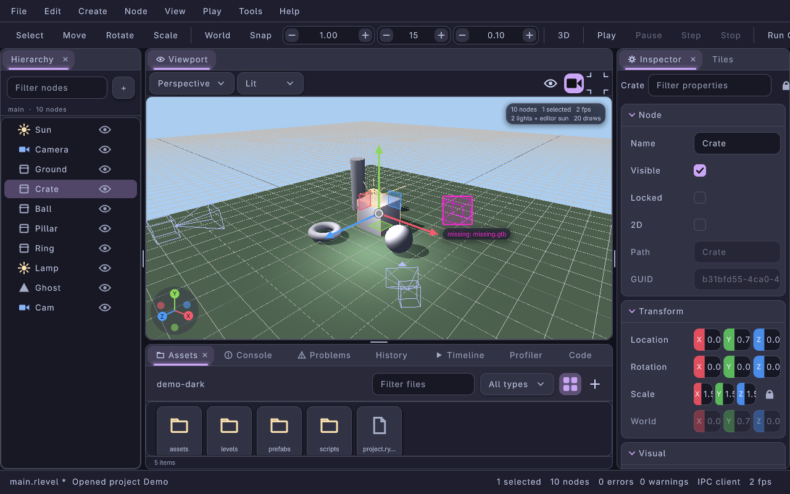

/The default 0.8.1 window (Catppuccin Mocha): menu bar and toolbar on top, Hierarchy left, the Viewport in the centre with its header (view preset, render mode, overlays, camera preview, maximise), Inspector and Tiles right, and Assets, Console, Problems, History, Timeline, Profiler and Code tabbed below./

** The pieces of the module
:PROPERTIES:
:CUSTOM_ID: editor-module-pieces
:END:
The module is four layers. Everything below the application is headless: it needs no window, no GL context and no UI toolkit, so it runs in tests, in =lrgeditor --headless=, in =lrgeditor --mcp= and inside other hosts such as cmacs.

| Layer | Where | What it holds | Documentation |
|-------+-------+---------------+---------------|
| Document | =src/editor/lrg-level*.c=, =lrg-node*.c=, =lrg-prefab.c=, =lrg-project.c=, =lrg-asset-*.c= | Levels, nodes, visuals, component descriptions, script bindings, linked prefabs, projects, the asset database with =.meta= sidecars | [[file:level-model.org][Level Model]], [[file:prefabs.org][Prefabs]], [[file:projects-and-assets.org][Projects and Assets]], [[file:yaml-format.org][.rlevel format]] |
| Editing core | =src/editor/lrg-editor*.c= | =LrgEditor= (undo/redo, selection, clipboard, commands), gizmo and picking math, validation, tilemap and timeline editing, =LrgEditorDocument= for data files, version-control status, the IPC server | [[file:editor-runtime.org][Editor Runtime]], [[file:editor-tools.org][Editor Tools]], [[file:data-editors.org][Data Editors]] |
| View model | =src/editor/lrg-editor-view-state.c=, =lrg-editor-viewport-nav.c=, =lrg-editor-play-session.c= | Viewport cameras, layout, render modes and overlays, navigation state machine, play-in-editor session (new in 0.8.1) | [[file:view-model.org][View Model]] |
| Application | =src/editor/ui/= on =src/ui/= | =LrgEditorApp=, the window, every panel and dialog, the scene renderer, the asset source registry (0.8.3) | [[file:editor-app.org][The Editor Application]], [[file:asset-sources.org][Asset Sources]] |

Around them sit the automation surfaces: the JSON-lines [[file:ipc-protocol.org][IPC protocol]] (136 methods in 0.8.3), the [[file:lrgeditorctl.org][lrgeditorctl]] CLI and its MCP server, and the [[file:emacs.org][Emacs package]].

** The Three-Layer Model
:PROPERTIES:
:CUSTOM_ID: the-three-layer-model
:END:
See [[file:../concepts/level-scene-world.org][Level, Scene, and World]] for the full rationale. In brief:

| Layer | Type | Role |
|-------+------+------|
| Authoring | =LrgLevel= / =LrgNode= | Editable document; serialized to =.rlevel= |
| Rendering | =LrgScene= | Baked geometry for preview |
| Simulation | =LrgWorld= | Runtime ECS instances for play-in-editor |

The bridges are:

- =lrg_level_to_scene(level)= bakes primitive-visual nodes into an =LrgScene= for geometry rendering. It is non-destructive and does not modify the level.
- =lrg_level_instantiate(level, world, engine, &err)= populates an =LrgWorld= with one =LrgGameObject= per node, materializing component descriptions through the =LrgRegistry=.
- =lrg_level_from_scene(scene)= imports a Blender-exported =LrgScene= back into an editable =LrgLevel=.

** Authoring Layer in Detail
:PROPERTIES:
:CUSTOM_ID: authoring-layer-in-detail
:END:
The authoring layer is a rooted node tree:

#+begin_example
LrgLevel
└── root LrgNode (implicit, not serialized)
    ├── LrgNode ("sky")           visual: NONE (group)
    ├── LrgNode ("floor")         visual: PRIMITIVE (cube)  + LrgNodeVisual
    │   ├── components: [LrgComponentDesc("collider")]
    │   └── scripts:   [LrgScriptBinding(LUA, "floor.lua")]
    └── LrgNode ("crate")         visual: PRIMITIVE, prefab link -> prefabs/crate.rprefab (1 override)
#+end_example

- Every node carries a stable =guid=, a local TRS transform (always 3D; 2D nodes live at Z=0 with =is-2d= set), and ordered lists of component descriptions and script bindings.
- =LrgNodeVisual= is a tagged payload describing what the node looks like: primitive, mesh asset, sprite, light, camera, audio emitter, tilemap, prefab.
- Component descriptions (=LrgComponentDesc=) are serializable type-name plus property-bag records. They are not live components; =lrg_level_instantiate()= materializes them through the registry.
- Script bindings (=LrgScriptBinding=) record a language and a path and become =LrgScriptComponent= instances at instantiation time.
- Since 0.8.1 a node can carry a *prefab link* (=LrgPrefabLink=): the source prefab, a map from source GUIDs to instance GUIDs, and the set of overridden property paths. The =.rlevel= still stores the expanded subtree, so the runtime loads it unchanged; the editor uses the link to sync instances when the prefab changes. See [[file:prefabs.org::#linked-instances][Linked instances]].

** The editor application (lrgeditor)
:PROPERTIES:
:CUSTOM_ID: standalone-engine-drawn-editor
:END:
=lrgeditor= (=LrgEditorApp=, =src/editor/ui/=, program =src/launcher/lrgeditor.c=) is the full editor. In 0.8.1 it was rebuilt from the immediate-mode =src/gui= (which stays in the engine, untouched) onto the retained toolkit: every panel is a widget tree on one =LrgCanvas=, every menu item and shortcut is a GIO action, and the frame is input, one canvas update and one render. The sections below are a tour; [[file:editor-app.org][The Editor Application]] has every detail and the [[file:tutorial.org][tutorial]] walks through a session.

*** Dock layout
:PROPERTIES:
:CUSTOM_ID: overview-dock-layout
:END:
The window is an =LrgEditorWindow=: an =LrgMenuBar= (File, Edit, Create, Node, View, Play, Tools, Help; Alt + the first letter opens a menu), a toolbar (tools, space, snapping increments, 2D/3D, Play / Pause / Step / Stop, Run Game, the viewport layout picker), an =LrgDockArea= with the panels, a status bar (document, dirty marker, play state, selection and node counts, log counters, IPC client, frame rate) and toasts. Panels are dragged by their tab onto another panel's edge or centre to split or tab them, closed and reopened from View > Panels, and the layout is saved under =ui-layout= in =editor.yaml= (a 0.8.0 =layout= string is converted on first start, see [[file:editor-app.org::#settings-migration][Settings migration]]). View > Reset Layout restores the default shown above. Embedders dock their own panels with =lrg_editor_app_add_panel()=.

*** Panels
:PROPERTIES:
:CUSTOM_ID: overview-panels
:END:
| Panel | Id | What it does | Details |
|-------+----+--------------+---------|
| Viewport | =viewport= | One to four cameras, gizmos, picking, box select, drop targets, camera preview | [[file:editor-app.org::#editor-panel-viewport][Viewport panel]] |
| Hierarchy | =hierarchy= | Node tree with multi-select, inline rename, drag to reparent or reorder, filter, a Live tab while playing | [[file:editor-app.org::#editor-panel-hierarchy][Hierarchy panel]] |
| Inspector | =inspector= | Property grids per section with multi-edit, prefab bar, lock, live values | [[file:editor-app.org::#editor-panel-inspector][Inspector panel]] |
| Tiles | =tiles= | Tilemap grid, layers and tileset of the selected tilemap node | [[file:editor-app.org::#editor-panel-tiles][Tiles panel]] |
| Assets | =assets= | Grid or list of the project, thumbnails, git badges, import settings | [[file:editor-app.org::#editor-panel-assets][Assets panel]] |
| Console, Problems, History | =console=, =problems=, =history= | Log with filters and a command line, live validation, the undo history | [[file:editor-app.org::#editor-panel-console][Console, History and Problems]] |
| Timeline | =timeline= | Keyframe tracks, playhead, easing | [[file:editor-app.org::#editor-panel-timeline][Timeline panel]] |
| Profiler | =profiler= | 300-frame graph and a section table | [[file:editor-app.org::#editor-panel-profiler][Profiler panel]] |
| Code | =code= | Tabs of =LrgTextEditor= with syntax colours | [[file:editor-app.org::#editor-panel-code][Code editor]] |
| Data editors | per file | Input maps, locales, sound banks, themes, HUD and UI layouts, dialog trees, dungeons | [[file:data-editors.org::#data-editors-panel-base][Data editor panels]] |
| Material editor | per =.rmat= | Live lit preview, PBR grid, instances with overrides, uniform inspector (0.9.0) | [[file:material-editor.org][Material Editor]] |
| Environment | right (tab of the Inspector) | The level's sky, IBL, ambient, fog, volumetric fog and post stack, undoable, with a sky preview and a Bake progress bar (0.9.0) | [[file:environment.org::#environment-panel][Environment panel]] |
| Physics | right (tab of the Inspector) | The selected node's =physics:= block: body, shapes, joints, fit to mesh, undoable; live body state while playing (0.9.0) | [[file:physics.org::#editor-physics-panel][Physics panel]] |
| Terrain | right (tab of the Inspector) | The selected terrain's brushes (sculpt, paint, holes, foliage), surface and foliage layers, chunk grid, Rebake, Save; water outline handles in the viewport (0.9.0) | [[file:terrain.org::#editor-terrain-panel][Terrain panel]] |
| Navigation | right (tab of the Inspector) | The level's =navigation:= block and =.rnav= settings: areas, links, Bake, Save; agents and ORCA debug while playing (0.9.0) | [[file:navigation.org][Navigation]] |
| AI | right (tab of the Inspector) | Live agents with blackboards and events while playing; the LLM decisions inspector (0.9.0) | [[file:ai.org][AI]] |
| Mixer | bottom (tab next to Assets) | The project mixer as channel strips with live meters (0.9.0) | [[file:audio.org::#editor-audio-mixer-panel][Mixer panel]] |
| Lighting | right (tab of the Inspector) | The level's lighting bake: settings, async bake with progress and cancel, atlas pages, light at cursor, save / clear with undo (0.9.0 M3) | [[file:bake.org][Lighting Bake]] |
| Post-stack editor | per =.rpost= | Effect chain, per-effect parameters, live viewport preview, save current look (0.9.0) | [[file:environment.org::#post-stack-editor][Post-stack editor]] |
| Sequencer | bottom (tab next to Timeline) | =.rseq= sequences: tracks by binding, Bézier curve editor, sections, events, scrub/play preview on level nodes with camera piloting (0.9.0) | [[file:sequencer.org][Sequencer]] |
| Shader graph editor | per =.rshadergraph= | Node shaders on the graph canvas, validation, GLSL, preview (0.9.0) | [[file:shader-graph-editor.org][Shader Graph Editor]] |

The command palette and quick open, Preferences, Project Settings and the other dialogs are described in [[file:editor-app.org::#editor-panel-palette][Command palette]], [[file:editor-app.org::#editor-panel-preferences][Preferences]] and [[file:editor-app.org::#editor-panel-dialogs][Dialogs]].

*** Viewport layouts and render modes
:PROPERTIES:
:CUSTOM_ID: overview-viewports
:END:
The viewport area holds up to four viewports in the =single=, =split-h=, =split-v= and =quad= layouts (toolbar Layout picker, =view.layout-*= actions, =view.layout= over IPC). Each viewport has its own camera (the extra ones start as the orthographic Top, Front and Right views), render mode and overlays; the one you last pressed or scrolled in is the active viewport that keys and =view.*= calls act on. Viewports render on demand and continuously only while something moves.

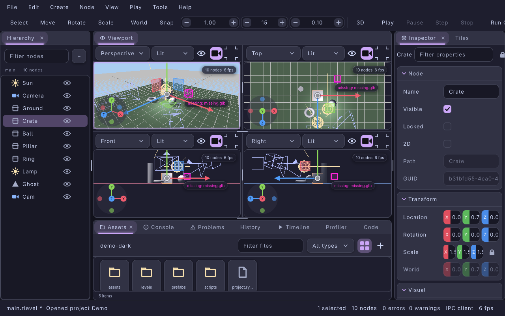

/The quad layout: perspective, Top, Front and Right, each with its own header./

Render modes are Lit (the level's lights through =LrgLightSet=, cascaded shadows from =LrgShadowRenderer=, a default sun when the level has no directional light), Unlit, Wireframe, Normals and Lighting Only. The overlays menu (eye icon) toggles the grid, gizmos, icons, bounds and stats, and the scene lighting, shadows, sky dome and a preview-only post stack (FXAA, bloom, vignette, colour grade).

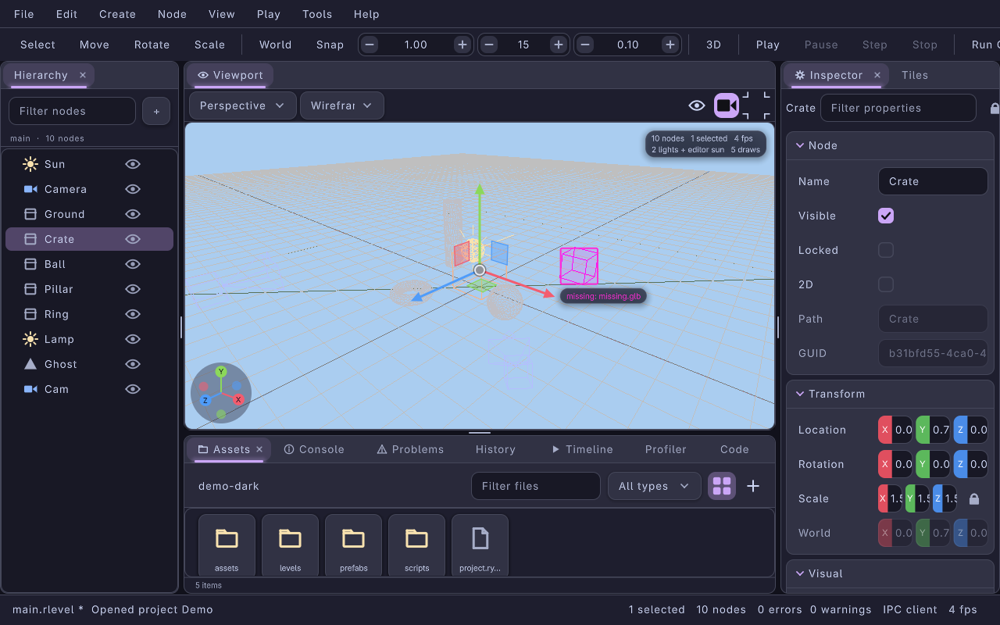

/A viewport in Wireframe mode; missing assets are tagged in magenta in every mode./

Selecting a camera node shows a picture-in-picture preview of what it sees in the active viewport.

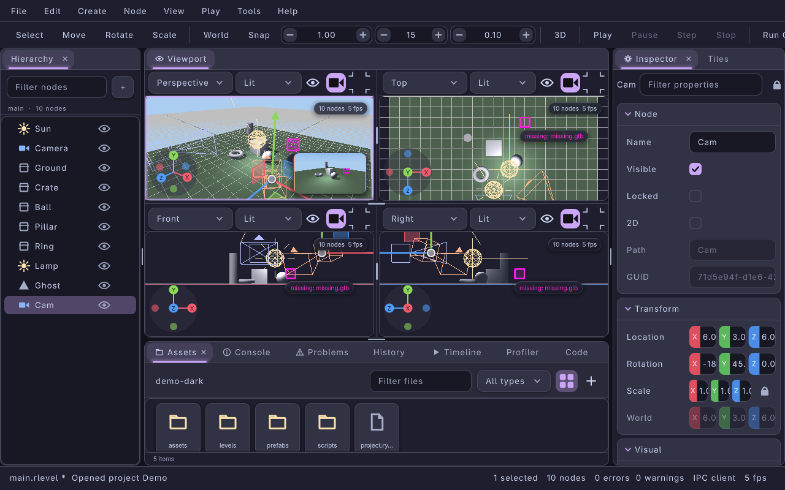

Navigation is the same in every viewport: the axis gizmo, right-drag fly with WASDQE, middle-drag pan, Alt-drag orbit, the wheel and the numpad, with Blender and trackpad schemes in Preferences. The state machine behind it is =LrgEditorViewportNav= ([[file:view-model.org::#viewport-nav][View model]]).

*** Inspector and multi-edit
:PROPERTIES:
:CUSTOM_ID: overview-inspector
:END:
The inspector is built from one =LrgPropertyGrid= per section (Node, Transform, Visual, one per component, Scripts) over =LrgEditorNodeSource= objects. With several nodes selected it shows the properties they share and marks values that differ as mixed; editing a field sets it on every node, and scrubbing a value across three nodes is one undo step (Escape cancels the drag). Rows carry state markers (overridden, animated, invalid), a filter field searches every grid, and the lock keeps the inspector on its nodes while the selection moves on. See [[file:editor-app.org::#editor-panel-inspector][Inspector panel]] and the toolkit side in [[file:../modules/ui/property-grid.org][Property grid]].

*** Linked prefabs
:PROPERTIES:
:CUSTOM_ID: overview-prefabs
:END:
Instantiating a prefab creates a /linked/ instance. Changing a property of the instance records an override; saving the prefab (or Apply All) updates every other instance in the level while keeping their overrides, as one undo group. The inspector's prefab bar shows the source, the override count, Select Source, Apply All, Revert All, Unlink and (for 0.8.0 instances) Relink; overridden rows get an accent bar and Apply to Prefab / Revert to Prefab in their context menu.

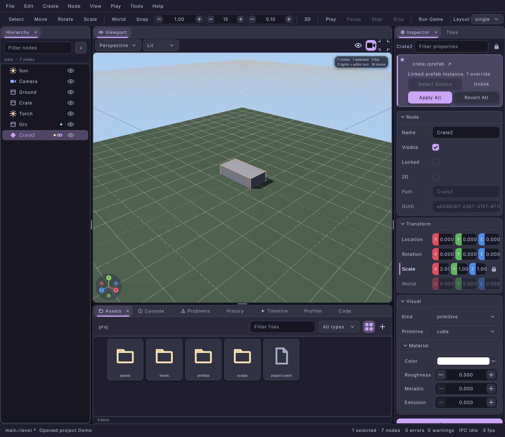

/A linked instance of crate.rprefab with one override (Scale); the hierarchy marks instances with a link badge./

Format, override paths, sync rules and the IPC methods are in [[file:prefabs.org::#linked-instances][Prefabs > Linked instances]].

*** Play mode and live inspection
:PROPERTIES:
:CUSTOM_ID: overview-play
:END:
F5 runs the level in a private =LrgWorld= (=LrgEditorPlaySession=); F7 pauses, F10 steps and Shift+F5 stops and restores the level exactly. While playing, the hierarchy gains a Live tab over the play world and the inspector edits the live components directly, under a "changes are discarded on Stop" banner; a row's context menu can apply a live value back to the level.

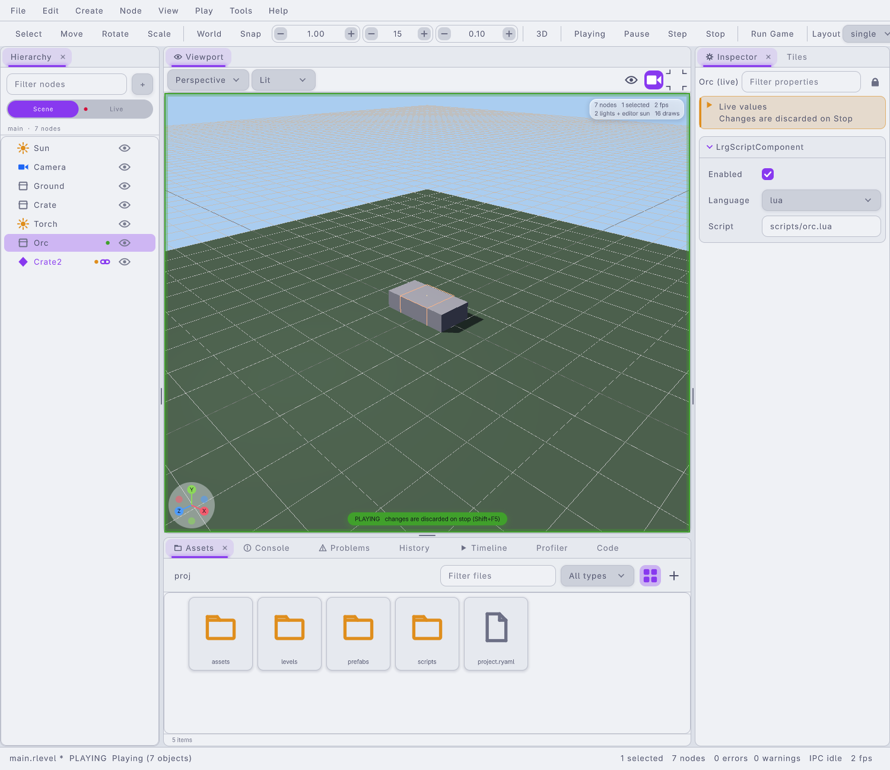

/Play mode in the Catppuccin Latte theme: the green frame and pill in the viewport, the Scene / Live switch in the hierarchy and the live values banner in the inspector./

The Profiler panel records while it is visible or while the game plays: a 300-frame graph and a table of the =LrgProfiler= sections (the play tick, UI input and update, each viewport's render).

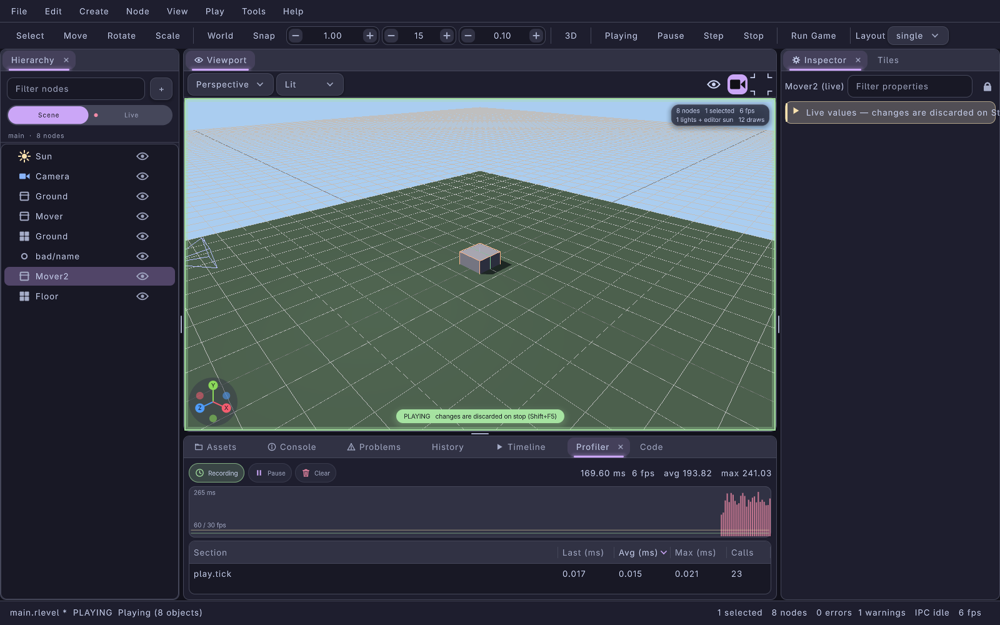

*** Assets, version control and thumbnails
:PROPERTIES:
:CUSTOM_ID: overview-assets
:END:
Every asset now has a =<file>.meta= sidecar with a stable GUID and importer settings (texture filter, mipmaps, wrap, sRGB, max size; model scale and up axis; audio mode, loop and volume; font size and code points). Existing projects keep their GUIDs: a missing sidecar is created with the GUID 0.8.0 derived from the path. The Assets panel renames, moves, duplicates and trashes files with their sidecars, shows thumbnails (textures, models, levels, prefabs, audio waveforms, font samples, script tiles) and git status badges with the branch in the breadcrumb.

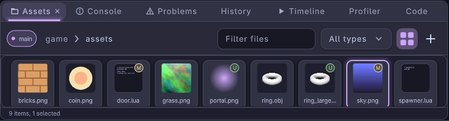

/The Assets panel in grid view (catppuccin-mocha) on a git project: the branch pill, M (modified) badges on a script and a texture, U (untracked) on a new texture and a new model, and texture, model and script thumbnails./

See [[file:projects-and-assets.org::#asset-sidecars][Asset sidecars]], [[file:projects-and-assets.org::#vcs-badges][Version control badges]] and [[file:editor-app.org::#editor-panel-assets][Assets panel]].

*** Code panel, command palette and preferences
:PROPERTIES:
:CUSTOM_ID: overview-code
:END:
Scripts can be edited inside the editor: the Code panel opens tabs of =LrgTextEditor= with syntax colours from =LrgSyntax=, marks dirty tabs, saves with the panel-scoped Ctrl+S, reloads files changed on disk and jumps to a line from the Problems panel. The =script-editor= setting chooses whether scripts open here (=internal=), in =$EDITOR= (=external=, the default) or in Emacs.

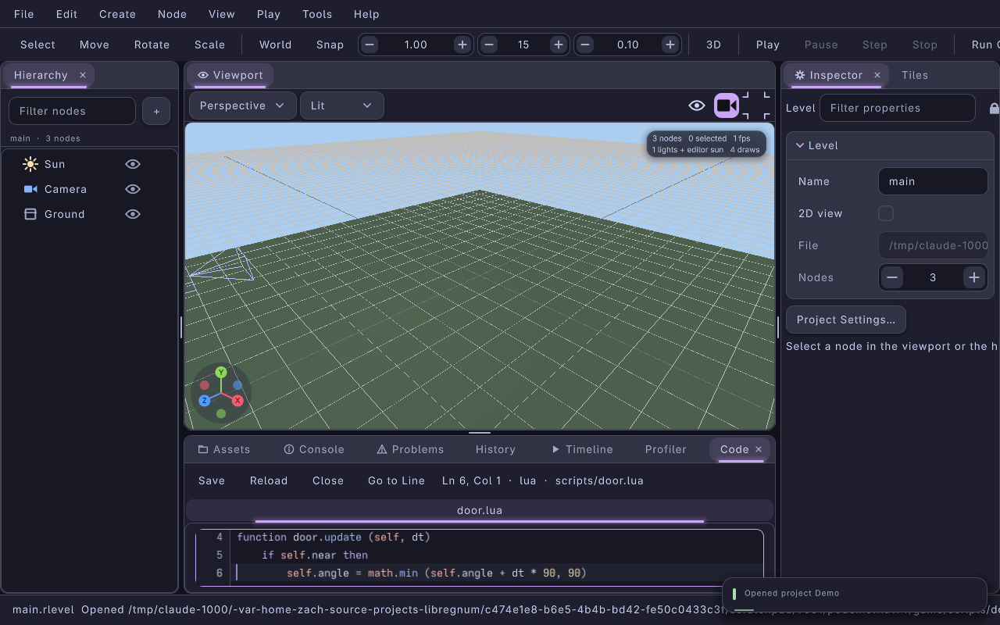

The command palette (Ctrl+Shift+P or F1) fuzzy-searches every action with its shortcut and jumps to nodes with =@name=; quick open (Ctrl+P) finds files.

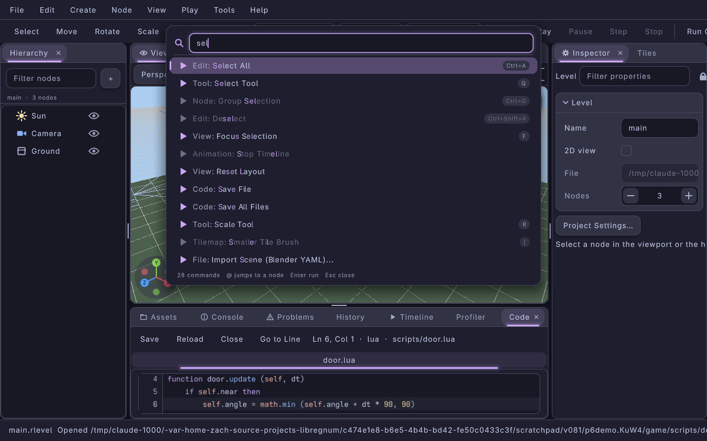

Preferences (Ctrl+,) edits =editor.yaml= live: General, Appearance (a card per theme: Catppuccin Mocha, Latte, Macchiato and Frappé, Midnight, Daylight and High Contrast; =theme= also takes a theme file), External Editor, Viewport, Keybindings (capture a new shortcut, conflicts are reported) and Server.

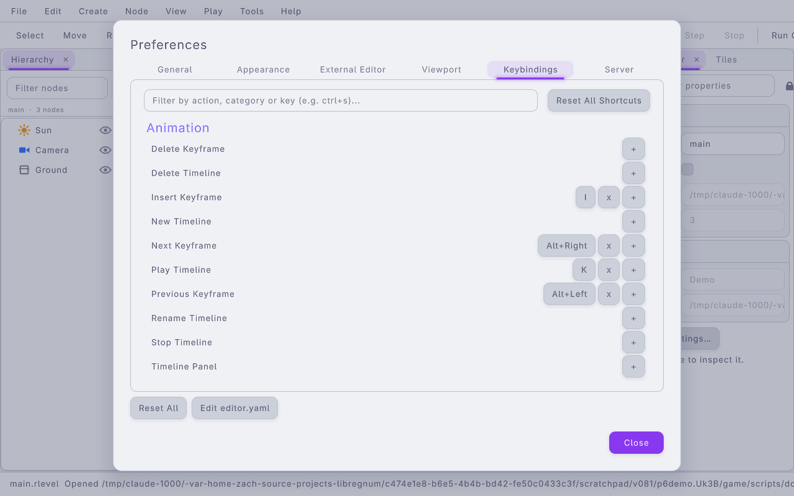

*** Data editors
:PROPERTIES:
:CUSTOM_ID: overview-data-editors
:END:
Activating a data file opens it in its own editor, docked as a tab next to the viewport: input maps (actions by bindings, with key capture), locales (keys by languages, missing translations flagged, CSV import and export), sound banks, themes (with a live widget gallery), HUD layouts (drag and resize elements on a canvas), UI layouts (YAML next to a live preview), dialog trees (a node graph with a play-test pane) and procgen dungeons (parameters, seed and a grid preview). Every one shares Save, Revert, Validate and an issues list, has its own undo history scoped to the document, keeps keys it does not understand, and validates through the engine's own loader.

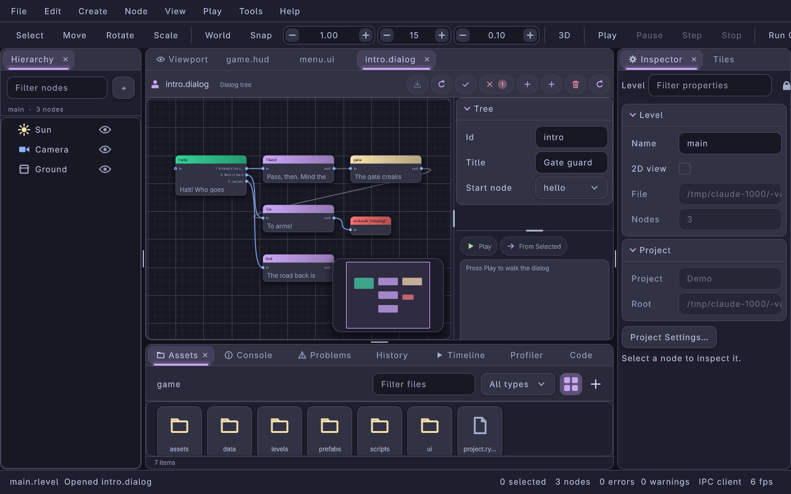

/The dialog tree editor: nodes on an =LrgNodeGraph=, the tree's fields on the right and the play-test pane below them./

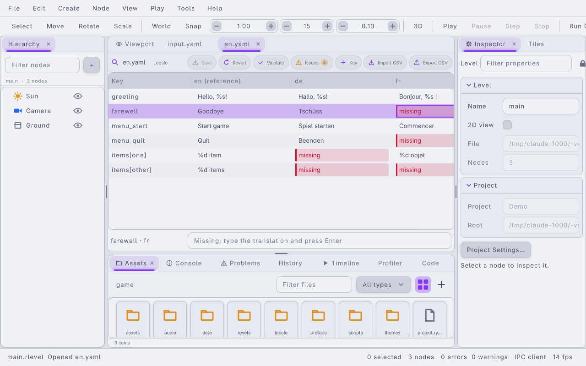

/The locale editor with missing translations flagged./

The headless model is =LrgEditorDocument=; the panels and their IPC methods (=data.*=) are in [[file:data-editors.org][Data Editors]].

*** Animation and tiles
:PROPERTIES:
:CUSTOM_ID: overview-timeline
:END:
The Timeline panel keys the selection (I), plays (K), drags keys and sets easing per segment; the Tiles panel and B in the viewport paint tilemaps. Both are covered in [[file:editor-tools.org][Editor Tools]].

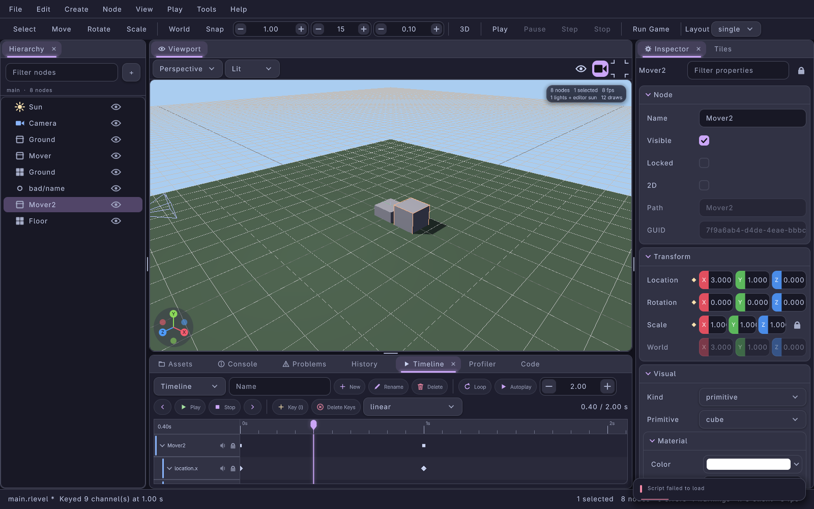

** Dual-Frontend Host Contract
:PROPERTIES:
:CUSTOM_ID: dual-frontend-host-contract
:END:
=LrgEditor= is host-agnostic: it owns no window and no render context. A host implements the =LrgEditorHost= GInterface to supply the engine, the render target, frame timing and injected input. Two frontends exist, and both target the same =LrgEditor= C API, so undo/redo, selection and every document operation are shared.

*** cmacs / IDE host
:PROPERTIES:
:CUSTOM_ID: cmacs-ide-host
:END:
cmacs (the Emacs integration) allocates an Emacs buffer backed by a Cairo/pgtk surface and implements =LrgEditorHost= against that surface. It uses =LrgEditorSoftwareHost= as a concrete holder and calls =lrg_editor_host_request_redraw()= when Emacs schedules a repaint.

*** Standalone application
:PROPERTIES:
:CUSTOM_ID: overview-standalone-host
:END:
=lrgeditor= is the second frontend, described above. Programs can host it too: =LrgEditorApp= is public, introspectable API with =lrg_editor_app_process_frame()= for one frame from an =LrgCanvasInput=, =lrg_editor_app_get_canvas()=, =lrg_editor_app_add_panel()= and the view model accessors. See [[file:editor-app.org::#embedding][Embedding and automation]] and, for code written against 0.8.0, [[file:../guides/editor-migration-0-8-1.org][Migrating to the 0.8.1 editor]].

** Automation
:PROPERTIES:
:CUSTOM_ID: overview-automation
:END:
- [[file:ipc-protocol.org][IPC protocol]]: a JSON-lines Unix socket with every document, view, play, panel and data-editor operation; the [[file:ipc-protocol.org::#method-index][method index]] lists all of them.
- [[file:lrgeditorctl.org][lrgeditorctl]]: a kubectl-style CLI over that socket (=lrgeditorctl get nodes=, =set=, =screenshot=, =view layout quad=, =code open=, =data validate=, ...).
- MCP: =lrgeditorctl mcp= and =lrgeditor --mcp= expose the same operations as MCP tools for AI agents ([[file:lrgeditorctl.org::#mcp][MCP]]).
- [[file:emacs.org][Emacs]]: =libregnum.el= follows the selection, edits nodes and opens scripts at the right line.

** Build Configuration
:PROPERTIES:
:CUSTOM_ID: build-configuration
:END:
The editor subsystem is compiled when =-DLRG_BUILD_EDITOR= is defined (=BUILD_EDITOR ?= 1= in =config.mk=). The Crispy scripting backend additionally needs =-DLRG_HAS_CRISPY= (=CRISPY=1=). =BUILD_EDITOR_UI=0= builds the editing core without the application, for hosts that bring their own UI.

#+begin_src sh
# Build with editor and Crispy (the lrgeditor application is built by default)
make BUILD_EDITOR=1 CRISPY=1

# Editor runtime only, without the application (embedded hosts)
make BUILD_EDITOR_UI=0

# Build without editor (runtime-only)
make BUILD_EDITOR=0
#+end_src

The Fedora packages the application needs beyond the base build are listed in [[file:editor-app.org::#building][Building and running]].

** Related Documentation
:PROPERTIES:
:CUSTOM_ID: related-documentation
:END:
- [[file:tutorial.org][Tutorial]]: a first session in =lrgeditor=, then the same level from C
- [[file:editor-app.org][The Editor Application]]: window, every panel, preferences, shortcuts, embedding
- [[file:view-model.org][View Model]]: =LrgEditorViewState=, =LrgEditorViewportNav=, =LrgEditorPlaySession=
- [[file:data-editors.org][Data Editors]]: =LrgEditorDocument= and the eight data editor panels
- [[file:material-editor.org][Material Editor]]: =.rmat= materials, preview, instances, assignment
- [[file:environment.org][Level Look]]: the Environment panel, the =.rpost= post-stack editor, debug view modes and render layers, volume gizmos, the LOD preview
- [[file:physics.org][Physics in Levels]]: the Physics panel, collider and joint gizmos, the Physics overlay, =physics.*= IPC
- [[file:navigation.org][Navigation in Levels]]: the Navigation panel, navmesh overlay and handles, agent debug view, =nav.*= IPC
- [[file:ai.org][AI in the Editor]]: behaviour tree and state-machine editors with live state, the AI panel and decisions inspector, =bt.*= / =fsm.*= / =ai.*= IPC
- [[file:vfx.org][Effects in the Editor]]: the particle and weather editors, =particles.*= / =weather.*= IPC
- [[file:audio.org][Audio in the Editor]]: the mixer editor and Mixer panel, the attenuation gizmo, =mixer.*= / =audio.*= IPC
- [[file:terrain.org][Terrain and Water in the Editor]]: Create > Terrain / Water, the Terrain panel and viewport brushes, foliage layers, water handles, the =.rwater= editor, =terrain.*= / =water.*= IPC
- [[file:physics-asset-editor.org][Physics Asset Editor and Layers]]: =.rphysasset= ragdolls, Project Settings > Physics, =physasset.*= and =physics.layers.*= IPC
- [[file:bake.org][Lighting Bake]]: the Lighting panel, static lighting rows, probe volumes, baked lighting in the viewport
- [[file:sequencer.org][Sequencer]]: =.rseq= sequences, the curve editor, preview and =sequence.*= IPC
- [[file:2d-tools.org][2D Tools]]: rule tile painting, tile transforms, iso/hex grids and tile properties in the Tiles panel, the =.rtileset= and =.rsprite= editors, =tiles.*= / =tileset.*= / =sprite.*= IPC
- [[file:skeleton2d-editor.org][2D Rig Editor]]: =.rskel2d= rigs, the canvas tools, weights, skins, animation mode and =skel2d.*= IPC
- [[file:shader-graph-editor.org][Shader Graph Editor]]: =.rshadergraph= node shaders
- [[file:visual-scripting.org][Visual Scripting]]: =.rvscript= node graph and blocks, =vscript.*= IPC
- [[file:prefabs.org][Prefabs]]: reusable node subtrees and linked instances
- [[file:projects-and-assets.org][Projects and Assets]]: =LrgProject=, =LrgAssetDatabase=, =.meta= sidecars, thumbnails, git status
- [[file:asset-sources.org][Asset Sources]]: =LrgAssetSource= virtual asset trees from game modules (game archives), the Sources panel, cached exports and imports
- [[file:editor-tools.org][Editor Tools]]: tilemap painting, the animation timeline, asset thumbnails
- [[file:level-model.org][Level Model]]: =LrgLevel= / =LrgNode= / =LrgNodeVisual= and the node property source
- [[file:yaml-format.org][.rlevel YAML Format]]: serialization schema
- [[file:editor-runtime.org][Editor Runtime]]: =LrgEditor=, commands, undo/redo, host
- [[file:ipc-protocol.org][IPC Protocol]]: drive the editor from scripts and tools
- [[file:lrgeditorctl.org][lrgeditorctl and MCP]]: kubectl-style CLI for running editors; MCP tools for AI agents
- [[file:external-editor.org][External Code Editor]]: =$EDITOR=, presets and command templates
- [[file:emacs.org][Emacs Integration]]: =libregnum.el=
- [[file:gap-analysis.org][Gap Analysis]]: the editor and engine against Godot 4, Unity 6 and Unreal 5, and the roadmap that follows
- [[file:../guides/editor-migration-0-8-1.org][Migrating to the 0.8.1 editor]]: embeddings, settings, levels and assets written for 0.8.0
- [[file:../concepts/level-scene-world.org][Level, Scene, and World]]: three-layer rationale
- [[file:../modules/editor/index.org][Editor Module Reference]]
- [[file:../modules/ui/index.org][UI toolkit]]: the retained toolkit the editor is drawn with
- [[file:../modules/scripting/index.org][Scripting Manager Reference]]
