#+title: Editor Tutorial
#+description: A first session in lrgeditor 0.8.1 (project, viewport layouts, inspector multi-edit, linked prefabs, play mode, code and data editors, automation), then the same level built from C
#+authors: Zach Podbielniak
#+categories: libregnum editor tutorial
#+created: 2026-06-07T00:43:11-04:00
#+updated: 2026-11-07T12:00:00-05:00
#+version: 2.0

* Editor Tutorial
:PROPERTIES:
:CUSTOM_ID: tutorial
:END:
#+begin_quote
*[[file:../index.org][Home]]* > *[[file:overview.org][Editor Module]]* > Tutorial
#+end_quote

Part 1 walks through a first session in =lrgeditor=: create a project, place and edit nodes, split the viewport, edit several nodes at once, turn a crate into a linked prefab, play the level, edit a script and a data file, and drive it all from the shell. Part 2 builds the same level from C with the authoring API, for tools and tests that generate levels without the editor. The screenshots come from the 0.8.1 editor at 1280 x 800 in the Catppuccin Mocha and Latte themes.

* Part 1: A session in lrgeditor
:PROPERTIES:
:CUSTOM_ID: tutorial-editor
:END:
** Step 1: Create a project
:PROPERTIES:
:CUSTOM_ID: tutorial-editor-project
:END:
#+begin_src sh
lrgeditor --new-project ~/games/demo --name "Demo"
#+end_src

This creates =project.ryaml=, the =levels/=, =scripts/=, =assets/= and =prefabs/= folders and a starter level, and opens it. The window has the menu bar and toolbar on top, the Hierarchy on the left, the Viewport in the centre, the Inspector (with Tiles as a second tab) on the right, and Assets, Console, Problems, History, Timeline, Profiler and Code tabbed below. Drag a panel's tab onto another panel's edge to rearrange the dock; View > Reset Layout brings the default back. Next time, =lrgeditor ~/games/demo= (or no argument at all: the last project reopens) is enough.

A 0.8.0 =editor.yaml= is migrated on the first start (layout, keybindings and theme names), with a backup next to it; see [[file:editor-app.org::#settings-migration][Settings migration]].

** Step 2: Add nodes
:PROPERTIES:
:CUSTOM_ID: tutorial-editor-nodes
:END:
Use the Create menu (or the + button above the hierarchy, or a right click in the viewport) to add a Plane named /Ground/, a Cube named /Crate/, a Sphere, a Point Light and a Camera. New nodes land at the ground point under the pointer and are selected.

- Move with W, rotate with E, scale with R and select with Q; T toggles local/world space and Y snapping (the toolbar spin boxes set the increments). Ctrl inverts snapping during a drag and Escape cancels it.
- Right-drag to fly (W A S D, Q E down and up, Shift faster, the wheel changes the speed), middle-drag to pan, Alt + left drag to orbit, F to frame the selection, Home to frame everything. The axis gizmo bottom left orbits on drag and snaps to an axis on click.
- Rename with F2 or a double click in the hierarchy; drag rows onto a node to reparent, between rows to reorder (Alt keeps world transforms).

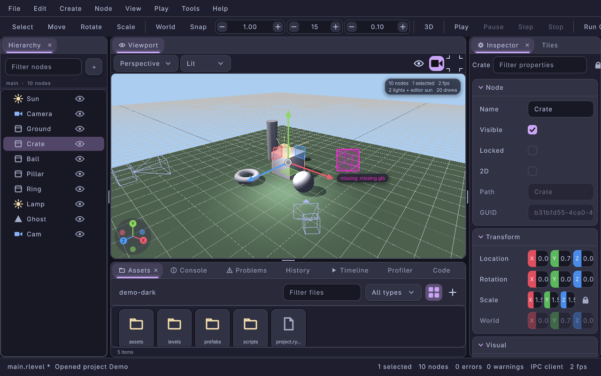

/The level with the crate selected: the move gizmo in the viewport, the crate highlighted in the hierarchy, its Node and Transform sections in the inspector. The stats chip top right counts nodes, lights and draw calls./

Every change is one step in the History panel; Ctrl+Z and Ctrl+Shift+Z undo and redo, and clicking a History row jumps there.

** Step 3: Split the viewport and change render modes
:PROPERTIES:
:CUSTOM_ID: tutorial-editor-viewports
:END:
Pick =quad= in the toolbar's Layout box (or run =view.layout-quad= from the palette). The viewport splits into perspective, Top, Front and Right views, each with its own camera. Click or scroll in a viewport to make it the active one: the shortcuts (F, the numpad, =view.*= actions) act on it.

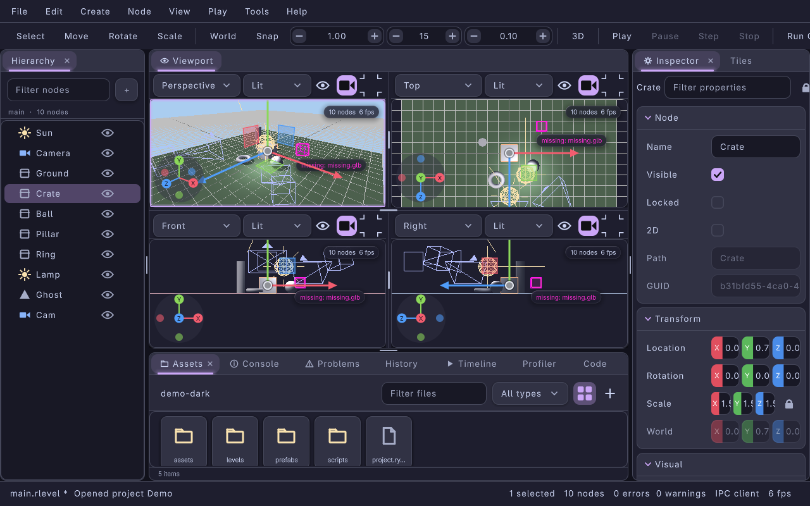

Each viewport header has a view preset (Perspective, Orthographic, Top, Bottom, Front, Back, Right, Left, 2D), a render mode (Lit, Unlit, Wireframe, Normals, Lighting Only), the overlays menu behind the eye icon (grid, gizmos, icons, bounds, stats, scene lighting, shadows, sky, post processing), the camera preview toggle and maximise. Set one viewport to Wireframe to check silhouettes while another stays Lit:

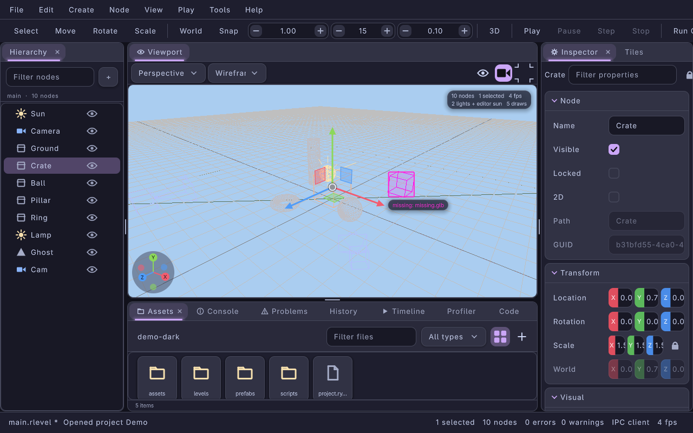

Select the Camera node and, with the camera button on, the active viewport shows what that camera sees in a picture-in-picture:

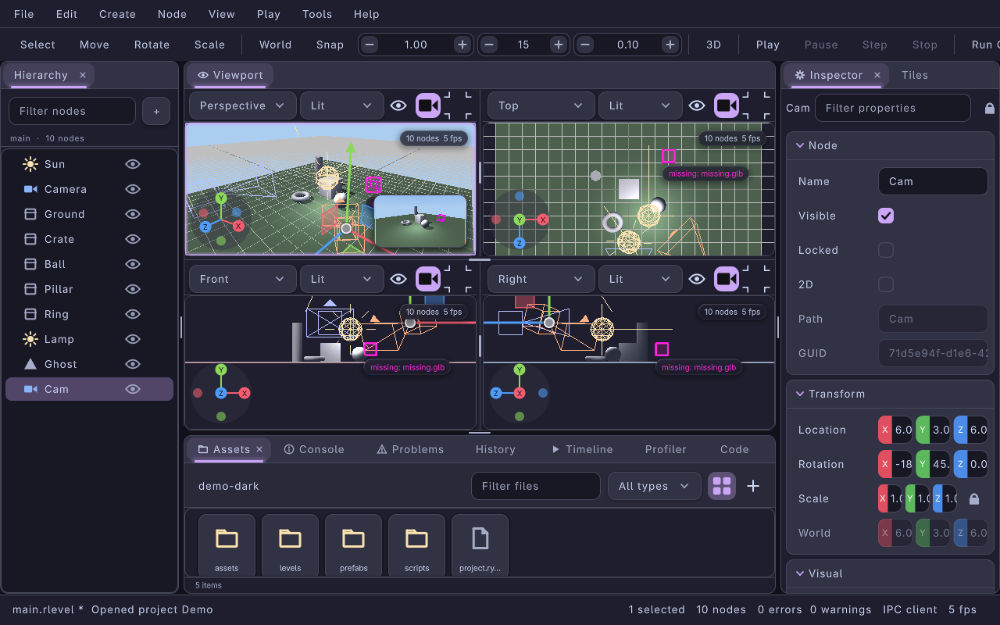

The layout, the four cameras and every viewport's mode and overlays are saved with the preferences.

** Step 4: Edit several nodes at once
:PROPERTIES:
:CUSTOM_ID: tutorial-editor-multi-edit
:END:
Duplicate the crate twice (Ctrl+D), then Ctrl-click the three crates in the hierarchy. The inspector title reads "3 nodes" and shows the properties they share. Location X shows a dash because the crates differ; type a value and all three move to the same X while keeping their own Y and Z. Drag the Y field's label to scrub: the drag is one undo step for all three, and Escape during the drag puts every crate back.

- The filter field at the top of the inspector searches every section.
- Add Component (bottom of the inspector, or =node.add-component=) opens a searchable list of registered component types and adds the component to every inspected node in one step. A component section appears only when every inspected node has it.
- The lock button keeps the inspector on these nodes while you select something else.

** Step 5: Make the crate a linked prefab
:PROPERTIES:
:CUSTOM_ID: tutorial-editor-prefab
:END:
Select one crate and choose Node > Save as Prefab, saving =prefabs/crate.rprefab=. Then Node > Instantiate Prefab (Ctrl+Shift+I) places a linked instance, or drag =crate.rprefab= from the Assets panel into the viewport. The hierarchy marks linked instances with a link badge, and the inspector shows the prefab bar.

Scale the instance along X. The Scale row gets an accent bar and the bar reports "1 override":

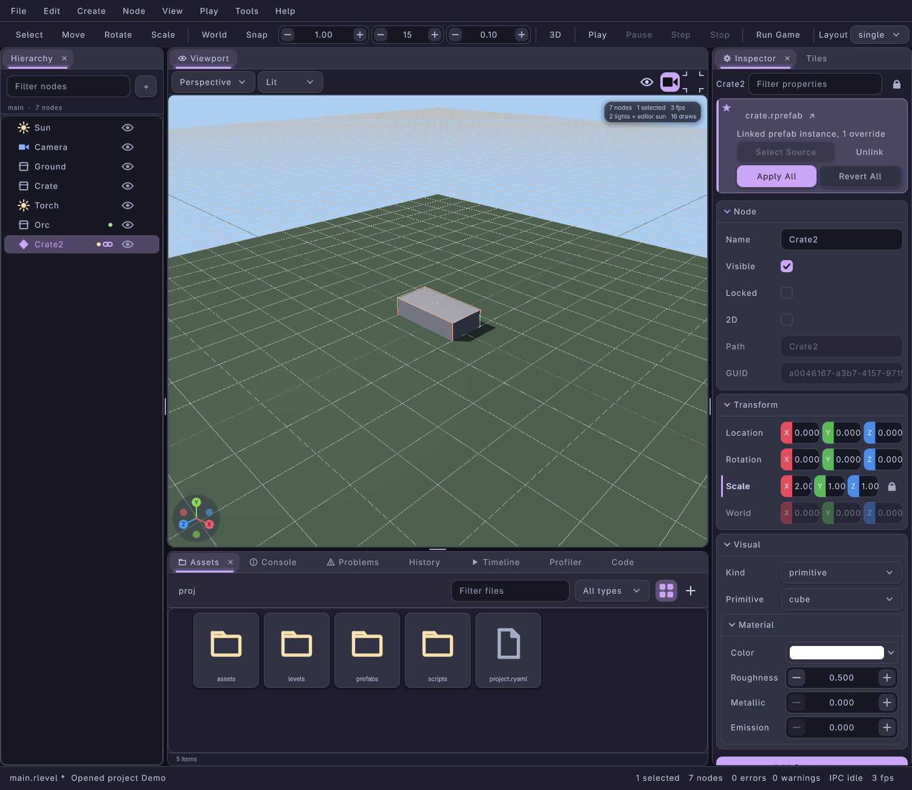

- *Apply All* writes the instance's overrides into =crate.rprefab= and updates every other instance in the level as one undo group.
- *Revert All* drops the overrides. A single row reverts or applies from its context menu (Revert to Prefab, Apply to Prefab).
- Editing =crate.rprefab= itself (open it from Assets, or save over it) syncs every instance and keeps each one's overrides.
- Instances in a 0.8.0 level load unlinked; *Relink* restores the link from the old marker.

The =.rlevel= still contains the expanded nodes, so the game loads the level exactly as before. See [[file:prefabs.org::#linked-instances][Linked instances]].

** Step 6: Play the level
:PROPERTIES:
:CUSTOM_ID: tutorial-editor-play
:END:
Press F5 (or Play in the toolbar). The level runs in a private world: the viewport gets a green frame and a PLAYING pill, the hierarchy a Scene / Live switch, and the inspector inspects the live object of the selected node under a "changes are discarded on Stop" banner. Live edits go straight into the game; a row's Apply to Level copies a value you want to keep back into the level.

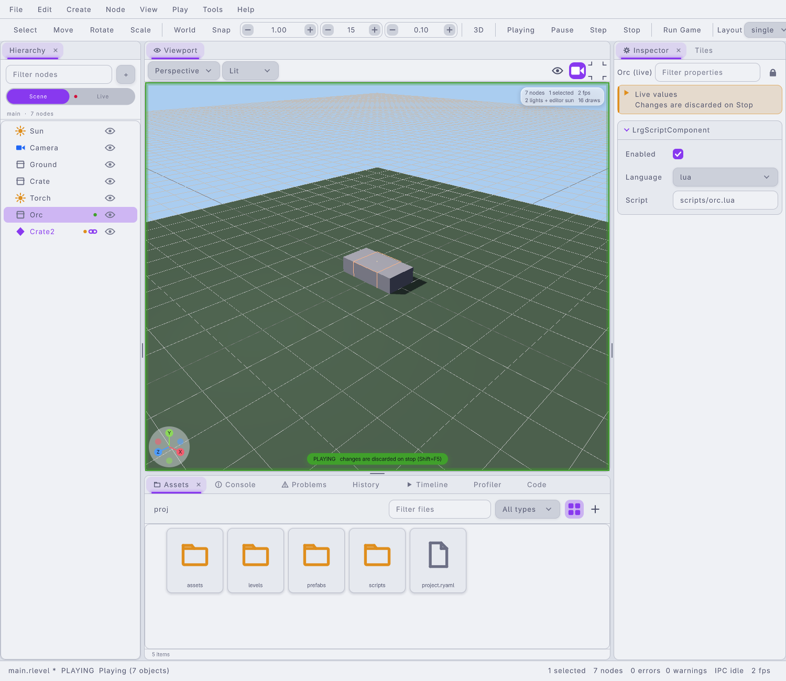

/Play mode in the Latte theme with the live inspector on a scripted node./

F7 pauses, F10 steps one frame and Shift+F5 stops, restoring the level exactly (edits made while playing stay on the redo stack). Open the Profiler tab while playing to see the frame graph and the =play.tick= section:

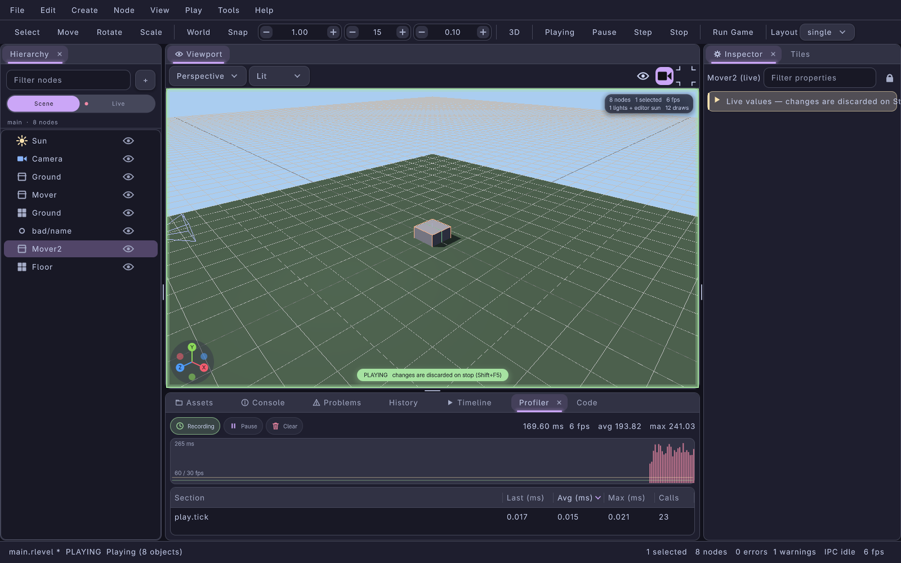

F6 instead runs the game as its own process with the project's run command; its output streams into the Console.

** Step 7: Animate a node
:PROPERTIES:
:CUSTOM_ID: tutorial-editor-timeline
:END:
Open the Timeline tab, click New, select a crate and press I to key its transform at the playhead. Move the playhead, move the crate, press I again, and press K to play. Keys can be dragged, deleted and given an easing per segment; autoplay timelines run in play mode.

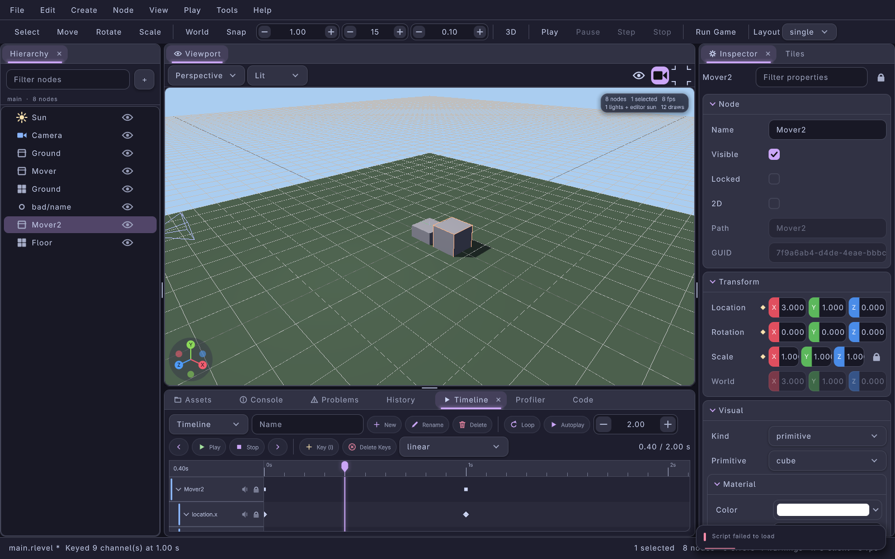

Details: [[file:editor-tools.org::#animation-timeline][Animation timeline]].

** Step 8: Attach and edit a script
:PROPERTIES:
:CUSTOM_ID: tutorial-editor-code
:END:
In the inspector's Scripts section, choose New Script... to create =scripts/crate.lua= from a template and attach it. Where it opens depends on Preferences > External Editor > Scripts open in: =internal= uses the Code panel, =external= (the default) your =$VISUAL= / =$EDITOR= or a preset, =emacs= a connected Emacs. With =internal=, the file opens in a tab with syntax colours; Ctrl+S inside the panel saves the file (not the level), Ctrl+G goes to a line, and a file changed on disk reloads.

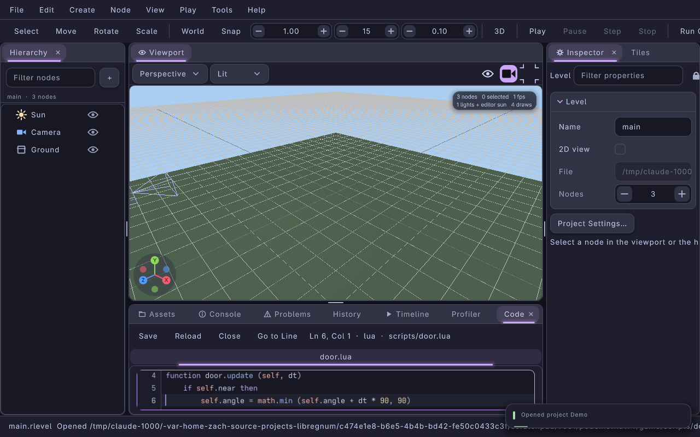

Ctrl+Shift+P (or F1) opens the command palette: type a few letters of any action, or =@name= to jump to a node. Ctrl+P opens files by name.

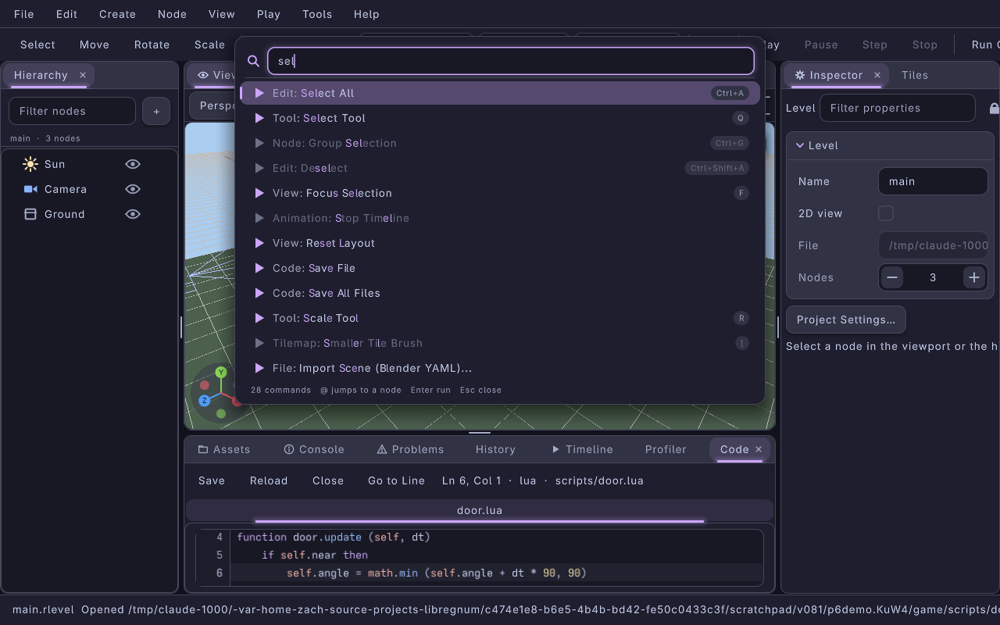

Every shortcut can be rebound in Edit > Preferences > Keybindings: press + on a row and the key you press next becomes a shortcut; conflicts are reported.

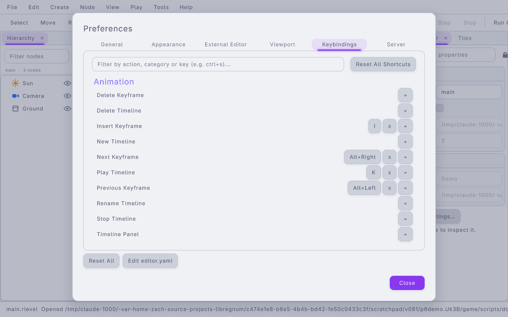

** Step 9: Assets, import settings and git
:PROPERTIES:
:CUSTOM_ID: tutorial-editor-assets
:END:
Copy a texture and a =.wav= into =assets/=. The Assets panel picks them up, writes a =.meta= sidecar next to each (a stable GUID and the importer's settings) and draws thumbnails, an audio waveform included. In a git work tree the breadcrumb shows the branch and each tile a status badge (U untracked, M modified, A added, ...).

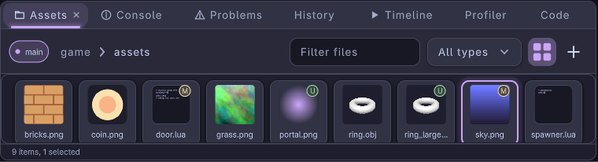

Right-click a texture and choose Import Settings to change filter, mipmaps, wrap, sRGB or the maximum size; the sidecar is written right away and the editor previews use it. Rename, move and duplicate files from the panel so their sidecars go with them. See [[file:projects-and-assets.org::#asset-sidecars][Asset sidecars]].

** Step 10: Edit game data
:PROPERTIES:
:CUSTOM_ID: tutorial-editor-data
:END:
Double-click a data file in Assets and it opens in its editor, docked as a tab next to the viewport. Each editor has Save, Revert, Validate and an issues list, and its own undo history. A dialog tree opens as a node graph with a play-test pane:

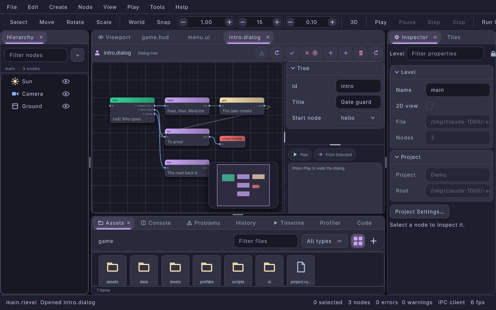

A locale opens as a key by language grid; missing translations are flagged and listed as issues, and CSV import and export are on the toolbar:

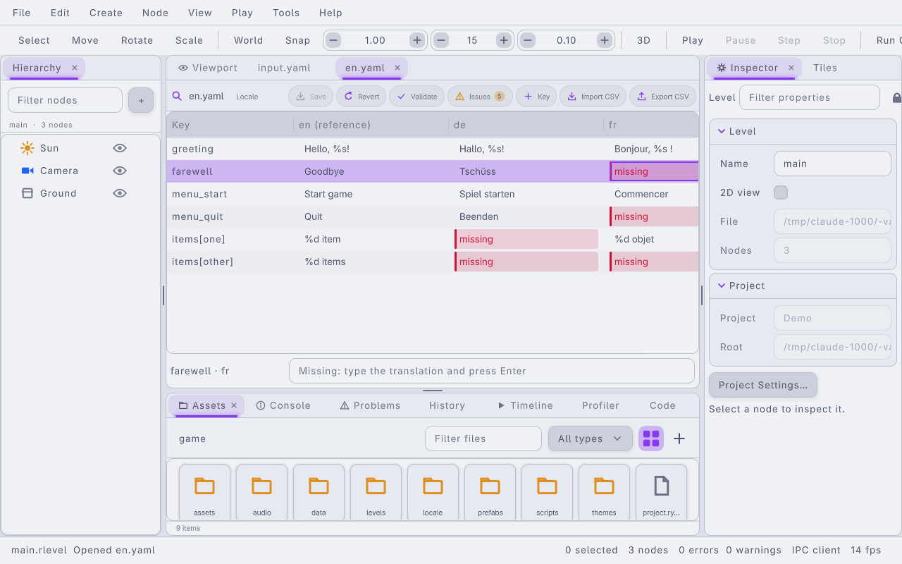

The other editors cover input maps, sound banks, themes, HUD layouts, UI layouts and procgen dungeons. See [[file:data-editors.org][Data Editors]].

** Step 11: Drive it from the shell
:PROPERTIES:
:CUSTOM_ID: tutorial-editor-automation
:END:
Everything above is also an IPC method. With the editor running:

#+begin_src sh
lrgeditorctl get nodes
lrgeditorctl create node Barrel --primitive cylinder location=4,0.5,-2
lrgeditorctl view layout quad
lrgeditorctl view render-mode wireframe viewport=1
lrgeditorctl inspector set Crate scale section=transform value=2,2,2
lrgeditorctl prefab sync prefabs/crate.rprefab
lrgeditorctl play start
lrgeditorctl profiler frames=120
lrgeditorctl play stop
lrgeditorctl call data.validate path=data/intro.dialog
lrgeditorctl screenshot /tmp/viewport.png
lrgeditorctl save
#+end_src

=lrgeditorctl mcp= exposes the same operations to AI agents as MCP tools, and =lrgeditor --headless= serves them without a window. See [[file:lrgeditorctl.org][lrgeditorctl and MCP]] and the [[file:ipc-protocol.org::#method-index][IPC method index]].

* Part 2: The same level from C
:PROPERTIES:
:CUSTOM_ID: tutorial-build-a-level-in-c
:END:
The authoring API builds levels without the editor: create a level, add nodes with visuals and components, save it, bake a scene and instantiate a runtime world. Everything here is headless.

** Step 1: Create a Level
:PROPERTIES:
:CUSTOM_ID: step-1-create-a-level
:END:
#+begin_src C
#include <libregnum.h>

int
main (int argc, char *argv[])
{
    g_autoptr(GError) error = NULL;

    /* Create an empty level */
    g_autoptr(LrgLevel) level = lrg_level_new ("tutorial_level");
    lrg_level_set_default_2d (level, FALSE);  /* 3D viewport */

    return 0;
}
#+end_src

** Step 2: Add Nodes with Visuals
:PROPERTIES:
:CUSTOM_ID: step-2-add-nodes-with-visuals
:END:
#+begin_src C
    /* --- Floor --- */
    g_autoptr(LrgNode) floor = lrg_node_new ("floor");
    lrg_node_set_location_xyz (floor, 0.0f, 0.0f, 0.0f);
    lrg_node_set_scale_xyz    (floor, 8.0f, 0.25f, 8.0f);

    g_autoptr(LrgNodeVisual) floor_vis = lrg_node_visual_new (LRG_NODE_VISUAL_PRIMITIVE);
    lrg_node_visual_set_primitive (floor_vis, LRG_PRIMITIVE_CUBE);

    g_autoptr(LrgMaterial3D) floor_mat = lrg_material3d_new ();
    lrg_material3d_set_color (floor_mat, 0.45f, 0.40f, 0.35f, 1.0f);
    lrg_material3d_set_roughness (floor_mat, 0.9f);
    lrg_node_visual_set_material (floor_vis, floor_mat);

    lrg_node_set_visual (floor, floor_vis);
    lrg_level_add_node (level, floor, NULL);   /* NULL = under root */

    /* --- Crate --- */
    g_autoptr(LrgNode) crate = lrg_node_new ("crate_01");
    lrg_node_set_location_xyz (crate, 2.0f, 0.5f, 1.0f);

    g_autoptr(LrgNodeVisual) crate_vis = lrg_node_visual_new (LRG_NODE_VISUAL_PRIMITIVE);
    lrg_node_visual_set_primitive (crate_vis, LRG_PRIMITIVE_CUBE);
    lrg_node_set_visual (crate, crate_vis);

    lrg_level_add_node (level, crate, NULL);
#+end_src

** Step 3: Add Component Descriptions
:PROPERTIES:
:CUSTOM_ID: step-3-add-component-descriptions
:END:
Component descriptions are serialized with the level and materialized at instantiation time. Their type names must be registered in =LrgRegistry= before =lrg_level_instantiate()= is called (in the editor, =lrgeditor --module= loads a game module that registers them).

#+begin_src C
    /* Collider on the floor */
    g_autoptr(LrgComponentDesc) floor_col = lrg_component_desc_new ("collider");
    lrg_component_desc_set_string (floor_col, "shape", "box");
    lrg_node_add_component (floor, floor_col);

    /* Health component on the crate */
    g_autoptr(LrgComponentDesc) crate_hp = lrg_component_desc_new ("health");
    lrg_component_desc_set_int    (crate_hp, "max_hp",    50);
    lrg_component_desc_set_double (crate_hp, "regen_rate", 0.0);
    lrg_node_add_component (crate, crate_hp);
#+end_src

** Step 4: Attach Script Bindings
:PROPERTIES:
:CUSTOM_ID: step-4-attach-script-bindings
:END:
#+begin_src C
    g_autoptr(LrgScriptBinding) crate_script = lrg_script_binding_new (
        LRG_SCRIPT_LANGUAGE_LUA, "scripts/crate.lua");
    lrg_node_add_script (crate, crate_script);
#+end_src

** Step 5: Save to Disk
:PROPERTIES:
:CUSTOM_ID: step-5-save-to-disk
:END:
The file is the same =.rlevel= the editor writes, so =lrgeditor tutorial.rlevel= opens it.

#+begin_src C
    g_autoptr(LrgLevelSerializer) ser = lrg_level_serializer_new ();
    g_autoptr(GError) save_err = NULL;

    if (!lrg_level_serializer_save_to_file (ser, level, "tutorial.rlevel", &save_err))
    {
        g_error ("Save failed: %s", save_err->message);
        return 1;
    }
    g_message ("Saved tutorial.rlevel");
#+end_src

** Step 6: Bake a Scene (Geometry Preview)
:PROPERTIES:
:CUSTOM_ID: step-6-bake-a-scene-geometry-preview
:END:
Baking converts the primitive-visual nodes into an =LrgScene= for geometry rendering. Nodes without a =PRIMITIVE= visual are skipped.

#+begin_src C
    g_autoptr(LrgScene) scene = lrg_level_to_scene (level);

    /* scene now contains two entities: "floor" and "crate_01"
       (keyed by their guids) */
    g_message ("Scene has %u entities",
               g_hash_table_size (lrg_scene_get_entities (scene)));
#+end_src

** Step 7: Instantiate for Play
:PROPERTIES:
:CUSTOM_ID: step-7-instantiate-for-play-in-editor
:END:
Instantiation populates an =LrgWorld= with live =LrgGameObject= instances; component descriptions are resolved through the engine's =LrgRegistry=. This is what play-in-editor does (inside =LrgEditorPlaySession=, see [[file:view-model.org::#play-session][View model]]).

#+begin_src C
    LrgEngine *engine = lrg_engine_get_default ();
    LrgRegistry *registry = lrg_engine_get_registry (engine);

    /* Register component types before instantiation */
    lrg_registry_register (registry, "collider", MY_TYPE_COLLIDER_COMPONENT);
    lrg_registry_register (registry, "health",   MY_TYPE_HEALTH_COMPONENT);

    g_autoptr(LrgWorld)  world     = lrg_world_new ();
    g_autoptr(GError)    inst_err  = NULL;

    if (!lrg_level_instantiate (level, world, engine, &inst_err))
    {
        g_error ("Instantiate failed: %s", inst_err->message);
        return 1;
    }

    /* Run the game loop */
    while (lrg_engine_is_running (engine))
        lrg_world_update (world, 0.016f);

    return 0;
#+end_src

** Step 8: Load Back from Disk
:PROPERTIES:
:CUSTOM_ID: step-8-load-back-from-disk
:END:
#+begin_src C
    g_autoptr(LrgLevelSerializer) ser   = lrg_level_serializer_new ();
    g_autoptr(GError)              err  = NULL;
    g_autoptr(LrgLevel) loaded = lrg_level_serializer_load_from_file (
        ser, "tutorial.rlevel", &err);
    if (loaded == NULL)
        g_error ("Load failed: %s", err->message);

    g_message ("Level name: %s", lrg_level_get_name (loaded));
#+end_src

** Complete Program
:PROPERTIES:
:CUSTOM_ID: complete-program
:END:
The steps above assemble into a standalone C program:

#+begin_src C
#include <libregnum.h>

int
main (int argc, char *argv[])
{
    g_autoptr(GError) error = NULL;

    /* Level */
    g_autoptr(LrgLevel) level = lrg_level_new ("tutorial_level");
    lrg_level_set_default_2d (level, FALSE);

    /* Floor */
    g_autoptr(LrgNode) floor = lrg_node_new ("floor");
    lrg_node_set_scale_xyz (floor, 8.0f, 0.25f, 8.0f);
    g_autoptr(LrgNodeVisual) fv = lrg_node_visual_new (LRG_NODE_VISUAL_PRIMITIVE);
    lrg_node_visual_set_primitive (fv, LRG_PRIMITIVE_CUBE);
    lrg_node_set_visual (floor, fv);
    lrg_level_add_node  (level, floor, NULL);

    /* Crate */
    g_autoptr(LrgNode) crate = lrg_node_new ("crate_01");
    lrg_node_set_location_xyz (crate, 2.0f, 0.5f, 1.0f);
    g_autoptr(LrgNodeVisual) cv = lrg_node_visual_new (LRG_NODE_VISUAL_PRIMITIVE);
    lrg_node_visual_set_primitive (cv, LRG_PRIMITIVE_CUBE);
    lrg_node_set_visual (crate, cv);

    g_autoptr(LrgComponentDesc) hp = lrg_component_desc_new ("health");
    lrg_component_desc_set_int (hp, "max_hp", 50);
    lrg_node_add_component (crate, hp);

    g_autoptr(LrgScriptBinding) sb =
        lrg_script_binding_new (LRG_SCRIPT_LANGUAGE_LUA, "scripts/crate.lua");
    lrg_node_add_script (crate, sb);
    lrg_level_add_node  (level, crate, NULL);

    /* Save */
    g_autoptr(LrgLevelSerializer) ser = lrg_level_serializer_new ();
    if (!lrg_level_serializer_save_to_file (ser, level, "tutorial.rlevel", &error))
        g_error ("Save: %s", error->message);

    /* Bake */
    g_autoptr(LrgScene) scene = lrg_level_to_scene (level);
    (void) scene;  /* pass to renderer */

    /* Instantiate */
    g_autoptr(LrgWorld) world = lrg_world_new ();
    if (!lrg_level_instantiate (level, world, NULL, &error))
        g_error ("Instantiate: %s", error->message);

    g_message ("Tutorial complete.");
    return 0;
}
#+end_src

* See Also
:PROPERTIES:
:CUSTOM_ID: see-also
:END:
- [[file:overview.org][Editor Module Overview]]: the pieces of the editor and a tour of the window
- [[file:editor-app.org][The Editor Application]]: every panel, preference and shortcut
- [[file:prefabs.org][Prefabs]]: linked instances, override paths, sync
- [[file:data-editors.org][Data Editors]]: the eight data editors and =LrgEditorDocument=
- [[file:level-model.org][Level Model]]: full API for =LrgLevel= / =LrgNode=
- [[file:yaml-format.org][.rlevel Format]]: YAML schema reference
- [[file:editor-runtime.org][Editor Runtime]]: =LrgEditor= and undo/redo
- [[file:lrgeditorctl.org][lrgeditorctl and MCP]]: scripting the editor
- [[file:../concepts/level-scene-world.org][Level, Scene, and World]]: three-layer rationale
