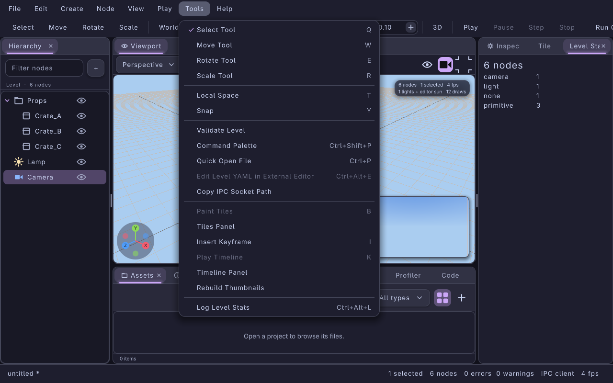

#+title: Editor Custom Panel Example
#+description: Walkthrough of examples/editor-custom-panel.c: embedding LrgEditorApp in a program of your own, docking a "Level Stats" panel that follows LrgEditor::changed, and adding an action with a shortcut, an enabled state and a Tools menu entry
#+authors: Zach Podbielniak
#+categories: libregnum editor examples embedding
#+created: 2026-11-06T00:00:00-05:00
#+updated: 2026-11-06T00:00:00-05:00
#+version: 1.0

* Editor Custom Panel Example
:PROPERTIES:
:CUSTOM_ID: editor-custom-panel
:END:
#+begin_quote
*[[file:../index.org][Home]]* > Examples > Editor Custom Panel
#+end_quote

=examples/editor-custom-panel.c= is the smallest useful extension of the libregnum editor from a host program. It embeds the full =LrgEditorApp= (menus, viewport, hierarchy, inspector, assets, IPC socket, preferences), docks a panel of its own and adds a command:

- *Level Stats*, a dock panel shown as a tab next to the inspector, counts the level's nodes by visual kind (=primitive=, =mesh-asset=, =light=, =camera=, =none= for groups, ...) and refreshes whenever the document changes.
- *Log Level Stats*, an action with the shortcut Ctrl+Alt+L, an entry at the bottom of the Tools menu, a row in the command palette and the keybinding editor, writes the same summary to the editor's console and shows it as a toast. It is disabled while the level is empty.

Everything else is the stock editor, so the example is also a template: replace the counting with your tool (a lighting baker, a navmesh checker, a localisation report) and keep the wiring.

The screenshot shows the sample level (a /Props/ group with three cubes, a lamp and a camera), the Level Stats tab on the right and the Tools menu open with the custom entry at the bottom.

** What it shows
:PROPERTIES:
:CUSTOM_ID: editor-custom-panel-what
:END:
| Piece | API | Where in the source |
|-------+-----+---------------------|
| Hosting the editor | =lrg_editor_new()=, =lrg_editor_app_new()=, =lrg_editor_app_load_settings()=, =lrg_editor_app_run()= | =main()= steps 3 and 8 |
| Opening a project | =lrg_editor_app_open_project()= (=--project DIR=) | =main()= step 3 |
| A custom dock panel | =lrg_dock_panel_new()=, =lrg_dock_panel_set_child()=, =lrg_editor_app_add_panel (app, panel, "tab:inspector")= | =make_panel()= |
| Following the document | =LrgEditor::changed= (every edit, undo, redo) and =LrgEditor::level-replaced= (new, open, reload) | =refresh_panel()= |
| Walking the level | =lrg_level_get_root()=, =lrg_node_get_children()=, =lrg_node_get_visual()=, =lrg_node_visual_get_kind()= | =count_nodes()= |
| A custom action | =lrg_editor_actions_add()= with an activate and an enabled callback and the accelerator =<Ctrl><Alt>l= | =main()= step 5, =log_stats()=, =has_nodes()= |
| A menu entry | =lrg_editor_window_get_menu_model()=: append a section to the Tools submenu naming =editor.example.log-stats= | =add_menu_entry()= |
| Talking to the editor in-process | =lrg_editor_server_dispatch()= with =ui.notify= (level =success=) | =log_stats()= |
| Scripting it from outside | =lrg_editor_app_start_server()=; =lrgeditorctl run example.log-stats= | =main()= step 6 |
| Window screenshots | =view.screenshot= with =window: true=, then =editor.quit= with =force: true= | =screenshot_tick()= |

** How it works
:PROPERTIES:
:CUSTOM_ID: editor-custom-panel-how
:END:
*** The panel
:PROPERTIES:
:CUSTOM_ID: editor-custom-panel-panel
:END:
The panel is an =LrgDockPanel= with the id =level-stats= holding an =LrgVBox=. =lrg_editor_app_add_panel()= docks it as a tab of the inspector's group (=tab:inspector=; =left=, =right=, =top=, =bottom= and =center= also work) and lists it in View > Panels, so the user can close and reopen it, and View > Reset Layout keeps it. Because the id is stable, a layout the user saved in =editor.yaml= that mentions =level-stats= places it again on the next =lrg_editor_app_load_settings()=.

The content is rebuilt from scratch on every =LrgEditor::changed=: =lrg_container_remove_all()=, a heading label with the total, then one =LrgHBox= per kind with the kind in a 110 px column (the UI font is proportional, so padding the text with spaces would not line up) and the count beside it. Counting even a large level is cheap; a heavier tool would debounce the signal or rebuild only on idle. =LrgEditor::level-replaced= is connected too, because opening, reloading or creating a level replaces the whole document.

The handlers are disconnected after =lrg_editor_app_run()= returns, before the =Example= struct on the stack goes away.

*** The action and its menu entry
:PROPERTIES:
:CUSTOM_ID: editor-custom-panel-action
:END:
=lrg_editor_actions_add()= registers =example.log-stats= in the category "Example" with the accelerator =<Ctrl><Alt>l=. From that moment the action has a mirror =editor.example.log-stats= action, its shortcut works, and it shows up in the command palette (Ctrl+Shift+P), Help > Keyboard Shortcuts, the keybinding page of the preferences (where the user can rebind it) and =action.list= / =action.run= over IPC. The enabled callback =has_nodes()= is polled once per frame (=lrg_editor_actions_refresh_state()=), which greys out the menu entry and makes =action.run= refuse it while the level is empty.

Menus are not automatic: the menu bar shows =lrg_editor_window_get_menu_model()=, a =GMenu= with one submenu per top-level menu (File, Edit, Create, Node, View, Play, Tools, Help) whose items name =editor.<id>= actions. =add_menu_entry()= finds the submenu labelled =_Tools= and appends a section with one item; the menu bar follows the model's =items-changed=, so this works before or after the window opens.

=log_stats()= logs with =g_message()= (the app's log handler puts it in the Console panel and =log.tail=) and dispatches a =ui.notify= request with level =success= through =lrg_editor_server_dispatch()=, the same entry point the socket uses, which shows a green toast and the status-bar message.

*** Screenshots without a timer race
:PROPERTIES:
:CUSTOM_ID: editor-custom-panel-screenshot
:END:
=lrg_editor_app_run()= owns the frame loop and drains the GLib main context once per frame. A =g_timeout_add (1, ...)= source therefore fires about once per frame: it is not due again during the same drain, while an idle source (or a 0 ms timeout) would be dispatched over and over and never let the frame finish. After =--frames= ticks it requests =view.screenshot= with =window: true= (the capture is taken right after the next frame is drawn), and once the file exists it sends =editor.quit= with =force: true=: the sample level is unsaved, and a screenshot run must not stop at the unsaved-changes dialog.

** Building and running
:PROPERTIES:
:CUSTOM_ID: editor-custom-panel-build
:END:
The example is built with the editor UI (=BUILD_EDITOR_UI=1=, the default), next to =editor-standalone=:

#+begin_src sh
make -j"$(nproc)" lib
make examples
./examples/build/release/examples/editor-custom-panel
./examples/build/release/examples/editor-custom-panel --project ~/games/mygame
#+end_src

| Option | Meaning |
|--------+---------|
| =-p=, =--project DIR= | Open a project instead of the in-memory sample level |
| =-s=, =--screenshot PATH= | Save a PNG of the whole window after =--frames= frames and exit (window mode: it needs a display) |
| =-f=, =--frames N= | Frames to run before the screenshot (default 90) |
| =--license= | Print the AGPLv3 notice |
| =-h=, =--help= | Options and usage examples |

Without =DISPLAY= or =WAYLAND_DISPLAY= it prints a note and exits 0, as the other windowed examples do, so CI can run every example. The IPC socket is started as in =lrgeditor=, so from another terminal:

#+begin_src sh
lrgeditorctl get actions -o wide | grep example
lrgeditorctl run example.log-stats
lrgeditorctl delete node Props/Crate_C     # the panel updates
lrgeditorctl logs --tail 3
#+end_src

The screenshot above was taken under an isolated Xvfb (=xvfb-run -a -s "-screen 0 1280x800x24"= with =WAYLAND_DISPLAY= unset and private =XDG_RUNTIME_DIR= / =XDG_CONFIG_HOME=, so the run never touches the user's session or saved preferences), with the Tools menu opened by an =xdotool= click and captured with =lrgeditorctl screenshot PATH --window=.

** See also
:PROPERTIES:
:CUSTOM_ID: editor-custom-panel-see-also
:END:
- [[file:../editor/editor-app.org::#embedding][Embedding and automation]]: the embedding API in full
- [[file:../editor/editor-app.org::#keybindings][Keybindings]]: accelerator syntax and how users rebind actions
- [[file:../editor/ipc-protocol.org][IPC protocol]]: =ui.notify=, =view.screenshot=, =action.run=, =editor.quit=
- [[file:../guides/editor-migration-0-8-1.org][Migrating to the 0.8.1 Editor]]: moving a 0.8.0 =LrgGuiDock= panel to =lrg_editor_app_add_panel()=
- =examples/editor-standalone.c=: the minimal embedding (a level path argument and a "Scatter cubes" action)
