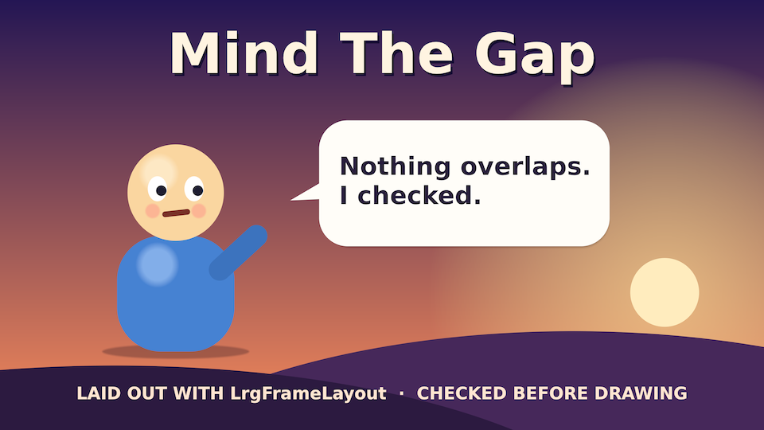
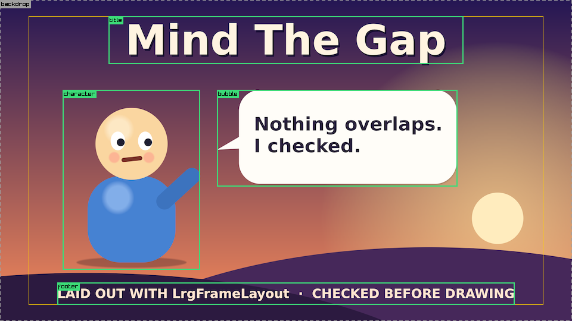

#+title: Frame Layout Poster
#+description: Walkthrough of examples/frame-layout-poster.c: a poster with a full-bleed backdrop, title, character, speech bubble and footer placed with LrgFrameLayout against a safe area, validated before drawing, drawn with anti-aliased SDF fills and fitted text on a supersampled canvas, with a debug overlay
#+authors: Zach Podbielniak
#+categories: libregnum examples graphics layout
#+created: 2026-11-27T12:00:00-05:00
#+updated: 2026-11-27T12:00:00-05:00
#+version: 1.0

* Frame Layout Poster
:PROPERTIES:
:CUSTOM_ID: frame-layout-poster
:END:
#+begin_quote
*[[file:../index.org][Home]]* > Examples > Frame Layout Poster
#+end_quote

=examples/frame-layout-poster.c= makes a 960 x 540 poster the way generated scenes should be made: every element gets a named box first, the boxes are checked, and only then are pixels drawn - each element inside its own box. It runs headless and exits with status 1 when the layout does not validate, so it can guard a pipeline.

With =--debug-boxes= it also writes the poster with =lrg_frame_layout_draw_debug()= on top (safe area in yellow, boxes in green, the backdrop dashed) and prints the check:

** The layout
:PROPERTIES:
:CUSTOM_ID: frame-layout-poster-layout
:END:
| Box | Placement |
|-----+-----------|
| =backdrop= | =set_box_rect= over the whole frame, =set_backdrop (TRUE)=: lies under everything and may leave the safe area |
| =title= | =add_box (TOP)=, 62 % x 15 % of the frame |
| =character= | =add_box (BOTTOM_LEFT)=, offset (6 %, -11 %), 24 % x 56 % |
| =bubble= | =add_box_relative= to the =RIGHT= of =character=, gap 3 %, =ALIGN_START= (top edges line up) |
| =footer= | =add_box (BOTTOM)=, 80 % x 7 % |

The safe area is 5 % of the frame (=set_safe_area_percent (0.05)=). The bubble's tail is drawn inside the bubble's box (its tip touches the box's left edge), so no overlap has to be allowed. =--broken= moves the bubble over the title; the check then fails with:

#+begin_example
layout problems:
overlap: "title" (x=182.4, y=27, w=595.2, h=81) and "bubble" (x=384, y=54, w=403.2, h=162) share (x=384, y=54, w=393.6, h=54)
#+end_example

** Drawing
:PROPERTIES:
:CUSTOM_ID: frame-layout-poster-drawing
:END:
- A 3x supersampled quality canvas (=lrg_image_canvas_new_supersampled=), resolved with Lanczos-3.
- The backdrop: a dusk gradient and a radial sun glow (large pixels), a sun disc and two hills as SDF fills.
- Shapes: one =LrgSdf2Func= (=shape_sdf()=) for circles, ellipses, round boxes, capsules and triangles via =lrg_sdf2_*=, filled with =lrg_image_canvas_fill_sdf_rect()= over each shape's bounds; a =feather= field widens the edge ramp for soft shadows and highlights.
- Text: measured at 100 px with =grl_image_measure_text_ttf()=, scaled to the largest size that fits the box, centred; the title gets a dark offset copy as a shadow.

** Building and running
:PROPERTIES:
:CUSTOM_ID: frame-layout-poster-run
:END:
#+begin_src sh
make -j8 && make -C examples build/release/examples/frame-layout-poster
examples/build/release/examples/frame-layout-poster                             # ./frame-layout-poster.png
examples/build/release/examples/frame-layout-poster --debug-boxes --out shots   # plus -debug.png and the check
examples/build/release/examples/frame-layout-poster --broken --debug-boxes      # a failing check, exit 1
examples/build/release/examples/frame-layout-poster --size 1920x1080
#+end_src

| Option | Meaning |
|--------+---------|
| =-o=, =--out DIR= | folder for the PNGs |
| =-s=, =--size WxH= | poster size (default 960x540); the layout is in fractions of it |
| =-f=, =--font FILE= | TrueType font (default DejaVu Sans Bold) |
| =-d=, =--debug-boxes= | also write =frame-layout-poster-debug.png= and print the check |
| =--broken= | push the bubble into the title to see a failing check |
| =--license= | AGPL-3.0-or-later |

** See also
:PROPERTIES:
:CUSTOM_ID: frame-layout-poster-see-also
:END:
- [[file:../modules/graphics/frame-layout.org][LrgFrameLayout]] - placements, checks, backdrops, the debug overlay, testing a layout
- [[file:../guides/image-cookbook.org][Image cookbook]] - =speech-bubble-layout= and =poster-typography= use the same pattern
