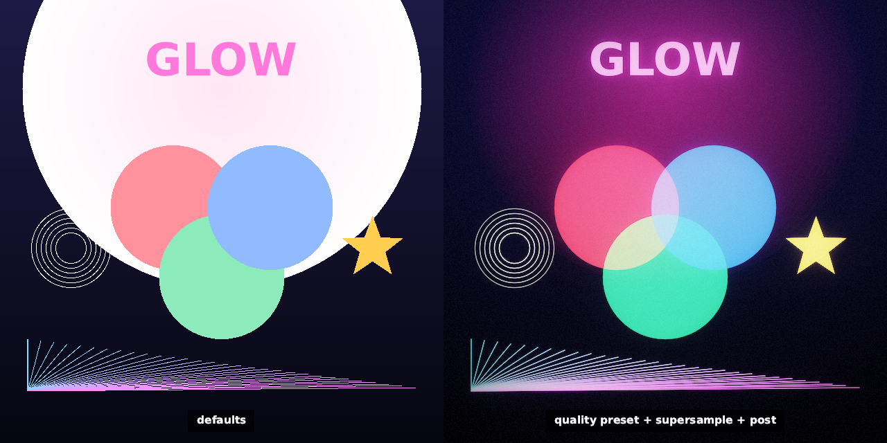

#+title: Image Quality Showcase
#+description: Walkthrough of examples/image-quality-showcase.c: one scene drawn twice, with a plain LrgImageCanvas (pixel-exact defaults) and with the quality preset, 3x supersampling and the CPU post stack, side by side
#+authors: Zach Podbielniak
#+categories: libregnum examples graphics postprocess
#+created: 2026-11-27T12:00:00-05:00
#+updated: 2026-11-27T12:00:00-05:00
#+version: 1.0

* Image Quality Showcase
:PROPERTIES:
:CUSTOM_ID: image-quality-showcase
:END:
#+begin_quote
*[[file:../index.org][Home]]* > Examples > Image Quality Showcase
#+end_quote

=examples/image-quality-showcase.c= draws the same scene twice into one 1280 x 640 PNG: a night gradient with a radial glow, a "GLOW" title, three translucent overlapping discs, a star, a fan of hairlines and thin rings. The drawing code is one function, =draw_scene()=; only the canvas and the finishing differ. It runs headless (no window, no GL context).

| | Left: "defaults" | Right: "quality preset + supersample + post" |
|-+------------------+----------------------------------------------|
| Canvas | =lrg_image_canvas_new (640, 640, bg)= | =lrg_image_canvas_new_supersampled (640, 640, 3, bg)= |
| Blending | =GRL_IMAGE_BLEND_REPLACE=: a translucent shape replaces the pixels under it, alpha included | =GRL_IMAGE_BLEND_OVER= in linear light |
| Edges | aliased | anti-aliased, then 3x supersampled |
| Finish | none | =lrg_image_canvas_resolve (LANCZOS3)=, then =LrgBloom= - =LrgTonemap= (ACES) - =LrgVignette= - =LrgFilmGrain= with =lrg_post_processor_apply_to_image()= |

What to look for on the left: the radial glow, drawn with a transparent rim, replaces the sky with a solid pink disc (REPLACE writes the translucent colour, not a blend); the three discs cover each other instead of mixing; the title, star and lines have stair-stepped edges; the hairlines in the fan break into dashes where they are nearly horizontal. On the right the same calls blend, glow and stay smooth.

** How the scene is drawn for both canvases
:PROPERTIES:
:CUSTOM_ID: image-quality-showcase-draw
:END:
=draw_scene (canvas, font, size, f)= takes the canvas's supersampling factor =f= (1 or 3):

1. Gradients and text ignore the transform stack, so their coordinates and the font size are multiplied by =f=.
2. =lrg_image_canvas_save()=, =lrg_image_canvas_scale (canvas, f, f)=, then every geometry call in final-size coordinates (=fill_circle=, =fill_path=, =draw_line=, =stroke_circle=), =lrg_image_canvas_restore()=.

That is the whole difference between drawing for a 1x and a 3x canvas, which is why switching an existing generator to the quality path is cheap.

** Building and running
:PROPERTIES:
:CUSTOM_ID: image-quality-showcase-run
:END:
#+begin_src sh
make -j8 && make -C examples build/release/examples/image-quality-showcase
examples/build/release/examples/image-quality-showcase                       # ./image-quality-showcase.png
examples/build/release/examples/image-quality-showcase --out shots --size 1920x960
examples/build/release/examples/image-quality-showcase --font /usr/share/fonts/liberation-sans-fonts/LiberationSans-Bold.ttf
examples/build/release/examples/image-quality-showcase --help
#+end_src

| Option | Meaning |
|--------+---------|
| =-o=, =--out DIR= | folder for the PNG (created if missing) |
| =-s=, =--size WxH= | size of the whole image (default 1280x640; each half is W/2 wide) |
| =-f=, =--font FILE= | TrueType font (default DejaVu Sans Bold; without a font the text is left out) |
| =--license= | AGPL-3.0-or-later |

** See also
:PROPERTIES:
:CUSTOM_ID: image-quality-showcase-see-also
:END:
- [[file:../guides/image-cookbook.org][Image cookbook]] - the recipes, twelve reference scenes and the pitfalls
- [[file:../modules/graphics/image-canvas.org][LrgImageCanvas]] - the quality preset and supersampled export
- [[file:../modules/postprocess/cpu.org][Post-processing on the CPU]]
