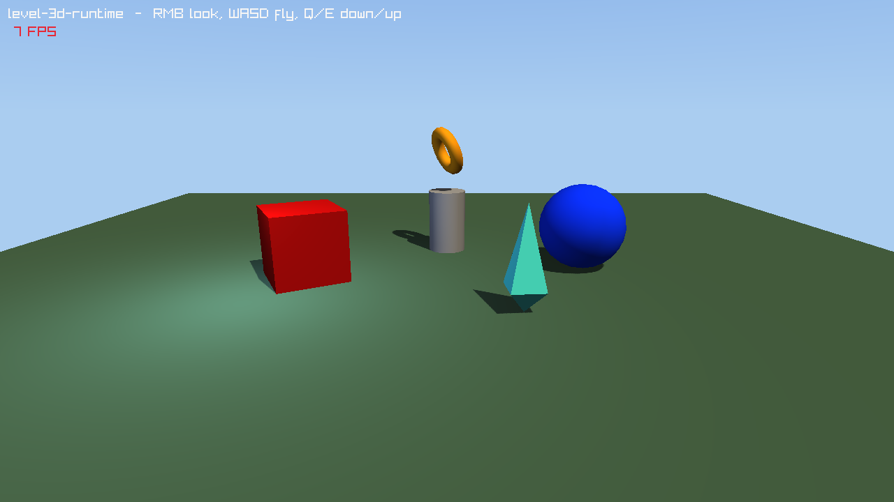

#+title: Level 3D Runtime Example
#+description: Walkthrough of examples/level-3d-runtime.c, a standalone game that loads a .rlevel authored in lrgeditor into an LrgWorld3D with lrg_level_load_world3d(), adds a small game component through the engine registry, flies the level's camera with WASD and the mouse, plays a positional sound and draws everything with LrgWorld3DRenderer
#+authors: Zach Podbielniak
#+categories: libregnum examples level world3d
#+created: 2026-11-07T01:00:00-05:00
#+updated: 2026-11-07T01:00:00-05:00
#+version: 1.0

* Level 3D Runtime Example
:PROPERTIES:
:CUSTOM_ID: level-3d-runtime
:END:
#+begin_quote
*[[file:../index.org][Home]]* > Examples > Level 3D Runtime
#+end_quote

=examples/level-3d-runtime.c= is the smallest complete 3D game built on a level authored in =lrgeditor=. It uses no editor object at all: it loads =examples/data/levels/level-3d-runtime.rlevel= into an =LrgWorld3D= (one =LrgEntity3D= per node, with the node's GUID, name, hierarchy and full transform), steps the world every frame and draws it with =LrgWorld3DRenderer=, the renderer the editor viewport uses, so the game looks like the editor's Play mode. The step-by-step explanation is the guide [[file:../guides/load-a-level-in-your-game.org][Load a level in your game]].

** What it shows
:PROPERTIES:
:CUSTOM_ID: level-3d-runtime-shows
:END:
- =lrg_level_load_world3d()=: load and instantiate in one call; every visual kind of the level becomes its component (primitives and the =crystal.obj= mesh an =LrgMeshRendererComponent=, the sun and the blue fill light =LrgLightComponent=s, the camera an =LrgCameraComponent=, the hum an =LrgAudioSourceComponent=).
- A game component (=GameSpinner=, registry name ="spinner"=) that the level attaches by name with a =speed= prop; it uses the 0.9.0 =attached_entity= and =update= hooks of =LrgComponent=.
- Hierarchy: the =Pedestal= group carries a column and a =RingPivot= that spins, and the tilted ring under the pivot wobbles with it (nested transforms).
- A fly camera that drives the level's camera entity; the =LrgCameraComponent= follows the entity.
- Positional audio: an =LrgAudioListenerComponent= on the camera entity, the emitter's relative =sound-path= made absolute after loading.
- =LrgWorld3DRenderer= with the level directory as its asset base directory: directional sun with cascaded shadows, a point light, the sky dome.
- Reproducible screenshots: a fixed 1/60 s step with =--screenshot=.

** Building and running
:PROPERTIES:
:CUSTOM_ID: level-3d-runtime-build
:END:
The example links the static library:

#+begin_src sh
make -j"$(nproc)" lib
make -C examples
cd examples
./build/release/examples/level-3d-runtime
#+end_src

Run it from =examples/=: the default level path is =data/levels/level-3d-runtime.rlevel=, and the level's assets (=assets/crystal.obj=, =assets/hum.wav=) are relative to the level file.

*** Command-line options
:PROPERTIES:
:CUSTOM_ID: level-3d-runtime-options
:END:
| Option | Short | Argument | Meaning |
|--------+-------+----------+---------|
| =--level= | =-l= | =PATH= | The =.rlevel= to play (default =data/levels/level-3d-runtime.rlevel=) |
| =--screenshot= | =-s= | =PATH= | Save a PNG after =--frames= frames and exit (fixed 1/60 s steps) |
| =--frames= | =-f= | =N= | Frames simulated before =--screenshot= (default 90) |
| =--license= | | | Print the AGPL-3.0-or-later notice and exit |
| =-h=, =--help= | | | GLib's generated help with usage examples |

#+begin_src sh
level-3d-runtime
level-3d-runtime --level ~/game/levels/main.rlevel     # any level saved by lrgeditor
level-3d-runtime --screenshot shot.png --frames 120
#+end_src

*** Controls
:PROPERTIES:
:CUSTOM_ID: level-3d-runtime-controls
:END:
| Input | Action |
|-------+--------|
| Right mouse button + mouse | Look around (yaw and pitch, pitch clamped to +/-1.5 rad) |
| W / S | Fly forward / back along the view |
| A / D | Strafe left / right |
| Q / E | Down / up |
| Shift | Four times faster |
| Esc | Quit |

** The level
:PROPERTIES:
:CUSTOM_ID: level-3d-runtime-level
:END:
=examples/data/levels/level-3d-runtime.rlevel= is an ordinary level file; open it in =lrgeditor= to change it. Its nodes and what they become:

| Node | Visual / components | Runtime |
|------+---------------------+---------|
| Sun | light, =light_type: directional=, warm material colour, =cast_shadows= | =LrgLightComponent= (directional, shines down its local -Z) |
| Fill | light, blue, =range: 14= | point =LrgLightComponent= |
| Camera | camera, =fov: 55= | =LrgCameraComponent=; the example adds the audio listener and flies it |
| Ground | plane primitive scaled 30 x 30 | =LrgMeshRendererComponent= |
| RedCube, BlueSphere | cube and UV sphere primitives with materials | =LrgMeshRendererComponent= |
| Pedestal | group (no visual) | an empty entity with two children |
| Column | cylinder | =LrgMeshRendererComponent= |
| RingPivot | group with =type: spinner= (=speed: 1.2=) | =GameSpinner= turns it about Y |
| Ring | torus tilted 1.2 rad about X, gold metallic | =LrgMeshRendererComponent=, wobbles with its parent |
| Crystal | =mesh-asset= =assets/crystal.obj= + =type: spinner= (=speed: -0.6=) | =LrgMeshRendererComponent= drawing the OBJ, spinning |
| Hum | =audio-emitter= =assets/hum.wav=, =loop=, =autoplay=, distances | =LrgAudioSourceComponent= |

=crystal.obj= is a stretched octahedron with flat normals and =hum.wav= a one second 110/165 Hz loop (11025 Hz mono), both generated for the example.

** Program structure
:PROPERTIES:
:CUSTOM_ID: level-3d-runtime-structure
:END:
=main()= does, in order:

1. Parses the options (=GOptionContext=).
2. Starts the default engine and registers ="spinner"= in its registry: the level's =components:= entries are resolved by registry name when the level is instantiated, so this comes first.
3. Opens the window (=grl_window_new()=) and the default audio device.
4. =lrg_level_load_world3d()=: the =.rlevel= becomes the world. =resolve_audio_paths()= makes the emitters' =sound-path= absolute (relative to the level directory) and restarts them.
5. Finds the camera entity (=lrg_world3d_find_with_component (world, LRG_TYPE_CAMERA_COMPONENT)=), reads its Euler rotation as the fly camera's yaw and pitch, and adds an =LrgAudioListenerComponent=.
6. Creates the =LrgWorld3DRenderer= with the level directory as base directory, so =assets/crystal.obj= resolves.
7. The frame loop: =fly_camera_update()=, =lrg_world3d_step()= (fixed steps, update, late update: the spinner turns, the camera component follows its entity, lights register), =lrg_audio_manager_update()=, then =lrg_world3d_renderer_render (renderer, world, NULL, NULL, 0, 0)= draws through the world's active camera onto the screen, and the title and FPS are drawn on top.
8. With =--screenshot=, after =--frames= frames the 2D batch is flushed (=rlDrawRenderBatchActive()=) and the screen read back with =LoadImageFromScreen()=.
9. =lrg_world3d_renderer_release()= frees the GPU resources before the window closes.

*** The spinner component
:PROPERTIES:
:CUSTOM_ID: level-3d-runtime-spinner
:END:
#+begin_src C
static void
game_spinner_attached_entity (LrgComponent *component,
                              LrgEntity3D  *entity)
{
	GameSpinner *self = GAME_SPINNER (component);

	/* The level's rotation, set before components attach */
	lrg_entity3d_get_rotation (entity, self->base);
	self->have_base = TRUE;
}

static void
game_spinner_update (LrgComponent *component,
                     gfloat        delta)
{
	GameSpinner  *self = GAME_SPINNER (component);
	LrgEntity3D  *entity = lrg_component_get_entity (component);
	const gfloat  axis[3] = { 0.0f, 1.0f, 0.0f };
	gfloat        turn[4], q[4];

	if (entity == NULL || !self->have_base)
		return;
	self->angle = fmodf (self->angle + self->speed * delta, 2.0f * (gfloat) G_PI);
	lrg_math3d_quat_from_axis_angle (axis, self->angle, turn);
	lrg_math3d_quat_multiply (self->base, turn, q);   /* base * turn: about local Y */
	lrg_entity3d_set_rotation (entity, q);
}
#+end_src

The =speed= property is a plain =GParamSpecFloat=; =lrg_level_instantiate_3d()= converts the level's =speed: 1.2= (a YAML double) into it with =g_value_transform()=. In =lrgeditor= the same component shows in the inspector's component list and runs during Play, once the editor knows the type (a plugin or project module registering it).

*** The fly camera
:PROPERTIES:
:CUSTOM_ID: level-3d-runtime-camera
:END:
The camera is just the entity the level's camera node became. Looking sets its rotation from yaw and pitch with =lrg_entity3d_set_rotation_euler()= (R = Rz * Ry * Rx: pitch about the local X axis, then yaw about Y). Moving adds =lrg_entity3d_get_forward()= and =lrg_entity3d_get_right()= (world-space -Z and +X of the entity) scaled by the speed. The =LrgCameraComponent= copies the entity's world transform into its =LrgCamera3D= in late update, so =lrg_world3d_renderer_render()= with =camera = NULL= (the world's active camera) sees the move the same frame.

** Performance
:PROPERTIES:
:CUSTOM_ID: level-3d-runtime-performance
:END:
- The level has 12 entities; loading and instantiating take well under a millisecond after the YAML parse. The OBJ loads on the first frame (the renderer's model cache).
- Under the software rasteriser of a headless X server the example runs at a few frames per second because of the shadow cascades; on a GPU it is vsync bound.

** Things to try
:PROPERTIES:
:CUSTOM_ID: level-3d-runtime-try
:END:
- Open the level in =lrgeditor=, move the ring, add a node, save, and run the example again.
- Press Play in the editor: the same spinner (once registered in the editor) turns the pivot, and the hierarchy's Live tab shows the entity tree.
- Change the sun's =intensity= or the camera's =fov= in the file and compare.
- Give a node =visible: false=: it stays in the world but is not drawn.

** See also
:PROPERTIES:
:CUSTOM_ID: level-3d-runtime-see-also
:END:
- [[file:../guides/load-a-level-in-your-game.org][Guide: Load a level in your game]]
- [[file:../modules/level/index.org::#level-instantiate-3d][Runtime level module: 3D instantiation]]
- [[file:../modules/world3d/world3d.org][LrgWorld3D]] · [[file:../modules/world3d/renderer.org][LrgWorld3DRenderer]]
