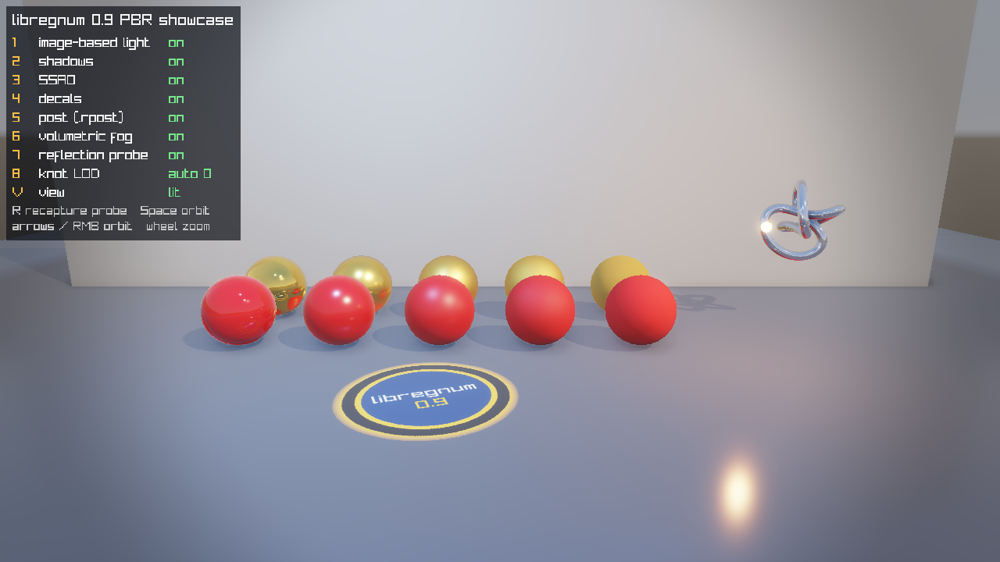

#+title: PBR Showcase Example
#+description: Walkthrough of examples/pbr-showcase.c, a level whose look (environment with an HDR sky and IBL, fog and volumetric fog, a .rpost post stack, .rmat materials, spot and point shadows, a decal, a reflection probe and an LOD model) is authored in the .rlevel and carried into the runtime by lrg_level_load_world3d(), with keyboard toggles for every rendering feature
#+authors: Zach Podbielniak
#+categories: libregnum examples rendering pbr level world3d
#+created: 2026-11-07T03:00:00-05:00
#+updated: 2026-11-07T03:00:00-05:00
#+version: 1.0

* PBR Showcase Example
:PROPERTIES:
:CUSTOM_ID: pbr-showcase
:END:
#+begin_quote
*[[file:../index.org][Home]]* > Examples > PBR Showcase
#+end_quote

=examples/pbr-showcase.c= shows every rendering feature of 0.9.0 in one small stage, and shows that a level carries its look into a game: everything on screen is authored in =examples/data/pbr-showcase/pbr-showcase.rlevel= and its assets, and the program only loads the level (=lrg_level_load_world3d()=), turns post-processing and SSAO on, bakes the environment, captures the reflection probe and draws the world with =LrgWorld3DRenderer=. Number keys switch each feature off and on, so you can see what it adds.

** What it shows
:PROPERTIES:
:CUSTOM_ID: pbr-showcase-shows
:END:
| Feature | Where it is authored | What to look for |
|---------+----------------------+------------------|
| Metallic-roughness PBR | ten =.rmat= instances of =metal.rmat= (gold) and =dielectric.rmat= (red plastic), roughness 0.05 .. 0.95 left to right | sharp sun and sky reflections on the left, broad lobes on the right; metals tinted, plastics with white highlights |
| Image-based lighting | =environment.sky= (equirect =skies/showcase-sky.hdr=), =ibl= | the spheres' shading from the sky; key 1 falls back to the flat =ambient= colour |
| Shadows | the Sun (directional), the Spot and the Lamp (point) with =cast_shadows: true= | three shadow directions under each sphere; key 2 |
| SSAO | renderer (=lrg_world3d_renderer_set_ssao_enabled()=) | contact darkening where spheres meet the floor; key 3, view mode "ambient occlusion" |
| Decal | node =Decal= (=kind: decal=, =textures/showcase-decal.png=) | the emblem projected onto the floor, lit with the floor; key 4 |
| Post stack | =environment.post_stack: showcase.rpost= (bloom, ACES tonemap, vignette) | bloom around the glowing bulb and the sun highlights; key 5 |
| Fog and volumetric fog | =environment.fog=, =environment.volumetric= | haze in the distance, the spot light's scattered beam; key 6 for the volumetric pass |
| Reflection probe | node =Probe= (=kind: reflection-probe=, box-projected) | the wall and the spheres reflected in the floor and the chrome knot in place; key 7, view mode "reflections" |
| LOD | =models/knot.obj= + =knot.obj.meta= (=lod-levels: 3=) | the chrome knot is an =LrgLodComponent=; key 8 forces level 0, 1, 2 (watch the silhouette) |
| Debug view modes | renderer render mode | key V: lit, lighting only, reflections, ambient occlusion, light complexity, normals, wireframe |

** Building and running
:PROPERTIES:
:CUSTOM_ID: pbr-showcase-build
:END:
The example links the static library:

#+begin_src sh
make -j"$(nproc)" lib
make examples
cd examples
./build/release/examples/pbr-showcase
#+end_src

The default level, =examples/data/pbr-showcase/pbr-showcase.rlevel=, is found from the repository root, from =examples/= or beside the binary. The generated assets (sky, decal, knot) are written next to that level and nowhere else. When no level is found the example exits with status 1 before it writes anything.

Every asset reference in the level is relative to the level file. The first run writes the binary assets the level names into =examples/data/pbr-showcase/= when they are missing: =skies/showcase-sky.hdr= (a 512 x 256 Radiance HDR sky with the sun where the level's Sun light comes from, written with =lrg_hdr_image_save_to_file()=), =textures/showcase-decal.png= (the emblem), =models/knot.obj= (a trefoil knot of about 5000 triangles, 1.4 MB of OBJ text, raylib's =GenMeshKnot()=) and =models/knot.obj.meta= (=lod-levels: 3=, ratios =1.0, 0.3, 0.08=, screen sizes =0.12, 0.04, 0.0=). Delete them to regenerate.

*** Command-line options
:PROPERTIES:
:CUSTOM_ID: pbr-showcase-options
:END:
| Option | Short | Argument | Meaning |
|--------+-------+----------+---------|
| =--level= | =-l= | =PATH= | The =.rlevel= to show (default =data/pbr-showcase/pbr-showcase.rlevel=) |
| =--screenshot= | =-s= | =PATH= | Save a PNG after =--frames= frames and exit (fixed 1/60 s steps) |
| =--frames= | =-f= | =N= | Frames rendered before the screenshot (default 60) |
| =--no-legend= | | | Hide the key legend |
| =--license= | | | Print the AGPLv3 notice and exit |
| =--help= | =-h= | | Usage, keys and examples |

The screenshot above was taken with:

#+begin_src sh
cd examples
./build/release/examples/pbr-showcase --screenshot ../docs/examples/images/pbr-showcase.png --frames 90
#+end_src

*** Controls
:PROPERTIES:
:CUSTOM_ID: pbr-showcase-controls
:END:
| Key | Action |
|-----+--------|
| 1 | image-based lighting on / off (=lrg_world3d_renderer_set_ibl_enabled()=) |
| 2 | shadows (=LRG_WORLD3D_RENDER_FLAG_SHADOWS=) |
| 3 | SSAO (=lrg_world3d_renderer_set_ssao_enabled()=) |
| 4 | decals (=lrg_world3d_renderer_set_decals_enabled()=) |
| 5 | the post stack (=LRG_WORLD3D_RENDER_FLAG_POST=) |
| 6 | volumetric fog (=lrg_world3d_renderer_set_volumetric_enabled()=) |
| 7 | the reflection probe (disables the =LrgReflectionProbeComponent=, which takes its probe out of the environment) |
| 8 | the knot's LOD: automatic, then forced level 0, 1, 2 (=lrg_lod_component_set_force_level()=) |
| V | cycle the view mode (=lrg_world3d_renderer_set_render_mode()=) |
| R | recapture the probe (=lrg_reflection_probe_component_request_capture()=; the loop captures pending probes) |
| arrows, right mouse drag | orbit the camera around the stage |
| mouse wheel, +/- | zoom |
| Space | automatic slow orbit |
| Esc | quit |

** The level
:PROPERTIES:
:CUSTOM_ID: pbr-showcase-level
:END:
The look lives in the level's =environment:= block (see [[file:../editor/yaml-format.org::#environment][the environment format]]):

#+begin_src yaml
environment:
  sky:
    source: equirect
    path: skies/showcase-sky.hdr   # resolved against the level's directory
  ibl: { enabled: true, resolution: 128 }
  ambient: { color: [0.16, 0.17, 0.2] }   # used when IBL is off
  fog: { enabled: true, type: exponential, color: [0.62, 0.68, 0.78, 0.6], density: 0.012 }
  volumetric: { enabled: true, density: 0.03, anisotropy: 0.6, steps: 32 }
  post_stack: showcase.rpost       # bloom, tonemap (ACES), vignette
#+end_src

Spheres reference material instances; each instance names its parent and overrides one value:

#+begin_src yaml
# materials/metal_r3.rmat
version: 1
name: metal_r3
parent: metal.rmat     # gold, metallic 1
roughness: 0.70        # the only override
#+end_src

#+begin_src yaml
- name: Metal_3
  transform: { location: [0.80, 0.75, -1.40], scale: [1.40, 1.40, 1.40] }
  visual:
    kind: primitive
    primitive: uv-sphere
    material: materials/metal_r3.rmat   # loaded through the engine's asset manager
#+end_src

The decal, the probe and the knot are ordinary nodes ([[file:../editor/yaml-format.org::#decal-probe-nodes][decal and reflection-probe nodes]]):

#+begin_src yaml
- name: Decal
  transform: { location: [-1.2, 0.3, 3.0] }   # projects down its local -Y onto the floor
  visual:
    kind: decal
    asset: textures/showcase-decal.png
    params: { size_x: 3.2, size_y: 1.0, size_z: 3.2, fade_angle: 60.0 }
- name: Probe
  transform: { location: [0.0, 3.0, 3.0] }   # the box also holds the camera, see below
  visual:
    kind: reflection-probe
    params: { extents_x: 16.0, extents_y: 5.0, extents_z: 13.0, blend_distance: 1.5 }
- name: Knot
  visual:
    kind: mesh-asset
    asset: models/knot.obj           # knot.obj.meta: lod-levels: 3 -> LrgLodComponent
    material: materials/chrome.rmat
#+end_src

** Program structure
:PROPERTIES:
:CUSTOM_ID: pbr-showcase-structure
:END:
1. *Engine.* =lrg_engine_startup()= creates the asset manager that loads the =.rmat= materials and generates the LOD chain; the level's directory is added as a search path (=lrg_asset_manager_add_search_path()=) so material references resolve.
2. *Window and generated assets* (=ensure_assets()=).
3. *Level.* =lrg_level_load_world3d()= instantiates the nodes and puts the look on the world: =lrg_world3d_get_environment()= is a copy of the level's environment with the sky loaded, =lrg_world3d_get_post_stack()= the loaded =.rpost=. The probe component registered its probe with that environment as it entered the world.
4. *Renderer.* Post-processing (=LRG_WORLD3D_RENDER_FLAG_POST=, which builds the world's post stack) and SSAO on; =lrg_world3d_renderer_bake_environment()= derives the IBL maps up front and =lrg_world3d_renderer_capture_probes()= renders the probe once, outside =BeginDrawing()=.
5. *Loop.* Keys, the orbit camera (it moves the level's camera entity), =lrg_world3d_step()=, a capture when =lrg_reflection_probe_component_count_pending()= says one is due, =lrg_world3d_renderer_render()=, the legend.

#+begin_src C
level = lrg_level_load_world3d (opt_level, world, &error);   /* nodes + the look */

renderer = lrg_world3d_renderer_new ();
lrg_world3d_renderer_set_base_dir (renderer, level_dir);
lrg_world3d_renderer_set_flags (renderer, lrg_world3d_renderer_get_flags (renderer)
                                          | LRG_WORLD3D_RENDER_FLAG_POST);
lrg_world3d_renderer_set_ssao_enabled (renderer, TRUE);
lrg_world3d_renderer_bake_environment (renderer, &error);
lrg_world3d_renderer_capture_probes (renderer, world);
#+end_src

** Performance
:PROPERTIES:
:CUSTOM_ID: pbr-showcase-performance
:END:
- The environment bake (radiance cubemap, SH irradiance, prefiltered specular, BRDF table) and the probe capture (six lit faces and a prefilter) are one-off costs at start, a few tens of milliseconds on a desktop GPU and seconds under software GL; =bake_environment()= moves the bake out of the first frame.
- Per frame the stage costs the shadow passes (sun cascades, one spot map, one point cube), the SSAO pass (depth prepass, kernel, blur), the lit pass with clustered lights and the decal, the volumetric march and the post chain. Keys 2, 3, 5 and 6 drop the corresponding passes; =lrg_world3d_renderer_set_timing()= and =lrg_world3d_renderer_get_pass_time()= measure them (see [[file:../guides/rendering-pipeline.org][the rendering pipeline]]).
- The LOD chain of the knot is simplified once, on its first draw, and shared by every component using the same model and sidecar.

** Pitfalls
:PROPERTIES:
:CUSTOM_ID: pbr-showcase-pitfalls
:END:
- *The probe box must contain the camera.* =LrgWorld3DRenderer= selects the reflection probes for a frame at the camera position (=lrg_environment_set_reference_point()=), so a probe whose box only wraps the objects is never bound while the camera is outside it. The level's probe box is large enough for the orbit; zoom far out and the reflections fall back to the sky.
- *Light intensity is a display-space multiplier,* not a photometric unit: the spot is 2.2 and the lamp 1.8; values in the tens wash the whole stage out.
- *Generated assets are written next to the level.* Run the example once before opening its level in the editor, or the sky, the decal and the knot are missing there.

** Things to try
:PROPERTIES:
:CUSTOM_ID: pbr-showcase-try
:END:
- Open the level in =lrgeditor= (=lrgeditor examples/data/pbr-showcase/pbr-showcase.rlevel=) after one run of the example: the environment panel edits the same block, and Play shows the same look.
- Change =sky.exposure= or =ambient.color= in the level, or swap =post_stack= for your own =.rpost=.
- Make a new instance: copy =metal_r2.rmat=, set =base_color: [0.95, 0.64, 0.54, 1.0]= (copper) and point a sphere at it.
- Set =auto_recapture: false= on the probe and move it at runtime; press R to recapture.

** See also
:PROPERTIES:
:CUSTOM_ID: pbr-showcase-see-also
:END:
- [[file:../guides/load-a-level-in-your-game.org::#load-level-look][Guide: the level's look]]
- [[file:../modules/level/index.org::#level-look][Level module: the level's look]]
- [[file:../modules/world3d/world3d.org::#look][LrgWorld3D: environment and post stack]]
- [[file:../modules/world3d/components.org::#reflection-probe][LrgReflectionProbeComponent]], [[file:../modules/world3d/components.org::#decal][LrgDecalComponent]], [[file:../modules/world3d/components.org::#lod][LrgLodComponent]]
- [[file:../modules/graphics/material.org][Materials (.rmat)]], [[file:../modules/lighting/environment.org][LrgEnvironment]], [[file:../modules/postprocess/post-stack.org][LrgPostStack]]
- [[file:level-3d-runtime.org][Example: level-3d-runtime]]
