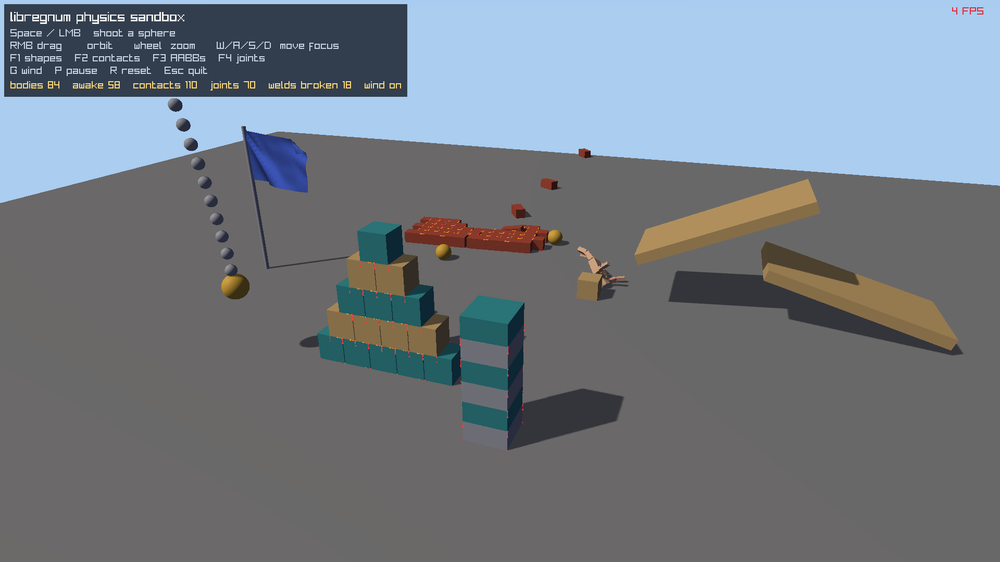

#+title: Physics Sandbox Example
#+description: Walkthrough of examples/physics-sandbox.c, a 3D physics playground built from LrgEntity3D components: rigid bodies, colliders and joints stepped by LrgWorld3D, box stacks, ramps, a component ragdoll, a joint chain, a breakable wall of welded bricks, a cloth flag in the wind and CCD spheres shot from the camera, with physics debug draw toggles
#+authors: Zach Podbielniak
#+categories: libregnum examples physics world3d
#+created: 2026-11-07T08:00:00-05:00
#+updated: 2026-11-07T08:00:00-05:00
#+version: 1.0

* Physics Sandbox Example
:PROPERTIES:
:CUSTOM_ID: physics-sandbox
:END:
#+begin_quote
*[[file:../index.org][Home]]* > Examples > Physics Sandbox
#+end_quote

=examples/physics-sandbox.c= is a playground for the 0.9.0 physics engine as a game sees it: every object is an =LrgEntity3D= with an =LrgMeshRendererComponent= (what you see), an =LrgRigidBodyComponent= (its body) and an =LrgColliderComponent3D= (its shape); joints are =LrgJointComponent=s. The =LrgWorld3D= owns the =LrgDynamicsWorld= (=lrg_world3d_ensure_physics()=) and steps it in its fixed updates, so the loop is the usual =lrg_world3d_step()= plus =LrgWorld3DRenderer=. No physics call in the loop moves an entity: the world writes the bodies' poses back.

The screenshot is the unattended capture (=--screenshot=, 120 frames at 1/60 s): three shots have knocked bricks out of the wall (18 welds broken), the ragdoll has slid down the ramp, the chain swings, the flag waves, and the contact debug draw (red) marks the resting contacts.

** What it shows
:PROPERTIES:
:CUSTOM_ID: physics-sandbox-shows
:END:
| Feature                | How                                                                                                  |
|------------------------+------------------------------------------------------------------------------------------------------|
| Static geometry        | the floor, two tilted ramps and the flag pole: =LrgRigidBodyComponent= of kind =static= + a collider |
| Stacks                 | a 5-row box pyramid and a 6-box tower of dynamic boxes resting on each other (sleeping when still)   |
| Ramps                  | balls and a crate dropped on a 25° ramp slide and roll onto a second one                             |
| Ragdoll                | eleven box limbs joined with =swing-twist= joints (neck, shoulders, hips) and =hinge= joints (elbows, knees), all limited |
| Joint chain            | ten links on =point= joints, the first pinned to the world, a heavy weight at the end                |
| Breakable wall         | a 6 x 5 running-bond wall; every brick is welded to its left and lower neighbour by a =fixed= joint with =break-force= 400 N; =LrgJointComponent::broken= counts the welds that gave way |
| Cloth flag             | an =LrgCloth= grid (24 x 16) pinned along the pole, gusty wind from =lrg_cloth_set_wind()=, drawn with =lrg_cloth_draw()= in the same camera |
| Shooting               | 40 kg CCD spheres at 28 m/s; the velocity is set on the component before its body exists and applied when it is built |
| Debug draw             | =lrg_world3d_debug_draw_physics()= into the renderer's =LrgDebugDraw= (=LRG_WORLD3D_RENDER_FLAG_DEBUG_DRAW=) with =LrgDynamicsDebugFlags= toggles |
| HUD                    | body, awake body, contact and joint counts from the =LrgDynamicsWorld=                               |

** Building and running
:PROPERTIES:
:CUSTOM_ID: physics-sandbox-build
:END:
#+begin_src sh
make -j"$(nproc)" lib
make -C examples
cd examples
./build/release/examples/physics-sandbox
#+end_src

The window opens at 1920 x 1080 (resizable).

*** Controls
:PROPERTIES:
:CUSTOM_ID: physics-sandbox-controls
:END:
| Key                  | Action                                         |
|----------------------+------------------------------------------------|
| Space / left click   | shoot a sphere from the camera at the focus    |
| right mouse + drag   | orbit the camera                               |
| mouse wheel          | zoom                                           |
| W / A / S / D        | move the focus point                           |
| F1                   | toggle shape outlines (=LRG_DYNAMICS_DEBUG_SHAPES=) |
| F2                   | toggle contacts (=LRG_DYNAMICS_DEBUG_CONTACTS=) |
| F3                   | toggle AABBs (=LRG_DYNAMICS_DEBUG_AABBS=)      |
| F4                   | toggle joints (=LRG_DYNAMICS_DEBUG_CONSTRAINTS=) |
| G                    | wind on / off                                  |
| P                    | pause                                          |
| R                    | rebuild the scene                              |
| Esc                  | quit                                           |

*** Command-line options
:PROPERTIES:
:CUSTOM_ID: physics-sandbox-options
:END:
| Option          | Short | Argument | Meaning                                                                  |
|-----------------+-------+----------+--------------------------------------------------------------------------|
| =--screenshot=  | =-s=  | =PATH=   | save a PNG after =--frames= frames and exit; fixed 1/60 s steps, shoots the wall at frames 30, 42 and 54, contacts drawn |
| =--frames=      | =-f=  | =N=      | frames before the capture (default 150)                                  |
| =--license=     |       |          | print the AGPL-3.0-or-later notice                                       |
| =-h=, =--help=  |       |          | GLib's help with usage examples                                          |

#+begin_src sh
# the documentation screenshot (isolated Xvfb)
build-aux/xrun.sh env LD_LIBRARY_PATH=... examples/build/release/examples/physics-sandbox \
    --screenshot docs/examples/images/physics-sandbox.png --frames 120
#+end_src

** Walkthrough
:PROPERTIES:
:CUSTOM_ID: physics-sandbox-walkthrough
:END:
*** One object = one entity with three components
:PROPERTIES:
:CUSTOM_ID: physics-sandbox-spawn
:END:
=spawn()= builds every object the same way. The collider is passed in with transfer full and the entity keeps it; the body is created by the world on the next fixed update, at the entity's pose:

#+begin_src C
static LrgEntity3D *
spawn (Sandbox *sb, const gchar *name, const gfloat *pos,
       LrgDynamicsBodyKind kind, gfloat mass, LrgColliderComponent3D *collider)
{
	g_autoptr(LrgEntity3D)           e = lrg_entity3d_new_with_name (name);
	g_autoptr(LrgRigidBodyComponent) body = lrg_rigid_body_component_new (kind);

	lrg_entity3d_set_position (e, pos);
	lrg_rigid_body_component_set_mass (body, mass);
	lrg_entity3d_add_component (e, LRG_COMPONENT (body));
	lrg_entity3d_add_component (e, LRG_COMPONENT (collider));
	g_object_unref (collider);
	lrg_world3d_add_entity (sb->world, e);
	return e;
}
#+end_src

Static ramps are rotated after =spawn()= (=lrg_entity3d_set_rotation_euler()=): the body is built lazily, so it is created with the rotated pose. Rotating a static body later teleports it on the next fixed update.

*** Joints between entities
:PROPERTIES:
:CUSTOM_ID: physics-sandbox-joints
:END:
The chain, ragdoll and wall all use =LrgJointComponent=. The anchor is in the entity's local space; the target is another entity (or none, for the world). The joint is built when both bodies exist, at rest in their current poses:

#+begin_src C
LrgJointComponent *j = add_joint (link, lrg_joint_component_new (LRG_JOINT_POINT));

lrg_joint_component_set_anchor (j, -0.25f, 0.0f, 0.0f);   /* half a link back */
if (prev != NULL)
	lrg_joint_component_set_target (j, prev);             /* else: the world */
#+end_src

The ragdoll's elbows and knees are hinges about local X with limits (radians); its shoulders, hips and neck are swing-twist joints whose =limit-max= is the swing cone and =abs (limit-min)= the twist range. The wall's welds are =fixed= joints with a break force; their =broken= signal fires once per weld.

*** Shooting with CCD
:PROPERTIES:
:CUSTOM_ID: physics-sandbox-shoot
:END:
A shot is a 40 kg sphere spawned a metre in front of the eye. Its velocity is given to the component right away: there is no body yet, so the component remembers it and applies it when the body is built in the next fixed update. =ccd= sweeps the sphere between steps so it cannot pass through a thin brick at 28 m/s. The oldest shot is removed (=lrg_world3d_remove_entity()=, which removes its body) beyond 40.

*** The loop
:PROPERTIES:
:CUSTOM_ID: physics-sandbox-loop
:END:
#+begin_src C
lrg_world3d_step (sb.world, delta);              /* fixed updates step the physics */
update_flag (&sb, delta);                         /* lrg_cloth_step () */
lrg_world3d_debug_draw_physics (sb.world, dd, sb.debug);

grl_window_begin_drawing (window);
lrg_world3d_renderer_render (renderer, sb.world, sb.camera, NULL, 0, 0);  /* draws dd too */
lrg_camera_begin (LRG_CAMERA (sb.camera));
lrg_cloth_draw (sb.flag, &blue, NULL);
lrg_camera_end (LRG_CAMERA (sb.camera));
lrg_debug_draw_end_frame (dd);
draw_hud (&sb);
grl_window_end_drawing (window);
#+end_src

Entities of dynamic bodies are drawn interpolated between the last two physics states (=LrgWorld3D:physics-interpolation=), so the motion stays smooth when the frame rate and the 60 Hz physics step differ.

** Performance
:PROPERTIES:
:CUSTOM_ID: physics-sandbox-performance
:END:
The scene has about 85 bodies and 70 joints. Physics is CPU only and steps at 60 Hz whatever the frame rate; most bodies fall asleep once the stacks settle, which is visible in the HUD's "awake" count. The screenshot's frame rate is the software rasteriser of the headless X server, not the physics.

** Pitfalls
:PROPERTIES:
:CUSTOM_ID: physics-sandbox-pitfalls
:END:
- Raylib defines colour macros (=GOLD=, =RED=, ...): name your own constants differently.
- The cloth is not an entity: it is stepped and drawn by the example itself. =LrgClothComponent= (a 0.9.0 component) does that for entities.
- Welded walls topple as one piece when the break force is high: 400 N lets single bricks pop out under a 40 kg shot.
- A rigid body without a collider has no body. Add the collider in the same frame.

** See also
:PROPERTIES:
:CUSTOM_ID: physics-sandbox-see-also
:END:
- [[file:../modules/world3d/components.org::#physics-components][Physics components]]
- [[file:../guides/physics.org][Physics guide]]
- [[file:../modules/world3d/world3d.org::#physics][LrgWorld3D physics]]
- [[file:../modules/physics/dynamics.org][LrgDynamicsWorld]], [[file:../modules/physics/cloth.org][LrgCloth]]
- [[file:level-3d-runtime.org][Level 3D runtime example]]
