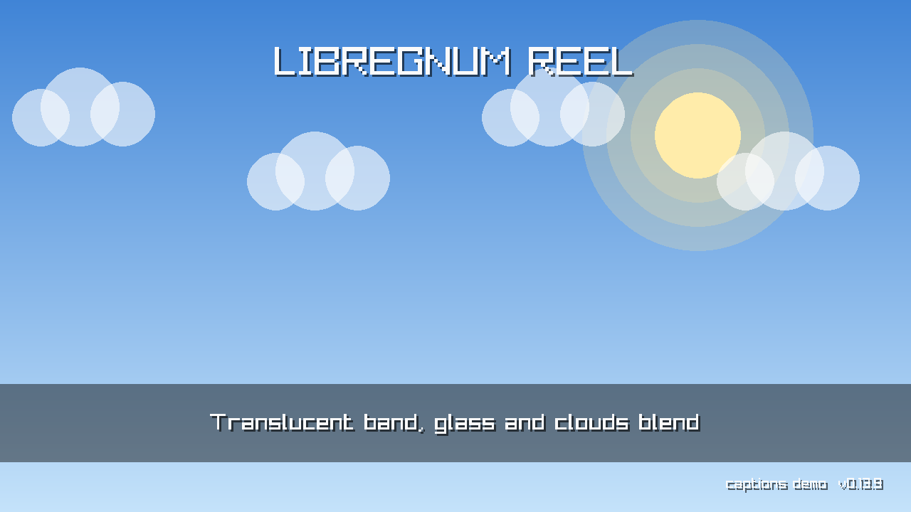
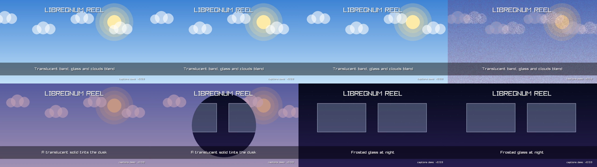

#+title: Reel Captions Demo
#+description: Walkthrough of examples/reel-captions-demo.c: a 1280x720 title sequence with translucent caption bands, glass and haze, anchored titles, a dissolve and an iris, rendered on every core and exported to H.264 with whatever encoder the machine's ffmpeg can run
#+authors: Zach Podbielniak
#+categories: libregnum examples reel video
#+created: 2026-11-27T15:00:00-05:00
#+updated: 2026-11-27T15:00:00-05:00
#+version: 1.0

* Reel Captions Demo
:PROPERTIES:
:CUSTOM_ID: reel-captions-demo
:END:
#+begin_quote
*[[file:../index.org][Home]]* > Examples > Reel Captions Demo
#+end_quote

=examples/reel-captions-demo.c= renders a seven-second title sequence with the [[file:../modules/reel/index.org][reel module]]: a day scene, a dusk scene and a night scene joined by a dissolve and an iris, with a 45%-black lower third, captions and a credit on top. It writes three stills and an H.264 MP4. Every part of it leans on one of the reel fixes in 0.13.5 to 0.13.9, so it doubles as a visual regression check for them.

The sheet shows every 21st frame: the clouds drifting, the dissolve's speckle, the dusk tint, the iris opening onto the night scene.

** What it shows
:PROPERTIES:
:CUSTOM_ID: reel-captions-demo-shows
:END:
| Part | API | In the demo | Since |
|------+-----+-------------+-------|
| Translucent shapes blend | =lrg_reel_shape_clip_new_rect=, fill ={0,0,0,115}= | The lower-third band is grey over the sky and dark over the night, never a hole | 0.13.8 |
| Callback primitives blend | =grl_image_draw_circle=, =grl_image_draw_rectangle= in a =lrg_reel_clip_new_with_func= callback | Sun haze rings, cloud puffs, frosted glass panels | 0.13.8 |
| Translucent solid tints | =lrg_reel_solid_clip_new= with alpha 110, in an =LrgReelSequence= over the day scene | The dusk scene | 0.13.8 |
| Text anchored on =text-x= | =lrg_reel_text_clip_set_align= CENTER / RIGHT, no =max-width= | Title and captions centred on x = 640; credit ending 40 px from the right edge | 0.13.6 |
| Parallel transitions | =LrgReelTransitionSeries= with a dissolve and an iris, =lrg_reel_renderer_render_parallel (r, 0, ...)= | Clean overlaps on every core | 0.13.5 |
| Encoder fallback | =LRG_REEL_VIDEO_CODEC_H264=, =lrg_reel_video_exporter_get_encoder= | Prints the encoder that was used (libx264, a real libopenh264 or a GPU encoder) | 0.13.7 |
| Raw-frame export | the video exporter's raw RGBA pipe | 168 720p frames rendered and encoded in about 2 s on 16 threads | 0.13.9 |

** Running it
:PROPERTIES:
:CUSTOM_ID: reel-captions-demo-running
:END:
#+begin_src sh
make examples
./examples/build/release/examples/reel-captions-demo                      # 720p MP4 + 3 stills in .
./examples/build/release/examples/reel-captions-demo --out /tmp/demo      # into /tmp/demo
./examples/build/release/examples/reel-captions-demo -s 0.25 --no-video   # 320x180 stills only
#+end_src

| Option | Meaning |
|--------+---------|
| =-o=, =--out DIR= | Directory for the output (created if missing; default =.=) |
| =-s=, =--scale F= | Render at this fraction of 1280x720 (0.05 to 4) |
| =--no-video= | Write the stills only |
| =--license= | Print the license (AGPL-3.0-or-later) |
| =-h=, =--help= | Usage with examples |

Output: =reel-captions-demo.mp4= and =reel-captions-demo-day.png=, =-dissolve.png=, =-night.png=. Without ffmpeg on the =PATH= the program writes the stills and says it skipped the video. With an ffmpeg that has no working H.264 encoder it fails and names every encoder it tried.

The program needs no display and no data files; =tests/test-examples-smoke.sh= (=make test-examples=) runs it at =--scale 0.25 --no-video= and checks the stills.

** How it is built
:PROPERTIES:
:CUSTOM_ID: reel-captions-demo-structure
:END:
- =draw_day= and =draw_night= are render callbacks. They draw with the plain graylib primitives, which blend because every clip renders onto a canvas in =GRL_IMAGE_BLEND_OVER= ([[file:../modules/reel/clips.org::#translucent-pixels][Translucent pixels inside a clip]]).
- The dusk scene is a sequence holding the day callback and a translucent =LrgReelSolidClip=.
- The three scenes go into one =LrgReelTransitionSeries= (72 frames each, 24-frame dissolve and iris, 168 frames in all). It takes its overlap buffers from each worker's context, so =render_parallel= on every core gives the same frames as a sequential render ([[file:../modules/reel/rendering.org::#parallel-rendering][Parallel rendering]]).
- The band and the text clips sit on top of the series at the reel's top level. Captions are swapped by giving each text clip its own =from-frame= and duration.
- Everything is laid out on a 1280x720 grid and multiplied by =--scale=, so the quick smoke run is the same picture at a quarter of the size.

** See also
:PROPERTIES:
:CUSTOM_ID: reel-captions-demo-see-also
:END:
- [[file:../modules/reel/clips.org][Reel clips]], [[file:../modules/reel/transitions.org][transitions]], [[file:../modules/reel/exporters.org][exporters]]
- =examples/reel-hello.c= and =examples/reel-showcase.c= for smaller reel programs
