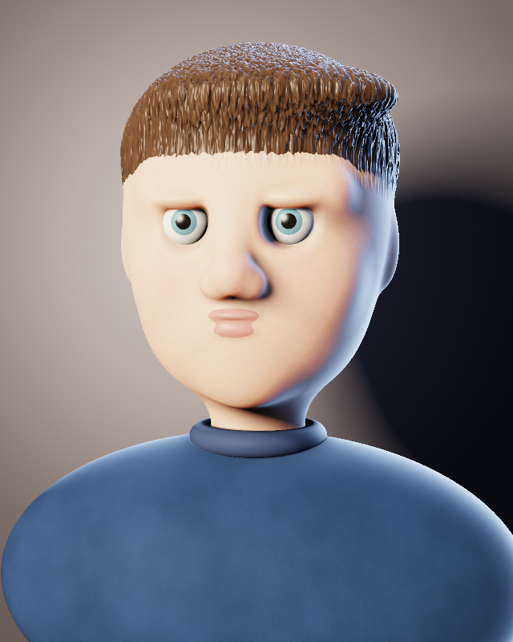

#+title: SDF Portrait
#+description: Walkthrough of examples/sdf-portrait.c: a character bust built from signed distance primitives with smooth unions and subtractions, raymarched into an LrgHdrCanvas with soft shadow, ambient occlusion, rim light, wrapped diffuse and band-limited fBm textures, ACES tone-mapped
#+authors: Zach Podbielniak
#+categories: libregnum examples shading graphics
#+created: 2026-11-27T12:00:00-05:00
#+updated: 2026-11-27T12:00:00-05:00
#+version: 1.0

* SDF Portrait
:PROPERTIES:
:CUSTOM_ID: sdf-portrait
:END:
#+begin_quote
*[[file:../index.org][Home]]* > Examples > SDF Portrait
#+end_quote

=examples/sdf-portrait.c= renders a 640 x 800 character bust as a CPU fragment shader. It is the render issue #7 was written about - a generated portrait with soft light, smooth edges and textured skin, hair and cloth - done with the 0.14 shading APIs instead of hand-written maths. It runs headless in about 17 s at 2 x 2 samples on one core.

** How it is made
:PROPERTIES:
:CUSTOM_ID: sdf-portrait-how
:END:
| Part | Library calls |
|------+---------------|
| Head, skull, jaw, chin, cheekbones, brow ridge | =lrg_sdf3_ellipsoid=, =lrg_sdf3_sphere=, =lrg_sdf3_capsule= joined with =lrg_sdf_smooth_union= (blend radii 0.07 .. 0.12) |
| Eye sockets and lids | =lrg_sdf_smooth_subtract= of spheres, flattened ellipsoids added back with a small blend |
| Nose, lips, mouth line | a capsule bridge, sphere tip and wings; two ellipsoid lips; a thin capsule subtracted between them |
| Hair | an ellipsoid cap and fringe, displaced by stretched =lrg_noise_fbm3= (strands run vertically) with the pixel footprint |
| Shirt, collar | an ellipsoid torso, =lrg_sdf3_torus= collar |
| Marching | =lrg_sdf3_raymarch= (260 steps), =lrg_sdf3_normal= |
| Light | key: wrapped diffuse per channel (red wraps furthest, a cheap subsurface look) times =lrg_sdf3_soft_shadow= (k = 4); fill: sky colour times =lrg_sdf3_ambient_occlusion=; rim: Fresnel-weighted cool light from behind; Blinn highlight scaled by gloss |
| Textures | skin mottling and cheek/nose warmth, iris fibres, hair strands, cloth weave and folds: all =lrg_noise_fbm2= / =fbm3= with footprint = distance x pixel angle x frequency, so detail fades instead of aliasing |
| Output | =lrg_hdr_canvas_shade= with N x N stratified samples, =lrg_hdr_canvas_to_image (ACES, 0 EV, dither)= |

The field is multiplied by 0.75 before it goes to the marcher, the normal, the shadow and the occlusion: ellipsoids, blends and the hair displacement give distance estimates, and the factor keeps the marcher from overshooting (see [[file:../guides/image-cookbook.org::#pitfall-estimates][distance estimates]]).

** Line count
:PROPERTIES:
:CUSTOM_ID: sdf-portrait-lines
:END:
The issue's reference render needed about 700 lines of hand-written maths outside libregnum (distance functions, smooth minimum, normals, marcher, soft shadow, ambient occlusion, noise, supersampling, tone map, dither); only the final copy and PNG export used the library. =sdf-portrait.c= is 559 lines in total, of which:

| Part | Lines |
|------+-------|
| Command line, camera set-up, saving (=main=) | about 90 |
| Vector helpers and the look-at camera | about 60 |
| The model (which primitives, where, which material) | about 165 |
| Materials and lighting (=albedo_at=, =shade=) | about 195 |
| Comments and blank lines (of the above) | 121 |

None of it is a distance function, a marcher, a shadow or occlusion estimator, a noise function, a supersampler or a tone curve: those are library calls. What remains is the content (the shapes and colours of this particular character) and its lighting model; a shared lighting helper is the next candidate for the library ([[file:../guides/image-cookbook.org::#by-hand][what you still write by hand]]).

** Building and running
:PROPERTIES:
:CUSTOM_ID: sdf-portrait-run
:END:
#+begin_src sh
make -j8 && make -C examples build/release/examples/sdf-portrait
examples/build/release/examples/sdf-portrait                                   # ./sdf-portrait.png, 640x800, 2x2
examples/build/release/examples/sdf-portrait --samples 1 --size 320x400         # a quick look (about 1 s)
examples/build/release/examples/sdf-portrait --samples 3 --size 960x1200 --out shots
#+end_src

| Option | Meaning |
|--------+---------|
| =-o=, =--out DIR= | folder for the PNG |
| =-s=, =--size WxH= | image size (default 640x800) |
| =-n=, =--samples N= | samples per pixel per axis, 1 .. 8 (default 2); time grows with N^2 |
| =--license= | AGPL-3.0-or-later |

** See also
:PROPERTIES:
:CUSTOM_ID: sdf-portrait-see-also
:END:
- [[file:../guides/image-cookbook.org][Image cookbook]] - =sdf-character-bust= is the compact version of this scene
- [[file:../modules/shading/sdf.org][Signed distance functions]], [[file:../modules/shading/noise.org][band-limited noise]], [[file:../modules/graphics/hdr-canvas.org][LrgHdrCanvas]]
