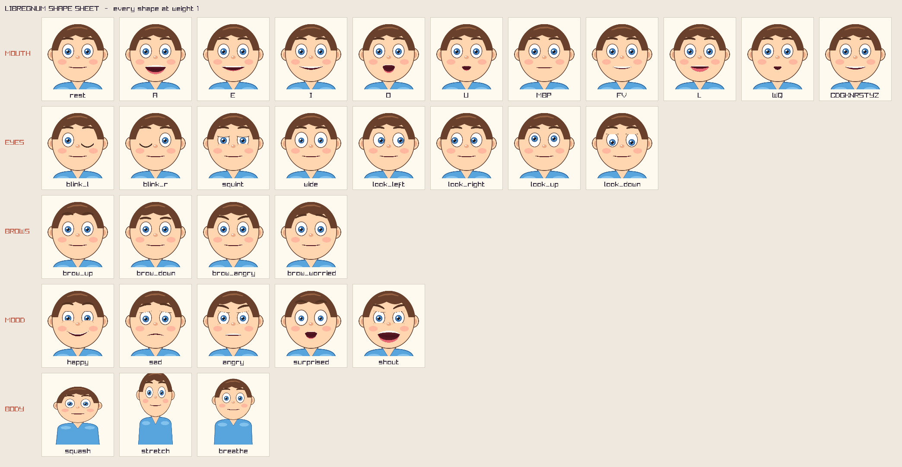

#+title: Skeleton2D Shape Sheet Example
#+description: Walkthrough of examples/skeleton2d-shape-sheet.c: a labelled contact sheet of every shape of the standard 2D shape sheet on the demo character, drawn headless
#+authors: Zach Podbielniak
#+categories: libregnum examples animation skeleton2d
#+created: 2026-11-27T16:00:00-05:00
#+updated: 2026-11-27T16:00:00-05:00
#+version: 1.0

* Skeleton2D Shape Sheet Example
:PROPERTIES:
:CUSTOM_ID: skeleton2d-shape-sheet
:END:
#+begin_quote
*[[file:../index.org][Home]]* > Examples > Skeleton2D Shape Sheet
#+end_quote

=examples/skeleton2d-shape-sheet.c= draws the demo character of the [[file:skeleton2d-talking-head.org][talking head example]] once for every shape of the [[file:../modules/animation/shape-sheet.org][standard shape sheet]], at weight 1, labels each picture with the shape's name and groups them by category: one row each for the mouth (visemes), eyes, brows, moods and body. It is the reference for what each name means and a check that a character implements the whole sheet.

** Running it
:PROPERTIES:
:CUSTOM_ID: skeleton2d-shape-sheet-running
:END:
#+begin_src sh
make -j8 && make -C examples
examples/build/release/examples/skeleton2d-shape-sheet --out /tmp/sheet
# wrote /tmp/sheet/shape-sheet.png (2088 x 1082, 31 shapes)
#+end_src

| Option | Meaning |
|--------+---------|
| =--out DIR= | directory for =shape-sheet.png= (default the current directory) |
| =--cell PX= | size of one picture, 64 to 512 (default 168) |
| =--license= | print the license (AGPL-3.0-or-later) |

It needs no window and no files and runs in well under a second.

** How it works
:PROPERTIES:
:CUSTOM_ID: skeleton2d-shape-sheet-how
:END:
- The rows come from the sheet itself: =lrg_shape_sheet_list (category)= for each =LrgShapeCategory=, so a name added to the sheet shows up without changing the example.
- For each cell the character is reset (=lrg_skeleton2d_reset_pose()=), one shape is set to 1 on every slot that implements it (=lrg_demo_character_set_shape()=, a loop over the slots calling =lrg_skeleton2d_set_shape_weight()=), and drawn with =lrg_skeleton2d_draw_to_canvas()=.
- One =LrgImageCanvas= holds the whole sheet. Each cell sets a clip rectangle and a canvas transform that frames the head (face shapes) or the whole figure (body shapes). The canvas applies each new transform after the earlier ones, so the calls go in the order they act on a point: centre the frame on the origin, scale, move to the cell's centre.
- Labels use graylib's built-in 8 x 8 bitmap font (=grl_image_draw_text_bitmap()=, scaled 2x), which needs no font file.

** See also
:PROPERTIES:
:CUSTOM_ID: skeleton2d-shape-sheet-see-also
:END:
- [[file:skeleton2d-talking-head.org][Skeleton2D Talking Head example]] (how the character and its shapes are built)
- [[file:../modules/animation/shape-sheet.org][The standard shape sheet]]
- [[file:../modules/graphics/skinned-sprite.org::#blend-shapes][LrgSkinnedSprite: blend shapes]]
