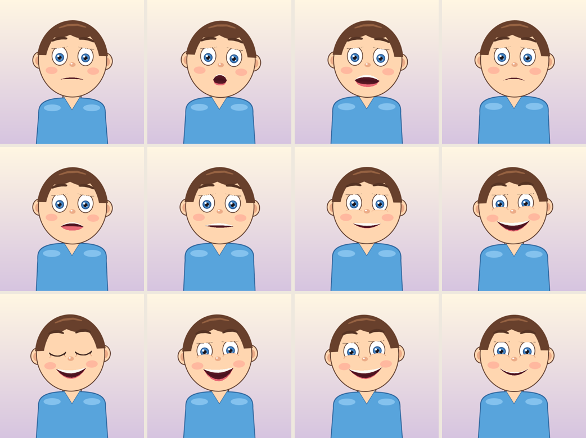

#+title: Skeleton2D Talking Head Example
#+description: Walkthrough of examples/skeleton2d-talking-head.c: a 2D character built in code lip-syncs a phoneme alignment, blinks, breathes and changes mood, rendered headless to PNG frames and an MP4
#+authors: Zach Podbielniak
#+categories: libregnum examples animation skeleton2d reel
#+created: 2026-11-27T16:00:00-05:00
#+updated: 2026-11-27T16:00:00-05:00
#+version: 1.0

* Skeleton2D Talking Head Example
:PROPERTIES:
:CUSTOM_ID: skeleton2d-talking-head
:END:
#+begin_quote
*[[file:../index.org][Home]]* > Examples > Skeleton2D Talking Head
#+end_quote

=examples/skeleton2d-talking-head.c= makes a cartoon character say "Hello, I am a libregnum character" with no window, no artist and no image files. The character is an =LrgSkeleton2D= built in code with every shape of the [[file:../modules/animation/shape-sheet.org][standard shape sheet]]; [[file:../modules/animation/lip-sync.org][LrgLipSync]] turns a phoneme alignment into viseme keys; a mood fades from worried to happy halfway; [[file:../modules/animation/procedural.org][LrgSkeleton2DProcedural]] blinks and breathes on top; and [[file:../modules/reel/clips.org::#skeleton2d-clip][LrgReelSkeleton2DClip]] draws every frame on the CPU into a PNG sequence and an MP4.

Twelve frames of the line, left to right and top to bottom: silence (worried), "hello" (O), "I" (A), "am" (M, lips pressed), the "l" (tongue up) and "i" of libregnum, the mood change, then "character" (E, a blink, R, ER) and the happy close.

** Running it
:PROPERTIES:
:CUSTOM_ID: skeleton2d-talking-head-running
:END:
#+begin_src sh
make -j8 && make -C examples
examples/build/release/examples/skeleton2d-talking-head --out /tmp/talk
# wrote 114 frames (512 x 512, 30 fps, 3.80 s) to /tmp/talk/frames
# wrote /tmp/talk/talking-head.mp4
#+end_src

Run it from the repository root so the default line, =examples/data/hello.yaml=, is found (or pass =--line=).

| Option | Meaning |
|--------+---------|
| =--out DIR= | output directory (default =./talking-head=): =DIR/frames/frame_NNNNN.png= and =DIR/talking-head.mp4= |
| =--line FILE= | a phoneme alignment in YAML or CSV (default =examples/data/hello.yaml=) |
| =--wave FILE= | lip-sync from the loudness of a recording instead (=lrg_lip_sync_new_from_wave()=), and put the recording in the MP4 |
| =--scale S= | frame size as a fraction of 512 px; =--scale 0.25= is a quick 128 x 128 smoke run |
| =--fps N=, =--threads N= | frame rate (30) and render threads (8) |
| =--no-video= | write the PNG frames only |
| =--license= | print the license (AGPL-3.0-or-later) |

Without =ffmpeg= on the =PATH= the MP4 is skipped with a message; the frames are complete either way.

** What it shows
:PROPERTIES:
:CUSTOM_ID: skeleton2d-talking-head-shows
:END:
| Part | API | In the example |
|------+-----+----------------|
| A character in code | =lrg_skeleton2d_add_bone()=, =lrg_skeleton2d_add_slot()=, =lrg_skinned_sprite_add_vertex()=, =lrg_skinned_sprite_set_source_image()= | =examples/skeleton2d/lrg-demo-character.c=: three bones, five mesh slots (body, head, eyes, brows, mouth), textures painted into =GrlImage=​s |
| Blend shapes | =lrg_skinned_sprite_add_shape()= | all 31 names of the sheet, computed from small pose tables (see below) |
| Lip sync | =lrg_lip_sync_load_file()=, =lrg_lip_sync_write_clip()= | the ARPAbet alignment in =examples/data/hello.yaml= keyed onto the =mouth= slot with 60 ms cross-fades |
| Audio fallback | =lrg_lip_sync_new_from_wave()= | =--wave= |
| Mood keys | =lrg_skeleton2d_clip_add_shape_key()= | =sad= at 0.8 fades out and =happy= fades in across the middle, keyed on eyes, brows and mouth |
| Procedural layers | =lrg_skeleton2d_procedural_add_blink()=, =lrg_skeleton2d_procedural_add_breathe()= | a seeded blink every 1.4 to 2.6 s, a 3.2 s breath on the body |
| Pose callback | =lrg_reel_skeleton2d_clip_set_pose_func()= | a head sway from two sines, then the procedural layers |
| CPU drawing | =lrg_skeleton2d_draw_to_canvas()= (inside the reel clip) | the same deformation as the GPU path, blend shapes included |
| Rendering | =lrg_reel_renderer_render_parallel()=, =LrgReelSeqExporter=, =LrgReelVideoExporter= | 8 threads, PNG frames, then an H.264 MP4 |

** The character
:PROPERTIES:
:CUSTOM_ID: skeleton2d-talking-head-character
:END:
=lrg_demo_character_new()= (=examples/skeleton2d/lrg-demo-character.{h,c}=, shared with [[file:skeleton2d-shape-sheet.org][the shape sheet example]] and =tests/test-skeleton2d-character.c=) builds a head-and-shoulders figure about 450 units tall with its origin between the feet:

| Slot | Bone | Mesh | Shapes |
|------+------+------+--------|
| =body= | =body= | 4 x 4 grid over the shirt and neck | =squash=, =stretch=, =breathe= |
| =head= | =head= | 4 x 4 grid over face, ears, hair, cheeks and nose | =squash=, =stretch= |
| =eyes= | =head= | per eye: a white, an iris, a lower lid and an upper lid, all from one 228 x 72 atlas | blinks, gaze, =squint=, =wide=, the moods, =squash=, =stretch= |
| =brows= | =head= | two 3-cell strips, the right one sampling the texture mirrored | brow poses, the moods, =squash=, =stretch= |
| =mouth= | =head= | 9 columns by 4 rows (top edge, teeth bottom, tongue top, bottom edge) | the 11 visemes, the moods, =squash=, =stretch= |

The design choices that make the shapes blend well:
- *Eyelids are separate quads*, not a squashed eye. The upper lid's texture is skin above a shallow curve with a lash line along it; at rest the lid has no height, and a shape pulls its lower edge down, so 0.5 is a half-closed heavy lid and 1 a closed eye with a curved lash line. Lower lids rise for =happy= and =squint=. Lower lids draw before upper ones, so a blink covers a smile's raised lower lid.
- *The mouth is four rows over three texture bands* (teeth, dark interior, tongue). A viseme sets how far the rows open at the centre, the profile (flat lens or round), the width and how much teeth and tongue show, and the shape's offsets are its row positions minus the rest pose. "Closed" is a thin dark line (teeth and tongue bands collapsed); =A= shows all three bands, =FV= mostly teeth, =L= mostly tongue, =O=, =U= and =WQ= are narrow and round.
- *Shapes add*, so moods are written as differences from the neutral face too: =happy= curls the mouth corners up and raises the lower lids, and stays a smile under any viseme.
- *Squash and stretch are on every slot*, as a scale about the feet, so the whole figure squashes together.

** Pitfalls
:PROPERTIES:
:CUSTOM_ID: skeleton2d-talking-head-pitfalls
:END:
- Shape weights belong to slots: a mood must be keyed on every slot that implements it (=lrg_demo_character_key_shape()= does that).
- Additive shapes can overshoot: a blink during a mood that already lowers the lids pushes the lash line slightly below the eye. Keep moods' lid travel small, as here.
- The pose callback must be a pure function of the time: the renderer calls it out of order and from several threads (under the reel clip's lock).

** See also
:PROPERTIES:
:CUSTOM_ID: skeleton2d-talking-head-see-also
:END:
- [[file:skeleton2d-shape-sheet.org][Skeleton2D Shape Sheet example]]
- [[file:../modules/animation/lip-sync.org::#end-to-end][LrgLipSync: end-to-end]]
- [[file:../modules/animation/skeleton2d.org::#cpu-drawing][LrgSkeleton2D: drawing on the CPU]]
