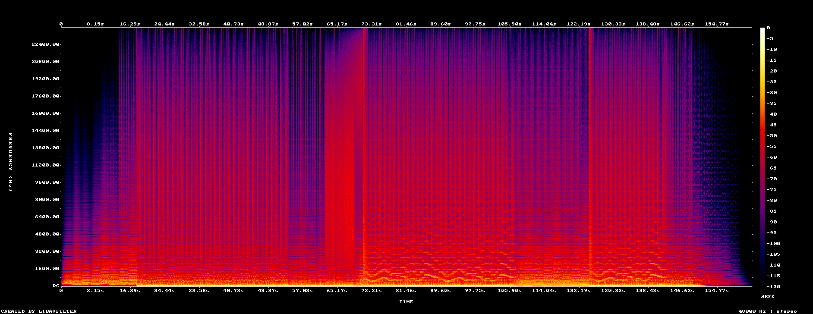

#+title: Synthwave Song Example
#+description: Walkthrough of examples/synthwave-song.c, "Neon Drive": a 2:40 synthwave song built entirely in code with the music module (synthesizers, an 808, a Foley impact, patterns, step lanes, automation, a sidechained mix), rendered at streaming loudness and exported to every audio format the machine can write
#+authors: Zach Podbielniak
#+categories: libregnum examples music audio
#+created: 2026-11-08T19:30:00-05:00
#+updated: 2026-11-08T19:30:00-05:00
#+version: 1.0

* Synthwave Song Example
:PROPERTIES:
:CUSTOM_ID: synthwave-song
:END:
#+begin_quote
*[[file:../index.org][Home]]* > Examples > Synthwave Song
#+end_quote

=examples/synthwave-song.c= makes "Neon Drive", a complete synthwave track of 2 minutes 40 seconds, from nothing but code: no samples, no data files. It builds an =LrgSong= with the [[file:../modules/music/index.org][music module]], saves it as =.rsong= (open it in =lrgeditor=) and =.mid=, renders it normalised to -14 LUFS with a -1 dBTP ceiling, prints the measurements, and writes it in every format asked for that this machine can encode. The same song is committed as =examples/data/music/neon-drive.rsong=.

The spectrogram above shows the arrangement: the pad alone with its filter opening, the arpeggio coming in, the verse, the build with its noise riser, the chorus (the lead melody draws the bright lines around 1 to 3 kHz), the quieter bridge, the second chorus and the fading outro.

** What it shows
:PROPERTIES:
:CUSTOM_ID: synthwave-song-shows
:END:
| Part | API | In the song |
|------+-----+-------------|
| Synthesizer presets | =lrg_song_set_instrument (song, id, "synth", preset)= | =synthwave-pad=, =arp-pluck=, =synthwave-bass=, =synthwave-lead=, =brass-stab=, =noise-riser= |
| Drum machine | =lrg_song_set_instrument (song, "kit", "drums", "808")= | One kit on three tracks (kick, drums, cymbals), so the kick has a bus of its own |
| A Foley patch as an instrument | =LrgFoleyPatch= saved as =sfx/impact.rfoley=, then an instrument of type =foley= | A sub boom with a closing noise burst on each chorus downbeat |
| Note patterns | =lrg_song_pattern_add_note()= | Am - F - C - G chords, the octave bass, the arpeggio, the brass stabs, a two-phrase lead melody |
| Step lanes | =lrg_song_pattern_set_lane (song, id, "kick", "X...x...x...x...")= | Four-on-the-floor, offbeat hats, rolls, fills |
| Arrangement | =lrg_song_add_clip()=, =lrg_song_add_marker()= | Intro (8 bars), Verse (16), Build (8), Chorus (16), Bridge (8), Chorus 2 (8), Outro (8) |
| Automation | =lrg_song_set_automation()= | The pad's and arpeggio's filter sweeps (=param.cutoff=), the riser's swell (=volume=), the master fade (=bus.master.volume=) |
| Mixing | =lrg_song_get_mixer()= (the =.rmixer= schema) | Buses for kick, drums, bass, synths, pad, lead and a reverb return; sends; a dotted-eighth echo on the lead; chorus on the pad; a widener with mono bass |
| Sidechain | =lrg_mixer_asset_set_duck (m, "kick", "pad", ...)= | The kick pumps the pad and the bass, the signature synthwave breathing |
| Mastering | EQ, glue compressor and limiter on =master=; =LRG_SONG_NORMALIZE_LOUDNESS= | -14 LUFS integrated, -1 dBTP true peak |
| Export | =lrg_audio_encode_wave()= | WAV and AIFF natively; FLAC, MP3, Ogg, Opus, AAC, ALAC and WavPack through FFmpeg |
| MIDI | =lrg_song_save_midi()= | The notes for any other music program |

** Building and running
:PROPERTIES:
:CUSTOM_ID: synthwave-song-running
:END:
#+begin_src sh
make examples
./build/release/examples/synthwave-song                  # neon-drive/: wav flac mp3 ogg opus m4a
./build/release/examples/synthwave-song -f all --stems   # every format, plus a WAV per track
./build/release/examples/synthwave-song -n -o examples/data/music   # only .rsong, .rfoley, .mid
lrgeditor neon-drive                                     # then open neon-drive.rsong
#+end_src

| Option | Meaning |
|--------+---------|
| =-o=, =--out DIR= | Where to write (default =neon-drive=) |
| =-f=, =--formats LIST= | Comma-separated: =wav=, =aiff=, =flac=, =mp3=, =ogg=, =opus=, =aac=, =alac=, =wavpack=, or =all= |
| =-s=, =--stems= | Every track rendered alone at the mix's gain, as 24-bit WAVs in =stems/= |
| =-n=, =--no-render= | Write the song files only |
| =--license= | Print the license |

No audio device is needed. A render takes about 25 seconds on one core. Formats with no encoder here are listed as =none= with a hint to install =ffmpeg-free=.

** Program structure
:PROPERTIES:
:CUSTOM_ID: synthwave-song-structure
:END:
- =write_patterns()= writes every pattern. The chords come from one table of voicings, so the pad, arpeggio and stabs always agree. The melody is written as text (="0 E5 1.5 0.95; 1.5 D5 0.5; ..."=).
- =write_mixer()= builds the mixer layout: buses, levels, effects with their parameters, sends and the two ducking rules.
- =write_arrangement()= defines the instruments and tracks, places the clips section by section, writes the automation and the markers.
- =impact_patch()= makes the Foley impact from a body, a noise and a wash layer.
- =main()= saves the files (the song names =sfx/impact.rfoley= relative to its own folder, so that is written first), validates the song, renders with progress, analyses and exports.

** Pitfalls
:PROPERTIES:
:CUSTOM_ID: synthwave-song-pitfalls
:END:
- The kick needs a bus of its own for the ducking to follow only the kick. A drum machine plays all its pieces on one track, so the song uses the same kit on three tracks.
- A closed hat chokes an open hat. The chorus groove puts the closed hats on the beats and the open hats on the offbeats, so each open hat rings until the next beat.
- Loudness normalisation stops at the true-peak ceiling. This mix lands at -14.2 LUFS because the limiter's peaks reach -1 dBTP first; push the glue compressor's threshold down for a louder master.
- Instruments are rebuilt for every render, so a long sampler file or SoundFont is loaded once per render, not once per note.

** Things to try
:PROPERTIES:
:CUSTOM_ID: synthwave-song-try
:END:
- Change the kit to ="909"= or ="linn"=, or the lead to =acid-bass= an octave down.
- Add =lrg_song_add_tempo_change (song, 256, 96, TRUE)= for a slowing outro.
- Play it in a game with =LrgSongPlayer=, and use =lrg_song_player_queue_section (player, "Chorus", LRG_SONG_QUANTIZE_BAR)= when the action starts ([[file:../modules/music/player.org][Playback]]).
- Open the =.rsong= in =lrgeditor=: the arrangement, piano roll and step grid show what the code wrote ([[file:../editor/music.org][Music in the editor]]).

** See also
- [[file:../modules/music/song.org][Songs]], [[file:../modules/music/instruments.org][Instruments]], [[file:../modules/audio/encoder.org][Audio files]], [[file:../modules/audio/analysis.org][Loudness]]
