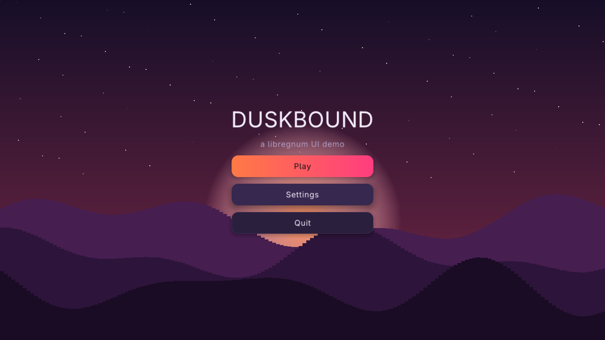
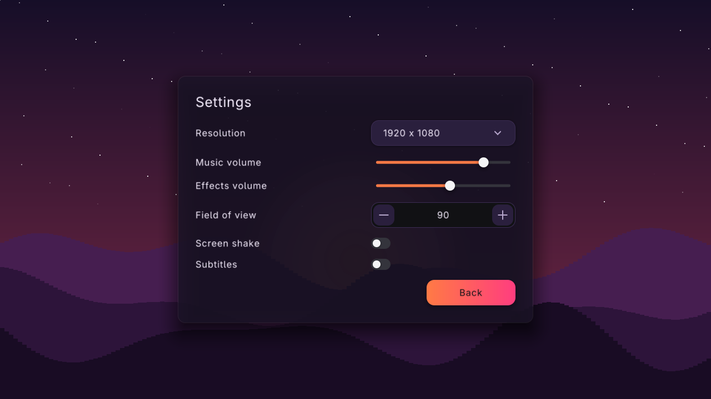
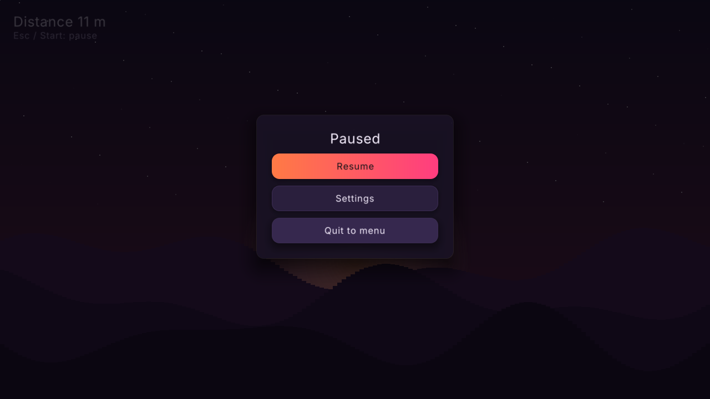

#+title: Game UI Menu Example
#+description: Walkthrough of examples/game-ui-menu.c, game menus over a live scene: a YAML theme, a 1280x720 virtual resolution letterboxed into the window, an animated title menu, a settings card, a HUD with achievement toasts and a modal pause menu driven by mouse, keyboard or gamepad
#+authors: Zach Podbielniak
#+categories: libregnum ui examples games
#+created: 2026-11-05T00:00:00-05:00
#+updated: 2026-11-05T00:00:00-05:00
#+version: 1.0

* Game UI Menu Example
:PROPERTIES:
:CUSTOM_ID: game-menu
:END:
#+begin_quote
*[[file:../index.org][Home]]* > Examples > Game UI Menu
#+end_quote

=examples/game-ui-menu.c= ("Duskbound") puts the UI framework where a game needs it: on top of a live, animated scene. It has an animated title menu, a settings card, an in-game HUD that raises achievement toasts, and a modal pause menu. Everything works with a gamepad (D-pad or stick to move, A to activate, B or Start to go back) as well as with mouse and keyboard. The UI renders at a fixed 1280x720 virtual resolution into a render texture that is letterboxed into the window, and a canvas pointer transform maps window pixels back to UI units so clicks land where they appear. The whole look comes from a YAML theme file, =examples/data/themes/game-menu.yaml=.

Read [[file:ui-basics.org][UI Basics]] for the minimal program and [[file:ui-showcase.org][UI Showcase]] for an application-style tour of every widget.

** What it shows
:PROPERTIES:
:CUSTOM_ID: game-menu-what
:END:
- *A live scene behind the UI*: a parallax dusk landscape (sky gradient, sun, twinkling stars, three scrolling hill layers) drawn with raylib every frame. The canvas does not paint a background, so the scene shows through.
- *A themed look from YAML*: =lrg_theme_new_from_file()= loads an "arcade dusk" theme built on the =midnight= preset with a sunset accent, gradient primary buttons with a glow on hover and focus, and floating menu cards.
- *Choreographed entrances*: the title drops in, the subtitle fades in, the three buttons fly up one after another; the settings card pops; the HUD score slides in from the left; the pause card drops.
- *Screens as visibility*: main menu, settings and HUD live in one =LrgOverlay=; switching screens toggles visibility and moves focus.
- *Back and pause through the canvas*: the canvas =cancel= signal (Escape / pad B with nothing else to close) opens the pause menu in-game and goes back from settings. Start on a gamepad also pauses.
- *A modal pause menu*: an =LrgPanel= shown with =lrg_canvas_show_popup()= as a modal, centred popup (veil, blocked input, trapped focus). =popup-dismissed= keeps the game's paused flag in sync when Escape closes it.
- *Virtual resolution*: UI and scene render into a 1280x720 target, scaled with letterbox bars into any window size, with =lrg_canvas_set_default_pointer_transform()= keeping hit-testing correct.

** Building and running
:PROPERTIES:
:CUSTOM_ID: game-menu-build
:END:
From the repository root:

#+begin_src sh
make -j"$(nproc)" lib
make -C examples
cd examples
./build/release/examples/game-ui-menu
#+end_src

The binary lands in =examples/build/release/examples/= (=build/debug/examples/= for a debug build) and links libregnum statically. The default theme path, =data/themes/game-menu.yaml=, is *relative to the working directory*, so run it from =examples/= or pass =--theme-file=. If the file cannot be read the program prints the error, says =using the midnight preset= and carries on with the plain =midnight= preset:

#+begin_src sh
# from the repository root instead of examples/
./examples/build/release/examples/game-ui-menu --theme-file examples/data/themes/game-menu.yaml
#+end_src

*** Command-line options
:PROPERTIES:
:CUSTOM_ID: game-menu-options
:END:
From the =GOptionEntry= table in =main()=:

| Option          | Short | Argument | Meaning                                                                            |
|-----------------+-------+----------+------------------------------------------------------------------------------------|
| =--theme-file=  | =-t=  | =PATH=   | Theme YAML to load (default =data/themes/game-menu.yaml=, relative to the cwd)      |
| =--screen=      |       | =NAME=   | Start on a screen: =main=, =settings=, =playing= or =pause=                        |
| =--screenshot=  | =-s=  | =PATH=   | Save a PNG of the 1280x720 target after =--frames= frames and exit                 |
| =--frames=      | =-f=  | =N=      | Frames to run before =--screenshot= (default 120)                                  |
| =--license=     |       |          | Print the AGPLv3 notice and exit                                                   |
| =-h=, =--help=  |       |          | GLib's generated help, with the gamepad summary and examples                       |

#+begin_src sh
game-ui-menu
game-ui-menu --screen settings
game-ui-menu --theme-file my-theme.yaml
game-ui-menu --screen pause --screenshot pause.png
game-ui-menu --screen playing --frames 600 --screenshot hud.png
#+end_src

=--screen pause= starts a run (as if Play was pressed) and opens the pause menu on frame 30.

*** Controls
:PROPERTIES:
:CUSTOM_ID: game-menu-controls
:END:
| Input                          | Action                                                                   |
|--------------------------------+--------------------------------------------------------------------------|
| Mouse                          | Hover and click any control (mapped through the letterbox)               |
| Arrow keys / D-pad / left stick | Move focus between controls; adjust the focused slider or spin box      |
| =Tab= / =Shift+Tab=            | Move focus in order                                                      |
| =Enter= / =Space= / pad A      | Activate the focused control                                             |
| =Escape= / pad B               | Close an open combo box; in-game: pause; in settings: back; in pause: resume |
| Start (pad =MIDDLE_RIGHT=)     | Pause while playing                                                      |

Focus is placed on a control whenever a screen opens, so a gamepad works from the first frame without touching the mouse.

** The game state
:PROPERTIES:
:CUSTOM_ID: game-menu-state
:END:
#+begin_src C
typedef enum
{
	SCREEN_MAIN,
	SCREEN_SETTINGS,
	SCREEN_PLAYING
} Screen;

typedef struct
{
	LrgCanvas      *canvas;
	LrgOverlay     *root;
	LrgVBox        *main_menu;
	LrgPanel       *settings;
	LrgVBox        *hud;
	LrgLabel       *score;
	LrgPanel       *pause;
	LrgToastQueue  *toasts;
	LrgButton      *play;
	LrgButton      *settings_back;
	LrgButton      *resume;
	Screen          screen;
	Screen          settings_return;
	gboolean        paused;
	gboolean        quit;
	gdouble         play_time;
	guint           achievements;

	/* letterbox: virtual -> window */
	gfloat          scale;
	gfloat          offset_x;
	gfloat          offset_y;
} Game;
#+end_src

Pause is not a =Screen=: it is a popup layered over =SCREEN_PLAYING= (or, briefly, over whatever was showing), tracked by =paused=. =settings_return= remembers whether Settings was opened from the title menu or from the pause menu, so Back returns to the right place. The widget pointers are owned references released with =g_clear_object()= at exit.

** Building the widget tree
:PROPERTIES:
:CUSTOM_ID: game-menu-tree
:END:
#+begin_example
LrgCanvas (1280x720, no background)
├── LrgOverlay root (pointer-transparent, 1280x720)
│   ├── LrgVBox main_menu (centred): title, subtitle, Play / Settings / Quit
│   ├── LrgPanel settings ("card", centred, min width 640)
│   │   └── LrgVBox: heading, 6 labelled rows, Back
│   └── LrgVBox hud (top-left, margin 24): score, hint
└── LrgToastQueue (1280x720, toasts top-right)

LrgPanel pause ("card"), not in the tree: shown as a modal popup
#+end_example

*** The canvas and the root overlay
:PROPERTIES:
:CUSTOM_ID: game-menu-canvas
:END:
The canvas is sized to the virtual resolution once; it never follows the window, because the window only ever sees the scaled render texture. Its two signals carry the game's "back" logic:

#+begin_src C
game->canvas = lrg_canvas_new ();
lrg_widget_set_size (LRG_WIDGET (game->canvas), VIRTUAL_W, VIRTUAL_H);
g_signal_connect (game->canvas, "cancel", G_CALLBACK (on_cancel), game);
g_signal_connect (game->canvas, "popup-dismissed", G_CALLBACK (on_popup_dismissed), game);

game->root = lrg_overlay_new ();
lrg_widget_set_pointer_transparent (LRG_WIDGET (game->root), TRUE);
lrg_widget_set_size (LRG_WIDGET (game->root), VIRTUAL_W, VIRTUAL_H);
lrg_container_add_child (LRG_CONTAINER (game->canvas), LRG_WIDGET (game->root));
#+end_src

Unlike the showcase there is no =lrg_canvas_set_paint_background()=: background painting is off by default precisely so a game scene shows through. Full-screen layers (the overlay, the menu box, the HUD) are marked pointer-transparent, so a click on their empty areas is not swallowed by them. Here that keeps a click on the sky from stealing focus from the menu; in a game with clickable world objects it lets those clicks fall through to the game. See [[file:../modules/ui/widgets/overlay.org][Overlay]] and [[file:../modules/ui/widgets/canvas.org][Canvas]].

*** The title menu with a staggered entrance
:PROPERTIES:
:CUSTOM_ID: game-menu-main
:END:
=menu_button()= makes every menu button the same: an optional =primary= class (the gradient from the theme), a minimum width of 300, centred, with its =clicked= handler connected:

#+begin_src C
static LrgButton *
menu_button (const gchar *text,
             gboolean     primary,
             GCallback    cb,
             gpointer     data)
{
	LrgButton *b = lrg_button_new (text);

	if (primary)
		lrg_widget_add_class (LRG_WIDGET (b), "primary");
	lrg_widget_set_min_size (LRG_WIDGET (b), 300.0f, 0.0f);
	lrg_widget_set_halign (LRG_WIDGET (b), LRG_ALIGN_CENTER);
	g_signal_connect (b, "clicked", cb, data);
	return b;
}
#+end_src

The title menu is a centred =LrgVBox=. The entrance is choreographed with appear kinds and delays: the title drops in at once, the subtitle fades in at 0.25 s, and the buttons fly up at 0.35 s, 0.42 s and 0.49 s:

#+begin_src C
title = lrg_label_new ("DUSKBOUND");
lrg_widget_add_class (LRG_WIDGET (title), "title");
lrg_widget_set_halign (LRG_WIDGET (title), LRG_ALIGN_CENTER);
lrg_widget_set_appear (LRG_WIDGET (title), LRG_APPEAR_DROP, 0.0f);
add (game->main_menu, title);
subtitle = lrg_label_new ("a libregnum UI demo");
lrg_widget_add_class (LRG_WIDGET (subtitle), "muted");
lrg_widget_set_halign (LRG_WIDGET (subtitle), LRG_ALIGN_CENTER);
lrg_widget_set_margin_all (LRG_WIDGET (subtitle), 0.0f);
lrg_widget_set_appear (LRG_WIDGET (subtitle), LRG_APPEAR_FADE, 0.25f);
add (game->main_menu, subtitle);
{
	LrgButton *buttons[3];

	game->play = menu_button ("Play", TRUE, G_CALLBACK (on_play), game);
	buttons[0] = game->play;
	buttons[1] = menu_button ("Settings", FALSE, G_CALLBACK (on_settings), game);
	buttons[2] = menu_button ("Quit", FALSE, G_CALLBACK (on_quit), game);
	for (i = 0; i < 3; i++)
	{
		lrg_widget_set_appear (LRG_WIDGET (buttons[i]), LRG_APPEAR_FLY_UP, 0.35f + 0.07f * (gfloat) i);
		lrg_container_add_child (LRG_CONTAINER (game->main_menu), LRG_WIDGET (buttons[i]));
		if (i > 0)
			g_object_unref (buttons[i]);
	}
}
#+end_src

=game->play= keeps its creation reference (it is not unreffed in the loop) because =show_screen()= focuses it. Because appear animations replay whenever a widget is shown again, returning to the title from the pause menu replays the whole cascade. With the theme's =bouncy= motion the =DROP= and =FLY_UP= animations overshoot slightly before settling. See [[file:../modules/ui/animation.org][Animation]].

*** The settings card
:PROPERTIES:
:CUSTOM_ID: game-menu-settings
:END:

The settings screen is a single =LrgPanel= with the =card= style class (which the YAML theme gives a big soft shadow and a hairline border), elevation 3, =fill-children= on, centred, at least 640 wide, popping in when shown:

#+begin_src C
game->settings = lrg_panel_new ();
lrg_widget_add_class (LRG_WIDGET (game->settings), "card");
lrg_panel_set_fill_children (game->settings, TRUE);
lrg_panel_set_elevation (game->settings, 3);
lrg_container_set_padding (LRG_CONTAINER (game->settings), 32.0f);
lrg_widget_set_min_size (LRG_WIDGET (game->settings), 640.0f, 0.0f);
lrg_widget_set_halign (LRG_WIDGET (game->settings), LRG_ALIGN_CENTER);
lrg_widget_set_valign (LRG_WIDGET (game->settings), LRG_ALIGN_CENTER);
lrg_widget_set_appear (LRG_WIDGET (game->settings), LRG_APPEAR_POP, 0.0f);
#+end_src

Every setting is a "label ........ control" row built by =labelled_row()=: an =LrgHBox= whose label takes all spare width (fill weight 1) and whose control is at least 260 wide, both vertically centred. The helper takes ownership of the control:

#+begin_src C
static void
labelled_row (LrgContainer *parent,
              const gchar  *text,
              LrgWidget    *control)
{
	LrgHBox  *row = lrg_hbox_new ();
	LrgLabel *label = lrg_label_new (text);

	lrg_container_set_spacing (LRG_CONTAINER (row), 16.0f);
	lrg_widget_set_fill_weight (LRG_WIDGET (label), 1.0f);
	lrg_widget_set_valign (LRG_WIDGET (label), LRG_ALIGN_CENTER);
	lrg_widget_set_min_size (control, 260.0f, 0.0f);
	lrg_widget_set_valign (control, LRG_ALIGN_CENTER);
	add (row, label);
	add (row, control);
	add (parent, row);
}
#+end_src

The rows: a resolution =LrgComboBox= (four entries, 1920 x 1080 selected), two volume sliders (=lrg_slider_new_with_range (0.0, 100.0, 5.0)=), a field-of-view spin box (60..120 in steps of 5) and two switch-style checkboxes created with an empty label (=lrg_checkbox_new_with_style ("", LRG_CHECKBOX_STYLE_SWITCH)=), since the row already provides the text. A right-aligned primary Back button closes the card. The controls are deliberately not wired to anything; this is where a real game would connect =changed=, =value-changed= and =toggled= to its settings. See [[file:../modules/ui/widgets/combo-box.org][Combo Box]], [[file:../modules/ui/widgets/slider.org][Slider]], [[file:../modules/ui/widgets/spin-box.org][Spin Box]], [[file:../modules/ui/widgets/checkbox.org][Checkbox]], [[file:../modules/ui/widgets/hbox.org][HBox]].

*** The HUD and achievement toasts
:PROPERTIES:
:CUSTOM_ID: game-menu-hud
:END:
The HUD is a pointer-transparent =LrgVBox= in the top-left corner with a 24-unit margin: a heading label for the distance that slides in from the left (=LRG_APPEAR_FLY_RIGHT=) and a muted hint. =game->score= keeps a reference because the frame loop rewrites its text.

The toast queue is added to the canvas after the root, so it draws above every screen, and its toasts are moved to the top edge, away from the HUD:

#+begin_src C
game->toasts = lrg_toast_queue_new ();
lrg_toast_queue_set_toast_valign (game->toasts, LRG_ALIGN_START);
lrg_widget_set_size (LRG_WIDGET (game->toasts), VIRTUAL_W, VIRTUAL_H);
lrg_container_add_child (LRG_CONTAINER (game->canvas), LRG_WIDGET (game->toasts));
#+end_src

=toast()= is the same three-call helper as in the showcase (=lrg_toast_new()=, =lrg_toast_set_kind()=, =lrg_toast_queue_show()=). See [[file:../modules/ui/widgets/toast.org][Toast]].

*** The pause menu: a modal popup
:PROPERTIES:
:CUSTOM_ID: game-menu-pause
:END:

The pause card is built like the settings card ("card" class, elevation 3, =fill-children=) with a centred "Paused" heading and three menu buttons, but it is *not* added to the tree. It is shown as a popup:

#+begin_src C
static void
open_pause (Game *game)
{
	if (game->paused)
		return;
	game->paused = TRUE;
	lrg_widget_set_appear (LRG_WIDGET (game->pause), LRG_APPEAR_DROP, 0.0f);
	lrg_canvas_show_popup (game->canvas, LRG_WIDGET (game->pause), NULL,
	                       LRG_POPUP_PLACEMENT_CENTER, TRUE);
	lrg_canvas_set_focused_widget (game->canvas, LRG_WIDGET (game->resume));
}

static void
close_pause (Game *game)
{
	if (!game->paused)
		return;
	game->paused = FALSE;
	lrg_canvas_dismiss_popup (game->canvas, LRG_WIDGET (game->pause));
}
#+end_src

=lrg_canvas_show_popup (canvas, popup, anchor, placement, modal)= with a =NULL= anchor, =LRG_POPUP_PLACEMENT_CENTER= and =modal= = =TRUE= gives the full modal treatment: the theme's =VEIL= colour dims everything behind (the YAML theme makes it a near-black =#08050ccc=), pointer input outside the card is blocked, and focus navigation stays inside it. Focus is put on Resume so pad A resumes immediately. The appear is set again on each open so the card drops in every time.

** Back, cancel and pause
:PROPERTIES:
:CUSTOM_ID: game-menu-cancel
:END:
Escape and gamepad B produce a =CANCEL= event. The canvas first offers it to the focused widget (an open combo box list closes itself), then closes the top popup if there is one, and only if neither happened emits =LrgCanvas::cancel=. That ordering gives a game a single "back" hook that never fights with widgets:

#+begin_src C
/* Escape / gamepad B with nothing else to close */
static void
on_cancel (LrgCanvas *canvas,
           gpointer   user_data)
{
	Game *game = user_data;

	if (game->screen == SCREEN_PLAYING)
		open_pause (game);
	else if (game->screen == SCREEN_SETTINGS)
		on_settings_back (NULL, game);
}
#+end_src

When the pause menu is open, Escape is consumed by the canvas closing the popup, so =cancel= is not emitted. The canvas reports that through =popup-dismissed=, which the game uses to clear its own flag (without it, =paused= would stay =TRUE= and the next Escape would do nothing):

#+begin_src C
static void
on_popup_dismissed (LrgCanvas *canvas,
                    LrgWidget *popup,
                    gpointer   user_data)
{
	Game *game = user_data;

	if (popup == LRG_WIDGET (game->pause))
		game->paused = FALSE;
}
#+end_src

Start is not a UI event, so the loop polls it directly before handing input to the canvas:

#+begin_src C
/* Start on a gamepad also pauses */
if (game.screen == SCREEN_PLAYING && IsGamepadAvailable (0) &&
    IsGamepadButtonPressed (0, GAMEPAD_BUTTON_MIDDLE_RIGHT))
	open_pause (&game);
#+end_src

*** Switching screens
:PROPERTIES:
:CUSTOM_ID: game-menu-screens
:END:
#+begin_src C
static void
show_screen (Game   *game,
             Screen  screen)
{
	game->screen = screen;
	lrg_widget_set_visible (LRG_WIDGET (game->main_menu), screen == SCREEN_MAIN);
	lrg_widget_set_visible (LRG_WIDGET (game->settings), screen == SCREEN_SETTINGS);
	lrg_widget_set_visible (LRG_WIDGET (game->hud), screen == SCREEN_PLAYING);

	/* Land focus on something so the gamepad works immediately */
	if (screen == SCREEN_MAIN)
		lrg_canvas_set_focused_widget (game->canvas, LRG_WIDGET (game->play));
	else if (screen == SCREEN_SETTINGS)
		lrg_canvas_set_focused_widget (game->canvas, LRG_WIDGET (game->settings_back));
	else
		lrg_canvas_set_focused_widget (game->canvas, NULL);
}
#+end_src

The handlers are small: =on_play()= resets the run timer, shows the HUD and raises a "First Steps" toast; =on_settings()= records =settings_return=, closes the pause popup if open, and shows settings; =on_settings_back()= returns to the HUD or the title; =on_to_menu()= closes the pause and shows the title; =on_quit()= sets =game->quit=, which ends the loop. Several handlers are also called directly with a =NULL= button (from =on_cancel()= and from the =--screen= option), so none of them touch their =LrgButton *= argument. See [[file:../modules/ui/input-and-focus.org][Input and Focus]] and [[file:../modules/ui/canvas-api.org][Canvas API]].

** Theming with a YAML file
:PROPERTIES:
:CUSTOM_ID: game-menu-theme
:END:
The theme is loaded and installed before the tree is built, with a preset as a fallback:

#+begin_src C
theme = lrg_theme_new_from_file (opt_theme_file != NULL ? opt_theme_file
                                                        : "data/themes/game-menu.yaml", &error);
if (theme == NULL)
{
	g_printerr ("game-ui-menu: %s; using the midnight preset\n", error->message);
	g_clear_error (&error);
	theme = lrg_theme_new_preset ("midnight");
}
lrg_theme_set_default (theme);
#+end_src

*** The theme file, annotated
:PROPERTIES:
:CUSTOM_ID: game-menu-theme-file
:END:
=examples/data/themes/game-menu.yaml=, with extra annotations (the =##= comments) explaining each part:

#+begin_src yaml
# game-menu.yaml - theme for examples/game-ui-menu.c
#
# Hex colours must be quoted: '#' starts a YAML comment.

## Identity. "preset" is applied first; every key below overrides it.
name: arcade-dusk
preset: midnight
## One brand colour; hover/pressed shades, focus ring, selection and
## text-on-accent are derived from it (same as lrg_theme_set_accent()).
accent: "#ff7a45"
## Spring preset for every transition and appear animation:
## none, snappy, smooth, bouncy or wobbly.
motion: bouncy

## Colour roles (LRG_THEME_COLOR_*), in kebab-case. #rrggbbaa adds alpha:
## "panel" is slightly translucent so the scene tints through the cards,
## "veil" is the near-black dim behind the modal pause menu.
colors:
  window: "#120d1a"
  panel: "#1c1428cc"
  surface: "#261b36"
  border: "#3b2c52"
  text: "#f6eefe"
  text-muted: "#b6a6cc"
  control: "#2a1f3d"
  control-hover: "#36284e"
  control-pressed: "#433161"
  popup: "#1f1630"
  veil: "#08050ccc"

## Metrics (LRG_THEME_METRIC_*), in UI units. Bigger controls and type
## than a desktop tool: these menus are read from a couch.
metrics:
  corner-radius: 14
  control-height: 46
  padding-x: 22
  font-size: 20
  font-size-large: 30
  font-size-title: 56       ## the "title" class: DUSKBOUND
  popup-radius: 20
  shadow-blur: 26
  shadow-offset-y: 10

## Style rules: widget type + style class + part (+ optional states)
## select which looks to override. Only the listed fields change.
styles:
  # Primary buttons: sunset gradient at rest...
  - widget: LrgButton
    class: primary
    part: box
    gradient: { kind: linear, start: "#ff7a45", end: "#ff3d7f", angle: 0 }
  # ...that glows when hovered or focused
  - widget: LrgButton
    class: primary
    part: box
    state: [hovered]
    glow: "#ff6a5a88"
    glow-size: 22
  ## focus-visible: keyboard/gamepad focus only, so a gamepad user
  ## sees which button is selected even without a pointer.
  - widget: LrgButton
    class: primary
    part: box
    state: [focus-visible]
    glow: "#ff6a5aaa"
    glow-size: 26
  # Menu cards float with a big soft shadow
  ## Matches the settings and pause panels (lrg_widget_add_class "card").
  - widget: LrgPanel
    class: card
    part: box
    shadow: "#000000c0"
    shadow-blur: 40
    shadow-offset: 16
    border: "#ffffff14"
    border-width: 1
#+end_src

State rules are blended in by the widget's springs, so the glow grows as the pointer arrives rather than switching on. Because the theme is data, an artist can restyle the whole menu without recompiling: copy the file, edit it and run =game-ui-menu --theme-file my-theme.yaml=. The full format is in [[file:../guides/theming.org][Theming Guide]]; the rule matching and =LrgPartLook= fields are in [[file:../modules/ui/styling.org][Styling]].

** Virtual resolution and letterboxing
:PROPERTIES:
:CUSTOM_ID: game-menu-virtual
:END:
The UI is authored for a fixed 1280x720 space. Scene and UI are rendered into a render texture of that size, which is then scaled into the window, centred, with black bars on the long axis. Bilinear filtering keeps the scaled text smooth:

#+begin_src C
target = LoadRenderTexture (VIRTUAL_W, VIRTUAL_H);
SetTextureFilter (target.texture, TEXTURE_FILTER_BILINEAR);
#+end_src

Each frame the letterbox is recomputed from the window size:

#+begin_src C
/* Letterbox the virtual screen into the window */
game.scale = MIN (ww / (gfloat) VIRTUAL_W, wh / (gfloat) VIRTUAL_H);
game.offset_x = (ww - (gfloat) VIRTUAL_W * game.scale) * 0.5f;
game.offset_y = (wh - (gfloat) VIRTUAL_H * game.scale) * 0.5f;
#+end_src

*** Mapping the pointer back
:PROPERTIES:
:CUSTOM_ID: game-menu-pointer
:END:
The mouse reports window pixels, but the widgets live in virtual units. A pointer transform undoes the letterbox:

#+begin_src C
static void
window_to_virtual (gfloat   *x,
                   gfloat   *y,
                   gpointer  user_data)
{
	Game *game = user_data;

	*x = (*x - game->offset_x) / game->scale;
	*y = (*y - game->offset_y) / game->scale;
}
#+end_src

It is installed once, after the tree is built, and removed at exit:

#+begin_src C
lrg_canvas_set_default_pointer_transform (window_to_virtual, &game);
/* ... loop ... */
lrg_canvas_set_default_pointer_transform (NULL, NULL);
#+end_src

The transform is process-wide and applied by =lrg_canvas_handle_input()= before hit-testing, for every canvas. It reads =game.scale= and the offsets live, so updating them each frame is enough to follow window resizes. If you drive input yourself with =lrg_canvas_process_input()=, no transform is applied: pass coordinates already in canvas units. =LrgGame2DTemplate='s virtual-resolution pipeline registers its window-to-target mapping through the same function; this example does by hand what that template does for you.

** The frame loop
:PROPERTIES:
:CUSTOM_ID: game-menu-loop
:END:
#+begin_src C
while (!grl_window_should_close (window) && !game.quit)
{
	gfloat ww = (gfloat) GetScreenWidth ();
	gfloat wh = (gfloat) GetScreenHeight ();
	gfloat dt = GetFrameTime ();

	/* letterbox, Start-to-pause (see above) */

	lrg_canvas_handle_input (game.canvas);

	/* A tiny "game": distance and timed achievements */
	if (game.screen == SCREEN_PLAYING && !game.paused)
	{
		g_autofree gchar *text = NULL;

		game.play_time += dt;
		text = g_strdup_printf ("Distance %d m", (gint) (game.play_time * 12.0));
		lrg_label_set_text (game.score, text);
		if (game.play_time > 6.0 * (game.achievements + 1))
		{
			game.achievements++;
			toast (&game, "Achievement unlocked",
			       game.achievements % 2 ? "Wanderer: travel 70 m." : "Night owl: keep going.",
			       LRG_TOAST_KIND_INFO);
		}
	}

	/* Scene + UI into the virtual target */
	BeginTextureMode (target);
	draw_scene (GetTime ());
	lrg_canvas_render (game.canvas);
	EndTextureMode ();

	grl_window_begin_drawing (window);
	ClearBackground (BLACK);
	DrawTexturePro (target.texture,
	                (Rectangle){ 0.0f, 0.0f, (gfloat) VIRTUAL_W, -(gfloat) VIRTUAL_H },
	                (Rectangle){ game.offset_x, game.offset_y,
	                             (gfloat) VIRTUAL_W * game.scale, (gfloat) VIRTUAL_H * game.scale },
	                (Vector2){ 0.0f, 0.0f }, 0.0f, WHITE);
	grl_window_end_drawing (window);
}
#+end_src

1. =lrg_canvas_handle_input()= runs every frame, even while paused: it dispatches events and advances the UI's springs and animations, so the pause card and the veil still animate. Game logic checks =game.paused= itself; the scene keeps drifting because it is driven by =GetTime()=.
2. The "game" is only a timer: the distance label is rewritten every frame and an achievement toast fires every 6 s of play.
3. The scene is drawn first and the canvas second, inside the same =BeginTextureMode()=, so the UI composites over it. =lrg_canvas_render()= draws in the coordinate space of whatever target is bound.
4. The target is drawn into the window with a negative source height, because render textures are stored upside down in OpenGL.

=draw_scene()= is plain raylib (=DrawRectangleGradientV=, =DrawCircleGradient=, =DrawCircleV=, =DrawRectangle=) and is a stand-in for your real game rendering.

** Screenshot mode
:PROPERTIES:
:CUSTOM_ID: game-menu-screenshot
:END:
With =--screenshot=, the frame after =--frames= frames reads the *render texture* rather than the screen, so the PNG is always 1280x720 regardless of window size and has no letterbox bars. It is flipped for the same reason the draw call uses a negative height:

#+begin_src C
if (opt_screenshot != NULL && frame >= opt_frames)
{
	Image shot = LoadImageFromTexture (target.texture);

	ImageFlipVertical (&shot);
	ExportImage (shot, opt_screenshot);
	UnloadImage (shot);
	grl_window_end_drawing (window);
	break;
}
#+end_src

The default is 120 frames, enough for the staggered title entrance (last button starts at 0.49 s) and the bouncy springs to settle. With =--screen pause= the popup opens on frame 30, so its drop has finished by frame 120.

** Things to try
:PROPERTIES:
:CUSTOM_ID: game-menu-try
:END:
- Resize the window to something tall and narrow: the 1280x720 image letterboxes and the mouse still hits the right buttons.
- Plug in a gamepad and never touch the mouse: D-pad through the settings rows, adjust sliders with left/right, B back, Start to pause.
- Open Settings from the pause menu and press Back: it returns to the HUD, not the title.
- Change =motion: bouncy= to =wobbly= or =none= in the YAML and restart.
- Change =accent= and delete the =gradient= rule: primary buttons fall back to the derived accent colours.
- Run with =--theme-file /nonexistent= to see the fallback to the =midnight= preset.

** Extending it
:PROPERTIES:
:CUSTOM_ID: game-menu-extend
:END:
- *Real settings*: keep the combo box, sliders, spin box and switches in =Game= and connect =changed=, =value-changed= and =toggled=; read values with =lrg_combo_box_get_selected()=, =lrg_slider_get_value()= and =lrg_checkbox_get_checked()=. Persist them with the engine's settings module (=src/settings/=).
- *A confirm dialog on Quit*: present an =LrgDialog= (see [[file:ui-showcase.org#ui-showcase-feedback-page][UI Showcase]]) and quit only on the primary response.
- *More screens*: add a value to =Screen=, a widget to the root overlay, and a branch in =show_screen()= with the widget to focus. Hook =on_cancel()= to define what Back does there.
- *Freeze the world while paused*: drive =draw_scene()= from a game clock you stop when =game.paused= is set, instead of =GetTime()=.
- *Per-screen themes*: themes can be scoped to a subtree; see [[file:../guides/theming.org][Theming Guide]].

** See also
:PROPERTIES:
:CUSTOM_ID: game-menu-see-also
:END:
- [[file:ui-basics.org][UI Basics]]: the minimal program
- [[file:ui-showcase.org][UI Showcase]]: every widget, presets, accent swatches, list view, dialog
- [[file:../guides/theming.org][Theming Guide]], [[file:../modules/ui/styling.org][Styling]], [[file:../modules/ui/theme.org][Theme]]
- [[file:../modules/ui/canvas-api.org][Canvas API]], [[file:../modules/ui/input-and-focus.org][Input and Focus]], [[file:../modules/ui/animation.org][Animation]]
- [[file:../modules/ui/widgets/panel.org][Panel]], [[file:../modules/ui/widgets/toast.org][Toast]], [[file:../modules/ui/widgets/overlay.org][Overlay]]
- [[file:../modules/paint/index.org][Paint]]
