#+title: UI Showcase Example
#+description: Walkthrough of examples/ui-showcase.c, an app-style tour of every widget, theme presets, accent swatches, motion presets, gradient cards, toasts, a modal dialog, virtualized list and table, tree and icon tiles, pickers, glass materials and effect shaders, curves, the island and layout glide, Markdown with rich-text effects, a hot-reloaded YAML screen, the UI inspector, a menu bar with GIO actions and shortcuts, card context menus, right-to-left layout, an anchor-layout HUD, a switcher and a size box, a live 3D viewport and a custom widget, a code editor and console, a node graph, a playing timeline and a dock area
#+authors: Zach Podbielniak
#+categories: libregnum ui examples
#+created: 2026-11-05T00:00:00-05:00
#+updated: 2026-11-06T00:00:00-05:00
#+version: 3.0

* UI Showcase Example
:PROPERTIES:
:CUSTOM_ID: ui-showcase
:END:
#+begin_quote
*[[file:../index.org][Home]]* > Examples > UI Showcase
#+end_quote

=examples/ui-showcase.c= is an application-style tour of the retained UI framework. One window holds a sidebar with a page list and a header with a menu bar (File, View, Theme, Motion, Help), accent swatches, a theme picker and a motion picker. Its seventeen pages exercise every widget, the theme presets and accent derivation, spring motion presets, elevation shadows, gradient fills from theme style rules, staggered appear animations, toasts, a modal dialog, a virtualized list and a 10,000-row table, a tree with breadcrumbs, the built-in vector icons, colour, date and time pickers, glass materials and effect shaders over an animated backdrop, curves with travelling pulses, the dynamic island, layout glide, expanders, Markdown with rich-text effects, a hot-reloaded YAML screen, the UI inspector, game-HUD anchoring, page switching with transitions, aspect-ratio boxes, a live 3D scene in a viewport, a custom-painted widget, a syntax-highlighting editor with a console, a shader-style node graph, a playing timeline whose curves drive a stage, and a dock area of tabbed, splittable, floatable panels. Every menu item is a GIO action, shortcuts are bound on the canvas, cards have context menus, and the whole window can flip to right-to-left. It is the program to open when you want to see what the UI can do, and the source to read when you want a working pattern for a real tool or game launcher.

For a five-minute introduction read [[file:ui-basics.org][UI Basics]] first. For the same widgets assembled into a docked tool application, see [[file:ui-studio.org][UI Studio]]. For game-style menus over a live scene, a fixed virtual resolution and gamepad-first navigation, see [[file:ui-game-menu.org][Game UI Menu]].

[[file:images/ui-showcase-controls.png]]

** What it shows
:PROPERTIES:
:CUSTOM_ID: ui-showcase-what
:END:
- *Controls page*: buttons in the default, =primary=, =flat=, =danger= and disabled styles; a switch, a checkbox and a radio-style toggle; a slider wired to a progress bar plus an indeterminate progress bar; a text input with placeholder and a spin box; a tab view; a separator. Each group sits in an elevated card panel in a two-column grid.
- *Cards page*: six panels with gradient fills that come from theme style rules (=card-0= .. =card-5=), elevations 0 to 3, a coloured glow on hover, and a "pop" appear animation staggered across the grid that replays each time the page opens.
- *Feedback page*: buttons that raise =info=, =success=, =warning= and =danger= toasts, a combo box that switches the toast queue between stack, sequence and replace modes, and a button that presents a modal =LrgDialog= whose response raises another toast.
- *List page*: an =LrgListView= over a =GListStore= of 10,000 items with multiple selection. Only the visible rows exist as widgets; a label reports the selection and activating a row raises a toast.
- *Data page*: an =LrgTreeView= of a fake game project and an =LrgTable= of 10,000 adventurers (sortable, resizable, striped columns) side by side in an =LrgSplitter=, an =LrgBreadcrumb= following the tree selection, and an =LrgTileView= with one tile per built-in vector icon (=LrgIcon=, drawn by =lrg_paint_list_icon()=). ([[#ui-showcase-data-page][details]])
- *Pickers page*: an inline =LrgColorPicker= and a popup-mode one, both driving the live theme accent, an accent preview, three =LrgRating= styles, =LrgDatePicker=, =LrgTimePicker= in 24- and 12-hour modes, and a second breadcrumb mirroring the tree. ([[#ui-showcase-pickers-page][details]])
- *Glass page*: a vivid backdrop of drifting gradient blobs and pulsing curves, clear, frosted and tinted glass cards, one button per effect shader (shimmer, aurora, neon, spotlight, ripple, grain, plasma, mesh-gradient) and a node graph with gradient wires and travelling pulses. Materials and effects come from theme style rules. ([[#ui-showcase-glass-page][details]])
- *Motion page*: an =LrgIsland= that morphs into music controls, an =LrgWrapBox= of chips that glide when added, removed or shuffled, replayable appear transitions, =LrgExpander= s and a note on touch gestures. ([[#ui-showcase-motion-page][details]])
- *Markdown page*: one =LrgMarkdownLabel= with headings, lists, links (=link-activated= raises a toast), inline and fenced code, a quote and rich-text effect tags (=[typewriter=60]=, =[wave]=, =[rainbow]=, =[shake]=, =[pulse]=, =[fade]=, =[s]=, =[color=..]=). ([[#ui-showcase-markdown-page][details]])
- *Declarative page*: =examples/data/ui/showcase-settings.yaml= built by =LrgUILoader=, watched and polled every frame, so saving the file hot-reloads the live screen. ([[#ui-showcase-declarative-page][details]])
- *Inspector page*: the canvas is registered with the UI inspector; F12 toggles pick mode, the selected widget is highlighted, its path, frame timings and =describe_widget()= JSON are shown live. ([[#ui-showcase-inspector-page][details]])
- *Layout page*: an =LrgAnchorLayout= HUD (health, objective, radar minimap, crosshair, prompt, ammo) pinned over the animated backdrop, an =LrgSwitcher= with a transition picker and Previous / Next, and an =LrgSizeBox= holding a 16:9 child. ([[#ui-showcase-layout-page][details]])
- *Viewport page*: an =LrgViewport= rendering a live 3D scene through =GrlCamera3D= (drag to orbit, wheel to zoom, a resolution-scale slider) and an =LrgCustomWidget= audio spectrum animated from its =step= callback. ([[#ui-showcase-viewport-page][details]])
- *Editor page*: an =LrgTextEditor= with C, YAML, GLSL and Lua samples and a language picker over every =LrgSyntax= language, beside a console: a read-only log and a submit-on-enter input that runs commands through the same actions as the menus. ([[#ui-showcase-editor-page][details]])
- *Graph page*: an =LrgNodeGraph= material graph (UV, Time with a slider body, Noise, Albedo texture, Tint, Mix, Fresnel, Material output) with animated wires, snapping and a minimap. ([[#ui-showcase-graph-page][details]])
- *Timeline page*: an =LrgTimelineView= playing in a loop (camera and music clips, a "Ball" group of curve tracks, two markers) above a stage whose ball is positioned, sized and coloured by =lrg_timeline_view_evaluate()= at the playhead. ([[#ui-showcase-timeline-page][details]])
- *Dock page*: an =LrgDockArea= with Hierarchy / Assets tabs, a Scene, an Inspector and a Log; drag tabs to split, join or float them. ([[#ui-showcase-dock-page][details]])
- *Menu bar*: File, View (go to page, right-to-left, pick mode), Theme (preset and accent radios), Motion (radio) and Help, all GIO actions in a =show= group on the canvas, with keyboard shortcuts shown beside the items. ([[#ui-showcase-menus][details]])
- *Context menus*: right-click a card for Raise / Lower elevation, Replay, Inspect and the accent radio; each card carries its own =card= action group. ([[#ui-showcase-context-menus][details]])
- *Header*: six accent swatches that re-derive the accent family of the running theme, a combo box listing every preset from =lrg_theme_list_presets()=, and a motion preset combo box (Smooth, Snappy, Bouncy, Wobbly, None).
- *Navigation*: the sidebar is itself an =LrgListView=; selecting a row shows that page, which flies up into place.

[[file:images/ui-showcase-glass.png]]

** Building and running
:PROPERTIES:
:CUSTOM_ID: ui-showcase-build
:END:
The example is part of the examples build. From the repository root:

#+begin_src sh
make -j"$(nproc)" lib
make -C examples
./examples/build/release/examples/ui-showcase
#+end_src

The examples Makefile writes binaries to =build/release/examples/= relative to =examples/= (=build/debug/examples/= for a debug build). Examples link libregnum statically by default, so no =LD_LIBRARY_PATH= is needed. The only data file is the Declarative page's =showcase-settings.yaml=; =find_settings_file()= looks for it as =data/ui/=, =examples/data/ui/= or =../../../data/ui/= relative to the current directory, then relative to the executable (=/proc/self/exe=), so the example works when started from the repository root, from =examples/= or from its build directory. Without the file the page shows a note and everything else still works.

*** Command-line options
:PROPERTIES:
:CUSTOM_ID: ui-showcase-options
:END:
The options come from the =GOptionEntry= table in =main()=:

| Option              | Short | Argument | Meaning                                                                                       |
|---------------------+-------+----------+-----------------------------------------------------------------------------------------------|
| =--theme=           | =-t=  | =NAME=   | Theme preset: =midnight= (default), =daylight=, =catppuccin-mocha=, =catppuccin-latte=, =high-contrast= |
| =--accent=          | =-a=  | =HEX=    | Accent colour, e.g. ='#22d3ee'= (quote it: =#= starts a shell comment in some contexts)       |
| =--motion=          | =-m=  | =NAME=   | Motion preset: =smooth=, =snappy=, =bouncy=, =wobbly=, =none= (case-insensitive)              |
| =--page=            | =-p=  | =NAME=   | Start page: =controls=, =cards=, =feedback=, =list=, =data=, =pickers=, =glass=, =motion=, =layout=, =viewport=, =editor=, =graph=, =timeline=, =dock=, =markdown=, =declarative=, =inspector= (case-insensitive) |
| =--toasts=          |       |          | Show two toasts at start-up                                                                   |
| =--dialog=          |       |          | Present the dialog on frame 10                                                                |
| =--island=          |       |          | Expand the Motion page's island on frame 10                                                   |
| =--pick=            |       |          | Start in inspector pick mode                                                                  |
| =--touch=           |       |          | Poll touch points (=lrg_canvas_input_set_poll_touch()=), for touch screens                    |
| =--rtl=             |       |          | Start in a right-to-left layout (activates =show.rtl=)                                        |
| =--menu=            |       | =N=      | Open menu N of the menu bar (1 = File) on frame 10, keyboard style (for screenshots)          |
| =--context-menu=    |       |          | Open the first card's context menu on frame 30 (Cards page, for screenshots)                  |
| =--dump-tree=       |       |          | With =--screenshot=: also print =lrg_ui_inspector_snapshot_json()= to stdout                  |
| =--screenshot=      | =-s=  | =PATH=   | Save a PNG of the window after =--frames= frames and exit                                     |
| =--frames=          | =-f=  | =N=      | Frames to run before =--screenshot= (default 90)                                              |
| =--license=         |       |          | Print the AGPLv3 notice and exit                                                              |
| =-h=, =--help=      |       |          | GLib's generated help, including the examples below                                           |

#+begin_src sh
ui-showcase
ui-showcase --theme catppuccin-latte --motion bouncy
ui-showcase --page cards --accent '#ff7a45'
ui-showcase --page feedback --toasts --dialog --screenshot dialog.png --frames 120
ui-showcase -t high-contrast -p list
ui-showcase --page glass --theme catppuccin-mocha
ui-showcase --page motion --island --motion bouncy
ui-showcase --page declarative      # then edit examples/data/ui/showcase-settings.yaml
ui-showcase --page inspector --pick
ui-showcase --page data --screenshot data.png --dump-tree > tree.json
ui-showcase --page viewport          # drag the 3D scene to orbit
ui-showcase --page timeline --theme daylight
ui-showcase --page dock --rtl
ui-showcase --page cards --context-menu --frames 60 --screenshot menu.png
#+end_src

An unknown =--theme= prints =ui-showcase: unknown theme 'NAME'= and leaves the built-in default theme in place, an unknown =--page= prints =ui-showcase: unknown page 'NAME'= and stays on Controls, and an unknown =--motion= is silently ignored.

*** Controls
:PROPERTIES:
:CUSTOM_ID: ui-showcase-controls
:END:
| Input                       | Action                                                                     |
|-----------------------------+----------------------------------------------------------------------------|
| Mouse                       | Everything: hover, click, drag sliders, scroll lists, open combo boxes     |
| =Tab= / =Shift+Tab=         | Move keyboard focus; the focus ring appears                                |
| Arrow keys / D-pad / stick  | Spatial focus navigation, list cursor, slider and spin box steps           |
| =Enter= / =Space= / pad A   | Activate the focused widget                                                |
| =Escape= / pad B            | Close the open popup (combo box list, dialog, picker); leave pick mode      |
| =F12=                       | Toggle inspector pick mode: hover highlights, click selects               |
| =Ctrl+Q=                    | Quit (=app.quit=)                                                          |
| =Ctrl+1= .. =Ctrl+9=        | Open the first nine pages (=show.page=)                                    |
| =Ctrl+Shift+R=              | Toggle right-to-left layout (=show.rtl=)                                   |
| =Ctrl+D=                    | Open the dialog (=show.dialog=)                                            |
| =Ctrl+Shift+S=              | Save a screenshot of the window to the user cache directory               |
| =F5=                        | Reload the Declarative page's YAML                                         |
| =F1=                        | Show the shortcut list as a toast                                          |
| Right click / =Shift+F10= / Menu key | Context menu of the card under the pointer or with focus          |
| Mouse wheel                 | Scroll the list view                                                       |

Input handling is covered in [[file:../modules/ui/input-and-focus.org][Input and Focus]].

** The application state
:PROPERTIES:
:CUSTOM_ID: ui-showcase-state
:END:
Everything the callbacks need lives in one plain struct on =main()='s stack, passed as =user_data= to every signal handler:

#+begin_src C
typedef struct
{
	LrgCanvas        *canvas;
	LrgHBox          *root;
	LrgListView      *nav;
	LrgOverlay       *pages;
	LrgWidget        *page[N_PAGES];
	gint              current_page;
	GPtrArray        *cards;       /* LrgPanel, for replaying their appear */
	LrgToastQueue    *toasts;
	/* ... controls, feedback and list page widgets ... */
	gchar            *accent;

	ShowcaseNode     *project;     /* tree root, owned */
	LrgTreeView      *tree;
	LrgTable         *table;
	LrgBreadcrumb    *crumbs[2];   /* data page and pickers page */
	LrgColorPicker   *pickers[2];  /* inline and popup, both drive the accent */
	gboolean          syncing;     /* guards picker <-> accent echo */

	LrgIsland        *island;
	LrgWrapBox       *chips;
	GPtrArray        *appear_tiles;

	LrgMarkdownLabel *markdown;

	LrgUILoader      *loader;
	LrgPanel         *yaml_host;

	LrgUIInspector   *inspector;
	LrgWidget        *inspect_target;
	LrgMarkdownLabel *inspect_json;
	/* ... status labels ... */
} Showcase;
#+end_src

Most of these are borrowed pointers into the widget tree. The fields that keep their own reference (the dialog, the canvas, the root, and widgets added with =lrg_container_add_child()= without an unref, such as =tree=, =table=, =pickers=, =crumbs=, =chips=) are released with =g_clear_object()= at the end of =main()=; =project= owns the tree model. =accent= remembers the hex string of the chosen swatch so it survives a theme switch.

** Building the widget tree
:PROPERTIES:
:CUSTOM_ID: ui-showcase-tree
:END:
The tree is built once, in =build_ui()=, before the first frame:

#+begin_example
LrgCanvas
├── LrgHBox root (padding 20, spacing 20)
│   ├── LrgPanel sidebar (240 wide, elevation 2, fill-children)
│   │   └── LrgVBox: "libregnum" title, "UI showcase", LrgListView nav
│   └── LrgVBox main_box (fill weight 1)
│       ├── LrgHBox header: title, 6 accent swatches, theme combo, motion combo
│       └── LrgOverlay pages (fill weight 1)
│           ├── Controls page (LrgGrid, 2 columns)
│           ├── Cards page    (LrgGrid, 3 columns)
│           ├── Feedback page (LrgVBox)
│           ├── List page     (LrgVBox with an LrgListView)
│           ├── Data page     (breadcrumb, LrgSplitter [tree | table], LrgTileView)
│           ├── Pickers page  (LrgHBox of two card columns)
│           ├── Glass page    (LrgOverlay: ShowcaseBackdrop under a content LrgVBox)
│           ├── Motion page   (LrgIsland, wrap box, appear tiles, expanders)
│           ├── Markdown page (LrgScrollBox > LrgPanel > LrgMarkdownLabel)
│           ├── Declarative   (LrgVBox, YAML root added to an LrgPanel host)
│           └── Inspector     (state, sample card, describe_widget JSON)
├── overlay layer: LrgToastQueue (covers the canvas, toasts bottom-right)
└── overlay layer: the inspector's highlight widget (while registered)
#+end_example

*** Two small helpers
:PROPERTIES:
:CUSTOM_ID: ui-showcase-helpers
:END:
Containers take their own reference to a child, so a freshly created widget is added and then unreffed. =add()= does both in one call; it is used whenever the caller does not need to keep the pointer:

#+begin_src C
/* add: append a child and drop our reference */
static void
add (gpointer container,
     gpointer child)
{
	lrg_container_add_child (LRG_CONTAINER (container), LRG_WIDGET (child));
	g_object_unref (child);
}
#+end_src

=section()= builds the card used for every group on the Controls and Feedback pages: an elevated =LrgPanel= with =fill-children= on, holding a =LrgVBox= whose first child is a heading label. It returns the inner box so the caller can append the group's widgets:

#+begin_src C
static LrgVBox *
section (LrgContainer *parent,
         const gchar  *title)
{
	LrgPanel *panel = lrg_panel_new ();
	LrgVBox  *box = lrg_vbox_new ();

	lrg_panel_set_elevation (panel, 1);
	lrg_panel_set_fill_children (panel, TRUE);
	lrg_container_set_padding (LRG_CONTAINER (panel), 18.0f);
	lrg_container_set_padding (LRG_CONTAINER (box), 0.0f);
	lrg_container_set_spacing (LRG_CONTAINER (box), 12.0f);
	add (box, label_with_class (title, "heading"));
	lrg_container_add_child (LRG_CONTAINER (panel), LRG_WIDGET (box));
	g_object_unref (box);
	add (parent, panel);
	return box;
}
#+end_src

=lrg_panel_set_fill_children()= is what makes a panel behave like a frame: children are laid out inside the padded content box (honouring margins, alignment and min/max size) and the panel measures as its largest child plus padding. Without it a panel leaves children where they were positioned by hand, which is the legacy behaviour. =lrg_panel_set_elevation()= picks the shadow depth (0 is flat, 3 floats highest). See [[file:../modules/ui/widgets/panel.org][Panel]] and [[file:../modules/ui/layout.org][Layout]].

The labels use style classes the themes understand: =title= (the largest size), =heading= and =muted= (secondary text colour). =label_with_class()= is a two-line wrapper around =lrg_label_new()= + =lrg_widget_add_class()=.

*** The sidebar and the header
:PROPERTIES:
:CUSTOM_ID: ui-showcase-sidebar
:END:
The sidebar is pinned to 240 units by giving it the same minimum and maximum width; a maximum of 0 on the other axis means "unbounded", so it still stretches vertically:

#+begin_src C
lrg_widget_set_min_size (LRG_WIDGET (sidebar), SIDEBAR_WIDTH, 0.0f);
lrg_widget_set_max_size (LRG_WIDGET (sidebar), SIDEBAR_WIDTH, 0.0f);
lrg_panel_set_elevation (sidebar, 2);
lrg_panel_set_fill_children (sidebar, TRUE);
#+end_src

The page list is an =LrgListView= over a =GListStore= of =ShowcaseItem= objects. =ShowcaseItem= is a tiny final =GObject= type defined at the top of the file with one read-only =label= property; the list view's default factory finds a readable string property named =string=, =text=, =name=, =label= or =title= and shows it, so no row factory is needed:

#+begin_src C
app->nav = lrg_list_view_new ();
lrg_list_view_set_model (app->nav, G_LIST_MODEL (nav_store));
lrg_widget_set_fill_weight (LRG_WIDGET (app->nav), 1.0f);
g_signal_connect (app->nav, "selection-changed", G_CALLBACK (on_nav_selection), app);
#+end_src

=lrg_widget_set_fill_weight()= gives a child a share of the box's spare space along the box's axis; with weight 1 the list takes all the height left under the two labels. The header uses the same trick on an empty spacer label after the menu bar, so the pickers are pushed to the right edge.

The header holds six accent swatches. Each is an ordinary =LrgButton= with empty text, a fixed 36x36 size, a corner radius of half that (a circle), and a per-instance colour override. The hex string is attached as object data for the click handler:

#+begin_src C
for (i = 0; i < G_N_ELEMENTS (accents); i++)
{
	LrgButton *swatch = lrg_button_new ("");
	GrlColor   c;

	lrg_color_parse (accents[i], &c);
	lrg_button_set_normal_color (swatch, &c);
	lrg_button_set_corner_radius (swatch, 18.0f);
	lrg_widget_set_min_size (LRG_WIDGET (swatch), 36.0f, 36.0f);
	lrg_widget_set_max_size (LRG_WIDGET (swatch), 36.0f, 36.0f);
	lrg_widget_set_valign (LRG_WIDGET (swatch), LRG_ALIGN_CENTER);
	g_object_set_data (G_OBJECT (swatch), "accent", (gpointer) accents[i]);
	g_signal_connect (swatch, "clicked", G_CALLBACK (on_accent_clicked), app);
	add (header, swatch);
}
#+end_src

The theme combo box is filled from =lrg_theme_list_presets()= and pre-selects the preset whose name matches the active default theme, so =--theme= is reflected in the picker:

#+begin_src C
for (i = 0; presets[i] != NULL; i++)
{
	lrg_combo_box_append (theme_combo, presets[i]);
	if (g_strcmp0 (presets[i], lrg_theme_get_name (lrg_theme_get_default ())) == 0)
		lrg_combo_box_set_selected (theme_combo, (gint) i);
}
g_signal_connect (theme_combo, "changed", G_CALLBACK (on_theme_changed), app);
#+end_src

See [[file:../modules/ui/widgets/combo-box.org][Combo Box]] and [[file:../modules/ui/widgets/button.org][Button]].

*** Menu bar, actions and shortcuts
:PROPERTIES:
:CUSTOM_ID: ui-showcase-menus
:END:
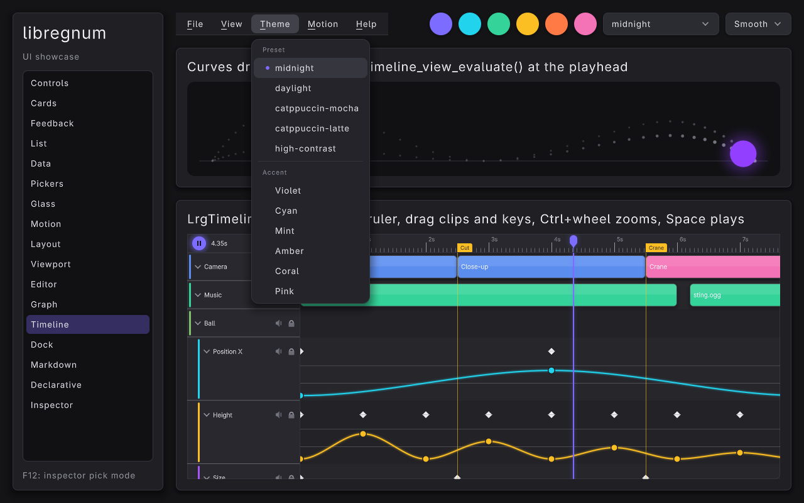

The header starts with an =LrgMenuBar= built from a =GMenu= (=build_menu_model()=). Nothing in the menus holds a C callback: every item names a GIO action, and =install_actions()= puts a =GSimpleActionGroup= on the canvas under the prefix =show=, so the actions resolve from the menu bar (the owner of its menus) up to the canvas. Quitting uses the canvas's built-in =app.quit=, which only emits =LrgCanvas::quit-requested=; the handler sets =app->quit= and the main loop ends.

#+begin_src C
const GActionEntry entries[] = {
	{ "theme",  on_theme_action,  "s",  "'midnight'", NULL, { 0 } },   /* radio */
	{ "motion", on_motion_action, "s",  "'Smooth'",   NULL, { 0 } },   /* radio */
	{ "accent", on_accent_action, "s",  "''",         NULL, { 0 } },   /* radio */
	{ "page",   on_page_action,   "s",  "'controls'", NULL, { 0 } },   /* radio */
	{ "rtl",    on_rtl_action,    NULL, "false",      NULL, { 0 } },   /* check */
	{ "pick",   on_pick_action,   NULL, "false",      NULL, { 0 } },   /* check */
	/* ... toasts, dialog, screenshot, reload, shortcuts, about ... */
};

app->actions = g_simple_action_group_new ();
g_action_map_add_action_entries (G_ACTION_MAP (app->actions), entries, G_N_ELEMENTS (entries), app);
lrg_widget_insert_action_group (LRG_WIDGET (app->canvas), "show", G_ACTION_GROUP (app->actions));
lrg_canvas_add_shortcut (app->canvas, "<Ctrl>q", "app.quit", NULL);
lrg_canvas_add_shortcut (app->canvas, "<Ctrl><Shift>r", "show.rtl", NULL);
#+end_src

| Menu   | Items                                                                                         | Action kind |
|--------+-----------------------------------------------------------------------------------------------+-------------|
| File   | Show toasts, Open dialog / Save screenshot, Reload YAML page / Quit                           | plain, =app.quit= |
| View   | Go to page (submenu, one item per page), Right-to-left layout, Inspector pick mode            | string radio, boolean checks |
| Theme  | Preset section (every =lrg_theme_list_presets()= name), Accent section (the six swatches)     | string radios |
| Motion | Smooth, Snappy, Bouncy, Wobbly, None                                                          | string radio |
| Help   | Keyboard shortcuts, About                                                                     | plain |

*Marks come from action state.* A boolean state draws a check mark, a string state a radio dot on the item whose target equals it. Every handler therefore calls =g_simple_action_set_state()= after doing its work, and code paths that change the same thing elsewhere update the state too: =show_page()= sets =show.page=, =update_inspector_labels()= sets =show.pick= (so F12 and Escape in pick mode keep the check mark right).

*Combo boxes and menus stay in sync.* The header's theme and motion combo boxes do not change anything themselves: their =changed= handlers activate =show.theme= / =show.motion=, and those handlers select the matching combo row. =app->syncing_menu= stops the echo (setting the combo emits =changed= again).

*Theme through the action, not ui.theme.* The canvas's built-in =ui.theme= would put a fresh preset on the canvas, which would lose the card and glass style rules this program adds. =show.theme= instead calls =apply_theme()= (a new default theme with the rules re-added). The RTL check does use a built-in: =on_rtl_action()= flips its boolean state and activates =ui.direction= with ="rtl"= or ="ltr"=, which sets the canvas default direction; every container then mirrors (the sidebar moves to the right, menu bar titles start from the right, check marks and accelerators swap sides):

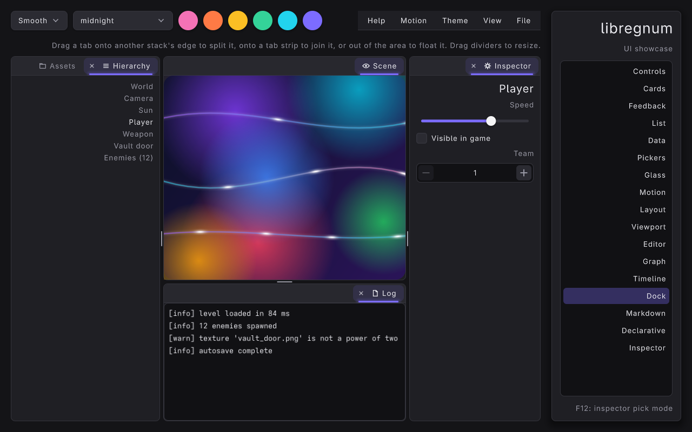

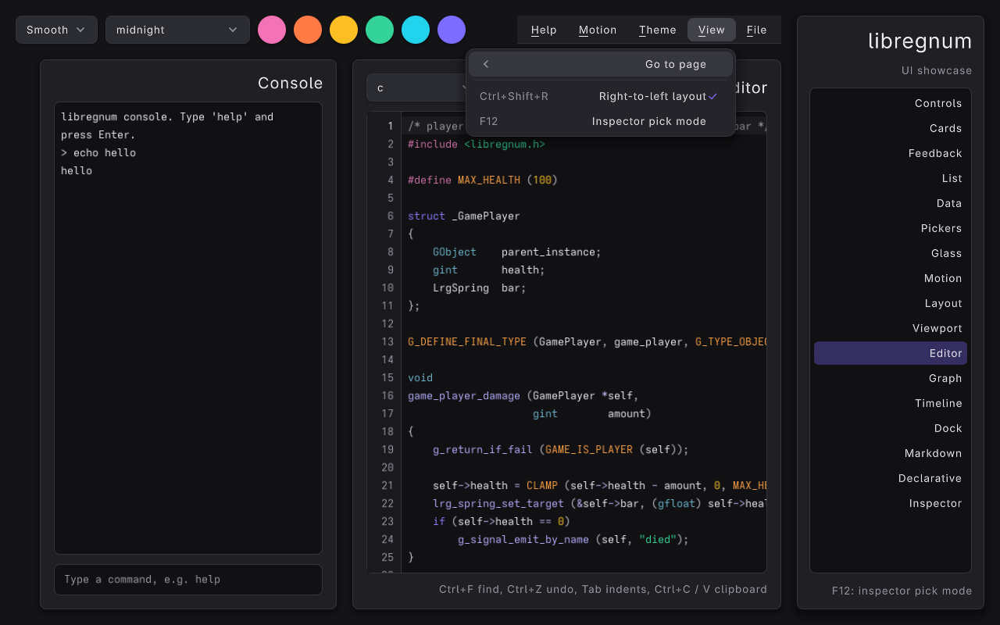

*Shortcuts in the menus.* Items get no =accel= attribute (except pick mode, whose F12 is polled by the main loop rather than bound): the menu shows whatever =lrg_canvas_get_accel_for_action()= returns for the item's action and target. =Ctrl+1= .. =Ctrl+9= are nine shortcuts to the same =show.page= action with different string targets, and the Go to page items show each one. Plain-letter shortcuts are never used: typing into the console must not trigger them.

The console on the Editor page drives the same actions (=g_action_group_activate_action()=) and the built-in =ui.toast= and =app.quit= (=lrg_widget_activate_action()= from the log widget, resolving up to the canvas). See [[file:../modules/ui/actions.org][Actions and shortcuts]], [[file:../modules/ui/widgets/menu-bar.org][Menu Bar]] and [[file:../modules/ui/widgets/menu.org][Menu]].

*** Pages in an overlay
:PROPERTIES:
:CUSTOM_ID: ui-showcase-pages
:END:
The seventeen pages (indexed by the =PAGE_*= enum, named by =page_names[]=) are stacked in an =LrgOverlay=, which lays every child over the same rectangle. Only one is visible at a time. Each page gets a fly-up appear animation; the List, Data, Glass, Viewport, Editor, Graph, Timeline, Dock, Markdown and Declarative pages fill the overlay vertically, the others align to the top:

#+begin_src C
app->pages = lrg_overlay_new ();
lrg_widget_set_fill_weight (LRG_WIDGET (app->pages), 1.0f);
app->page[PAGE_CONTROLS] = build_controls_page (app);
/* ... one build_*_page () per page ... */
app->page[PAGE_INSPECTOR] = build_inspector_page (app);
for (i = 0; i < N_PAGES; i++)
{
	gboolean fill = (i == PAGE_LIST || i == PAGE_DATA || i == PAGE_GLASS ||
	                 i == PAGE_MARKDOWN || i == PAGE_DECLARATIVE || i == PAGE_VIEWPORT ||
	                 i == PAGE_EDITOR || i == PAGE_GRAPH || i == PAGE_TIMELINE || i == PAGE_DOCK);

	lrg_widget_set_appear (app->page[i], LRG_APPEAR_FLY_UP, 0.0f);
	lrg_widget_set_valign (app->page[i], fill ? LRG_ALIGN_FILL : LRG_ALIGN_START);
	add (app->pages, app->page[i]);
}
#+end_src

Switching pages is just visibility. Because an appear animation plays "the first time the widget is painted and whenever it is shown again", making a page visible is enough to replay its fly-up. =show_page()= then does per-page extras: the cards and the Motion page's appear tiles replay their staggered entrances, the Markdown page restarts its typewriter (=lrg_markdown_label_reset_effects()=), and the Inspector page selects its sample card when nothing is selected so the highlight is visible at once. It also sets the state of the =show.page= action, so View > Go to page shows a radio dot on the open page however it was opened:

#+begin_src C
for (i = 0; i < N_PAGES; i++)
	lrg_widget_set_visible (app->page[i], i == index);
app->current_page = (gint) index;

switch (index)
{
case PAGE_CARDS:
	for (i = 0; i < app->cards->len; i++)
		lrg_widget_play_appear (g_ptr_array_index (app->cards, i));
	break;
case PAGE_MARKDOWN:
	lrg_markdown_label_reset_effects (app->markdown);
	break;
/* ... PAGE_MOTION, PAGE_INSPECTOR ... */
}
#+end_src

=on_nav_selection()= calls =show_page()= with =lrg_list_view_get_selected()=, ignoring =LRG_LIST_VIEW_INVALID_POSITION=. See [[file:../modules/ui/widgets/overlay.org][Overlay]].

*** Controls page: a grid of sections
:PROPERTIES:
:CUSTOM_ID: ui-showcase-controls-page
:END:
=build_controls_page()= is an =LrgGrid= with two columns and 20-unit gaps; every =section()= call adds one cell. A few highlights:

#+begin_src C
/* Buttons in every flavour */
btn = lrg_button_new ("Primary");
lrg_widget_add_class (LRG_WIDGET (btn), "primary");
add (row, btn);
btn = lrg_button_new ("Flat");
lrg_widget_add_class (LRG_WIDGET (btn), "flat");
add (row, btn);
btn = lrg_button_new ("Delete");
lrg_widget_add_class (LRG_WIDGET (btn), "danger");
add (row, btn);
btn = lrg_button_new ("Disabled");
lrg_widget_set_enabled (LRG_WIDGET (btn), FALSE);
add (row, btn);

/* Toggles: one widget, three looks */
add (box, lrg_checkbox_new_with_style ("Enable bloom", LRG_CHECKBOX_STYLE_SWITCH));
add (box, lrg_checkbox_new ("Show subtitles"));
add (box, lrg_checkbox_new_with_style ("Hard mode", LRG_CHECKBOX_STYLE_RADIO));
#+end_src

The slider drives the progress bar through its =value-changed= signal, and a second progress bar runs in indeterminate mode:

#+begin_src C
app->volume = lrg_slider_new_with_range (0.0, 100.0, 1.0);
lrg_slider_set_value (app->volume, 65.0);
g_signal_connect (app->volume, "value-changed", G_CALLBACK (on_volume_changed), app);
add (box, app->volume);
app->progress = lrg_progress_bar_new ();
lrg_progress_bar_set_max (app->progress, 100.0);
lrg_progress_bar_set_value (app->progress, 65.0);
add (box, app->progress);
#+end_src

#+begin_src C
static void
on_volume_changed (LrgSlider *slider,
                   gpointer   user_data)
{
	Showcase *app = user_data;

	lrg_progress_bar_set_value (app->progress, lrg_slider_get_value (slider));
}
#+end_src

The Input section shows =lrg_text_input_new_with_placeholder()= and a spin box with one decimal (=lrg_spin_box_new_with_range (0.0, 10.0, 0.5)= + =lrg_spin_box_set_digits (spin, 1)=). The Tabs section gives the tab view a minimum height of 110 so its pages have room, then adds three muted labels with =lrg_tab_view_add_tab()=.

Widget references: [[file:../modules/ui/widgets/button.org][Button]], [[file:../modules/ui/widgets/checkbox.org][Checkbox]], [[file:../modules/ui/widgets/slider.org][Slider]], [[file:../modules/ui/widgets/progress-bar.org][Progress Bar]], [[file:../modules/ui/widgets/text-input.org][Text Input]], [[file:../modules/ui/widgets/spin-box.org][Spin Box]], [[file:../modules/ui/tab-view.org][Tab View]], [[file:../modules/ui/widgets/separator.org][Separator]].

*** Cards page: gradient panels with a staggered pop
:PROPERTIES:
:CUSTOM_ID: ui-showcase-cards-page
:END:
[[file:images/ui-showcase-cards.png]]

The cards are plain panels. Their look comes entirely from a style class (=card-0= .. =card-5=) that matches theme style rules added in [[#ui-showcase-rules][Gradient cards from style rules]]:

#+begin_src C
for (i = 0; i < 6; i++)
{
	g_autofree gchar *klass = g_strdup_printf ("card-%u", i);
	g_autofree gchar *title = g_strdup_printf ("Elevation %u", i % 4);
	LrgPanel         *card = lrg_panel_new ();
	LrgVBox          *box = lrg_vbox_new ();

	lrg_widget_add_class (LRG_WIDGET (card), klass);
	lrg_panel_set_elevation (card, i % 4);
	lrg_panel_set_fill_children (card, TRUE);
	lrg_container_set_padding (LRG_CONTAINER (card), 22.0f);
	lrg_widget_set_appear (LRG_WIDGET (card), LRG_APPEAR_POP, 0.06f * (gfloat) i);
	/* ... heading + body label in box ... */
	g_ptr_array_add (app->cards, card);
	lrg_container_add_child (LRG_CONTAINER (grid), LRG_WIDGET (card));
}
#+end_src

Note the ownership: the card is added to the grid without an unref, and its reference is handed to =app->cards= (a =GPtrArray= with =g_object_unref= as its free function) so =show_page()= can replay the animations later.

*** Card context menus
:PROPERTIES:
:CUSTOM_ID: ui-showcase-context-menus
:END:
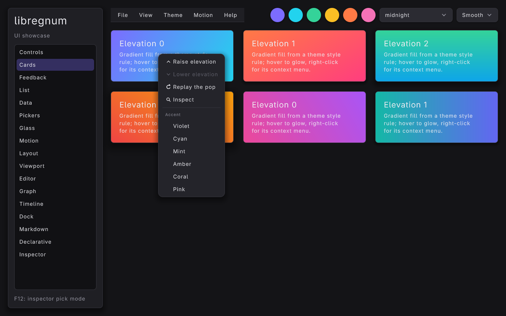

All six cards share one menu model (=card_menu_model()=) but each card has its own action group, inserted on the card under the prefix =card=. =lrg_widget_set_context_menu()= is all a widget needs: on an unhandled right click (or Shift+F10 / the Menu key with focus inside) the canvas opens an =LrgMenu= at the pointer, and its actions resolve from the card upwards, so =card.raise= finds this card's group while =show.accent= (the second section) continues up to the canvas.

#+begin_src C
static void
attach_card_menu (Showcase *app, LrgPanel *panel, LrgLabel *title, GMenuModel *model)
{
	const GActionEntry entries[] = {
		{ "raise",   on_card_raise,   NULL, NULL, NULL, { 0 } },
		{ "lower",   on_card_lower,   NULL, NULL, NULL, { 0 } },
		{ "replay",  on_card_replay,  NULL, NULL, NULL, { 0 } },
		{ "inspect", on_card_inspect, NULL, NULL, NULL, { 0 } }
	};
	g_autoptr(GSimpleActionGroup) group = g_simple_action_group_new ();

	g_action_map_add_action_entries (G_ACTION_MAP (group), entries, G_N_ELEMENTS (entries), panel);
	lrg_widget_insert_action_group (LRG_WIDGET (panel), "card", G_ACTION_GROUP (group));
	lrg_widget_set_context_menu (LRG_WIDGET (panel), model);
	card_sync (panel);
}
#+end_src

=card_sync()= rewrites the card's heading ("Elevation N") and disables =raise= at elevation 3 and =lower= at 0; the menu greys disabled items out and skips them with the keyboard. =Inspect= selects the card in the UI inspector and activates =show.page= with ="inspector"=. =--context-menu= opens the first card's menu programmatically on frame 30 (=lrg_menu_new_from_model()= + =lrg_menu_popup_at_point()= with the card as owner, exactly what the canvas does) for screenshots.

*** Feedback page: toasts and a modal dialog
:PROPERTIES:
:CUSTOM_ID: ui-showcase-feedback-page
:END:
[[file:images/ui-showcase-toasts.png]]

The toast queue is created in =build_ui()= and put in the canvas overlay layer (=lrg_canvas_add_overlay()=), which is painted above everything, including a modal dialog and its veil. It is a pointer-transparent layer that covers the canvas and stacks toasts in the bottom-right corner:

#+begin_src C
app->toasts = lrg_toast_queue_new ();
lrg_canvas_add_overlay (app->canvas, LRG_WIDGET (app->toasts));
#+end_src

Raising a toast is three calls. The queue takes its own reference:

#+begin_src C
static void
show_toast (Showcase     *app,
            const gchar  *title,
            const gchar  *message,
            LrgToastKind  kind)
{
	g_autoptr(LrgToast) toast = lrg_toast_new (title, message);

	lrg_toast_set_kind (toast, kind);
	lrg_toast_queue_show (app->toasts, toast);
}
#+end_src

Four buttons share one handler; each carries its index as object data (=g_object_set_data (G_OBJECT (btn), "kind", GINT_TO_POINTER (i))=) which =on_toast_clicked()= maps to a title, message and =LrgToastKind=. The mode combo box maps its selection to =LRG_TOAST_MODE_STACK= (several at once), =LRG_TOAST_MODE_SEQUENCE= (one after another) or =LRG_TOAST_MODE_REPLACE= (the newest replaces the current one) with =lrg_toast_queue_set_mode()=.

[[file:images/ui-showcase-feedback.png]]

The dialog (shown above in the =daylight= preset) is built once and presented on demand. Response ids are plain integers; =LRG_DIALOG_RESPONSE_CANCEL= is what Escape and pad B produce, and the button added with =primary= = =TRUE= gets the accent style, initial focus and Enter:

#+begin_src C
app->dialog = lrg_dialog_new ("Ascend this character?",
                              "You keep your relics but restart at level 1.\n"
                              "Ascension grants a permanent +10% to all stats.");
lrg_dialog_add_button (app->dialog, "Not yet", LRG_DIALOG_RESPONSE_CANCEL, FALSE);
lrg_dialog_add_button (app->dialog, "Ascend", 1, TRUE);
g_signal_connect (app->dialog, "response", G_CALLBACK (on_dialog_response), app);
#+end_src

#+begin_src C
static void
on_dialog_clicked (LrgButton *button,
                   gpointer   user_data)
{
	Showcase *app = user_data;

	lrg_dialog_present (app->dialog, app->canvas);
}
#+end_src

=lrg_dialog_present()= shows the dialog as a modal popup centred on the canvas: a veil dims everything behind it, input outside is blocked, focus is trapped inside and moves to the primary button. The =response= handler raises a success toast for id 1 and an info toast otherwise. See [[file:../modules/ui/widgets/toast.org][Toast]] and [[file:../modules/ui/widgets/dialog.org][Dialog]].

*** List page: a 10,000-row virtualized list
:PROPERTIES:
:CUSTOM_ID: ui-showcase-list-page
:END:
[[file:images/ui-showcase-list.png]]

The list view only creates row widgets for the rows on screen and rebinds them as you scroll, so the model can be large:

#+begin_src C
for (i = 0; i < N_LIST_ITEMS; i++)
{
	g_autoptr(ShowcaseItem) item = showcase_item_new (i);

	g_list_store_append (store, item);
}
lrg_list_view_set_model (list, G_LIST_MODEL (store));
lrg_list_view_set_selection_mode (list, LRG_SELECTION_MODE_MULTIPLE);
lrg_widget_set_fill_weight (LRG_WIDGET (list), 1.0f);
g_signal_connect (list, "selection-changed", G_CALLBACK (on_list_selection), app);
g_signal_connect (list, "row-activated", G_CALLBACK (on_list_activated), app);
#+end_src

=selection-changed= updates the status label from =lrg_list_view_get_selected()=; =row-activated= (double-click, Enter or pad A on the cursor row) receives the position and raises a toast. The page itself has =LRG_ALIGN_FILL= (set in =build_ui()=) so the list gets the whole height. See [[file:../modules/ui/widgets/list-view.org][List View]].

*** Data page: tree, table, splitter, breadcrumb and icon tiles
:PROPERTIES:
:CUSTOM_ID: ui-showcase-data-page
:END:
[[file:images/ui-showcase-data.png]]

=build_data_page()= stacks a breadcrumb, an =LrgSplitter= and an =LrgTileView= in a box.

*Tree.* =ShowcaseNode= is a small =GObject= (name, =LrgIcon=, a =GListStore= of children for folders, a borrowed parent pointer). =build_project()= makes a fake game project. The tree gets its children through a callback (transfer full, =NULL= for leaves) and its rows from a factory: an =hbox= of a =ShowcaseIcon= and a label, bound per item. Folders are painted in the =ACCENT= role, files in =TEXT_MUTED=:

#+begin_src C
lrg_tree_view_set_children_func (app->tree, tree_children, NULL, NULL);
lrg_tree_view_set_factory (app->tree, tree_create_row, tree_bind_row, NULL, NULL);
lrg_tree_view_set_model (app->tree, G_LIST_MODEL (roots));
lrg_tree_view_set_indent (app->tree, 18.0f);
lrg_tree_view_expand (app->tree, G_OBJECT (app->project));
/* assets and assets/sprites are expanded and hero.png selected */
#+end_src

=ShowcaseIcon= is the smallest possible custom widget: an =LrgWidget= subclass with a =measure()= (its size) and a =paint()= that calls =lrg_paint_list_icon()= in the theme colour of its role, so it follows theme and accent changes. It is pointer-transparent so clicks reach the row.

*Breadcrumbs.* =on_tree_selection()= walks the selected node's parents and refills both breadcrumbs (this page and the Pickers page) with =lrg_breadcrumb_append_with_data()=, each segment holding a reference to its node. =activated= on a segment selects that node in the tree (or clears the selection for the root), which rebuilds the path.

*Table.* 10,000 =ShowcaseRow= objects (id, name, role, level, power, region as typed read-only properties). Five columns are property columns, which sort numbers numerically and strings with =g_utf8_collate()= when the model is a =GListStore=; the Power column is a formatted cell function with its own sort function:

#+begin_src C
lrg_table_add_property_column (app->table, "Name", "name", 130.0f,
                               LRG_TABLE_COLUMN_RESIZABLE | LRG_TABLE_COLUMN_SORTABLE);
col = lrg_table_add_column (app->table, "Power", power_cell, NULL, NULL, 80.0f,
                            LRG_TABLE_COLUMN_RESIZABLE | LRG_TABLE_COLUMN_SORTABLE);
lrg_table_set_sort_func (app->table, col, by_power, NULL, NULL);
lrg_table_set_striped (app->table, TRUE);
lrg_table_set_selection_mode (app->table, LRG_SELECTION_MODE_MULTIPLE);
lrg_table_set_sort (app->table, 3, FALSE);   /* highest level first */
#+end_src

=sort-changed= updates the status line above the table; =row-activated= raises a toast. Click a header to sort, click again to flip, drag a header edge to resize.

*Splitter.* The tree column and the table column are the splitter's start and end children, with minimum sizes 180 and 360 and a default fraction of 0.27 (=lrg_splitter_reset()= returns to it; double-clicking the handle does the same).

*Tiles.* One tile per =LrgIcon= value: the loop runs while =lrg_paint_icon_get_name()= returns a nick, so new icons appear automatically. The tile factory is a vertical box of a 30-unit =ShowcaseIcon= and a muted label; =tile-activated= shows the C call that draws the icon.

Widget references: [[file:../modules/ui/widgets/tree-view.org][Tree View]], [[file:../modules/ui/widgets/table.org][Table]], [[file:../modules/ui/widgets/splitter.org][Splitter]], [[file:../modules/ui/widgets/breadcrumb.org][Breadcrumb]], [[file:../modules/ui/widgets/tile-view.org][Tile View]], [[file:../modules/paint/index.org::#paint-icons][Icons]].

*** Pickers page: colour, rating, date, time, breadcrumb
:PROPERTIES:
:CUSTOM_ID: ui-showcase-pickers-page
:END:
[[file:images/ui-showcase-pickers.png]]

The left column holds an inline =LrgColorPicker= (with a six-colour palette and no alpha strip) and, beside it, the same picker in popup mode (a swatch button that opens the full picker in a popup). Both connect =color-changed= to =on_picker_changed()=, which calls =set_accent()=: =lrg_theme_set_accent()= on the default theme, then the theme's style rules are rebuilt because the tinted-glass rule uses the accent. =sync_pickers_to_accent()= pushes the new colour into the other picker under the =syncing= guard so the echo does not re-enter; the header swatches call it too. The "Accent preview" card (primary button, switch, slider, progress bar) shows the derived accent family.

The picker is kept at its preferred width (=LRG_ALIGN_START=): its height grows with its width, and =measure()= cannot know the width it will get (see [[#ui-showcase-limits][Limitations]]).

The right column has three ratings (half stars with =lrg_rating_set_allow_half()=, six hearts, four read-only circles), an =LrgDatePicker= with the =%a %d %b %Y= format, two =LrgTimePicker= s (24-hour =21:30=, and 12-hour with seconds) and the second breadcrumb. =value-changed= and =date-changed= raise toasts.

Widget references: [[file:../modules/ui/widgets/color-picker.org][Color Picker]], [[file:../modules/ui/widgets/rating.org][Rating]], [[file:../modules/ui/widgets/date-picker.org][Date Picker]], [[file:../modules/ui/widgets/time-picker.org][Time Picker]].

*** Glass page: materials, effects and curves
:PROPERTIES:
:CUSTOM_ID: ui-showcase-glass-page
:END:
[[file:images/ui-showcase-glass-latte.png]]

The page is an =LrgOverlay= with two children: =ShowcaseBackdrop= underneath and the content box on top. Glass needs something to look at, so the backdrop paints a rounded diagonal gradient, six radial-gradient blobs (saturated centre to transparent) orbiting their home points on Lissajous paths, and three full-width curves with pulses:

#+begin_src C
gdouble t = lrg_paint_list_get_time (list);   /* the canvas clock */
gfloat  cx = x + w * (bx + ax * (gfloat) sin (t * speed + phase));
gfloat  cy = y + h * (by + ay * (gfloat) cos (t * speed * 1.3 + phase));

lrg_paint_gradient_init_radial (&g, &centre, &edge, 0.5f, 0.5f, r);
lrg_paint_list_rect_ex (list, cx - r, cy - r, r * 2.0f, r * 2.0f, NULL, NULL, &g, 0.0f, NULL);
#+end_src

=paint()= is a pure function of the list time, which =LrgCanvas= sets from its own clock each frame, so the motion is deterministic and screenshots are reproducible. The backdrop implements =measure()= returning 0x0: the default =LrgWidget= measure reports the current size, which would make a page that contains a filling widget grow with every layout.

*Materials through the theme.* The three cards are plain =LrgPanel= s with a style class; =add_glass_rules()= adds one rule per class, so the look is a theme concern:

| Class           | Material  | Glass parameters                                                    |
|-----------------+-----------+---------------------------------------------------------------------|
| =glass-clear=   | =GLASS=   | frost 0.15, refraction 14, dispersion 0.5, rim light 0.9, faint tint |
| =glass-frosted= | =FROSTED= | blur 22, saturation 1.4, a white veil (stronger on light themes)    |
| =glass-tinted=  | =TINTED=  | the background (the accent at 35 % alpha) is the tint               |

#+begin_src C
lrg_part_look_set_material (lrg_style_rule_get_look (frosted), LRG_PAINT_MATERIAL_FROSTED);
lrg_part_look_set_glass (lrg_style_rule_get_look (frosted), &glass);
lrg_theme_add_style_rule (theme, frosted);
#+end_src

*Effects through the theme.* For every name from =lrg_paint_effect_list_names()= the rules add =fx-NAME= on =LrgButton=: the =BOX= part gets =lrg_part_look_set_effect()=, a 14-unit radius and a fixed three-colour palette (=fx_palettes[]=), and the =LABEL= part white text so the label reads on every theme. The page creates one button per name in a four-column grid; hover and press feed the effect's springs, and =spotlight= / =ripple= follow the pointer (the canvas passes it to the paint list). Registered user effects would show up as extra buttons using the theme's colours.

*Curves.* =ShowcaseWires= paints a five-node graph on a frosted card: cubic Beziers that leave and enter horizontally, each with a start/end gradient, a glow and two pulses (=LrgPaintCurveStyle=), then the node chips (shadow, surface fill, border, icon, label) on top.

See [[file:../modules/paint/index.org::#paint-materials][Materials]], [[file:../modules/paint/index.org::#paint-effects][Effects]], [[file:../modules/paint/index.org::#paint-curves][Curves]] and [[file:../modules/ui/styling.org::#styling-materials][Styling: materials and effects]].

*** Motion page: island, layout glide, appear, expanders, touch
:PROPERTIES:
:CUSTOM_ID: ui-showcase-motion-page
:END:
[[file:images/ui-showcase-motion.png]]

*Island.* =build_island()= gives an =LrgIsland= a compact child (play icon + track title and time) and an expanded child (track info, a seek slider, Prev / Pause / Next). The island is centred (=LRG_ALIGN_CENTER=; a filled island could not change width). Clicking its background toggles it; clicks on the buttons inside do not. =--island= expands it on frame 10. On light themes the island paints with its dark twin.

*Wrap box with glide.* Chips are pill buttons with =lrg_widget_set_animate_layout (chip, TRUE)= and a =POP= appear. Add appends one (it pops in, the rest stay), Remove first removes child 0 (every later chip glides to its new slot), and Shuffle re-adds the same widgets in a Fisher-Yates order from a small fixed-seed LCG: each chip keeps its glide springs and flies to its new place while layout and hit-testing already use the final positions. The wrap box has a maximum width of 560: its preferred width is its single-line length, which would otherwise widen the row it shares with the expanders.

*Appear transitions.* Five gradient tiles (reusing the =card-N= rules) with =FADE=, =POP=, =ZOOM=, =FLY_UP= and =DROP= and a 0.08 s stagger, replayed by the Replay button and whenever the page opens.

*Expanders.* Three =LrgExpander= s with muted label bodies; the first starts open.

*Touch.* A card explains the gesture support: scroll boxes, lists, tables, trees and tile views claim one-finger pans along their axis and flick with momentum; taps click and long presses right-click. =--touch= turns on =lrg_canvas_input_set_poll_touch()=, which is off by default because desktop raylib reports a held mouse button as touch point 0. The Markdown page's scroll box sets =lrg_scroll_box_set_kinetic (scroll, TRUE)=.

See [[file:../modules/ui/widgets/island.org][Island]], [[file:../modules/ui/widgets/wrap-box.org][Wrap Box]], [[file:../modules/ui/widgets/expander.org][Expander]], [[file:../modules/ui/animation.org::#animation-layout-glide][Layout glide]] and [[file:../modules/ui/input-and-focus.org::#input-touch][Touch input]].

*** Layout page: anchor layout, switcher, size box
:PROPERTIES:
:CUSTOM_ID: ui-showcase-layout-page
:END:
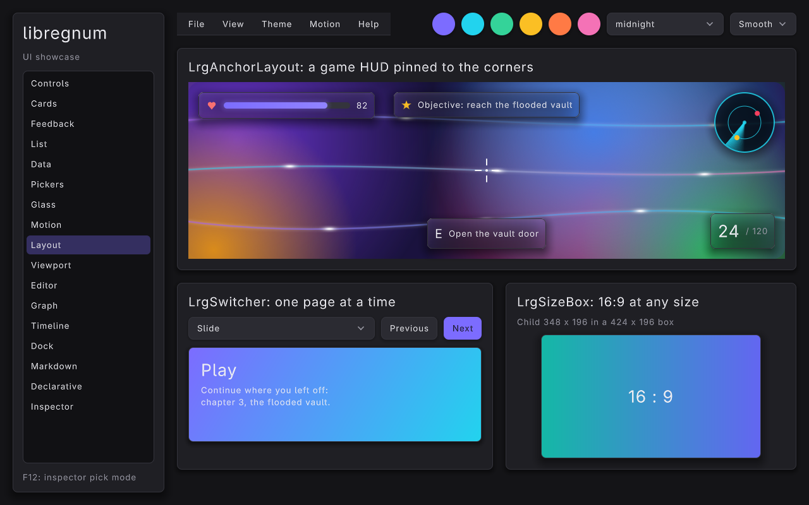

=--theme daylight=:

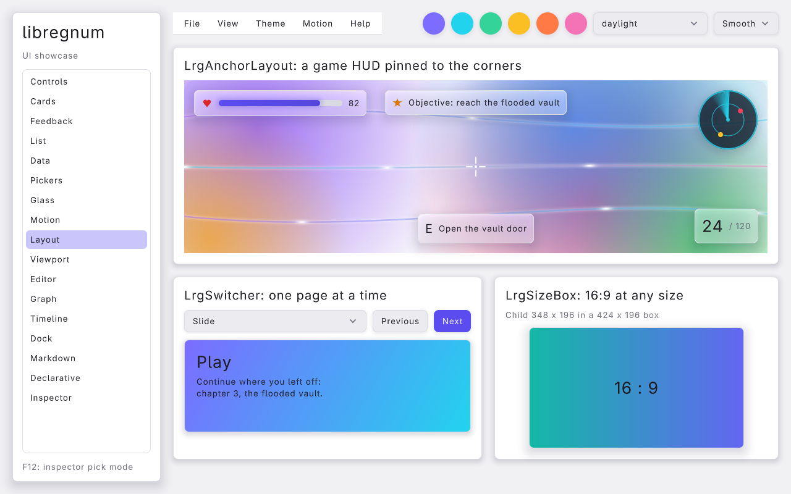

*Anchor layout HUD.* An =LrgOverlay= stacks the Glass page's =ShowcaseBackdrop= and an =LrgAnchorLayout=. HUD elements are frosted-glass chips (=hud_chip()=: a =glass-frosted= panel around an hbox) and two =LrgCustomWidget= s with only a paint callback (=custom_painter()=): a radar minimap whose sweep turns with =lrg_paint_list_get_time()=, and a breathing crosshair. Each is pinned with a preset and an inward offset; resize the window and they stay in their corners:

#+begin_src C
lrg_anchor_layout_add (hud, LRG_WIDGET (health), LRG_ANCHOR_PRESET_TOP_LEFT, 16.0f, 16.0f);
lrg_anchor_layout_add (hud, LRG_WIDGET (objective), LRG_ANCHOR_PRESET_TOP, 0.0f, 16.0f);
lrg_anchor_layout_add (hud, LRG_WIDGET (radar), LRG_ANCHOR_PRESET_TOP_RIGHT, 16.0f, 16.0f);
lrg_anchor_layout_add (hud, LRG_WIDGET (crosshair), LRG_ANCHOR_PRESET_CENTER, 0.0f, 0.0f);
lrg_anchor_layout_add (hud, LRG_WIDGET (prompt), LRG_ANCHOR_PRESET_BOTTOM, 0.0f, 16.0f);
lrg_anchor_layout_add (hud, LRG_WIDGET (ammo), LRG_ANCHOR_PRESET_BOTTOM_RIGHT, 16.0f, 16.0f);
#+end_src

The anchor layout is pointer-transparent where it has no child, so clicks reach the backdrop (a game scene) underneath.

*Switcher.* Three gradient slides (the =card-N= rules again) added with =lrg_switcher_add_named()=. The combo box sets the transition (Crossfade, Slide, Slide up, Slide down, Zoom, None; =Slide= picks left or right from the direction of travel), and Previous / Next step =lrg_switcher_set_visible_index()= with wrap-around.

*Size box.* An =LrgSizeBox= with =lrg_size_box_set_aspect_ratio (box, 16.0f / 9.0f)= and a 196-unit minimum height holds a gradient panel; the child gets the largest 16:9 rectangle that fits, centred. =update_size_label()= (called from the frame loop while the page is open) prints the child and box sizes.

See [[file:../modules/ui/widgets/anchor-layout.org][Anchor Layout]], [[file:../modules/ui/widgets/switcher.org][Switcher]], [[file:../modules/ui/widgets/size-box.org][Size Box]] and [[file:../modules/ui/widgets/custom-widget.org][Custom Widget]].

*** Viewport page: a live 3D scene and a custom widget
:PROPERTIES:
:CUSTOM_ID: ui-showcase-viewport-page
:END:
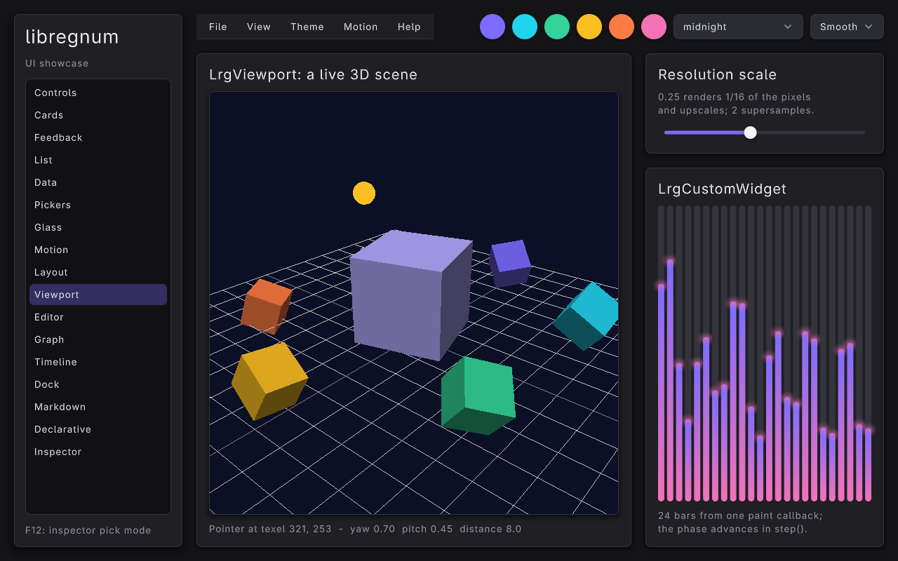

=--theme daylight=:

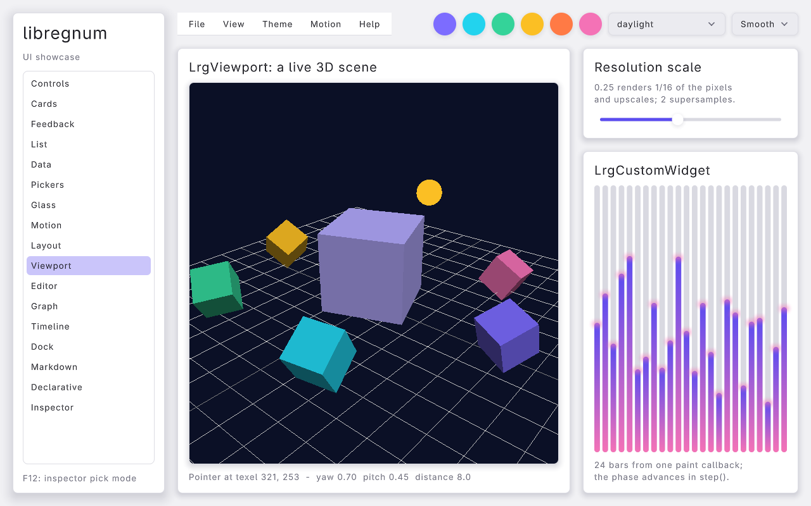

*The scene.* =lrg_viewport_set_render_func (viewport, draw_scene, app, NULL)= gives the viewport a C render function. The viewport calls it from its =step= (inside =lrg_canvas_update()=, which the inspector's input handling runs before drawing), between =BeginTextureMode()= and =EndTextureMode()= on its own render texture sized to the widget, so =draw_scene()= is free to use 3D mode: =grl_camera3d_begin()=, a grid, a ring of six bobbing, spinning cubes, a large centre cube and an orbiting sphere, all timed by =app->scene_time= (summed frame times). The paint pass then only samples the finished texture inside a themed, rounded frame.

The cube is a raylib =Model= built once by =load_shaded_cube()=: =GenMeshCube()= copied into a new mesh with per-vertex grey levels from a fixed light direction, so the default shader's =vertex colour x tint= reads as a lit solid without a lighting shader. It needs a GL context, which exists because the window opens before =build_ui()=; it is unloaded before the window closes.

*Orbit and zoom.* =pointer-move= gives texture-space coordinates and deltas; while =lrg_viewport_get_dragging()= is true the handler turns yaw and pitch and re-places the =GrlCamera3D= on a sphere (=orbit_apply()=); =pointer-scroll= scales the distance. The status label shows the texel under the pointer. The slider sets =lrg_viewport_set_resolution_scale()= (0.25 to 2): the texture follows the widget times the scale and is recreated once the size has settled.

*LrgCustomWidget.* The spectrum has no subclass: an =LrgCustomWidgetFuncs= table with =paint= and =step=. =step= adds the frame time to =app->spectrum_phase= and returns =TRUE= (always animating); =paint= is a pure function of the phase and draws 24 rounded bars with an accent-to-pink gradient over theme track pills and a glowing cap:

#+begin_src C
LrgCustomWidgetFuncs funcs = { 0 };

funcs.paint = spectrum_paint;
funcs.step = spectrum_step;
lrg_custom_widget_set_funcs (spectrum, &funcs, app, NULL);
lrg_custom_widget_set_preferred_height (spectrum, 140.0f);
#+end_src

See [[file:../modules/ui/widgets/viewport.org][Viewport]] and [[file:../modules/ui/widgets/custom-widget.org][Custom Widget]].

*** Editor page: text editor and console
:PROPERTIES:
:CUSTOM_ID: ui-showcase-editor-page
:END:
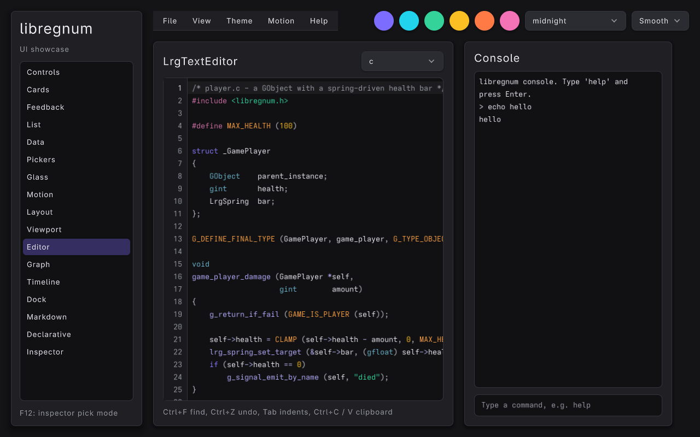

=--theme daylight=:

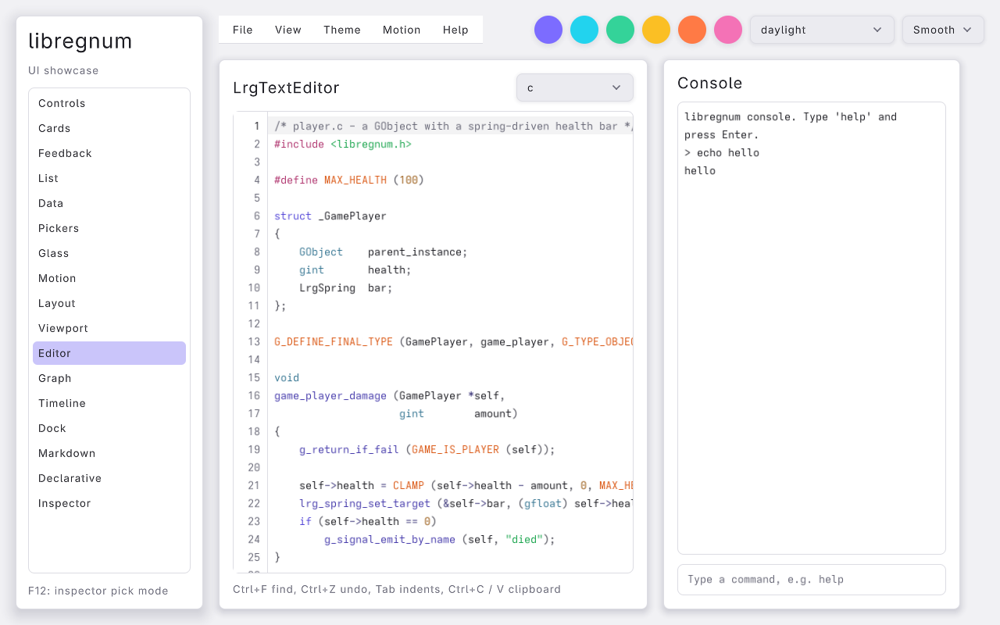

*Code editor.* An =LrgTextEditor= with line numbers, starting on a GObject-style C sample. The combo box lists =lrg_syntax_list_languages()=; choosing one calls =lrg_text_editor_set_language()= and, for =c=, =yaml=, =glsl= and =lua=, loads the matching sample from =code_samples[]= (other languages re-highlight the current text). Undo, find (Ctrl+F), indentation and the clipboard are the editor's own.

*Console.* Two more editors in a card capped at 380 units: a read-only, wrapping log with =max-lines= 500, and a one-line input with =submit-on-enter= and a placeholder (40 units high, min = max). =submit= runs =run_console_command()= and clears the input; output goes through =console_print()=, which uses =lrg_text_editor_append()= so the log follows new lines while its caret is at the end.

| Command      | Effect                                              |
|--------------+-----------------------------------------------------|
| =help=       | List the commands                                   |
| =echo TEXT=  | Print TEXT                                          |
| =theme NAME= | Activate =show.theme= (a preset name)               |
| =page NAME=  | Activate =show.page=                                |
| =rtl=        | Activate =show.rtl=                                 |
| =toast TEXT= | Activate the built-in =ui.toast=                    |
| =clear=      | Empty the log                                       |
| =quit=       | Activate the built-in =app.quit=                    |

See [[file:../modules/ui/widgets/text-editor.org][Text Editor]] and [[file:../modules/ui/widgets/syntax.org][Syntax]].

*** Graph page: a shader graph
:PROPERTIES:
:CUSTOM_ID: ui-showcase-graph-page
:END:
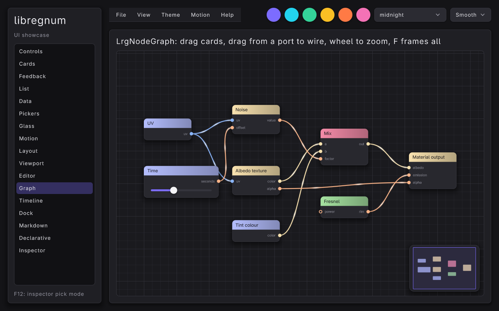

=--theme daylight=:

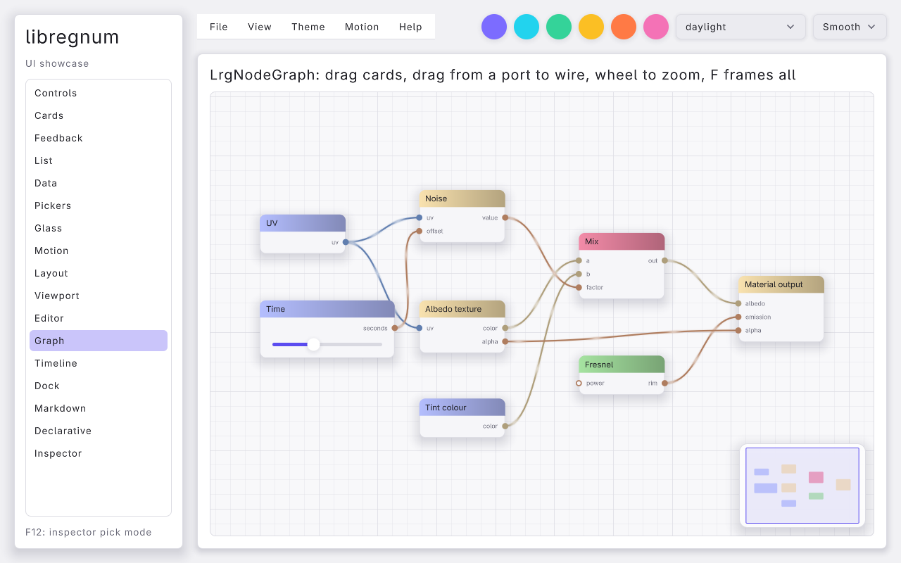

=build_graph_page()= adds nine nodes with =lrg_node_graph_add_node()=, gives each a category (=input=, =texture=, =math=, =lighting=, =output=; the header gradient colour is picked from the category), typed ports (=vec2=, =vec4=, =float=; port and wire colours come from the type) and wires them with =lrg_node_graph_connect_by_name()=. The Time node has a body: an =LrgSlider= set with =lrg_graph_node_set_body()=, which becomes a real child of the graph, hit-tested and scaled with the card. Animated links send pulses from outputs to inputs, snap-to-grid is on and the minimap shows the whole graph.

The graph is framed once, from the frame loop, the first time the page is open and the graph has a size: =lrg_node_graph_frame_all()= needs the widget's allocation.

See [[file:../modules/ui/widgets/node-graph.org][Node Graph]].

*** Timeline page: curves driving a stage
:PROPERTIES:
:CUSTOM_ID: ui-showcase-timeline-page
:END:
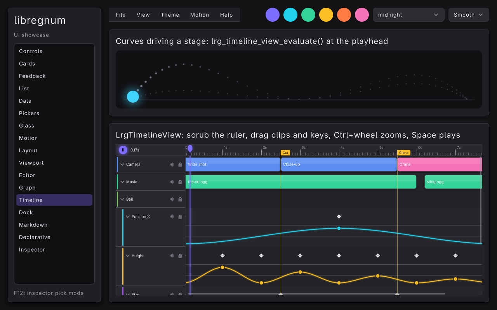

=--theme daylight=:

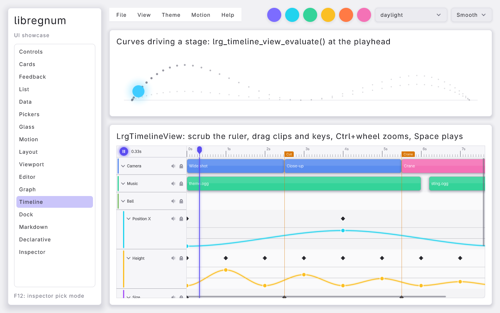

An 8-second, 30 fps =LrgTimelineView= with =loop= on and =playing= set at start-up: the widget advances its own playhead on the canvas clock. Tracks: Camera (three clips, one recoloured), Music (two clips) and a "Ball" group with four curve tracks (Position X, Height, Size, Hue), each with a curve lane, a value range and keyframes using =ease=, =linear= and =step= interpolation. Two markers flag the cuts.

The stage above is an =LrgCustomWidget= whose paint callback samples the curves at the playhead, the same curves the timeline draws:

#+begin_src C
gdouble t = lrg_timeline_view_get_time (app->timeline);
gfloat  fx = (gfloat) lrg_timeline_view_evaluate (app->timeline, app->track_x, t);
gfloat  fy = (gfloat) lrg_timeline_view_evaluate (app->timeline, app->track_y, t);
gfloat  size = (gfloat) lrg_timeline_view_evaluate (app->timeline, app->track_size, t);
gfloat  hue = (gfloat) lrg_timeline_view_evaluate (app->timeline, app->track_hue, t);
#+end_src

It also samples the whole path (97 points over the duration) as a dotted trail that brightens near the playhead. Scrub the ruler, drag a keyframe or double-click a curve lane and the ball follows at once.

See [[file:../modules/ui/widgets/timeline-view.org][Timeline View]].

*** Dock page: a dock area
:PROPERTIES:
:CUSTOM_ID: ui-showcase-dock-page
:END:
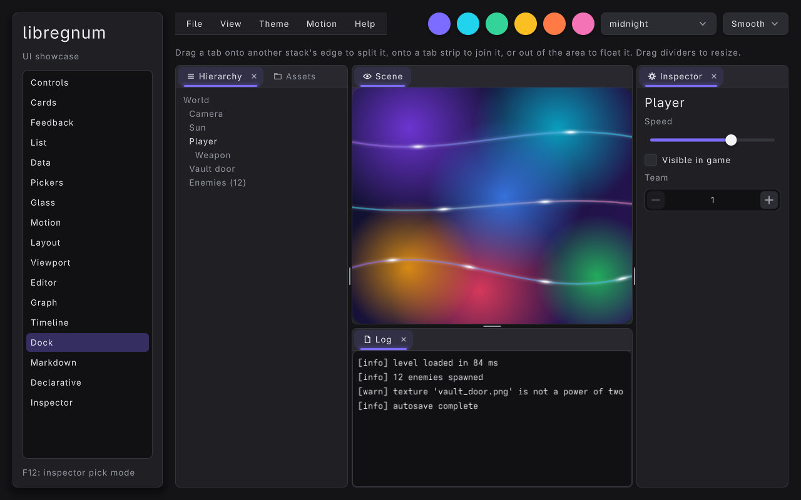

=--theme daylight=:

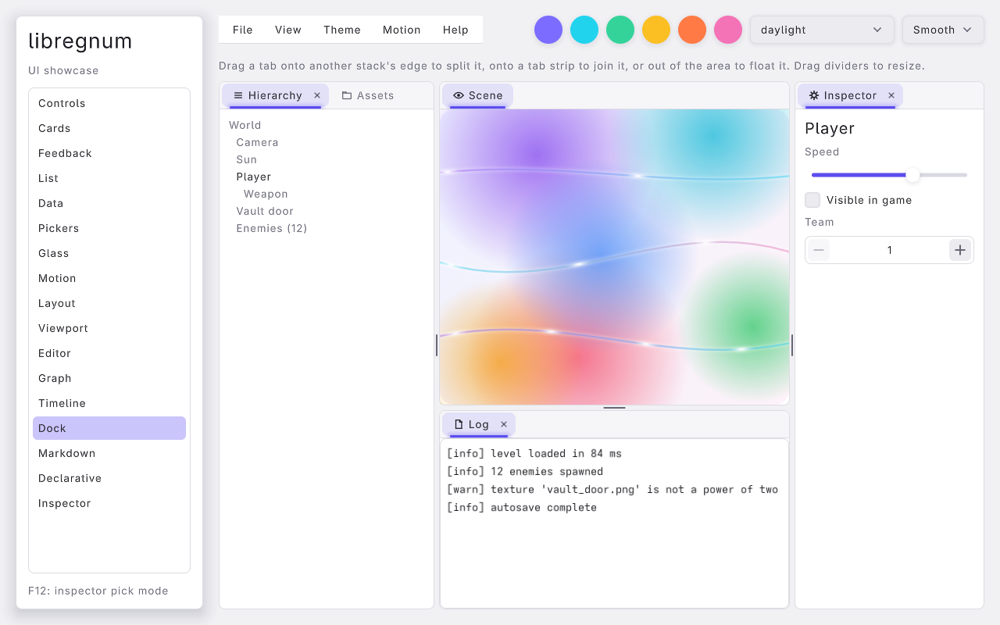

=build_dock_page()= creates an =LrgDockArea= and docks five =LrgDockPanel= s with =dock_panel()= (new panel, icon, child, =lrg_dock_area_add_panel()=): Scene (the backdrop; not closable) in the centre, Hierarchy on the left with Assets (a wrap box of icons) as a second tab, Inspector on the right, and Log (a read-only text editor) below the scene. =lrg_dock_area_set_panel_share()= then sets the scene to 62 % of its column and the left column to 38 % of its row. Drag a tab onto another stack's edge to split it, onto a tab strip to join it, or outside to float it in the canvas overlay layer; drag dividers to resize. [[file:ui-studio.org][UI Studio]] saves and restores such a layout as YAML.

See [[file:../modules/ui/widgets/dock-area.org][Dock Area]].

*** Markdown page
:PROPERTIES:
:CUSTOM_ID: ui-showcase-markdown-page
:END:
[[file:images/ui-showcase-markdown.png]]

One =LrgMarkdownLabel= inside a padded panel inside a vertical-only =LrgScrollBox= (=lrg_scroll_box_set_hscroll (scroll, FALSE)= so the label wraps to the viewport instead of growing sideways). The text (=markdown_text=) has H1 / H2 headings with rules, bold, italic and bold-italic, nested bullets, a numbered list, inline code chips, a quote, a fenced code block, two links and rich-text tags: =[typewriter=60]= on the intro sentence, =[wave]=, =[rainbow]=, =[shake]=, =[pulse]=, =[s]=, =[color=#f472b6]=, =[u]= and =[fade]=.

#+begin_src C
app->markdown = lrg_markdown_label_new (markdown_text);
g_signal_connect (app->markdown, "link-activated", G_CALLBACK (on_markdown_link), app);
#+end_src

=on_markdown_link()= raises a toast with the URL. Opening the page calls =lrg_markdown_label_reset_effects()= so the typewriter replays. See [[file:../modules/ui/widgets/markdown-label.org][Markdown Label]].

*** Declarative page: YAML with hot reload
:PROPERTIES:
:CUSTOM_ID: ui-showcase-declarative-page
:END:
[[file:images/ui-showcase-declarative.png]]

The page hosts =examples/data/ui/showcase-settings.yaml= (components with parameters and slots, =${expressions}=, =for-each=, =repeat=, =if=, tabs, look overrides, appear cascades and handlers; see the comments at the top of the file). =build_declarative_page()= registers the three handlers the document names and watches the file:

#+begin_src C
app->loader = lrg_ui_loader_new ();
lrg_ui_loader_add_handler (app->loader, "settings_apply", G_CALLBACK (on_settings_apply), app);
lrg_ui_loader_add_handler (app->loader, "settings_reset", G_CALLBACK (on_settings_reset), app);
lrg_ui_loader_add_handler (app->loader, "settings_slider_changed", G_CALLBACK (on_settings_slider), app);
g_signal_connect (app->loader, "reloaded", G_CALLBACK (on_yaml_reloaded), app);
g_signal_connect (app->loader, "reload-failed", G_CALLBACK (on_yaml_reload_failed), app);
lrg_ui_loader_watch_file (app->loader, app->yaml_path, LRG_CONTAINER (app->yaml_host), &error);
#+end_src

The frame loop calls =lrg_ui_loader_poll (app.loader)= every frame (a =stat()= of the watched files). Save the YAML while the example runs and the new document is diffed into the live widgets: matched by =id=, then type and order, so slider positions and the open tab survive; =reloaded= raises a success toast. A document with a mistake changes nothing and =reload-failed= shows the error (with the node path and position) in a danger toast.

=on_settings_slider()= shows how handlers find their siblings: the loader sets each =id= as the widget name, so the slider =slider-music= looks up =value-music= with =lrg_ui_loader_get_widget()= and updates its text.

See [[file:../modules/ui/declarative-ui.org][Declarative UI]].

*** Inspector page
:PROPERTIES:
:CUSTOM_ID: ui-showcase-inspector-page
:END:
[[file:images/ui-showcase-inspector.png]]

=build_ui()= registers the canvas with =lrg_ui_inspector_register_canvas()= (the MCP tools =lrg_ui_tree=, =lrg_ui_pick=, =lrg_ui_get_widget=, =lrg_ui_set_property=, =lrg_ui_highlight= and =lrg_ui_timings= then see this UI when the program runs an MCP server), and the frame loop replaces =lrg_canvas_handle_input()= with the inspector's input seam:

#+begin_src C
if (IsKeyPressed (KEY_F12))
	toggle_pick_mode (&app);
lrg_ui_inspector_handle_input (app.inspector);
#+end_src

In pick mode hovering outlines the widget under the pointer and a left click selects it (emitting =picked=, which raises a toast with its path) without the click reaching the app; Escape leaves pick mode, which the loop notices by comparing =lrg_ui_inspector_get_pick_mode()= with the previous frame. The page shows:

- the pick mode state, the selected widget's type and the last three segments of its path;
- the frame timings from =lrg_ui_inspector_get_timings()= (step, layout and record microseconds, instances, commands, draw calls), refreshed every 15 frames;
- a named "Sample card" (=sample-card= with =cancel= and =ok= buttons) that is selected when the page first opens, so the highlight (bounds, margin and a =Type#name w×h= tag) is visible right away;
- the first lines of =lrg_ui_inspector_describe_widget()= for the selection, in a Markdown code block (the mono face).

=--pick= starts in pick mode; =--dump-tree= prints =lrg_ui_inspector_snapshot_json()= after a screenshot, which is handy for checking layout in scripts. See [[file:../modules/ui/inspector.org][UI Inspector]].

** Theming
:PROPERTIES:
:CUSTOM_ID: ui-showcase-theming
:END:
The showcase never holds on to an =LrgTheme=. Widgets read the process-wide default theme every frame, so replacing it (or mutating it) restyles the running UI immediately.

*** Presets and runtime switching
:PROPERTIES:
:CUSTOM_ID: ui-showcase-presets
:END:
=apply_theme()= is used both at start-up (=--theme=) and from the theme combo box. It builds a fresh preset, re-applies the remembered accent, re-adds the card and glass/effect style rules (a new theme has none) and installs it as the default:

#+begin_src C
static void
apply_theme (Showcase    *app,
             const gchar *preset)
{
	g_autoptr(LrgTheme) theme = lrg_theme_new_preset (preset);
	GrlColor            accent;

	if (theme == NULL)
	{
		g_printerr ("ui-showcase: unknown theme '%s'\n", preset);
		return;
	}

	if (app->accent != NULL && lrg_color_parse (app->accent, &accent))
		lrg_theme_set_accent (theme, &accent);
	add_card_rules (theme);
	add_glass_rules (theme);
	lrg_theme_set_default (theme);
}
#+end_src

=lrg_theme_set_default()= takes its own reference, which is why the local can be a =g_autoptr=. =lrg_theme_new_preset()= returns =NULL= for unknown names. See [[file:../guides/theming.org][Theming Guide]] and [[file:../modules/ui/theme.org][Theme]].

*** Accent swatches
:PROPERTIES:
:CUSTOM_ID: ui-showcase-accent
:END:
Clicking a swatch changes the accent of the *current* default theme in place. =lrg_theme_set_accent()= derives the whole accent family (accent, hover, pressed, text on accent, focus, selection) from one colour, so primary buttons, selection highlights, focus rings and slider fills all follow:

#+begin_src C
static void
set_accent (Showcase       *app,
            const GrlColor *accent)
{
	LrgTheme *theme = lrg_theme_get_default ();

	g_free (app->accent);
	app->accent = lrg_color_to_string (accent);
	lrg_theme_set_accent (theme, accent);
	lrg_theme_clear_style_rules (theme);
	add_card_rules (theme);
	add_glass_rules (theme);
}
#+end_src

The swatch handler and both colour pickers go through =set_accent()=. The style rules are rebuilt because the tinted-glass rule bakes the accent into its background (the presets add no rules of their own, so clearing them is safe here). Afterwards =sync_pickers_to_accent()= shows the new colour in the pickers.

The hex is also stored in =app->accent= so that =apply_theme()= can carry it over to the next preset.

*** Gradient cards from style rules
:PROPERTIES:
:CUSTOM_ID: ui-showcase-rules
:END:
Style rules let a theme restyle any widget part by type name, style class and state. The showcase adds two rules per card class in code: a resting rule with a linear gradient for the =BOX= part, and a hover rule that adds a glow in the gradient's first colour at 55 % alpha:

#+begin_src C
for (i = 0; i < G_N_ELEMENTS (grads); i++)
{
	g_autofree gchar        *klass = g_strdup_printf ("card-%u", i);
	g_autoptr(LrgStyleRule)  rule = lrg_style_rule_new ("LrgPanel", klass, LRG_UI_PART_BOX,
	                                                    LRG_WIDGET_STATE_NONE);
	g_autoptr(LrgStyleRule)  hover = lrg_style_rule_new ("LrgPanel", klass, LRG_UI_PART_BOX,
	                                                     LRG_WIDGET_STATE_HOVERED);
	LrgPaintGradient         g;
	GrlColor                 a;
	GrlColor                 b;
	GrlColor                 glow;

	lrg_color_parse (grads[i].a, &a);
	lrg_color_parse (grads[i].b, &b);
	lrg_paint_gradient_init_linear (&g, &a, &b, grads[i].angle);
	lrg_part_look_set_gradient (lrg_style_rule_get_look (rule), &g);
	lrg_theme_add_style_rule (theme, rule);

	/* Hovered cards glow in their own colour */
	lrg_paint_color_with_alpha (&a, 0.55f, &glow);
	lrg_part_look_set_glow (lrg_style_rule_get_look (hover), &glow, 28.0f);
	lrg_theme_add_style_rule (theme, hover);
}
#+end_src

A rule only sets the fields you touch; everything else (radius, border, the elevation shadow) still comes from the panel's built-in look. The hovered rule is blended in by the panel's hover spring, so the glow fades in and out rather than snapping. The same rules can be written in a theme YAML file under =styles:=; [[file:ui-game-menu.org#game-menu-theme][the game menu example]] does that. See [[file:../modules/ui/styling.org][Styling]] and the gradient and glow primitives in [[file:../modules/paint/index.org][Paint]].

** Motion
:PROPERTIES:
:CUSTOM_ID: ui-showcase-motion
:END:
*** Motion presets
:PROPERTIES:
:CUSTOM_ID: ui-showcase-motion-presets
:END:
Every hover, press, focus and appear transition runs on a damped spring whose stiffness and damping come from the theme's motion preset. The motion combo box sets it on the default theme:

#+begin_src C
static const struct { const gchar *name; LrgMotion motion; } motions[] = {
	{ "Smooth", LRG_MOTION_SMOOTH },
	{ "Snappy", LRG_MOTION_SNAPPY },
	{ "Bouncy", LRG_MOTION_BOUNCY },
	{ "Wobbly", LRG_MOTION_WOBBLY },
	{ "None",   LRG_MOTION_NONE }
};

static void
on_motion_changed (LrgComboBox *combo,
                   gpointer     user_data)
{
	gint i = lrg_combo_box_get_selected (combo);

	if (i >= 0 && i < (gint) G_N_ELEMENTS (motions))
		lrg_theme_set_motion (lrg_theme_get_default (), motions[i].motion);
}
#+end_src

| Preset   | Feel                                           |
|----------+------------------------------------------------|
| =SMOOTH= | Critically damped, no overshoot (0.30 s)       |
| =SNAPPY= | Quick, nearly critically damped (0.16 s)       |
| =BOUNCY= | Visible overshoot (0.38 s)                     |
| =WOBBLY= | Playful, several oscillations (0.50 s)         |
| =NONE=   | No animation; values jump to their target      |

Switch to Bouncy and open the Cards page to see the pop overshoot. Note that picking a new theme preset also resets the motion to that preset's own value; the combo box is not re-applied.

*** Appear animations and stagger
:PROPERTIES:
:CUSTOM_ID: ui-showcase-appear
:END:
=lrg_widget_set_appear (widget, kind, delay)= gives a widget an entrance animation that plays on first paint and whenever it is shown again. The showcase uses two:

- Pages: =LRG_APPEAR_FLY_UP= with no delay; each page rises into place when selected.
- Cards: =LRG_APPEAR_POP= (fade in while scaling up from 85 %) with a delay of =0.06 * i= seconds, so the six cards cascade left-to-right, top-to-bottom. =lrg_widget_play_appear()= restarts it on demand.

Other kinds are =FADE=, =ZOOM=, =FLY_DOWN=, =FLY_LEFT=, =FLY_RIGHT= and =DROP=. See [[file:../modules/ui/animation.org][Animation]].

** The frame loop
:PROPERTIES:
:CUSTOM_ID: ui-showcase-loop
:END:
The window is created resizable with 4x MSAA and HiDPI hints. Before the loop the theme is applied (it must exist before widgets measure text), then the tree is built, then the command-line options that need the tree (=--motion=, =--page=, =--toasts=) are honoured:

#+begin_src C
SetConfigFlags (FLAG_WINDOW_RESIZABLE | FLAG_MSAA_4X_HINT | FLAG_WINDOW_HIGHDPI);
window = grl_window_new (WINDOW_WIDTH, WINDOW_HEIGHT, "libregnum UI showcase");
grl_window_set_target_fps (window, 60);

app.accent = g_strdup (opt_accent);
apply_theme (&app, opt_theme != NULL ? opt_theme : "midnight");
build_ui (&app);
#+end_src

=build_ui()= also calls =lrg_canvas_set_paint_background (app->canvas, TRUE)= so the canvas fills the window with the theme's =WINDOW= colour; that is why the loop never calls =ClearBackground()=. Each frame:

#+begin_src C
while (!grl_window_should_close (window))
{
	gfloat w = (gfloat) GetScreenWidth ();
	gfloat h = (gfloat) GetScreenHeight ();

	/* The canvas and the root box follow the window */
	lrg_widget_set_size (LRG_WIDGET (app.canvas), w, h);
	lrg_widget_set_size (LRG_WIDGET (app.root), w, h);
	lrg_widget_set_size (LRG_WIDGET (app.toasts), w, h);

	/* F12 toggles pick mode; input goes through the inspector */
	if (IsKeyPressed (KEY_F12))
		toggle_pick_mode (&app);
	lrg_ui_inspector_handle_input (app.inspector);
	/* ... refresh the inspector labels and timings ... */

	/* Hot reload: a stat () of the watched YAML per frame */
	lrg_ui_loader_poll (app.loader);

	if (opt_dialog && frame == 10)
		lrg_dialog_present (app.dialog, app.canvas);
	if (opt_island && frame == 10)
		lrg_island_set_expanded (app.island, TRUE);

	grl_window_begin_drawing (window);
	lrg_canvas_render (app.canvas);
	/* ... screenshot mode, see below ... */
	grl_window_end_drawing (window);
	frame++;
}
#+end_src

1. *Window-size following*: the canvas, the root box and the toast layer are sized to the window every frame. Setting the same size again is free; a changed size re-runs layout.
2. =lrg_ui_inspector_handle_input()= is =lrg_canvas_handle_input()= with the inspector's pick-mode filter in between (outside pick mode it passes everything through). It polls mouse, keyboard and gamepad, hit-tests, moves focus and dispatches events, then calls =lrg_canvas_update()= with the frame's delta time to advance every spring, appear animation and popup fade. Signal handlers (=clicked=, =changed=, =response=...) run inside this call. Call it every frame, even when you want to ignore input, or the UI stops animating.
3. =lrg_ui_loader_poll()= checks the watched YAML and diffs a changed document into the live tree; its signals fire here.
4. =lrg_canvas_render()= lays out what changed, records the tree into a paint list (=lrg_canvas_record()=) and draws it in batched SDF passes. See [[file:../modules/ui/canvas-api.org][Canvas API]] and [[file:../modules/paint/index.org][Paint]].
5. *Quit and captures*: the loop also ends when =app.quit= set =app->quit= (=while (!grl_window_should_close (window) && !app.quit)=), and File > Save screenshot only records a path in =app->shot_request=; the capture happens right after =lrg_canvas_render()=, the one point where the back buffer holds the finished frame. Per-page work also lives here: the size-box label, =app->scene_time= for the 3D scene, and framing the node graph once it has a size.

** Screenshot mode
:PROPERTIES:
:CUSTOM_ID: ui-showcase-screenshot
:END:
With =--screenshot PATH= the loop grabs the back buffer after =--frames= frames (after =lrg_canvas_render()= and before the buffer swap) and exits:

#+begin_src C
if (opt_screenshot != NULL && frame >= opt_frames)
{
	Image shot = LoadImageFromScreen ();

	ExportImage (shot, opt_screenshot);
	UnloadImage (shot);
	grl_window_end_drawing (window);
	break;
}
#+end_src

The default of 90 frames (1.5 s at 60 fps) lets appear animations and the theme's springs settle. With =--dialog= the dialog opens on frame 10, so its rise has finished well before frame 90. The images in this page were produced this way under a headless X server, e.g. =ui-showcase --theme daylight --page feedback --dialog --screenshot feedback.png= or =ui-showcase --theme catppuccin-latte --page glass --screenshot glass.png=. Because effects, curve pulses and the glass backdrop animate on the canvas clock (summed frame deltas, never a wall clock), the same =--frames= gives nearly the same picture every run.

With =--dump-tree= the program also prints the inspector's JSON snapshot of the whole tree (every widget's type, name, classes, state, world rectangle and resolved look) after saving the PNG. Pipe it to a file and check rectangles to find widgets that overflow the window:

#+begin_src sh
ui-showcase --page glass --screenshot /tmp/glass.png --dump-tree > /tmp/tree.json
#+end_src

** Things to try
:PROPERTIES:
:CUSTOM_ID: ui-showcase-try
:END:
- Cycle every preset in the theme combo box with the Cards page open: the gradients stay (they are re-added per theme), while panels, text and shadows follow the preset.
- Press =Tab= and then use the arrow keys or a gamepad D-pad: focus moves spatially across the grid, and the focus ring springs between widgets.
- Set Motion to Wobbly and hover the buttons; set it to None to see the same UI with no animation.
- Switch the toast mode to Sequence and click Info four times quickly.
- On the List page, Shift-click and Ctrl-click rows to build a multiple selection, then press Enter on the cursor row.
- On the Data page, sort the table by Power, drag the splitter handle, select a file in the tree and then click a breadcrumb segment.
- Drag the hue strip on the Pickers page and watch every page (primary buttons, focus rings, the tinted glass) follow.
- Hover the spotlight and ripple buttons on the Glass page and press them; switch to a light theme and compare the frosted cards.
- On the Motion page set Motion to Bouncy, open the island, then Shuffle the chips a few times quickly.
- With the Declarative page open, change =text: Settings= to something else in =examples/data/ui/showcase-settings.yaml= and save; then break the indentation and save again.
- Press F12 and click the table header, a chip or a glass card; the toast shows its path.
- Open Theme in the menu bar and pick presets and accents: the radio dots, the header combo boxes and the swatches all follow. Press Ctrl+Shift+R and watch the whole window mirror, menus included.
- Right-click a card and raise it to elevation 3: Raise greys out. Use Shift+F10 on a focused card for the keyboard version.
- On the Viewport page drag the scene and drop the resolution scale to 0.25.
- On the Editor page type =theme catppuccin-latte=, =page dock= or =toast hi= into the console.
- On the Timeline page drag the Height keyframes and watch the ball's arc change; pause with the corner button and scrub.
- On the Dock page drag the Log tab onto the Inspector, then drag Assets out of the area to float it.

** Extending it
:PROPERTIES:
:CUSTOM_ID: ui-showcase-extend
:END:
- *A new page*: write a =build_*_page()= returning an =LrgWidget *=, add a =PAGE_*= value before =N_PAGES= and its name to =page_names[]=, and assign it in =build_ui()=. The nav list, =--page= and the appear animation pick it up automatically.
- *A user effect*: register a GLSL snippet with =lrg_paint_effect_register()= before =apply_theme()=; =add_glass_rules()= and the Glass page iterate =lrg_paint_effect_list_names()=, so it gets an =fx-NAME= rule and a button.
- *Your own card look*: add a rule with a different =LrgPartLook= field (border, radii, shadow) in =add_card_rules()=, or match a state such as =LRG_WIDGET_STATE_PRESSED=.
- *Richer list rows*: replace the default rows with =lrg_list_view_set_factory()= (a =create= and a =bind= callback), as shown in [[file:../modules/ui/widgets/list-view.org][List View]].
- *Theme from a file*: replace =lrg_theme_new_preset()= with =lrg_theme_new_from_file()= and ship a YAML theme, as [[file:ui-game-menu.org][Game UI Menu]] does.
- *Dialog with content*: =lrg_dialog_set_content()= puts any widget (a form, a list) between the body text and the buttons.

** Limitations
:PROPERTIES:
:CUSTOM_ID: ui-showcase-limits
:END:
- *Height for width.* =measure()= receives no width, so widgets whose height depends on their width need care: the inline colour picker is kept at its preferred width (stretched wider it lays out taller than it measured and spills over the content below), the wrap box is capped at 560 units, and the Markdown scroll box disables horizontal scrolling so the label wraps to the viewport.
- *Default measure.* A plain =LrgWidget= subclass without =measure()= reports its current size; a filling widget (the glass backdrop) must report 0x0 or the page grows with each layout.
- *Material and effect looks in YAML.* The declarative loader's =look:= mapping accepts colours, borders, radii, shadows, gradients, opacity, size and glow but not =material=, =glass= or =effect=; the Glass page therefore builds its rules in C (theme files do support them).
- *Rich-text effects in stills.* =[pulse]= fades the alpha to 0 and back, and =[shake]= jitters glyphs, so a screenshot can catch "pulse" nearly invisible or "shake" looking ragged.
- *Touch* is only polled with =--touch=; on desktops the gestures can be driven from tests through =lrg_canvas_input_add_touch()=.

** See also
:PROPERTIES:
:CUSTOM_ID: ui-showcase-see-also
:END:
- [[file:ui-basics.org][UI Basics]]: the minimal program
- [[file:ui-studio.org][UI Studio]]: the new widgets as a docked tool application, loaded from YAML
- [[file:../modules/ui/actions.org][Actions and shortcuts]], [[file:../modules/ui/widgets/menu-bar.org][Menu Bar]], [[file:../modules/ui/widgets/menu.org][Menu]]
- [[file:../modules/ui/widgets/anchor-layout.org][Anchor Layout]], [[file:../modules/ui/widgets/switcher.org][Switcher]], [[file:../modules/ui/widgets/size-box.org][Size Box]], [[file:../modules/ui/widgets/viewport.org][Viewport]], [[file:../modules/ui/widgets/custom-widget.org][Custom Widget]]
- [[file:../modules/ui/widgets/text-editor.org][Text Editor]], [[file:../modules/ui/widgets/syntax.org][Syntax]], [[file:../modules/ui/widgets/node-graph.org][Node Graph]], [[file:../modules/ui/widgets/timeline-view.org][Timeline View]], [[file:../modules/ui/widgets/dock-area.org][Dock Area]]
- [[file:ui-game-menu.org][Game UI Menu]]: virtual resolution, YAML theme, pause menu, gamepad
- [[file:../modules/ui/index.org][UI module]], [[file:../modules/ui/widget.org][Widget]], [[file:../modules/ui/layout.org][Layout]], [[file:../modules/ui/container.org][Container]]
- [[file:../modules/ui/styling.org][Styling]], [[file:../modules/ui/theme.org][Theme]], [[file:../guides/theming.org][Theming Guide]]
- [[file:../modules/ui/animation.org][Animation]], [[file:../modules/ui/input-and-focus.org][Input and Focus]], [[file:../modules/ui/canvas-api.org][Canvas API]]
- [[file:../modules/paint/index.org][Paint]]
- [[file:../modules/ui/declarative-ui.org][Declarative UI]], [[file:../modules/ui/inspector.org][UI Inspector]]
