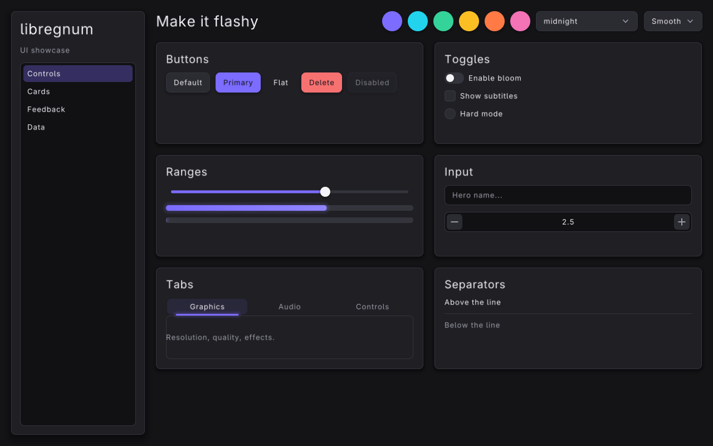
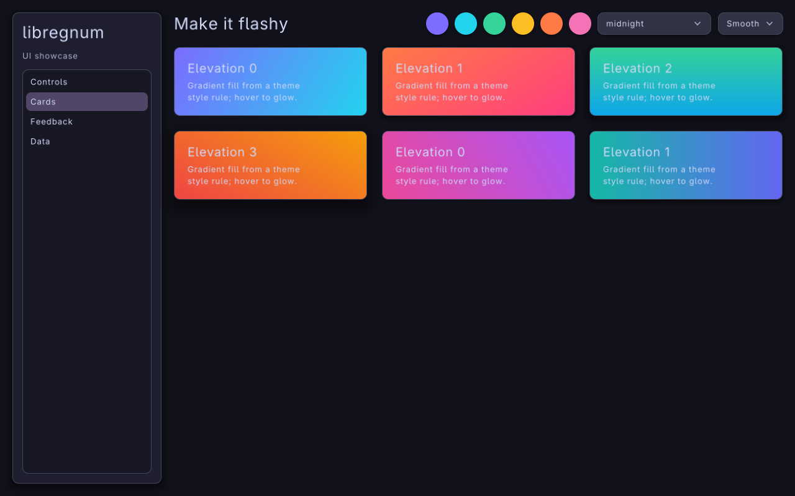
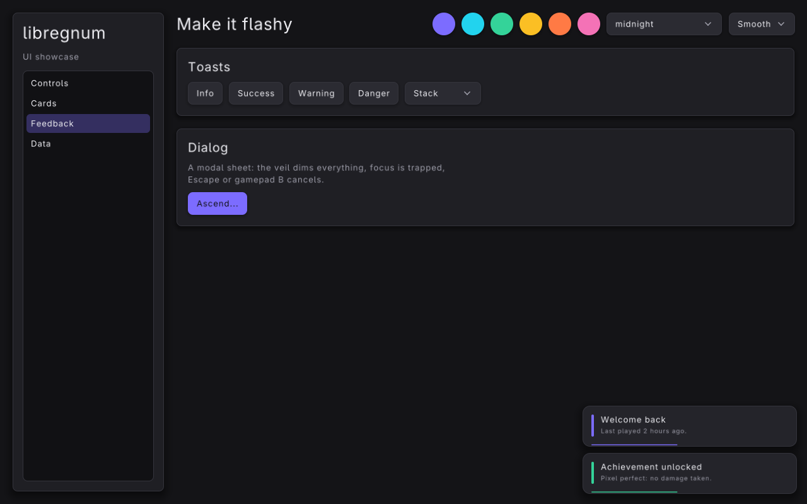
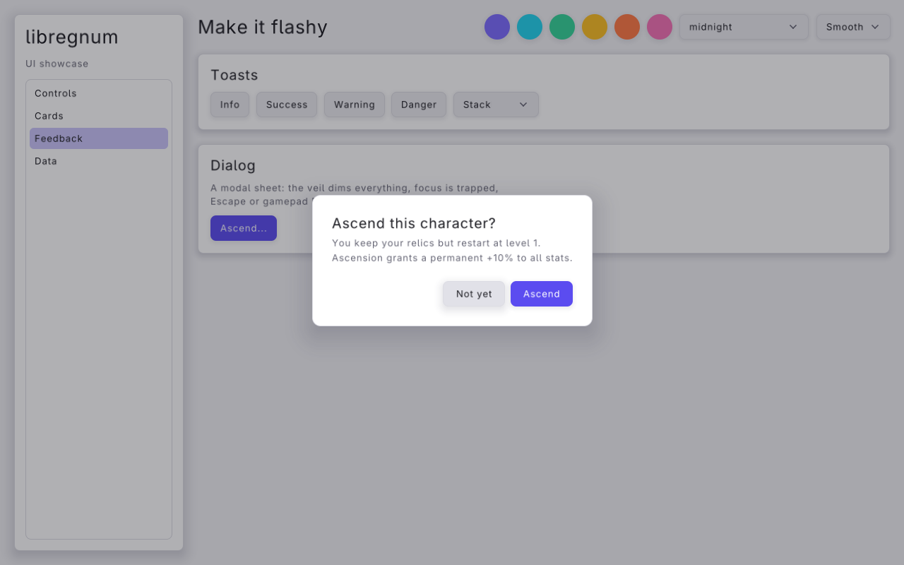
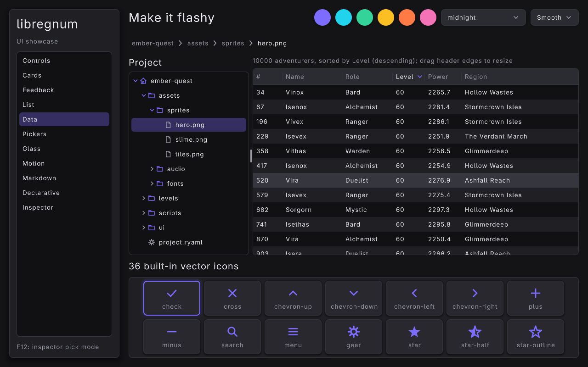

#+title: UI Showcase Example
#+description: Walkthrough of examples/ui-showcase.c, an app-style tour of every widget, theme presets, accent swatches, motion presets, gradient cards, toasts, a modal dialog and a 10,000-row virtualized list
#+authors: Zach Podbielniak
#+categories: libregnum ui examples
#+created: 2026-11-05T00:00:00-05:00
#+updated: 2026-11-05T00:00:00-05:00
#+version: 1.0

* UI Showcase Example
:PROPERTIES:
:CUSTOM_ID: ui-showcase
:END:
#+begin_quote
*[[file:../index.org][Home]]* > Examples > UI Showcase
#+end_quote

=examples/ui-showcase.c= is an application-style tour of the retained UI framework. One window holds a sidebar with a page list and a header with accent swatches, a theme picker and a motion picker. The four pages exercise every widget, the theme presets and accent derivation, spring motion presets, elevation shadows, gradient fills from theme style rules, staggered appear animations, toasts, a modal dialog and a virtualized list of 10,000 rows. It is the program to open when you want to see what the UI can do, and the source to read when you want a working pattern for a real tool or game launcher.

For a five-minute introduction read [[file:ui-basics.org][UI Basics]] first. For game-style menus over a live scene, a fixed virtual resolution and gamepad-first navigation, see [[file:ui-game-menu.org][Game UI Menu]].

** What it shows
:PROPERTIES:
:CUSTOM_ID: ui-showcase-what
:END:
- *Controls page*: buttons in the default, =primary=, =flat=, =danger= and disabled styles; a switch, a checkbox and a radio-style toggle; a slider wired to a progress bar plus an indeterminate progress bar; a text input with placeholder and a spin box; a tab view; a separator. Each group sits in an elevated card panel in a two-column grid.
- *Cards page*: six panels with gradient fills that come from theme style rules (=card-0= .. =card-5=), elevations 0 to 3, a coloured glow on hover, and a "pop" appear animation staggered across the grid that replays each time the page opens.
- *Feedback page*: buttons that raise =info=, =success=, =warning= and =danger= toasts, a combo box that switches the toast queue between stack, sequence and replace modes, and a button that presents a modal =LrgDialog= whose response raises another toast.
- *Data page*: an =LrgListView= over a =GListStore= of 10,000 items with multiple selection. Only the visible rows exist as widgets; a label reports the selection and activating a row raises a toast.
- *Header*: six accent swatches that re-derive the accent family of the running theme, a combo box listing every preset from =lrg_theme_list_presets()=, and a motion preset combo box (Smooth, Snappy, Bouncy, Wobbly, None).
- *Navigation*: the sidebar is itself an =LrgListView=; selecting a row shows that page, which flies up into place.

** Building and running
:PROPERTIES:
:CUSTOM_ID: ui-showcase-build
:END:
The example is part of the examples build. From the repository root:

#+begin_src sh
make -j"$(nproc)" lib
make -C examples
./examples/build/release/examples/ui-showcase
#+end_src

The examples Makefile writes binaries to =build/release/examples/= relative to =examples/= (=build/debug/examples/= for a debug build). Examples link libregnum statically by default, so no =LD_LIBRARY_PATH= is needed. The showcase loads no data files, so it can run from any directory.

*** Command-line options
:PROPERTIES:
:CUSTOM_ID: ui-showcase-options
:END:
The options come from the =GOptionEntry= table in =main()=:

| Option              | Short | Argument | Meaning                                                                                       |
|---------------------+-------+----------+-----------------------------------------------------------------------------------------------|
| =--theme=           | =-t=  | =NAME=   | Theme preset: =midnight= (default), =daylight=, =catppuccin-mocha=, =catppuccin-latte=, =high-contrast= |
| =--accent=          | =-a=  | =HEX=    | Accent colour, e.g. ='#22d3ee'= (quote it: =#= starts a shell comment in some contexts)       |
| =--motion=          | =-m=  | =NAME=   | Motion preset: =smooth=, =snappy=, =bouncy=, =wobbly=, =none= (case-insensitive)              |
| =--page=            | =-p=  | =NAME=   | Start page: =controls=, =cards=, =feedback=, =data= (case-insensitive)                        |
| =--toasts=          |       |          | Show two toasts at start-up                                                                   |
| =--dialog=          |       |          | Present the dialog on frame 10                                                                |
| =--screenshot=      | =-s=  | =PATH=   | Save a PNG of the window after =--frames= frames and exit                                     |
| =--frames=          | =-f=  | =N=      | Frames to run before =--screenshot= (default 90)                                              |
| =--license=         |       |          | Print the AGPLv3 notice and exit                                                              |
| =-h=, =--help=      |       |          | GLib's generated help, including the examples below                                           |

#+begin_src sh
ui-showcase
ui-showcase --theme catppuccin-latte --motion bouncy
ui-showcase --page cards --accent '#ff7a45'
ui-showcase --page feedback --toasts --dialog --screenshot dialog.png --frames 120
ui-showcase -t high-contrast -p data
#+end_src

An unknown =--theme= prints =ui-showcase: unknown theme 'NAME'= and leaves the built-in default theme in place. An unknown =--motion= or =--page= is silently ignored.

*** Controls
:PROPERTIES:
:CUSTOM_ID: ui-showcase-controls
:END:
| Input                       | Action                                                                     |
|-----------------------------+----------------------------------------------------------------------------|
| Mouse                       | Everything: hover, click, drag sliders, scroll lists, open combo boxes     |
| =Tab= / =Shift+Tab=         | Move keyboard focus; the focus ring appears                                |
| Arrow keys / D-pad / stick  | Spatial focus navigation, list cursor, slider and spin box steps           |
| =Enter= / =Space= / pad A   | Activate the focused widget                                                |
| =Escape= / pad B            | Close the open popup (combo box list, dialog)                              |
| Mouse wheel                 | Scroll the list view                                                       |

Input handling is covered in [[file:../modules/ui/input-and-focus.org][Input and Focus]].

** The application state
:PROPERTIES:
:CUSTOM_ID: ui-showcase-state
:END:
Everything the callbacks need lives in one plain struct on =main()='s stack, passed as =user_data= to every signal handler:

#+begin_src C
typedef struct
{
	LrgCanvas      *canvas;
	LrgHBox        *root;
	LrgListView    *nav;
	LrgOverlay     *pages;
	LrgWidget      *page[4];
	GPtrArray      *cards;       /* LrgPanel, for replaying their appear */
	LrgToastQueue  *toasts;
	LrgComboBox    *toast_mode;
	LrgProgressBar *progress;
	LrgSlider      *volume;
	LrgLabel       *selection;
	LrgDialog      *dialog;
	gchar          *accent;
} Showcase;
#+end_src

Most of these are borrowed pointers into the widget tree. The fields that keep their own reference (=dialog=, =toast_mode=, =selection=, =nav=, =pages=, =root=, =toasts=, =canvas=) are released with =g_clear_object()= at the end of =main()=. =accent= remembers the hex string of the chosen swatch so it survives a theme switch.

** Building the widget tree
:PROPERTIES:
:CUSTOM_ID: ui-showcase-tree
:END:
The tree is built once, in =build_ui()=, before the first frame:

#+begin_example
LrgCanvas
├── LrgHBox root (padding 20, spacing 20)
│   ├── LrgPanel sidebar (240 wide, elevation 2, fill-children)
│   │   └── LrgVBox: "libregnum" title, "UI showcase", LrgListView nav
│   └── LrgVBox main_box (fill weight 1)
│       ├── LrgHBox header: title, 6 accent swatches, theme combo, motion combo
│       └── LrgOverlay pages (fill weight 1)
│           ├── Controls page (LrgGrid, 2 columns)
│           ├── Cards page    (LrgGrid, 3 columns)
│           ├── Feedback page (LrgVBox)
│           └── Data page     (LrgVBox with an LrgListView)
└── LrgToastQueue (covers the canvas, toasts bottom-right)
#+end_example

*** Two small helpers
:PROPERTIES:
:CUSTOM_ID: ui-showcase-helpers
:END:
Containers take their own reference to a child, so a freshly created widget is added and then unreffed. =add()= does both in one call; it is used whenever the caller does not need to keep the pointer:

#+begin_src C
/* add: append a child and drop our reference */
static void
add (gpointer container,
     gpointer child)
{
	lrg_container_add_child (LRG_CONTAINER (container), LRG_WIDGET (child));
	g_object_unref (child);
}
#+end_src

=section()= builds the card used for every group on the Controls and Feedback pages: an elevated =LrgPanel= with =fill-children= on, holding a =LrgVBox= whose first child is a heading label. It returns the inner box so the caller can append the group's widgets:

#+begin_src C
static LrgVBox *
section (LrgContainer *parent,
         const gchar  *title)
{
	LrgPanel *panel = lrg_panel_new ();
	LrgVBox  *box = lrg_vbox_new ();

	lrg_panel_set_elevation (panel, 1);
	lrg_panel_set_fill_children (panel, TRUE);
	lrg_container_set_padding (LRG_CONTAINER (panel), 18.0f);
	lrg_container_set_padding (LRG_CONTAINER (box), 0.0f);
	lrg_container_set_spacing (LRG_CONTAINER (box), 12.0f);
	add (box, label_with_class (title, "heading"));
	lrg_container_add_child (LRG_CONTAINER (panel), LRG_WIDGET (box));
	g_object_unref (box);
	add (parent, panel);
	return box;
}
#+end_src

=lrg_panel_set_fill_children()= is what makes a panel behave like a frame: children are laid out inside the padded content box (honouring margins, alignment and min/max size) and the panel measures as its largest child plus padding. Without it a panel leaves children where they were positioned by hand, which is the legacy behaviour. =lrg_panel_set_elevation()= picks the shadow depth (0 is flat, 3 floats highest). See [[file:../modules/ui/widgets/panel.org][Panel]] and [[file:../modules/ui/layout.org][Layout]].

The labels use style classes the themes understand: =title= (the largest size), =heading= and =muted= (secondary text colour). =label_with_class()= is a two-line wrapper around =lrg_label_new()= + =lrg_widget_add_class()=.

*** The sidebar and the header
:PROPERTIES:
:CUSTOM_ID: ui-showcase-sidebar
:END:
The sidebar is pinned to 240 units by giving it the same minimum and maximum width; a maximum of 0 on the other axis means "unbounded", so it still stretches vertically:

#+begin_src C
lrg_widget_set_min_size (LRG_WIDGET (sidebar), SIDEBAR_WIDTH, 0.0f);
lrg_widget_set_max_size (LRG_WIDGET (sidebar), SIDEBAR_WIDTH, 0.0f);
lrg_panel_set_elevation (sidebar, 2);
lrg_panel_set_fill_children (sidebar, TRUE);
#+end_src

The page list is an =LrgListView= over a =GListStore= of =ShowcaseItem= objects. =ShowcaseItem= is a tiny final =GObject= type defined at the top of the file with one read-only =label= property; the list view's default factory finds a readable string property named =string=, =text=, =name=, =label= or =title= and shows it, so no row factory is needed:

#+begin_src C
app->nav = lrg_list_view_new ();
lrg_list_view_set_model (app->nav, G_LIST_MODEL (nav_store));
lrg_widget_set_fill_weight (LRG_WIDGET (app->nav), 1.0f);
g_signal_connect (app->nav, "selection-changed", G_CALLBACK (on_nav_selection), app);
#+end_src

=lrg_widget_set_fill_weight()= gives a child a share of the box's spare space along the box's axis; with weight 1 the list takes all the height left under the two labels. The header uses the same trick on its title label so the pickers are pushed to the right edge.

The header holds six accent swatches. Each is an ordinary =LrgButton= with empty text, a fixed 36x36 size, a corner radius of half that (a circle), and a per-instance colour override. The hex string is attached as object data for the click handler:

#+begin_src C
for (i = 0; i < G_N_ELEMENTS (accents); i++)
{
	LrgButton *swatch = lrg_button_new ("");
	GrlColor   c;

	lrg_color_parse (accents[i], &c);
	lrg_button_set_normal_color (swatch, &c);
	lrg_button_set_corner_radius (swatch, 18.0f);
	lrg_widget_set_min_size (LRG_WIDGET (swatch), 36.0f, 36.0f);
	lrg_widget_set_max_size (LRG_WIDGET (swatch), 36.0f, 36.0f);
	lrg_widget_set_valign (LRG_WIDGET (swatch), LRG_ALIGN_CENTER);
	g_object_set_data (G_OBJECT (swatch), "accent", (gpointer) accents[i]);
	g_signal_connect (swatch, "clicked", G_CALLBACK (on_accent_clicked), app);
	add (header, swatch);
}
#+end_src

The theme combo box is filled from =lrg_theme_list_presets()= and pre-selects the preset whose name matches the active default theme, so =--theme= is reflected in the picker:

#+begin_src C
for (i = 0; presets[i] != NULL; i++)
{
	lrg_combo_box_append (theme_combo, presets[i]);
	if (g_strcmp0 (presets[i], lrg_theme_get_name (lrg_theme_get_default ())) == 0)
		lrg_combo_box_set_selected (theme_combo, (gint) i);
}
g_signal_connect (theme_combo, "changed", G_CALLBACK (on_theme_changed), app);
#+end_src

See [[file:../modules/ui/widgets/combo-box.org][Combo Box]] and [[file:../modules/ui/widgets/button.org][Button]].

*** Pages in an overlay
:PROPERTIES:
:CUSTOM_ID: ui-showcase-pages
:END:
The four pages are stacked in an =LrgOverlay=, which lays every child over the same rectangle. Only one is visible at a time. Each page gets a fly-up appear animation; the Data page fills the overlay vertically (the list should use all the height), the others align to the top:

#+begin_src C
app->pages = lrg_overlay_new ();
lrg_widget_set_fill_weight (LRG_WIDGET (app->pages), 1.0f);
app->page[0] = build_controls_page (app);
app->page[1] = build_cards_page (app);
app->page[2] = build_feedback_page (app);
app->page[3] = build_data_page (app);
for (i = 0; i < G_N_ELEMENTS (app->page); i++)
{
	lrg_widget_set_appear (app->page[i], LRG_APPEAR_FLY_UP, 0.0f);
	lrg_widget_set_valign (app->page[i], i == 3 ? LRG_ALIGN_FILL : LRG_ALIGN_START);
	add (app->pages, app->page[i]);
}
#+end_src

Switching pages is just visibility. Because an appear animation plays "the first time the widget is painted and whenever it is shown again", making a page visible is enough to replay its fly-up. The cards additionally replay their own staggered pop:

#+begin_src C
static void
show_page (Showcase *app,
           guint     index)
{
	guint i;

	for (i = 0; i < G_N_ELEMENTS (app->page); i++)
		lrg_widget_set_visible (app->page[i], i == index);

	/* Cards pop in again each time their page opens */
	if (index == 1)
		for (i = 0; i < app->cards->len; i++)
			lrg_widget_play_appear (g_ptr_array_index (app->cards, i));
}
#+end_src

=on_nav_selection()= calls =show_page()= with =lrg_list_view_get_selected()=, ignoring =LRG_LIST_VIEW_INVALID_POSITION=. See [[file:../modules/ui/widgets/overlay.org][Overlay]].

*** Controls page: a grid of sections
:PROPERTIES:
:CUSTOM_ID: ui-showcase-controls-page
:END:
=build_controls_page()= is an =LrgGrid= with two columns and 20-unit gaps; every =section()= call adds one cell. A few highlights:

#+begin_src C
/* Buttons in every flavour */
btn = lrg_button_new ("Primary");
lrg_widget_add_class (LRG_WIDGET (btn), "primary");
add (row, btn);
btn = lrg_button_new ("Flat");
lrg_widget_add_class (LRG_WIDGET (btn), "flat");
add (row, btn);
btn = lrg_button_new ("Delete");
lrg_widget_add_class (LRG_WIDGET (btn), "danger");
add (row, btn);
btn = lrg_button_new ("Disabled");
lrg_widget_set_enabled (LRG_WIDGET (btn), FALSE);
add (row, btn);

/* Toggles: one widget, three looks */
add (box, lrg_checkbox_new_with_style ("Enable bloom", LRG_CHECKBOX_STYLE_SWITCH));
add (box, lrg_checkbox_new ("Show subtitles"));
add (box, lrg_checkbox_new_with_style ("Hard mode", LRG_CHECKBOX_STYLE_RADIO));
#+end_src

The slider drives the progress bar through its =value-changed= signal, and a second progress bar runs in indeterminate mode:

#+begin_src C
app->volume = lrg_slider_new_with_range (0.0, 100.0, 1.0);
lrg_slider_set_value (app->volume, 65.0);
g_signal_connect (app->volume, "value-changed", G_CALLBACK (on_volume_changed), app);
add (box, app->volume);
app->progress = lrg_progress_bar_new ();
lrg_progress_bar_set_max (app->progress, 100.0);
lrg_progress_bar_set_value (app->progress, 65.0);
add (box, app->progress);
#+end_src

#+begin_src C
static void
on_volume_changed (LrgSlider *slider,
                   gpointer   user_data)
{
	Showcase *app = user_data;

	lrg_progress_bar_set_value (app->progress, lrg_slider_get_value (slider));
}
#+end_src

The Input section shows =lrg_text_input_new_with_placeholder()= and a spin box with one decimal (=lrg_spin_box_new_with_range (0.0, 10.0, 0.5)= + =lrg_spin_box_set_digits (spin, 1)=). The Tabs section gives the tab view a minimum height of 110 so its pages have room, then adds three muted labels with =lrg_tab_view_add_tab()=.

Widget references: [[file:../modules/ui/widgets/button.org][Button]], [[file:../modules/ui/widgets/checkbox.org][Checkbox]], [[file:../modules/ui/widgets/slider.org][Slider]], [[file:../modules/ui/widgets/progress-bar.org][Progress Bar]], [[file:../modules/ui/widgets/text-input.org][Text Input]], [[file:../modules/ui/widgets/spin-box.org][Spin Box]], [[file:../modules/ui/tab-view.org][Tab View]], [[file:../modules/ui/widgets/separator.org][Separator]].

*** Cards page: gradient panels with a staggered pop
:PROPERTIES:
:CUSTOM_ID: ui-showcase-cards-page
:END:

The cards are plain panels. Their look comes entirely from a style class (=card-0= .. =card-5=) that matches theme style rules added in [[#ui-showcase-rules][Gradient cards from style rules]]:

#+begin_src C
for (i = 0; i < 6; i++)
{
	g_autofree gchar *klass = g_strdup_printf ("card-%u", i);
	g_autofree gchar *title = g_strdup_printf ("Elevation %u", i % 4);
	LrgPanel         *card = lrg_panel_new ();
	LrgVBox          *box = lrg_vbox_new ();

	lrg_widget_add_class (LRG_WIDGET (card), klass);
	lrg_panel_set_elevation (card, i % 4);
	lrg_panel_set_fill_children (card, TRUE);
	lrg_container_set_padding (LRG_CONTAINER (card), 22.0f);
	lrg_widget_set_appear (LRG_WIDGET (card), LRG_APPEAR_POP, 0.06f * (gfloat) i);
	/* ... heading + body label in box ... */
	g_ptr_array_add (app->cards, card);
	lrg_container_add_child (LRG_CONTAINER (grid), LRG_WIDGET (card));
}
#+end_src

Note the ownership: the card is added to the grid without an unref, and its reference is handed to =app->cards= (a =GPtrArray= with =g_object_unref= as its free function) so =show_page()= can replay the animations later.

*** Feedback page: toasts and a modal dialog
:PROPERTIES:
:CUSTOM_ID: ui-showcase-feedback-page
:END:

The toast queue is created in =build_ui()= and added to the canvas *after* the root box, so it is painted on top. It is a pointer-transparent layer that covers the canvas and stacks toasts in the bottom-right corner:

#+begin_src C
app->toasts = lrg_toast_queue_new ();
lrg_container_add_child (LRG_CONTAINER (app->canvas), LRG_WIDGET (app->toasts));
#+end_src

Raising a toast is three calls. The queue takes its own reference:

#+begin_src C
static void
show_toast (Showcase     *app,
            const gchar  *title,
            const gchar  *message,
            LrgToastKind  kind)
{
	g_autoptr(LrgToast) toast = lrg_toast_new (title, message);

	lrg_toast_set_kind (toast, kind);
	lrg_toast_queue_show (app->toasts, toast);
}
#+end_src

Four buttons share one handler; each carries its index as object data (=g_object_set_data (G_OBJECT (btn), "kind", GINT_TO_POINTER (i))=) which =on_toast_clicked()= maps to a title, message and =LrgToastKind=. The mode combo box maps its selection to =LRG_TOAST_MODE_STACK= (several at once), =LRG_TOAST_MODE_SEQUENCE= (one after another) or =LRG_TOAST_MODE_REPLACE= (the newest replaces the current one) with =lrg_toast_queue_set_mode()=.

The dialog (shown above in the =daylight= preset) is built once and presented on demand. Response ids are plain integers; =LRG_DIALOG_RESPONSE_CANCEL= is what Escape and pad B produce, and the button added with =primary= = =TRUE= gets the accent style, initial focus and Enter:

#+begin_src C
app->dialog = lrg_dialog_new ("Ascend this character?",
                              "You keep your relics but restart at level 1.\n"
                              "Ascension grants a permanent +10% to all stats.");
lrg_dialog_add_button (app->dialog, "Not yet", LRG_DIALOG_RESPONSE_CANCEL, FALSE);
lrg_dialog_add_button (app->dialog, "Ascend", 1, TRUE);
g_signal_connect (app->dialog, "response", G_CALLBACK (on_dialog_response), app);
#+end_src

#+begin_src C
static void
on_dialog_clicked (LrgButton *button,
                   gpointer   user_data)
{
	Showcase *app = user_data;

	lrg_dialog_present (app->dialog, app->canvas);
}
#+end_src

=lrg_dialog_present()= shows the dialog as a modal popup centred on the canvas: a veil dims everything behind it, input outside is blocked, focus is trapped inside and moves to the primary button. The =response= handler raises a success toast for id 1 and an info toast otherwise. See [[file:../modules/ui/widgets/toast.org][Toast]] and [[file:../modules/ui/widgets/dialog.org][Dialog]].

*** Data page: a 10,000-row virtualized list
:PROPERTIES:
:CUSTOM_ID: ui-showcase-data-page
:END:

The list view only creates row widgets for the rows on screen and rebinds them as you scroll, so the model can be large:

#+begin_src C
for (i = 0; i < N_LIST_ITEMS; i++)
{
	g_autoptr(ShowcaseItem) item = showcase_item_new (i);

	g_list_store_append (store, item);
}
lrg_list_view_set_model (list, G_LIST_MODEL (store));
lrg_list_view_set_selection_mode (list, LRG_SELECTION_MODE_MULTIPLE);
lrg_widget_set_fill_weight (LRG_WIDGET (list), 1.0f);
g_signal_connect (list, "selection-changed", G_CALLBACK (on_list_selection), app);
g_signal_connect (list, "row-activated", G_CALLBACK (on_list_activated), app);
#+end_src

=selection-changed= updates the status label from =lrg_list_view_get_selected()=; =row-activated= (double-click, Enter or pad A on the cursor row) receives the position and raises a toast. The page itself has =LRG_ALIGN_FILL= (set in =build_ui()=) so the list gets the whole height. See [[file:../modules/ui/widgets/list-view.org][List View]].

** Theming
:PROPERTIES:
:CUSTOM_ID: ui-showcase-theming
:END:
The showcase never holds on to an =LrgTheme=. Widgets read the process-wide default theme every frame, so replacing it (or mutating it) restyles the running UI immediately.

*** Presets and runtime switching
:PROPERTIES:
:CUSTOM_ID: ui-showcase-presets
:END:
=apply_theme()= is used both at start-up (=--theme=) and from the theme combo box. It builds a fresh preset, re-applies the remembered accent, re-adds the card style rules (a new theme has none) and installs it as the default:

#+begin_src C
static void
apply_theme (Showcase    *app,
             const gchar *preset)
{
	g_autoptr(LrgTheme) theme = lrg_theme_new_preset (preset);
	GrlColor            accent;

	if (theme == NULL)
	{
		g_printerr ("ui-showcase: unknown theme '%s'\n", preset);
		return;
	}

	if (app->accent != NULL && lrg_color_parse (app->accent, &accent))
		lrg_theme_set_accent (theme, &accent);
	add_card_rules (theme);
	lrg_theme_set_default (theme);
}
#+end_src

=lrg_theme_set_default()= takes its own reference, which is why the local can be a =g_autoptr=. =lrg_theme_new_preset()= returns =NULL= for unknown names. See [[file:../guides/theming.org][Theming Guide]] and [[file:../modules/ui/theme.org][Theme]].

*** Accent swatches
:PROPERTIES:
:CUSTOM_ID: ui-showcase-accent
:END:
Clicking a swatch changes the accent of the *current* default theme in place. =lrg_theme_set_accent()= derives the whole accent family (accent, hover, pressed, text on accent, focus, selection) from one colour, so primary buttons, selection highlights, focus rings and slider fills all follow:

#+begin_src C
static void
on_accent_clicked (LrgButton *button,
                   gpointer   user_data)
{
	Showcase   *app = user_data;
	const gchar *hex = g_object_get_data (G_OBJECT (button), "accent");
	GrlColor    accent;

	g_free (app->accent);
	app->accent = g_strdup (hex);
	if (lrg_color_parse (hex, &accent))
		lrg_theme_set_accent (lrg_theme_get_default (), &accent);
}
#+end_src

The hex is also stored in =app->accent= so that =apply_theme()= can carry it over to the next preset.

*** Gradient cards from style rules
:PROPERTIES:
:CUSTOM_ID: ui-showcase-rules
:END:
Style rules let a theme restyle any widget part by type name, style class and state. The showcase adds two rules per card class in code: a resting rule with a linear gradient for the =BOX= part, and a hover rule that adds a glow in the gradient's first colour at 55 % alpha:

#+begin_src C
for (i = 0; i < G_N_ELEMENTS (grads); i++)
{
	g_autofree gchar        *klass = g_strdup_printf ("card-%u", i);
	g_autoptr(LrgStyleRule)  rule = lrg_style_rule_new ("LrgPanel", klass, LRG_UI_PART_BOX,
	                                                    LRG_WIDGET_STATE_NONE);
	g_autoptr(LrgStyleRule)  hover = lrg_style_rule_new ("LrgPanel", klass, LRG_UI_PART_BOX,
	                                                     LRG_WIDGET_STATE_HOVERED);
	LrgPaintGradient         g;
	GrlColor                 a;
	GrlColor                 b;
	GrlColor                 glow;

	lrg_color_parse (grads[i].a, &a);
	lrg_color_parse (grads[i].b, &b);
	lrg_paint_gradient_init_linear (&g, &a, &b, grads[i].angle);
	lrg_part_look_set_gradient (lrg_style_rule_get_look (rule), &g);
	lrg_theme_add_style_rule (theme, rule);

	/* Hovered cards glow in their own colour */
	lrg_paint_color_with_alpha (&a, 0.55f, &glow);
	lrg_part_look_set_glow (lrg_style_rule_get_look (hover), &glow, 28.0f);
	lrg_theme_add_style_rule (theme, hover);
}
#+end_src

A rule only sets the fields you touch; everything else (radius, border, the elevation shadow) still comes from the panel's built-in look. The hovered rule is blended in by the panel's hover spring, so the glow fades in and out rather than snapping. The same rules can be written in a theme YAML file under =styles:=; [[file:ui-game-menu.org#game-menu-theme][the game menu example]] does that. See [[file:../modules/ui/styling.org][Styling]] and the gradient and glow primitives in [[file:../modules/paint/index.org][Paint]].

** Motion
:PROPERTIES:
:CUSTOM_ID: ui-showcase-motion
:END:
*** Motion presets
:PROPERTIES:
:CUSTOM_ID: ui-showcase-motion-presets
:END:
Every hover, press, focus and appear transition runs on a damped spring whose stiffness and damping come from the theme's motion preset. The motion combo box sets it on the default theme:

#+begin_src C
static const struct { const gchar *name; LrgMotion motion; } motions[] = {
	{ "Smooth", LRG_MOTION_SMOOTH },
	{ "Snappy", LRG_MOTION_SNAPPY },
	{ "Bouncy", LRG_MOTION_BOUNCY },
	{ "Wobbly", LRG_MOTION_WOBBLY },
	{ "None",   LRG_MOTION_NONE }
};

static void
on_motion_changed (LrgComboBox *combo,
                   gpointer     user_data)
{
	gint i = lrg_combo_box_get_selected (combo);

	if (i >= 0 && i < (gint) G_N_ELEMENTS (motions))
		lrg_theme_set_motion (lrg_theme_get_default (), motions[i].motion);
}
#+end_src

| Preset   | Feel                                           |
|----------+------------------------------------------------|
| =SMOOTH= | Critically damped, no overshoot (0.30 s)       |
| =SNAPPY= | Quick, nearly critically damped (0.16 s)       |
| =BOUNCY= | Visible overshoot (0.38 s)                     |
| =WOBBLY= | Playful, several oscillations (0.50 s)         |
| =NONE=   | No animation; values jump to their target      |

Switch to Bouncy and open the Cards page to see the pop overshoot. Note that picking a new theme preset also resets the motion to that preset's own value; the combo box is not re-applied.

*** Appear animations and stagger
:PROPERTIES:
:CUSTOM_ID: ui-showcase-appear
:END:
=lrg_widget_set_appear (widget, kind, delay)= gives a widget an entrance animation that plays on first paint and whenever it is shown again. The showcase uses two:

- Pages: =LRG_APPEAR_FLY_UP= with no delay; each page rises into place when selected.
- Cards: =LRG_APPEAR_POP= (fade in while scaling up from 85 %) with a delay of =0.06 * i= seconds, so the six cards cascade left-to-right, top-to-bottom. =lrg_widget_play_appear()= restarts it on demand.

Other kinds are =FADE=, =ZOOM=, =FLY_DOWN=, =FLY_LEFT=, =FLY_RIGHT= and =DROP=. See [[file:../modules/ui/animation.org][Animation]].

** The frame loop
:PROPERTIES:
:CUSTOM_ID: ui-showcase-loop
:END:
The window is created resizable with 4x MSAA and HiDPI hints. Before the loop the theme is applied (it must exist before widgets measure text), then the tree is built, then the command-line options that need the tree (=--motion=, =--page=, =--toasts=) are honoured:

#+begin_src C
SetConfigFlags (FLAG_WINDOW_RESIZABLE | FLAG_MSAA_4X_HINT | FLAG_WINDOW_HIGHDPI);
window = grl_window_new (WINDOW_WIDTH, WINDOW_HEIGHT, "libregnum UI showcase");
grl_window_set_target_fps (window, 60);

app.accent = g_strdup (opt_accent);
apply_theme (&app, opt_theme != NULL ? opt_theme : "midnight");
build_ui (&app);
#+end_src

=build_ui()= also calls =lrg_canvas_set_paint_background (app->canvas, TRUE)= so the canvas fills the window with the theme's =WINDOW= colour; that is why the loop never calls =ClearBackground()=. Each frame:

#+begin_src C
while (!grl_window_should_close (window))
{
	gfloat w = (gfloat) GetScreenWidth ();
	gfloat h = (gfloat) GetScreenHeight ();

	/* The canvas and the root box follow the window */
	lrg_widget_set_size (LRG_WIDGET (app.canvas), w, h);
	lrg_widget_set_size (LRG_WIDGET (app.root), w, h);
	lrg_widget_set_size (LRG_WIDGET (app.toasts), w, h);

	lrg_canvas_handle_input (app.canvas);
	if (opt_dialog && frame == 10)
		lrg_dialog_present (app.dialog, app.canvas);

	grl_window_begin_drawing (window);
	lrg_canvas_render (app.canvas);
	/* ... screenshot mode, see below ... */
	grl_window_end_drawing (window);
	frame++;
}
#+end_src

1. *Window-size following*: the canvas, the root box and the toast layer are sized to the window every frame. Setting the same size again is free; a changed size re-runs layout.
2. =lrg_canvas_handle_input()= polls mouse, keyboard and gamepad, hit-tests, moves focus and dispatches events, then calls =lrg_canvas_update()= with the frame's delta time to advance every spring, appear animation and popup fade. Signal handlers (=clicked=, =changed=, =response=...) run inside this call. Call it every frame, even when you want to ignore input, or the UI stops animating.
3. =lrg_canvas_render()= lays out what changed, records the tree into a paint list (=lrg_canvas_record()=) and draws it in batched SDF passes. See [[file:../modules/ui/canvas-api.org][Canvas API]] and [[file:../modules/paint/index.org][Paint]].

** Screenshot mode
:PROPERTIES:
:CUSTOM_ID: ui-showcase-screenshot
:END:
With =--screenshot PATH= the loop grabs the back buffer after =--frames= frames (after =lrg_canvas_render()= and before the buffer swap) and exits:

#+begin_src C
if (opt_screenshot != NULL && frame >= opt_frames)
{
	Image shot = LoadImageFromScreen ();

	ExportImage (shot, opt_screenshot);
	UnloadImage (shot);
	grl_window_end_drawing (window);
	break;
}
#+end_src

The default of 90 frames (1.5 s at 60 fps) lets appear animations and the theme's springs settle. With =--dialog= the dialog opens on frame 10, so its rise has finished well before frame 90. The images in this page were produced this way under a headless X server, e.g. =ui-showcase --theme daylight --page feedback --dialog --screenshot feedback.png=.

** Things to try
:PROPERTIES:
:CUSTOM_ID: ui-showcase-try
:END:
- Cycle every preset in the theme combo box with the Cards page open: the gradients stay (they are re-added per theme), while panels, text and shadows follow the preset.
- Press =Tab= and then use the arrow keys or a gamepad D-pad: focus moves spatially across the grid, and the focus ring springs between widgets.
- Set Motion to Wobbly and hover the buttons; set it to None to see the same UI with no animation.
- Switch the toast mode to Sequence and click Info four times quickly.
- On the Data page, Shift-click and Ctrl-click rows to build a multiple selection, then press Enter on the cursor row.

** Extending it
:PROPERTIES:
:CUSTOM_ID: ui-showcase-extend
:END:
- *A new page*: write a =build_*_page()= returning an =LrgWidget *=, grow =page[]= and =page_names[]= to five entries, and assign it in =build_ui()=. The nav list, =--page= and the appear animation pick it up automatically.
- *Your own card look*: add a rule with a different =LrgPartLook= field (border, radii, shadow) in =add_card_rules()=, or match a state such as =LRG_WIDGET_STATE_PRESSED=.
- *Richer list rows*: replace the default rows with =lrg_list_view_set_factory()= (a =create= and a =bind= callback), as shown in [[file:../modules/ui/widgets/list-view.org][List View]].
- *Theme from a file*: replace =lrg_theme_new_preset()= with =lrg_theme_new_from_file()= and ship a YAML theme, as [[file:ui-game-menu.org][Game UI Menu]] does.
- *Dialog with content*: =lrg_dialog_set_content()= puts any widget (a form, a list) between the body text and the buttons.

** See also
:PROPERTIES:
:CUSTOM_ID: ui-showcase-see-also
:END:
- [[file:ui-basics.org][UI Basics]]: the minimal program
- [[file:ui-game-menu.org][Game UI Menu]]: virtual resolution, YAML theme, pause menu, gamepad
- [[file:../modules/ui/index.org][UI module]], [[file:../modules/ui/widget.org][Widget]], [[file:../modules/ui/layout.org][Layout]], [[file:../modules/ui/container.org][Container]]
- [[file:../modules/ui/styling.org][Styling]], [[file:../modules/ui/theme.org][Theme]], [[file:../guides/theming.org][Theming Guide]]
- [[file:../modules/ui/animation.org][Animation]], [[file:../modules/ui/input-and-focus.org][Input and Focus]], [[file:../modules/ui/canvas-api.org][Canvas API]]
- [[file:../modules/paint/index.org][Paint]]
