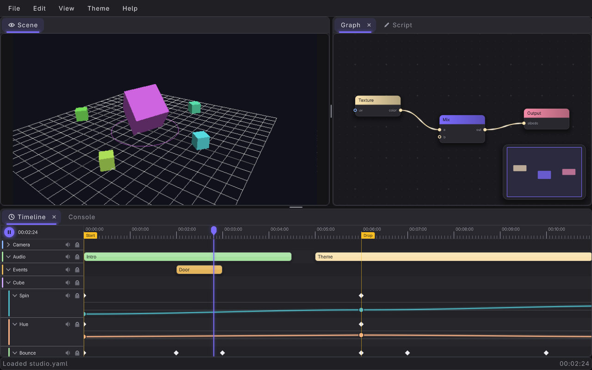
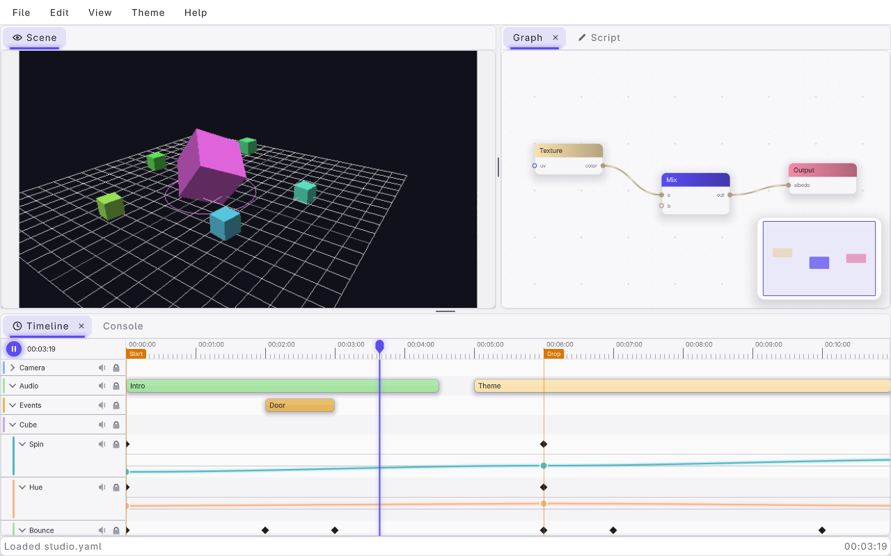
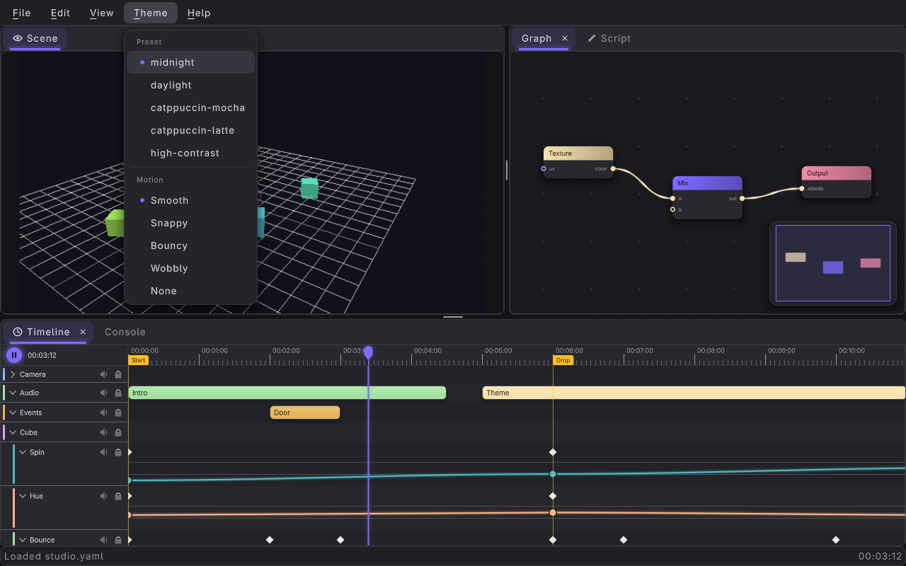
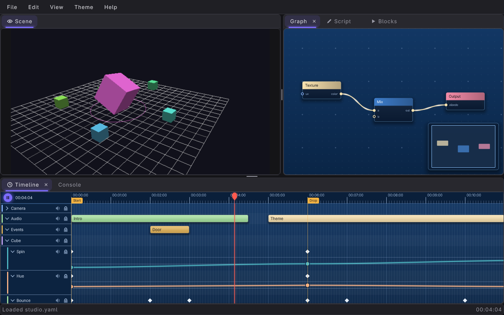
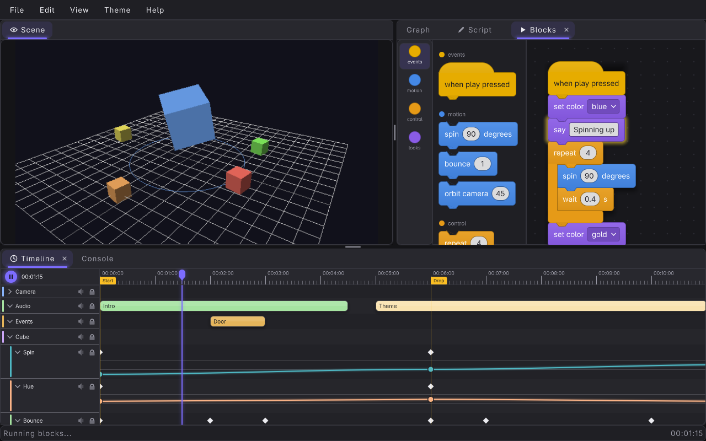
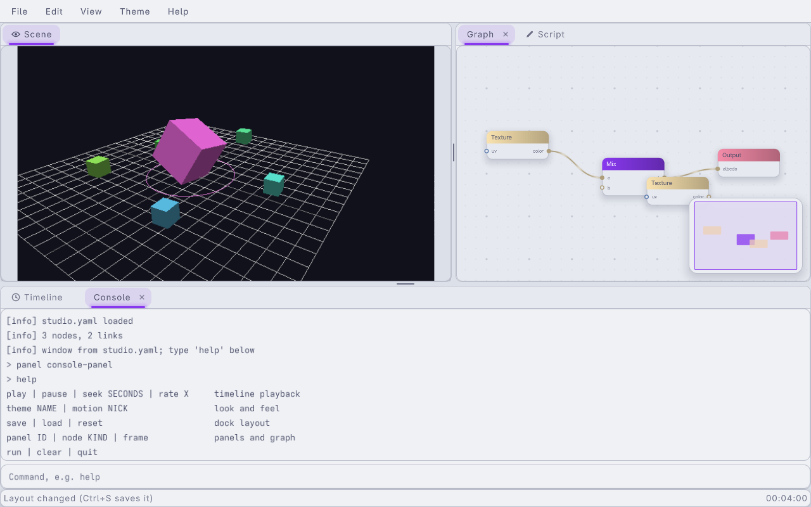

#+title: UI Studio Example
#+description: Walkthrough of examples/ui-studio.c, a docked tool application built purely on the libregnum UI: a menu bar over a dock area with a live 3D viewport, a node graph, a block editor whose scripts drive the scene, a timeline whose keyframes animate it, a script editor and a console, loaded from examples/data/ui/studio.yaml with LrgUILoader (or built in C), with GIO actions, global shortcuts, theme and canvas-look switching, file dialogs, desktop notifications and a dock layout saved as YAML
#+authors: Zach Podbielniak
#+categories: libregnum ui examples
#+created: 2026-11-06T00:00:00-05:00
#+updated: 2026-11-06T00:00:00-05:00
#+version: 1.1

* UI Studio Example
:PROPERTIES:
:CUSTOM_ID: ui-studio
:END:
#+begin_quote
*[[file:../index.org][Home]]* > Examples > UI Studio
#+end_quote

=examples/ui-studio.c= is a "flashy tool app": an editor-style window made of nothing but libregnum widgets. A menu bar sits over an =LrgDockArea= whose panels hold a live 3D scene (=LrgViewport=), a material graph (=LrgNodeGraph=), a block editor (=LrgBlockEditor=) whose Scratch-style scripts a tiny interpreter runs against the scene, a timeline (=LrgTimelineView=) whose curves spin, colour and bounce the scene while it plays, a script editor (=LrgTextEditor= with a custom =LrgSyntax= language) and a console with a command line. Everything a user can do is a GIO action, reachable from the menus, from global shortcuts and from the console. The dock layout is saved to and restored from YAML through file dialogs (=LrgFileDialog=), and a save is announced with a desktop notification (=LrgNotification=, or an in-app toast when there is no notification server).

The window itself is declared in =examples/data/ui/studio.yaml= and built by =LrgUILoader=; when the document is missing, fails to load or lacks one of the widgets the program needs, the same window is built in C. Either way, the same C code then wires the scene, the animation, the actions and the console.

Where [[file:ui-showcase.org][UI Showcase]] shows each widget on its own page, this example shows them working together as one application.

** What it shows
:PROPERTIES:
:CUSTOM_ID: ui-studio-what
:END:
- *Declarative window*: a menu model, a context menu, a script language, a graph document, timeline tracks and the dock arrangement, all in one YAML file loaded by =lrg_ui_loader_load_from_file()=; widgets are picked out by id with =lrg_ui_loader_get_widget()=. ([[#ui-studio-yaml][details]])
- *C fallback*: =build_ui_in_c()= builds the identical tree with the same ids, so =--c-only= and a missing data directory still run. ([[#ui-studio-c][details]])
- *3D scene in a dock panel*: an =LrgViewport= with a fixed 640 x 360 render, letterboxed (=contain=), drawn with =GrlCamera3D= and shaded raylib cubes; drag to orbit, wheel to zoom. ([[#ui-studio-scene][details]])
- *Timeline drives the scene*: a "Cube" group of curve tracks (Spin, Hue, Bounce) and the document's "Camera / Position X" curve are sampled with =lrg_timeline_view_evaluate()= at the playhead every time the scene renders; playback, scrubbing and editing keys all move the scene. ([[#ui-studio-animation][details]])
- *Node graph* with a context menu (Add Node, Frame All) declared in YAML.
- *Canvas looks*: View > Canvas Look is a radio submenu over the five =LrgCanvasLook= presets (Auto, Modern, Blueprint, Blender, Neon), applied to the graph and the timeline together; =--look= picks one at start-up. ([[#ui-studio-looks][details]])
- *Block programming*: a Blocks panel holds an =LrgBlockEditor= loaded from =examples/data/ui/studio-blocks.yaml= (palette and sample program); double-clicking a script, or Space, runs it one block per tick with the running block glowing, spinning, bouncing and tinting the cube and swinging the camera. ([[#ui-studio-blocks][details]])
- *File dialogs*: File > Open... and Save As... use =LrgFileDialog= (an in-app sheet, or the desktop's chooser through the XDG portal with =--native-dialogs=) filtered to =Layouts (*.yaml)= and starting in the layout folder. ([[#ui-studio-files][details]])
- *Notifications*: every save raises an =LrgNotification= ("Layout saved", the path, a "Show in console" button bound to =app.show-panel=); without a notification server, or with =--in-app-notifications=, it is a toast in the studio's toast queue. ([[#ui-studio-notifications][details]])
- *Script editor* in a language defined in YAML (=studio-script=); F5 "runs" it.
- *Console*: the document's read-only log plus a command input added in C, laid out with an =LrgAnchorLayout=. ([[#ui-studio-console][details]])
- *Actions and shortcuts*: an =app= action group on the canvas implements every action the document names, plus a Theme menu (presets through the built-in =ui.theme=, motion through =ui.motion=). ([[#ui-studio-actions][details]])
- *Layout persistence*: Ctrl+S writes =lrg_dock_area_save_layout()= YAML to the user cache directory; it is restored at start-up, Ctrl+O opens any saved layout through a file dialog, Ctrl+Shift+S saves one anywhere, and View > Reset Layout returns to the built-in arrangement. ([[#ui-studio-layout][details]])
- *Status bar*: the last status message and the playhead time in the timeline's own format.

** Building and running
:PROPERTIES:
:CUSTOM_ID: ui-studio-build
:END:
The example is part of the examples build:

#+begin_src sh
make -j"$(nproc)" lib
make -C examples
./examples/build/release/examples/ui-studio
#+end_src

=find_studio_file()= looks for =studio.yaml= (which names =studio-blocks.yaml= next to it with =blocks-file:=) as =data/ui/=, =examples/data/ui/= or =../../../data/ui/= relative to the current directory, then relative to the executable (=/proc/self/exe=), so it works from the repository root, from =examples/= or from the build directory. Without it the window is built in C and the status bar says so.

*** Command-line options
:PROPERTIES:
:CUSTOM_ID: ui-studio-options
:END:
| Option             | Short | Argument  | Meaning                                                                               |
|--------------------+-------+-----------+---------------------------------------------------------------------------------------|
| =--theme=          | =-t=  | =NAME=    | Start-up theme preset (=midnight= default, =daylight=, =catppuccin-mocha=, =catppuccin-latte=, =high-contrast=) |
| =--c-only=         |       |           | Build the window in C even when =studio.yaml= exists                                  |
| =--default-layout= |       |           | Do not restore the layout saved with Ctrl+S                                           |
| =--look=           | =-l=  | =NICK=    | Canvas look of the graph and timeline: =auto= (default), =modern=, =blueprint=, =blender=, =neon= (=app.canvas-look=) |
| =--native-dialogs= |       |           | Open and Save As try the desktop's file chooser (XDG portal) first (=prefer-native=)  |
| =--in-app-notifications= |  |         | Notifications are always toasts (=lrg_notification_set_force_in_app()=), never desktop bubbles |
| =--exec=           | =-e=  | =COMMAND= | Run a console command on frame 5 (repeatable)                                         |
| =--menu=           |       | =N=       | Open menu N of the menu bar (1 = File) on frame 10                                    |
| =--screenshot=     | =-s=  | =PATH=    | Save a PNG after =--frames= frames and exit; implies =--default-layout=               |
| =--frames=         | =-f=  | =N=       | Frames before =--screenshot= (default 90)                                             |
| =--license=        |       |           | Print the AGPL-3.0-or-later notice and exit                                           |
| =-h=, =--help=     |       |           | GLib's generated help with usage examples                                             |

#+begin_src sh
ui-studio
ui-studio --theme catppuccin-latte
ui-studio --c-only                   # ignore examples/data/ui/studio.yaml
ui-studio --default-layout           # do not restore the saved dock layout
ui-studio --theme daylight --screenshot studio.png --frames 120
ui-studio --menu 4 --screenshot theme-menu.png
ui-studio --exec 'theme catppuccin-latte' --exec 'seek 6'
ui-studio --look blueprint                               # also View > Canvas Look
ui-studio --exec 'panel blocks-panel' --exec blocks      # run the block script
ui-studio --native-dialogs                               # File > Open uses the desktop chooser
ui-studio --in-app-notifications --exec save             # the "Layout saved" toast
ui-studio --default-layout --exec save-as --screenshot save-as.png --frames 50
#+end_src

*** Controls
:PROPERTIES:
:CUSTOM_ID: ui-studio-controls
:END:
| Input                     | Action                                                     | Source            |
|---------------------------+------------------------------------------------------------+-------------------|
| =Ctrl+Q=                  | Quit (=app.quit=)                                          | =studio.yaml=     |
| =Space=                   | Play / pause the timeline (=app.play=); starting playback also runs the first "when play pressed" block script | =studio.yaml= |
| =Ctrl+S=                  | Save the dock layout to the default file (=app.save=)      | =studio.yaml=     |
| =Ctrl+O=                  | Open a layout in a file dialog (=app.open=)                | =studio.yaml=     |
| =Ctrl+N=                  | New session: default layout, empty console (=app.new=)     | =studio.yaml=     |
| =Ctrl+Shift+S=            | Save the layout and the graph where a save dialog says (=app.save-as=) | C     |
| Double-click a block script | Run it (=block-activated=)                               | C                 |
| =F5=                      | Run the script (=app.run=)                                 | C                 |
| =Ctrl+Z= / =Ctrl+Shift+Z= | Undo / redo in the script (when the editor does not take the key itself) | C   |
| =Home=                    | Frame the whole graph (=app.frame-all=)                    | C                 |
| Drag the scene            | Orbit the camera; wheel zooms                              | viewport signals  |
| Right click the graph     | Add Node / Frame All                                       | =studio.yaml=     |
| Drag tabs and dividers    | Re-dock, split, float, resize panels                       | =LrgDockArea=     |
| Console input + Enter     | Run a command (type =help=)                                | C                 |

=Space= is a printable shortcut: it fires only when no widget accepted the typed character, so typing a space in the script or the console never toggles playback (see [[file:../modules/ui/actions.org::#actions-shortcuts][the dispatch rule]]).

** Program structure
:PROPERTIES:
:CUSTOM_ID: ui-studio-structure
:END:
#+begin_example
main ()
  window, default theme (--theme)
  canvas
  root = build_ui_from_yaml ()        LrgUILoader + lookup by id
      || build_ui_in_c ()             same ids, same shortcuts
  wire ()
    install_actions ()                "app" group on the canvas, extra shortcuts
    add_theme_menu ()                 Theme submenu inserted before Help
    add_animation_tracks ()           Cube / Spin, Hue, Bounce
    add_console_input ()              log + input in an LrgAnchorLayout
    add_status_bar ()
    scene: camera, cube model, render func, orbit signals
    panel shares; block signals; toast queue (overlay)
    save the default layout; restore the saved one
  --look -> app.canvas-look
  loop
    g_main_context_iteration ()       file dialog listings, notification and
                                      portal replies
    lrg_canvas_handle_input ()        input -> actions -> step: timeline
                                      playback, viewport renders the scene
    studio_update ()                  block effects + one block per tick
    render, optional screenshot
#+end_example

All state lives in one =Studio= struct on =main()='s stack. Widgets found by id are not referenced: the tree (owned by the canvas) keeps them alive.

** The window from YAML
:PROPERTIES:
:CUSTOM_ID: ui-studio-yaml
:END:
=examples/data/ui/studio.yaml= declares the whole window. Its comment header lists the ids and the actions it expects:

| Id               | Type              | Holds                                                    |
|------------------+-------------------+----------------------------------------------------------|
| =studio=         | =LrgVBox=         | the root                                                 |
| =menubar=        | =LrgMenuBar=      | File / Edit / View / Help, from the =main= menu          |
| =dock=           | =LrgDockArea=     | the workspace                                            |
| =scene-panel=    | =LrgDockPanel=    | =scene=, an =LrgViewport= (640 x 360, =contain=)         |
| =graph-panel=    | =LrgDockPanel=    | =graph=, an =LrgNodeGraph= with the =graph-context= menu |
| =script-panel=   | =LrgDockPanel=    | =script=, an =LrgTextEditor= in =studio-script=          |
| =timeline-panel= | =LrgDockPanel=    | =timeline=, an =LrgTimelineView=                         |
| =console-panel=  | =LrgDockPanel=    | =console=, a read-only =LrgTextEditor=                   |
| =blocks-panel=   | =LrgDockPanel=    | =blocks=, an =LrgBlockEditor= from =studio-blocks.yaml=  |

The document also carries top-level =shortcuts:= (bound on the canvas as soon as the root is added to it), named =menus:= (referenced by =model:=, =submenu:=, =section:= and =context-menu:=), a =languages:= entry defining =studio-script=, the graph as an inline =graph:= document, the block editor's palette and program as =blocks-file: studio-blocks.yaml= (resolved next to the document), the View > Canvas Look radio submenu, and the timeline's tracks, keyframes, clips and markers. See [[file:../modules/ui/declarative-ui.org][Declarative UI]] for the format.

=build_ui_from_yaml()= loads the file and looks up each id with a type check; anything missing makes it fall back to C:

#+begin_src C
app->loader = lrg_ui_loader_new ();
root = lrg_ui_loader_load_from_file (app->loader, path, &error);
if (root == NULL)
{
	g_printerr ("ui-studio: %s: %s; building the window in C\n", path, error->message);
	return NULL;
}
app->menubar = lookup (app, "menubar", LRG_TYPE_MENU_BAR);
app->dock = lookup (app, "dock", LRG_TYPE_DOCK_AREA);
app->scene = lookup (app, "scene", LRG_TYPE_VIEWPORT);
/* ... graph, script, timeline, console, blocks ... */
#+end_src

The loader is kept for the program's lifetime: =lrg_ui_loader_get_widget()= is also how =app.show-panel= finds a panel when the dock area does not know its id.

** The C fallback
:PROPERTIES:
:CUSTOM_ID: ui-studio-c
:END:
=build_ui_in_c()= produces the same tree: =build_menus_in_c()= returns the =main= and =graph-context= menus as =GMenu= s; =dock_panel()= creates each =LrgDockPanel= with the YAML id as both panel id and widget name and docks it at the same position (scene in the centre, graph right of the scene, script and blocks as tabs beside the graph, timeline at the bottom, console as a tab beside the timeline). =build_blocks_in_c()= defines the same nine block kinds with =lrg_block_editor_define_kind()= and builds the same sample program with =lrg_block_editor_create_block()= and =lrg_block_editor_attach()= (=LRG_BLOCK_PLACE_NEXT= below a block, =LRG_BLOCK_PLACE_MOUTH= into the repeat), then clears the undo history; keep it in step with =studio-blocks.yaml=. The script language comes from the same YAML snippet, parsed with =lrg_syntax_new_from_yaml()= and registered with =lrg_syntax_register()=. The fallback binds the document's shortcuts itself with =lrg_canvas_add_shortcut()=. Run with =--c-only= to see it; the console's first line and the status bar say which path built the window.

** The scene
:PROPERTIES:
:CUSTOM_ID: ui-studio-scene
:END:
The viewport renders through a C render function. It runs from the viewport's =step=, inside =lrg_canvas_handle_input()= (which ends with =lrg_canvas_update()=), between =BeginTextureMode()= and =EndTextureMode()= on the viewport's render texture: never inside the UI paint pass, so 3D mode is safe.

#+begin_src C
lrg_viewport_set_render_func (app->scene, draw_scene, app, NULL);
lrg_viewport_set_continuous (app->scene, TRUE);
g_signal_connect (app->scene, "pointer-move", G_CALLBACK (on_scene_move), app);
g_signal_connect (app->scene, "pointer-scroll", G_CALLBACK (on_scene_scroll), app);
#+end_src

=draw_scene()= draws a grid (View > Show Grid toggles it), a large cube, five satellites in complementary hues and a ring on the floor. The cube model is a =GenMeshCube()= copy with per-vertex grey levels from a fixed light (=load_shaded_cube()=), so the default shader's vertex colour times tint looks lit. =pointer-move= turns the camera while =lrg_viewport_get_dragging()=; =pointer-scroll= zooms.

** Animation: the timeline drives the scene
:PROPERTIES:
:CUSTOM_ID: ui-studio-animation
:END:
=add_animation_tracks()= appends a "Cube" group to whatever timeline was built (YAML or C) with three curve tracks:

| Track  | Range      | Drives                                  |
|--------+------------+-----------------------------------------|
| Spin   | 0 .. 720   | rotation of the big cube (degrees), satellites counter-rotate twice as fast |
| Hue    | 0 .. 360   | hue of the big cube; satellites take complementary hues |
| Bounce | 0 .. 1     | height of the big cube and radius of the floor ring |

and finds the document's "Position X" track (under "Camera") with =lrg_timeline_view_find_track()=; that curve shifts the camera target sideways. The Camera group is collapsed and every row made compact (=lrg_timeline_view_track_set_height()=) so the cube curves are in view.

The scene samples each curve at the playhead whenever it renders:

#+begin_src C
static gfloat
sample (Studio *app, LrgTimelineViewTrack *track, gfloat fallback)
{
	if (app->timeline == NULL || track == NULL)
		return fallback;
	return (gfloat) lrg_timeline_view_evaluate (app->timeline, track,
	                                            lrg_timeline_view_get_time (app->timeline));
}
#+end_src

The timeline plays and loops by itself (=lrg_timeline_view_set_playing()=; the widget advances the playhead on the canvas clock), so there is no animation code in the main loop. Scrubbing the ruler, dragging a key or a curve point, or =seek= in the console moves the scene immediately, because =lrg_timeline_view_evaluate()= samples the same curves the timeline draws.

** Actions and shortcuts
:PROPERTIES:
:CUSTOM_ID: ui-studio-actions
:END:
=install_actions()= inserts an =app= group on the *canvas*. That replaces the canvas's built-in =app= group (same prefix), so the studio implements =app.quit= itself (it sets =app->quit=). It has to be on the canvas rather than on the root: shortcuts resolve from the focused widget and then from the canvas, so a group on the root would be invisible to a shortcut pressed with nothing focused.

| Action              | Parameter | State  | Effect                                                              |
|---------------------+-----------+--------+---------------------------------------------------------------------|
| =app.new=           |           |        | Default layout, cleared console, playhead to 0                      |
| =app.open=          |           |        | Pick a layout in a file dialog and apply it                         |
| =app.open-recent=   | =s=       |        | Report the picked recent file (target = file name)                  |
| =app.save=          |           |        | Save the layout to the default file, notify                         |
| =app.save-as=       |           |        | Save dialog; the layout there and =lrg_node_graph_to_yaml()= as =NAME-graph.yaml= beside it, notify |
| =app.quit=          |           |        | Leave the main loop                                                 |
| =app.undo= / =redo= / =cut= / =copy= / =paste= | |  | On the script editor                                                |
| =app.toggle-grid=   |           | =b=    | Grid on / off (check mark)                                          |
| =app.reset-layout=  |           |        | Back to the layout as built                                         |
| =app.show-panel=    | =s= id    |        | =lrg_dock_area_present_panel()=                                     |
| =app.frame-all=     |           |        | =lrg_node_graph_frame_all()= (animated)                             |
| =app.play=          |           |        | Toggle playback; starting it runs the first =when-play= block script |
| =app.add-node=      | =s= kind  |        | Add a texture, mix or output node at the view centre                |
| =app.about=         |           |        | A line in the console                                               |
| =app.theme=         | =s= preset| =s=    | Radio; activates the built-in =ui.theme= on the canvas              |
| =app.motion=        | =s= nick  | =s=    | Radio; activates the built-in =ui.motion=                           |
| =app.run=           |           |        | Count the script's statements, play from the start                  |
| =app.canvas-look=   | =s= nick  | =s=    | Radio; =lrg_node_graph_set_look()= and =lrg_timeline_view_set_look()= |

*Theme menu.* =add_theme_menu()= copies the menu bar's model item by item (=g_menu_item_new_from_model()=) into a new =GMenu=, inserts a Theme submenu (a Preset section and a Motion section, both radios) before Help, and sets it back with =lrg_menu_bar_set_model()=. Copying works whatever =GMenuModel= the loader produced. =app.theme= forwards to =ui.theme=, which puts a fresh preset on the canvas (=lrg_widget_set_theme()=); the process default theme set from =--theme= stays untouched.

*Menus show shortcuts by themselves.* Items carry no =accel= attribute in the C menus; the menu asks the canvas for the shortcut bound to each item's action and target. The YAML menus set =accel:= explicitly, which is equivalent.

*Open Recent.* A =GAction= has exactly one parameter type, so the document uses two actions: =app.open= (no parameter, Ctrl+O, the file dialog) and =app.open-recent= (type =s=, the file name as the target). The studio has no level loader, so =open-recent= reports the pick in the console and status bar; a real tool hooks its loader in there.

** Canvas looks
:PROPERTIES:
:CUSTOM_ID: ui-studio-looks
:END:

View > Canvas Look is declared in =studio.yaml= (and built in =build_menus_in_c()=) as items with action =app.canvas-look= and string targets =auto=, =modern=, =blueprint=, =blender=, =neon=. The action has a string state, so the menu draws a radio dot on the current look. Its handler maps the nick to an =LrgCanvasLook= through the enum's =GEnumClass= and applies it to both canvases:

#+begin_src C
g_autoptr(GEnumClass) klass = g_type_class_ref (LRG_TYPE_CANVAS_LOOK);
GEnumValue           *value = g_enum_get_value_by_nick (klass, nick);

lrg_node_graph_set_look (app->graph, (LrgCanvasLook) value->value);
lrg_timeline_view_set_look (app->timeline, (LrgCanvasLook) value->value);
g_simple_action_set_state (action, parameter);
#+end_src

=--look NICK= and the console's =look NICK= activate the same action. =auto= follows the theme; the other four are self-contained presets (see [[file:../modules/ui/widgets/node-graph.org::#node-graph-looks][node graph looks]]).

** Blocks and the interpreter
:PROPERTIES:
:CUSTOM_ID: ui-studio-blocks
:END:

=examples/data/ui/studio-blocks.yaml= is an =lrg_block_editor_load_yaml()= document with both sections: the palette (four categories, nine kinds) and a program (one script). The panel's =block-editor= node names it with =blocks-file:=, and =palette-width: 170= keeps the palette narrow in a half-width panel.

| Kind        | Shape     | Category | Label                                          | Does                                             |
|-------------+-----------+----------+------------------------------------------------+--------------------------------------------------|
| =when-play= | hat       | events   | when play pressed                              | Starts a script (Space, or double-click)         |
| =spin=      | statement | motion   | spin {deg:number=90} degrees                   | Turns the cube (eased)                           |
| =bounce=    | statement | motion   | bounce {height:number=1}                       | A half-sine hop of the cube (0.7 s)              |
| =orbit=     | statement | motion   | orbit camera {deg:number=45}                   | Swings the camera yaw (eased)                    |
| =repeat=    | C         | control  | repeat {times:number=4}                        | Runs its mouth N times                           |
| =wait=      | statement | control  | wait {s:number=1} s                            | Pauses the script                                |
| =stop=      | cap       | control  | stop                                           | Ends the script                                  |
| =set-color= | statement | looks    | set color {c:dropdown=red\vert{}green\vert{}blue\vert{}purple\vert{}gold} | Tints the cube (overrides the Hue curve)   |
| =say=       | statement | looks    | say {msg:text=Hello}                           | Prints to the console                            |

The interpreter runs from the main loop (=studio_update()=), never blocking a frame. Its state is a program counter (=app->pc=, the next =LrgBlock= to run), a stack of =BlockLoop= frames (a =repeat= block and the iterations left) and =run_delay=, the time until the next step. Each step:

1. If the program counter is =NULL= (the end of a stack): with no loop frame the run is over; otherwise the innermost loop counts down and either jumps back to its mouth (=lrg_block_get_mouth (loop, 0)=) or is popped and the run continues below it (=lrg_block_get_next (loop)=).
2. The block at the counter runs: it gets the glow (=lrg_block_editor_clear_running()= then =lrg_block_set_running (block, TRUE)=), its slots are read with =lrg_block_get_number()= / =lrg_block_get_value_by_name()=, and the counter moves to =lrg_block_get_next()=. A =repeat= with a non-empty mouth pushes a frame and jumps into it.
3. The step returns how long it takes: 0.3 s for most blocks, =wait='s seconds, a bounce's 0.7 s; that is added to =run_delay=.

#+begin_src C
app->run_delay -= dt;
while (app->running && app->run_delay <= 0.0)
{
	gdouble cost = blocks_step (app);

	if (cost < 0.0)          /* finished or stopped */
		break;
	app->run_delay += cost;
}
#+end_src

The blocks act on fields the scene adds to the timeline's curves: =block_spin= eases towards =block_spin_target=, =bounce_height= / =bounce_time= make the hop, =orbit_left= is swung into =yaw=, and =block_tinted= / =block_hue= replace the Hue curve. =block-activated= (double-click a script, or Enter with a block selected) runs that script; =app.play= runs the first =when-play= script when playback starts; the console's =blocks= and =stop= do the same from the command line. Any edit (=changed=) stops a run, so the block pointers the interpreter holds are never stale; the running glow is not an edit.

** File dialogs
:PROPERTIES:
:CUSTOM_ID: ui-studio-files
:END:
=layout_dialog()= describes the dialog for both operations: a title, two filters (=Layouts (*.yaml)= with suffixes =yaml= / =yml=, the default, and =All files=), the layout folder as the initial folder (created first, so it can be listed) and as an application place with a star icon, and =prefer-native= from =--native-dialogs=:

#+begin_src C
g_autoptr(LrgFileDialog) dialog = layout_dialog (app, "Open Layout");

lrg_file_dialog_open (dialog, LRG_WIDGET (app->canvas), NULL, on_open_chosen, app);
/* the operation keeps its own reference: the dialog may go now */
#+end_src

=on_open_chosen()= calls =lrg_file_dialog_open_finish()= and applies the file with =load_layout_file()=. Save As sets =initial-name= to =ui-studio-layout.yaml=; the in-app dialog asks before replacing a file, and =on_save_chosen()= writes the layout there plus the graph as =NAME-graph.yaml= beside it. Backing out (=LRG_FILE_DIALOG_ERROR_DISMISSED=) only sets the status bar; other errors go to the console. With =--native-dialogs= the portal's chooser is tried first and the in-app sheet is the fallback when there is no portal. Both backends complete on the default main context, which the frame loop iterates.

** Notifications
:PROPERTIES:
:CUSTOM_ID: ui-studio-notifications
:END:
=save_layout_to()= ends with =notify_saved()=:

#+begin_src C
g_autoptr(LrgNotification) note = lrg_notification_new ("Layout saved");

lrg_notification_set_body (note, shown);          /* the path, "~/..." when under home */
lrg_notification_set_icon_name (note, "document-save");
lrg_notification_set_timeout (note, 6000);
lrg_notification_add_button (note, "Show in console", "app.show-panel::console-panel");
lrg_notification_set_toast_queue (note, app->toasts);
lrg_notification_show (note, LRG_WIDGET (app->canvas), &error);
#+end_src

The button's detailed action resolves on the canvas, in the studio's own =app= group, so "Show in console" presents the console tab whether it was clicked in the desktop bubble or in the toast. The studio adds an =LrgToastQueue= to the canvas overlay layer (above dialogs and their veil) for the fallback, and also makes it the process default (=lrg_notification_set_default_toast_queue()=). =--in-app-notifications= calls =lrg_notification_set_force_in_app (TRUE)=; without it, a session with no notification server falls back to the toast by itself.

** Console
:PROPERTIES:
:CUSTOM_ID: ui-studio-console
:END:
The document's console is a read-only editor. =add_console_input()= adds a command line under it: the console panel's child becomes an =LrgAnchorLayout= holding the log (=FILL= preset with a 44-unit bottom offset) and an input (=BOTTOM_STRETCH=, 38 units, =submit-on-enter=). A vertical box would not do here: it never shrinks the log below its natural twelve rows, which would push the input out of a short panel; the anchor layout places both from the panel's actual size.

| Command                    | Effect                                    |
|----------------------------+-------------------------------------------|
| =play=, =pause=            | Playback                                  |
| =seek SECONDS=, =rate X=   | Playhead time, playback rate              |
| =theme NAME=, =motion NICK=| =app.theme=, =app.motion=                 |
| =save=, =load=, =reset=    | =app.save=, apply the default layout file, =app.reset-layout= |
| =open=, =save-as=          | =app.open=, =app.save-as= (file dialogs)  |
| =look NICK=                | =app.canvas-look=                         |
| =blocks=, =stop=           | Run the first =when-play= script, stop a run |
| =panel ID=                 | =app.show-panel= (e.g. =console-panel=)   |
| =node KIND=                | =app.add-node= (=texture=, =mix=, =output=) |
| =frame=, =run=             | =app.frame-all=, =app.run=                |
| =clear=, =quit=, =help=    |                                           |

=console_print()= appends with =lrg_text_editor_append()= (the log follows new output while its caret is at the end) and the log keeps at most 1000 lines. =--exec= runs the same commands at start-up, which is how the images on this page were set up.

** Layout persistence
:PROPERTIES:
:CUSTOM_ID: ui-studio-layout
:END:
After wiring, =wire()= sets the panel proportions (=lrg_dock_area_set_panel_share()=) and keeps =lrg_dock_area_save_layout()= as the default layout. Then, unless =--default-layout= or =--screenshot= is given, it reads =$XDG_CACHE_HOME/libregnum/ui-studio-layout.yaml= and applies it with =lrg_dock_area_load_layout()=:

#+begin_src C
app->default_layout = lrg_dock_area_save_layout (app->dock);
if (restore && g_file_get_contents (app->layout_path, &saved, NULL, NULL) && load_layout (app, saved))
	console_print (app, "[info] restored the layout saved in %s", app->layout_path);
#+end_src

=app.save= writes the current arrangement there (creating the directory), the console's =load= re-applies it, =app.open= / =app.save-as= read and write any file through the dialogs ([[#ui-studio-files][File dialogs]]), =app.reset-layout= and =app.new= apply the default. =layout-changed= on the dock updates the status bar ("Layout changed (Ctrl+S saves it)"). A layout only rearranges existing panels by id, so a saved file from the YAML window also works for the C window and vice versa.

** The frame loop
:PROPERTIES:
:CUSTOM_ID: ui-studio-loop
:END:
#+begin_src C
while (!grl_window_should_close (window) && !app.quit)
{
	lrg_widget_set_size (LRG_WIDGET (app.canvas), w, h);
	lrg_widget_set_size (app.root, w, h);
	lrg_widget_set_size (LRG_WIDGET (app.toasts), w, h);

	g_main_context_iteration (NULL, FALSE); /* dialogs, notifications, portal */
	lrg_canvas_handle_input (app.canvas);   /* shortcuts, actions, playback, scene render */
	studio_update (&app, GetFrameTime ());  /* block effects, one block per tick */
	if (frame == 2)
		lrg_node_graph_frame_all (app.graph, FALSE);
	/* ... --menu, --exec, the status-bar clock ... */

	grl_window_begin_drawing (window);
	lrg_canvas_render (app.canvas);
	/* ... --screenshot ... */
	grl_window_end_drawing (window);
}
#+end_src

Folder listings in the file dialog, notification D-Bus replies and portal responses are GIO async calls; one non-blocking =g_main_context_iteration()= per frame completes them. The graph is framed on frame 2, once it has been laid out (framing needs the widget's size). The status-bar clock uses =lrg_timeline_view_format_time()= so it matches the timeline's time format.

** Things to try
:PROPERTIES:
:CUSTOM_ID: ui-studio-try
:END:
- Press Space with nothing focused, then click into the script and type spaces: playback only toggles in the first case.
- Drag a Bounce keyframe higher: the cube jumps higher on the next pass. Double-click a curve lane to add a key.
- Drag the Console tab onto the right edge of the Scene, float the Graph, then press Ctrl+S and restart: the arrangement comes back. View > Reset Layout undoes it.
- Right-click the graph, Add Node > Mix, then press Home.
- Theme > catppuccin-latte, then Motion > Bouncy and hover the menu bar.
- Edit =examples/data/ui/studio.yaml= (add a marker, change the clear colour, add a menu item) and restart; run with =--c-only= to compare.
- Open the Blocks tab, drag a "bounce" block into the repeat, then press Space: the cube hops on every turn. Pick "purple" in a set color dropdown while it runs: the run stops (an edit).
- View > Canvas Look > Neon, then Blueprint: the graph and the timeline change together.
- Ctrl+Shift+S, type a new name and Save; then Ctrl+O and open it. Run with =--in-app-notifications= to see the toast with its "Show in console" button.

** Limitations
:PROPERTIES:
:CUSTOM_ID: ui-studio-limits
:END:
- The script language is a highlighting demo; =app.run= only counts statements. The block interpreter covers the studio's nine kinds only (no reporters or conditions).
- Block programs are not saved with the layout (=lrg_block_editor_save_yaml()= would do it).
- Open Recent items in the YAML menu are inert (see the note on =app.open=).
- The window is loaded, not watched: editing =studio.yaml= needs a restart (hot reload would rebuild the widgets the C wiring holds pointers to).
- The scene's clear colour is dark in every theme, like a typical editor viewport.

** See also
:PROPERTIES:
:CUSTOM_ID: ui-studio-see-also
:END:
- [[file:ui-showcase.org][UI Showcase]]: every widget on its own page
- [[file:../modules/ui/declarative-ui.org][Declarative UI]] and [[file:../modules/ui/actions.org][Actions and shortcuts]]
- [[file:../modules/ui/widgets/dock-area.org][Dock Area]], [[file:../modules/ui/widgets/viewport.org][Viewport]], [[file:../modules/ui/widgets/node-graph.org][Node Graph]], [[file:../modules/ui/widgets/timeline-view.org][Timeline View]]
- [[file:../modules/ui/widgets/block-editor.org][Block Editor]], [[file:../modules/ui/widgets/file-dialog.org][File Dialog]], [[file:../modules/ui/widgets/file-browser.org][File Browser]], [[file:../modules/ui/widgets/notification.org][Notification]], [[file:../modules/ui/widgets/toast.org][Toast]]
- [[file:../modules/ui/widgets/text-editor.org][Text Editor]], [[file:../modules/ui/widgets/syntax.org][Syntax]], [[file:../modules/ui/widgets/menu-bar.org][Menu Bar]], [[file:../modules/ui/widgets/menu.org][Menu]], [[file:../modules/ui/widgets/anchor-layout.org][Anchor Layout]]
