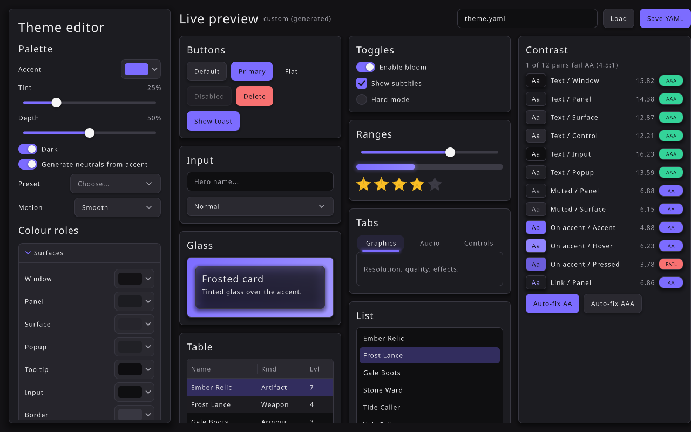
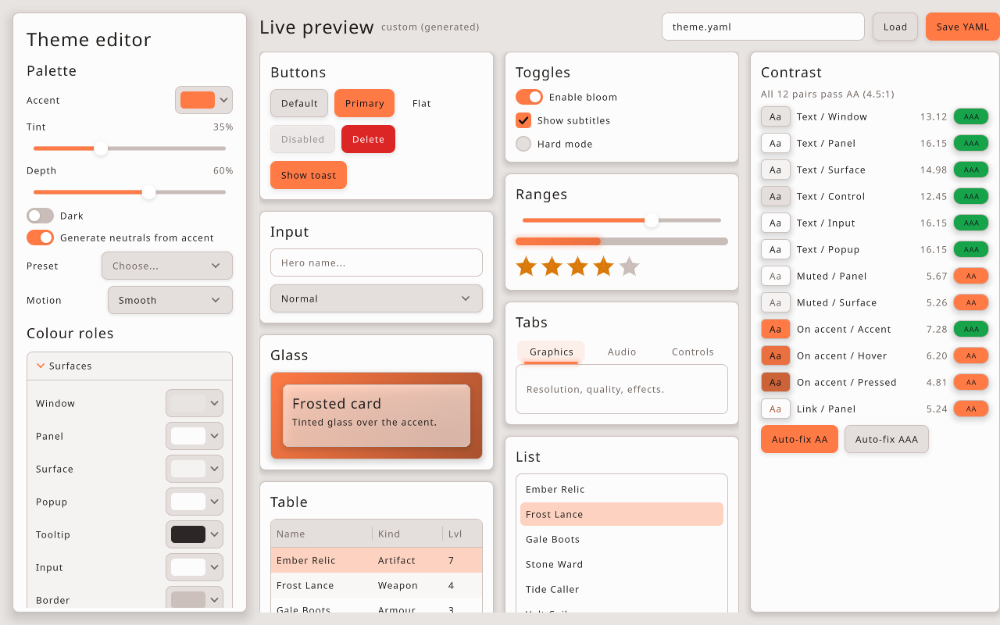
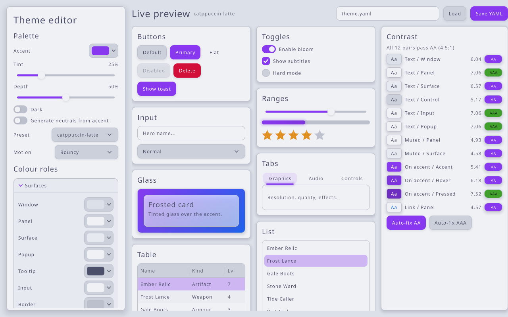

#+title: UI Theme Editor Example
#+description: Walkthrough of examples/ui-theme-editor.c, a live theme designer built on the retained UI widgets: palette generation from an accent with tint and depth, every colour role and metric, a live widget preview, WCAG contrast badges with auto-fix, and YAML export
#+authors: Zach Podbielniak
#+categories: libregnum ui examples theme
#+created: 2026-11-06T00:00:00-05:00
#+updated: 2026-11-06T00:00:00-05:00
#+version: 1.0

* UI Theme Editor Example
:PROPERTIES:
:CUSTOM_ID: ui-theme-editor
:END:
#+begin_quote
*[[file:../index.org][Home]]* > Examples > UI Theme Editor
#+end_quote

=examples/ui-theme-editor.c= is a tool for designing =LrgTheme= files live. The left panel edits the theme: an accent colour with /tint/ and /depth/ sliders that generate a whole palette, a dark switch, a base preset, a colour picker for each of the 27 colour roles, a spin box for each of the 18 metrics, and the motion preset. The right side shows real widgets drawn with that theme, restyling on the same frame as every change, beside a contrast panel that grades the text/background pairs against WCAG and can repair them. The result saves as YAML that =lrg_theme_new_from_file()= loads back unchanged.

It is both a tool (design the theme your game ships) and an example of a non-trivial application on the retained UI: a scrolling settings panel with expanders, colour pickers in popup mode, two-way binding between controls and a model object without feedback loops, per-instance part looks (a gradient and tinted glass), toasts, and a headless =--save= mode.

The design workflow (which knob to turn when) is in [[file:../guides/theming.org::#theming-editor][Designing with the theme editor]]; the palette and contrast API it is built on is in [[file:../modules/ui/theme.org::#theme-palette][LrgTheme: palette generation and contrast]].

** What it shows
:PROPERTIES:
:CUSTOM_ID: ui-theme-editor-what
:END:
- *Palette* (top left): an accent swatch (an =LrgColorPicker= in popup mode: click it for the full picker), /Tint/ and /Depth/ sliders with their percentages, a /Dark/ switch, a /Generate neutrals from accent/ switch, a /Preset/ combo listing =lrg_theme_list_presets()= and a /Motion/ combo.
- *Colour roles*: five =LrgExpander= sections (Surfaces, Text, Accent family, Controls, Status & effects) holding a labelled colour picker per role, 27 in all. The first section starts expanded.
- *Metrics*: an expander with one =LrgSpinBox= per =LrgThemeMetric= (font sizes, corner and popup radius, border and focus ring width, control and row height, padding, spacing, shadow blur and offset, scrollbar, check and handle size), each with a sensible range and step.
- *Header*: the theme's name (with "(generated)" while the palette follows the accent), a path field, /Load/ and /Save YAML/.
- *Live preview*: two columns of cards: buttons (default, =primary=, =flat=, disabled, =danger=, and a /Show toast/ trigger), a switch, checkbox and radio, a slider, progress bar and half-star rating, a text input and combo box, a tab view, a tinted-glass card over an accent gradient, a list view and a striped, sortable table.
- *Contrast panel*: one row per pair from =lrg_theme_get_contrast_pair()=: an "Aa" chip drawn in the pair's own colours, a compact name ("Muted / Surface", "On accent / Pressed"), the ratio, and a badge: *AAA* (green, 7:1 or more), *AA* (accent, 4.5:1 or more) or *FAIL* (red). A summary line counts failures; /Auto-fix AA/ and /Auto-fix AAA/ call =lrg_theme_fix_contrast()=.

** Screenshots
:PROPERTIES:
:CUSTOM_ID: ui-theme-editor-screenshots
:END:
All three were taken at 1280x800 with =--screenshot=:

- : =--accent '#7c6cff'= with the default tint 0.25 and depth 0.5. A violet-tinted dark palette; the contrast panel shows 11 passing pairs and one *FAIL* (the near-black text-on-accent over the darker pressed accent, 3.78:1), which is exactly what the auto-fix is for.
- : =--accent '#ff7a45' --light --tint 0.35 --depth 0.6=. A warm light palette stepping down from a white panel; all 12 pairs pass AA, seven reach AAA.
- : =--preset catppuccin-latte --fix-contrast=. The preset's muted text (4.06:1 on its surface, =#6c6f85= → =#64677b=) and link (4.34:1 on its panel, =#1e66f5= → =#1d63ed=) were nudged just past 4.5:1, two roles in all; the preset combo shows =catppuccin-latte= and generation is off.

** Building and running
:PROPERTIES:
:CUSTOM_ID: ui-theme-editor-build
:END:
From the repository root:

#+begin_src sh
make -j"$(nproc)" lib
make -C examples
./examples/build/release/examples/ui-theme-editor
#+end_src

The binary is written to =examples/build/release/examples/=. Examples link libregnum statically by default; the editor needs no data files.

*** Command-line options
:PROPERTIES:
:CUSTOM_ID: ui-theme-editor-options
:END:
| Option            | Short | Argument | Meaning |
|-------------------+-------+----------+---------|
| =--theme=         | =-t=  | =FILE=   | Start from a theme YAML file (generation off) |
| =--preset=        | =-p=  | =NAME=   | Start from a preset (generation off): =midnight=, =daylight=, =catppuccin-mocha=, =catppuccin-latte=, =high-contrast= |
| =--accent=        | =-a=  | =HEX=    | Accent colour, e.g. ='#22d3ee'=. Without =--theme= / =--preset= the palette is generated from it; with one, it re-derives the accent family only |
| =--tint=          |       | =T=      | Tint for generation, 0..1 (default 0.25) |
| =--depth=         |       | =D=      | Depth for generation, 0..1 (default 0.5) |
| =--light=         | =-l=  |          | Generate a light palette (default dark) |
| =--fix-contrast=  |       |          | Run the AA auto-fix (4.5:1) at start-up |
| =--output=        | =-o=  | =FILE=   | Path the Save button writes, shown in the header field (default =theme.yaml=) |
| =--save=          |       |          | Write the theme to =--output= and exit without opening a window |
| =--screenshot=    | =-s=  | =PATH=   | Save a PNG after =--frames= frames and exit |
| =--frames=        | =-f=  | =N=      | Frames to run before =--screenshot= (default 60) |
| =--license=       |       |          | Print the AGPLv3 notice and exit |
| =-h=, =--help=    |       |          | GLib's generated help, with the examples below |

With none of =--theme=, =--preset= and =--accent= the editor generates a dark palette from =#7c6cff=. A bad =--accent= prints =ui-theme-editor: 'X' is not a colour= and exits with 2; an unknown preset exits with 2; a theme file that fails to load prints the =GError= and exits with 1.

#+begin_src sh
ui-theme-editor
ui-theme-editor --accent '#22d3ee' --tint 0.4 --depth 0.7
ui-theme-editor --accent '#ff7a45' --light --output warm-light.yaml
ui-theme-editor --theme mytheme.yaml --output mytheme.yaml
ui-theme-editor --preset catppuccin-latte --fix-contrast --save --output latte-aa.yaml
ui-theme-editor --accent '#34d399' --screenshot editor.png --frames 90
#+end_src

Quote colours: =#= starts a comment in some shells.

*** Controls
:PROPERTIES:
:CUSTOM_ID: ui-theme-editor-controls
:END:
| Input               | Action |
|---------------------+--------|
| Mouse               | Everything: drag sliders, click swatches to open pickers, scroll the editor panel and the preview |
| =Tab= / =Shift+Tab= | Move keyboard focus |
| Arrow keys          | Spatial focus navigation; step sliders and spin boxes |
| =Enter= / =Space=   | Activate the focused widget (open a picker or combo, press a button) |
| =Escape=            | Close the open popup |

** How it works
:PROPERTIES:
:CUSTOM_ID: ui-theme-editor-how
:END:
*** One theme, edited in place
:PROPERTIES:
:CUSTOM_ID: ui-theme-editor-model
:END:
=main()= builds the theme (from =--theme=, =--preset= or =lrg_theme_generate_palette()=) and makes it the process-wide default with =lrg_theme_set_default()=. Every edit mutates that one object, so every widget, including the editor's own panel, the popups and the toasts, restyles on the next frame. The canvas compares the theme's generation counter each frame and re-lays out the whole tree when it changes, so metric edits (font size, control height, padding) resize everything without extra code.

Restyling the editor itself is deliberate: what you see is what a game gets. If an edit makes the editor hard to read, /Auto-fix AA/ is always one click away.

*** Two-way binding without loops
:PROPERTIES:
:CUSTOM_ID: ui-theme-editor-binding
:END:
Controls write to the theme; the theme's =::changed= signal is the single path back:

#+begin_example
slider / picker / spin box / combo
  └─ handler: lrg_theme_generate_palette / set_color / set_metric / set_motion / apply_preset
       └─ LrgTheme::changed (emitted once per call)
            └─ on_theme_changed → sync_controls()
                 ├─ every role picker, metric spin box, motion combo, switches
                 ├─ header name, contrast rows, glass looks
                 └─ (app->syncing = TRUE: control handlers return early)
#+end_example

Two details keep this stable:

- While =sync_controls()= runs, =app->syncing= is set and every control handler returns at once, so a programmatic =set_value()= or =set_checked()= cannot write back into the theme.
- =sync_picker()= only calls =lrg_color_picker_set_color()= when the colour actually differs. A picker being dragged gets its own colour back from the theme; skipping the no-op keeps the picker's hue for greys (RGB → HSV loses the hue of a grey).

*** Generated or hand-tuned
:PROPERTIES:
:CUSTOM_ID: ui-theme-editor-modes
:END:
=app->generating= decides what the accent does:

| Action | =generating= afterwards | Effect on colours |
|--------+-------------------------+-------------------|
| Start with only =--accent= (or nothing) | on | =lrg_theme_generate_palette()= |
| Move /Tint/ or /Depth/ | on | full regeneration |
| Change the accent while on | on | full regeneration |
| Change the accent while off | off | =lrg_theme_set_accent()= (accent family only) |
| Pick a preset, load a file, edit a role picker | off | the preset/file/role value is kept |
| Toggle /Dark/ while off | off | =set_dark()= then re-derive the accent family |
| Toggle /Generate neutrals from accent/ | as switched | on: regenerate now |

*** The preview's per-instance looks
:PROPERTIES:
:CUSTOM_ID: ui-theme-editor-glass
:END:
The glass card needs something behind it to refract, so it sits in an =LrgOverlay= on top of a plain =LrgPanel= whose =BOX= part gets a linear gradient from =ACCENT= to =LINK= through =lrg_widget_set_part_look()=. The card itself gets =LRG_PAINT_MATERIAL_TINTED= with the theme's =PANEL= colour at 62 % alpha as its tint, which keeps the theme's own text readable on it in light and dark palettes. Both looks are rebuilt in =update_glass_backdrop()= on every theme change. Per-instance looks are not part of the theme, so they never end up in the exported YAML.

*** The contrast panel
:PROPERTIES:
:CUSTOM_ID: ui-theme-editor-contrast
:END:
=build_contrast_panel()= makes one row per =lrg_theme_get_contrast_pair()= index and keeps the widgets in a =GArray= of =ContrastRow=. =update_contrast()= recomputes each ratio with =lrg_color_contrast_ratio()=, sets the chip's background and text colour to the pair itself, and colours the badge from the theme (=SUCCESS= / =ACCENT= / =DANGER=) with black or white text, whichever contrasts more with the badge. The summary uses =lrg_theme_count_contrast_failures()=. The auto-fix buttons report =lrg_theme_fix_contrast()='s count of changed roles in a toast.

*** Save and load
:PROPERTIES:
:CUSTOM_ID: ui-theme-editor-save
:END:
/Save YAML/ calls =lrg_theme_save_to_file()= with the path in the header field and shows a /Saved/ toast, or a /Save failed/ toast with the =GError= message. /Load/ applies the file on top of the current theme with =lrg_theme_load_from_file()= (generation switches off). =--save= does the same as /Save/ without a window, which makes the editor usable in scripts:

#+begin_src sh
ui-theme-editor --accent '#22d3ee' --fix-contrast --save --output a.yaml
ui-theme-editor --theme a.yaml --save --output b.yaml
cmp a.yaml b.yaml   # identical: the format round-trips
#+end_src

** Layout
:PROPERTIES:
:CUSTOM_ID: ui-theme-editor-tree
:END:
#+begin_example
LrgCanvas (paints the WINDOW colour)
├── LrgHBox root (padding 16, spacing 16)
│   ├── LrgPanel editor (300 wide, elevation 2)
│   │   └── LrgScrollBox
│   │       └── LrgVBox: title, Palette box, "Colour roles",
│   │           5 x LrgExpander (role pickers), LrgExpander "Metrics"
│   └── LrgVBox right (fill weight 1)
│       ├── LrgHBox header: title, name, path input, Load, Save YAML
│       └── LrgHBox body (fill weight 1)
│           ├── LrgScrollBox preview (fill weight 1)
│           │   └── LrgHBox (homogeneous): 2 x LrgVBox column of cards
│           └── LrgPanel contrast (320 wide): 12 rows + auto-fix buttons
└── LrgToastQueue (overlay layer)
#+end_example

The preview uses two =LrgVBox= columns inside a homogeneous =LrgHBox= rather than an =LrgGrid=: a grid gives every cell the size of the largest card, while columns let each card keep its natural height. Boxes do not shrink children below their preferred size, so the fixed side panels and the card contents are sized to fit a 1280x800 window; larger windows give the preview the extra room.

** Things to try
:PROPERTIES:
:CUSTOM_ID: ui-theme-editor-try
:END:
- Drag /Tint/ from 0 to 100 % and watch the greys turn into the accent's hue; drag /Depth/ and watch the cards lift off the window.
- Pick =high-contrast=, then move /Tint/: generation takes over and the preset's black-and-white look is replaced.
- Set /Font size/ to 20 in /Metrics/: the whole UI, the editor included, re-lays out.
- Give /Text muted/ a dark grey on a dark theme, see the two /Muted/ rows fail, then /Auto-fix AA/.
- Switch /Motion/ to /Wobbly/ and hover the preview buttons.

** Related
:PROPERTIES:
:CUSTOM_ID: ui-theme-editor-related
:END:
- [[file:../guides/theming.org][Theming guide]], in particular [[file:../guides/theming.org::#theming-editor][designing with the editor]] and [[file:../guides/theming.org::#theming-contrast][checking contrast]]
- [[file:../modules/ui/theme.org][LrgTheme reference]]
- [[file:ui-showcase.org][UI Showcase]] (every widget, presets and accents)
- [[file:../modules/ui/styling.org][UI styling]] (part looks, materials)
