#+title: Image cookbook
#+description: Twelve reference scenes for polished still images on the CPU: which libregnum calls to use and in which order (quality canvas, supersampled resolve, HDR shading with SDFs and band-limited noise, the CPU post stack, tone mapping, checked layouts), what good output looks like, the common pitfalls, and the headless GPU path

* Image cookbook
:PROPERTIES:
:CUSTOM_ID: image-cookbook
:END:
#+begin_quote
*[[file:../index.org][Home]]* > Guides > Image cookbook
#+end_quote

This guide is for anyone, person or model, who writes code that makes a picture with libregnum: a poster, a thumbnail, a character portrait, a frame for a reel, a test image. The plain image API (=grl_image_draw_*=, =lrg_image_canvas_new()=) keeps raylib's pixel-exact defaults, which are right for textures and wrong for pictures: aliased edges, translucent shapes that punch holes instead of blending, flat light, and elements placed by guessed coordinates. The libregnum calls below fix each of those, and the twelve scenes in =examples/cookbook/= show them together. Every scene is a small function, runs on the CPU without a display, and is checked by =tests/test-cookbook.c=.

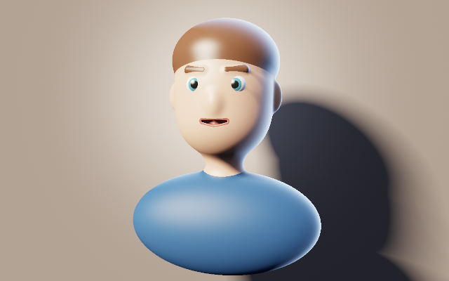

** The two recipes
:PROPERTIES:
:CUSTOM_ID: recipes
:END:
Almost every polished still is made one of two ways. Pick the recipe first; the rest is drawing.

*** Recipe A: 8-bit drawing, supersampled
:PROPERTIES:
:CUSTOM_ID: recipe-canvas
:END:
For flat-colour art: shapes, line art, text, posters, UI-like scenes.

1. =lrg_image_canvas_new_supersampled (w, h, 3, bg)= - a canvas 3x larger with the quality preset on (source-over blending, blending in linear light, anti-aliasing). Use 4 for hairlines.
2. Background gradients: =lrg_image_canvas_draw_gradient_rect()= and =draw_gradient_radial()= in *large* pixels (multiply by the factor; gradients and text ignore the transform).
3. =lrg_image_canvas_scale (canvas, f, f)= once, then the geometry in final-size coordinates: =fill_circle=, =fill_rect=, =fill_path=, =stroke_path=, =stroke_circle=, =draw_line=.
4. Smooth custom shapes: =lrg_image_canvas_fill_sdf_rect()= with a 2D distance from =lrg-sdf.h= (circle, ellipse, round box, capsule, triangle, unions). The field gets large pixels; divide the point by the factor and multiply the distance back (see =cb_shape_sdf()= in the scenes).
5. Text: =lrg_image_canvas_draw_text()= at large coordinates and size times the factor.
6. =lrg_image_canvas_resolve (canvas, LRG_RESAMPLE_FILTER_LANCZOS3)= - one gamma-correct downsample (Mitchell for soft content).
7. Optional finish: =lrg_post_processor_apply_to_image()= with bloom, tonemap, vignette, grain.

#+begin_src C
g_autoptr(LrgImageCanvas) canvas = lrg_image_canvas_new_supersampled (640, 400, 3, &night);
gint f = (gint) lrg_image_canvas_get_supersample (canvas);

lrg_image_canvas_draw_gradient_rect (canvas, 0, 0, 640 * f, 400 * f, &top, &bottom,
                                     GRL_GRADIENT_AXIS_VERTICAL);
lrg_image_canvas_scale (canvas, (gfloat) f, (gfloat) f);
lrg_image_canvas_fill_circle (canvas, 200, 180, 80, &translucent_red);   /* blends */
lrg_image_canvas_draw_line (canvas, 20, 380, 620, 300, 1, &hairline);    /* smooth */
image = lrg_image_canvas_resolve (canvas, LRG_RESAMPLE_FILTER_LANCZOS3);
#+end_src

*** Recipe B: HDR shading
:PROPERTIES:
:CUSTOM_ID: recipe-hdr
:END:
For light: anything with a glow, a sun, a soft shadow, a lit 3D shape or a texture.

1. =lrg_hdr_canvas_new (w, h)= - a float canvas in linear light.
2. =lrg_hdr_canvas_shade (canvas, shade, data, 2)= - a CPU fragment shader called at 2 x 2 (or 3 x 3) stratified positions per pixel. Inside it: 2D distance fields with =lrg_sdf2_coverage()=, or 3D scenes with =lrg_sdf3_raymarch()=, =lrg_sdf3_normal()=, =lrg_sdf3_soft_shadow()=, =lrg_sdf3_ambient_occlusion()=; textures with =lrg_noise_fbm2()= / =fbm3()= and a pixel footprint. Return radiance; values above 1 are normal (a sun is 30 to 60).
3. Optional post on the float buffer: =lrg_post_processor_apply_to_buffer()= on =lrg_hdr_canvas_get_data()= with =LrgBloom= or =LrgBlur= (for an opaque canvas the premultiplied data is the straight data the stack expects).
4. =lrg_hdr_canvas_to_image (canvas, LRG_TONEMAP_OPERATOR_ACES, exposure, TRUE)= - tone map, sRGB encode, dither.
5. Optional 8-bit finish: vignette and grain with =lrg_post_processor_apply_to_image()=.
6. Labels or crisp details on top: wrap the result with =lrg_image_canvas_new_for_image()= + =lrg_image_canvas_set_quality()=.

#+begin_src C
g_autoptr(LrgHdrCanvas) hdr = lrg_hdr_canvas_new (640, 400);

lrg_hdr_canvas_shade (hdr, shade_sky, &sky, 2);
bloom_the_float_buffer (hdr);   /* apply_to_buffer (post, lrg_hdr_canvas_get_data (hdr, NULL), ...) */
image = lrg_hdr_canvas_to_image (hdr, LRG_TONEMAP_OPERATOR_ACES, 0.0f, TRUE);
lrg_post_processor_apply_to_image (finish, image, 0.0f, &error);        /* vignette, grain */
#+end_src

*** Placing elements: layout first
:PROPERTIES:
:CUSTOM_ID: recipe-layout
:END:
When a frame has named elements (title, character, bubble, footer), give each a box with =LrgFrameLayout= before drawing anything, check it, and draw inside the boxes:

1. =lrg_frame_layout_new (w, h)=, =set_safe_area_percent (layout, 0.05)=.
2. A full-frame background: =set_box_rect= + =set_backdrop (layout, "backdrop", TRUE)=.
3. =add_box= against the safe area (nine anchors), =add_box_relative= beside another box (a bubble right of its speaker), =set_box_rect= for computed panels.
4. =lrg_frame_layout_validate (layout, &error)= - one message lists every overlap and every box outside the frame or safe area. In tests: =g_assert_no_error (error)=.
5. =lrg_frame_layout_get_box()= for each element; fit text to its box (measure at 100 px with =grl_image_measure_text_ttf()=, scale).
6. While iterating, =lrg_frame_layout_draw_debug (layout, canvas)= draws the boxes.

** What good looks like
:PROPERTIES:
:CUSTOM_ID: good
:END:
| Property | How to get it | How to check it |
|----------+---------------+-----------------|
| Smooth edges | supersampled canvas (3x, 4x for hairlines) or =shade= with 2..3 samples per axis | no stair steps on diagonals; edge pixels take intermediate colours |
| Blending, not holes | the quality preset (=GRL_IMAGE_BLEND_OVER=, linear) | translucent overlaps show both colours; no transparent pixels in an opaque picture |
| Soft light | HDR canvas, radiance above 1, a tone map | thousands of distinct colours; highlights roll off instead of clipping |
| No banding | dithered =to_image=, grain on dark gradients | smooth slow gradients at 100 % zoom |
| No moire | noise with a footprint (=lrg_noise_fbm2 (..., footprint, ...)=) | far textures fade to their average instead of shimmering |
| No overlaps | =LrgFrameLayout= + =validate= | =g_assert_no_error= in a test |

=tests/test-cookbook.c= turns this into numbers for every scene at 256 x 160: it renders, the image is opaque, the layout validates, and the scene has at least its floor of distinct colours (between 1,200 and 12,000 here; a flat, aliased rendering of the same scene has a few dozen). Copy that test for your own scenes.

** Running the scenes
:PROPERTIES:
:CUSTOM_ID: running
:END:
#+begin_src sh
make -j8 && make -C examples build/release/examples/cookbook
examples/build/release/examples/cookbook --list
examples/build/release/examples/cookbook --out shots --size 640x400               # all twelve
examples/build/release/examples/cookbook --scene noise-terrain --size 1280x800
examples/build/release/examples/cookbook --scene poster-typography --debug-boxes   # layout overlay
examples/build/release/examples/cookbook --size 320x200 --sheet sheet.png          # contact sheet
examples/build/release/examples/cookbook --pitfalls --out shots                    # also the comparisons
#+end_src

Text uses DejaVu Sans, Liberation Sans, Cantarell or Noto Sans when installed (=LRG_COOKBOOK_FONT= picks another file) and falls back to the bitmap font. Render times at 640 x 400 on one core: the 8-bit scenes take 0.1 to 0.2 s, the 2D HDR scenes under 1 s, the raymarched ones 3 to 6 s.

** The scenes
:PROPERTIES:
:CUSTOM_ID: scenes
:END:
All twelve live in =examples/cookbook/lrg-cookbook-scenes.c=, each as =GrlImage *lrg_cookbook_<name> (guint width, guint height, LrgFrameLayout **out_layout)=. The shared helpers at the top of the file (colours, a look-at camera, text fitting, a post stack from a list of effects, a shape struct for =fill_sdf_rect=) are the glue a scene needs; copy them with the scene.

*** aa-shapes
:PROPERTIES:
:CUSTOM_ID: scene-aa-shapes
:END:
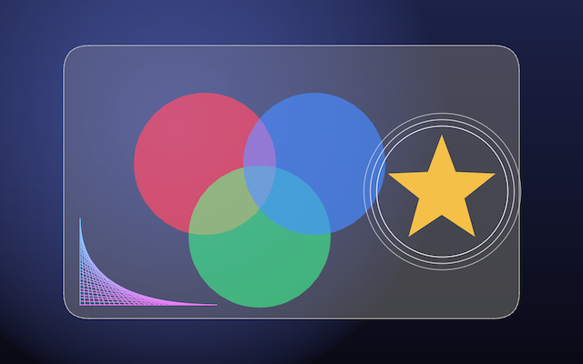

The quality preset and supersampling, nothing else: the same canvas primitives a generated scene would use (=fill_circle=, =fill_path= for a rounded card and a star, =draw_line= hairlines, =stroke_circle= rings) on =lrg_image_canvas_new_supersampled (w, h, 3, bg)=, one =scale (3, 3)=, then =resolve (LANCZOS3)=. The three discs at alpha 150 overlap in linear light; the 1-pixel string art stays smooth. With =lrg_image_canvas_new()= the same calls give the left half of [[file:../examples/image-quality-showcase.org][the showcase]].

*** glow-title
:PROPERTIES:
:CUSTOM_ID: scene-glow-title
:END:
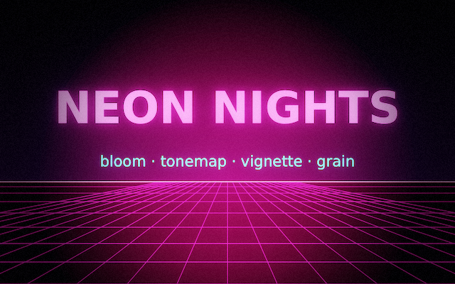

A layout with a title box and a subtitle box below it, a 3x canvas with a night gradient and a perspective grid of 1-pixel lines, TrueType text fitted into the boxes, the resolve, then one =LrgPostProcessor= on the 8-bit image: =LrgBloom= (threshold 0.45, intensity 2.2, 6 levels) - =LrgTonemap= (ACES, +0.2 EV) - =LrgVignette= - =LrgFilmGrain= (0.05). The bloom makes the glow from the text's own pixels: no hand-made halo.

*** sdf-character-bust
:PROPERTIES:
:CUSTOM_ID: scene-sdf-character-bust
:END:

A head, jaw, nose, ears, neck, hair cap, brows, eyes and torso from =lrg_sdf3_ellipsoid=, =capsule=, =sphere=, joined with =lrg_sdf_smooth_union= (and a smile cut with =lrg_sdf_smooth_subtract=), against a wall. Per sample: =lrg_sdf3_raymarch=, =lrg_sdf3_normal=, material from the nearest part, a wrapped key light with =lrg_sdf3_soft_shadow=, sky fill times =lrg_sdf3_ambient_occlusion=, a cool Fresnel rim light and a Blinn highlight; =shade= at 2 x 2, =to_image= with ACES. The field is multiplied by 0.8 because ellipsoids and blends are distance /estimates/ (see [[#pitfall-estimates][pitfalls]]). The detailed version is [[file:../examples/sdf-portrait.org][examples/sdf-portrait.c]].

*** product-shot
:PROPERTIES:
:CUSTOM_ID: scene-product-shot
:END:
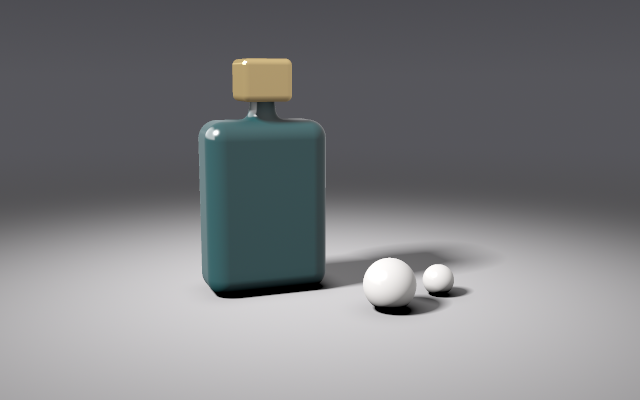

A rounded-box bottle turned 25 degrees (rotate the query point), a round-cone neck, a gold cap and two pearls on a floor plane. The key is a spot: its pool falls off around the object so the floor melts into a dark studio backdrop with distance fog. Glass, gold and pearl differ only in albedo, a Fresnel-weighted reflection of a procedural studio environment (a gradient plus a softbox) and a tight highlight. 3 x 3 samples per pixel, filmic tone map at +0.25 EV. The soft contact shadows come from =soft_shadow= (k = 6) plus =ambient_occlusion=.

*** band-limited-texture
:PROPERTIES:
:CUSTOM_ID: scene-band-limited-texture
:END:
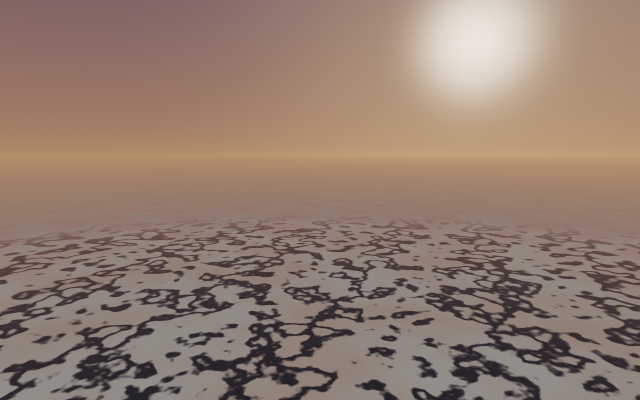

A marble floor to the horizon. The floor is a ray-plane hit; the texture is =lrg_noise_fbm2 (u, v, 9, 2, 0.5, footprint, seed)= with footprint = scale x distance x pixel angle / |rd.y| (the larger screen derivative on a grazing plane). The veins are a sine warped by the fBm; the sine carrier is faded by the same rule the library uses per octave (full contrast down to 4 pixels per cycle, none at 2). The far floor turns into its average colour and the sky's reflection instead of noise. Compare [[#pitfall-moire][the moire pitfall]].

*** sky-gradient-vignette
:PROPERTIES:
:CUSTOM_ID: scene-sky-gradient-vignette
:END:
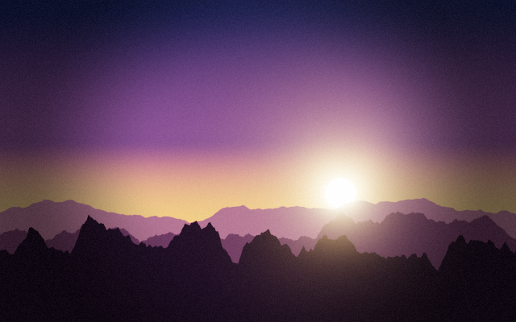

A 2D HDR shader: a three-stop sky ramp, a sun disc of radiance 60 with =lrg_sdf2_coverage()= for its edge and a 1/(1 + d^2) glow, and three hill ridges from 1D band-limited fBm, each with its own haze colour. Then =LrgBloom= on the float buffer (threshold 2.0 in linear units, so only the sun blooms), ACES, and vignette plus grain on the 8-bit result.

*** speech-bubble-layout
:PROPERTIES:
:CUSTOM_ID: scene-speech-bubble-layout
:END:
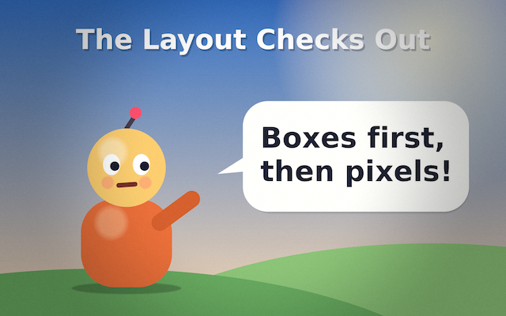

Boxes first: a backdrop, a title anchored at the top, a character anchored bottom-left, a bubble =add_box_relative= to the right of the character (=LRG_FRAME_ALIGN_START=), 6 % safe area, =validate=. The character (round box body, circle head, eyes, cheeks, a capsule arm pointing at the bubble) and the bubble (round box, triangle tail whose tip touches the bubble box's left edge, a feathered drop shadow) are SDF fills inside their boxes; the bubble text is fitted to the bubble's inner box. The tail stays inside the bubble's box, so no overlap needs to be allowed. =--debug-boxes= draws the boxes.

*** hdr-sunset
:PROPERTIES:
:CUSTOM_ID: scene-hdr-sunset
:END:
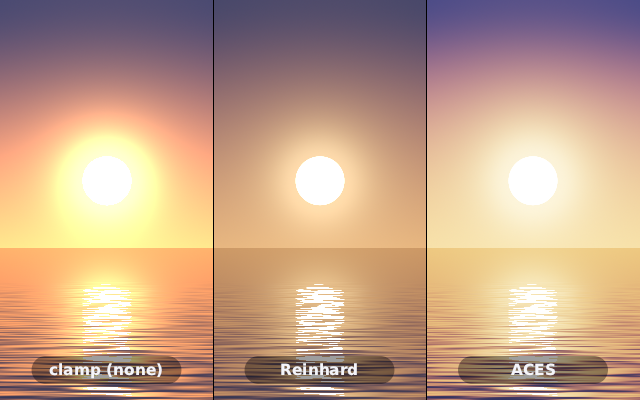

One panel-sized HDR image shaded once (sky ramp, sun of radiance 50, a sea that mirrors the sky through perspective-stretched band-limited ripples) and tone-mapped three times: =LRG_TONEMAP_OPERATOR_NONE= (clamp: the sky burns out to flat yellow), =REINHARD= (nothing clips, but the picture goes grey) and =ACES= (contrast and a soft roll-off). The three panels are layout backdrops and the labels are boxes inside the safe area. Use ACES for most scenes; Reinhard when dark detail matters more than punch ([[#pitfall-thin-detail][see below]]).

*** supersampled-line-art
:PROPERTIES:
:CUSTOM_ID: scene-supersampled-line-art
:END:
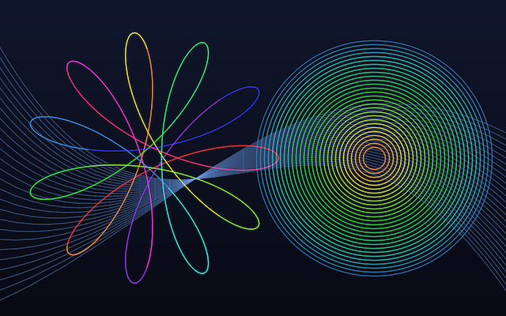

Hairlines only, on a 4x canvas: a fan of 26 cubic Beziers (=grl_path_cubic_to= + =stroke_path=, alpha 46), a hypotrochoid in twelve hues (one path per hue), 28 rings 5 pixels apart. Resolved with Lanczos-3. At 1x the rings beat into moire and the curves step; at 4x they stay clean.

*** poster-typography
:PROPERTIES:
:CUSTOM_ID: scene-poster-typography
:END:
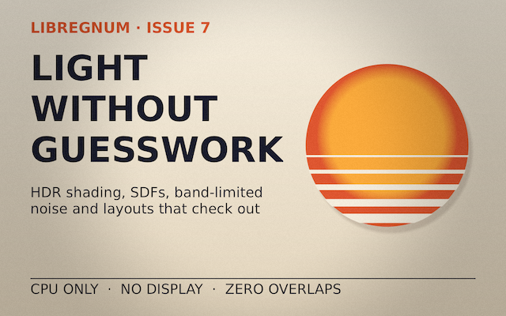

A text column (kicker, three-line title, subtitle, all =add_box_relative= below each other with =ALIGN_START=), an art box anchored right, a footer anchored bottom-left, 6 % safe area. Each text block gets the largest size that fits its box. The art is a retro sun: a feathered shadow circle, the disc, a feathered highlight and five =lrg_sdf_intersect= bands (circle and box) in the paper colour. Grain 0.04 keeps the flat paper from looking digital.

*** noise-terrain
:PROPERTIES:
:CUSTOM_ID: scene-noise-terrain
:END:
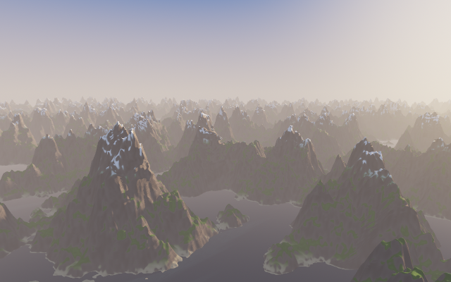

A heightfield h(x, z) from =lrg_noise_fbm2= raymarched as the distance field (y - h) x 0.5 (vertical distance overestimates the true one on slopes; 0.5 keeps the marcher from skipping ridges), with a water plane. The noise footprint is scale x distance x pixel angle, so far mountains lose fine octaves instead of shimmering and are cheaper to evaluate; above the highest peak the field returns the height difference so sky rays exit fast. Materials by height and slope (sand, grass, rock, snow), a low warm sun with =soft_shadow= (k = 10), sky fill, a Fresnel water reflection, exponential haze. The slowest scene: about 6 s at 640 x 400.

*** particles-glow
:PROPERTIES:
:CUSTOM_ID: scene-particles-glow
:END:
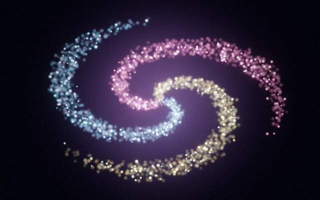

2,900 Gaussian dots of light added (=lrg_hdr_canvas_add()=, no sorting, no clipping) along a three-armed spiral from a seeded =GRand=. The far layer (2,400 dim dots) is softened with =LrgBlur= on the float buffer; the near layer (500 dots, up to 4x brighter) stays sharp; =LrgBloom= (threshold 0.8) on the floats, ACES, light vignette and grain.

** Pitfalls
:PROPERTIES:
:CUSTOM_ID: pitfalls
:END:
*** Defaults are for textures
:PROPERTIES:
:CUSTOM_ID: pitfall-defaults
:END:
=lrg_image_canvas_new()= and a bare =GrlImage= use =GRL_IMAGE_BLEND_REPLACE=: a translucent shape /replaces/ the pixels under it, alpha included. In the left half of the showcase a radial glow with a transparent rim becomes a solid pink disc and the three discs cover each other. Use =lrg_image_canvas_new_quality()= or =new_supersampled()=, or call =lrg_image_canvas_set_quality()= on a canvas you were given.

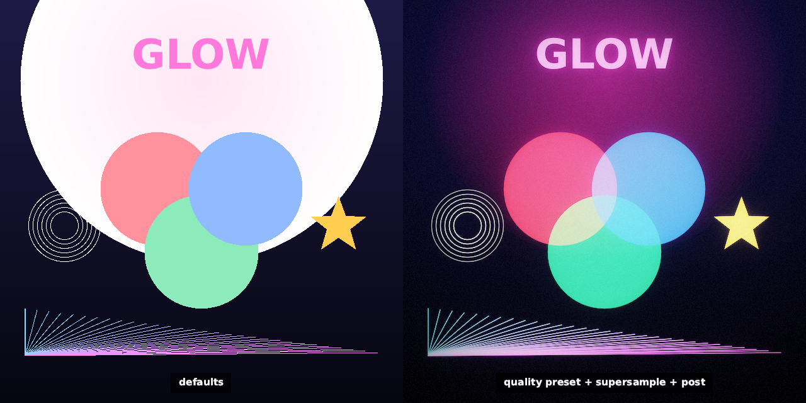

*** Moire from noise that is not band-limited
:PROPERTIES:
:CUSTOM_ID: pitfall-moire
:END:
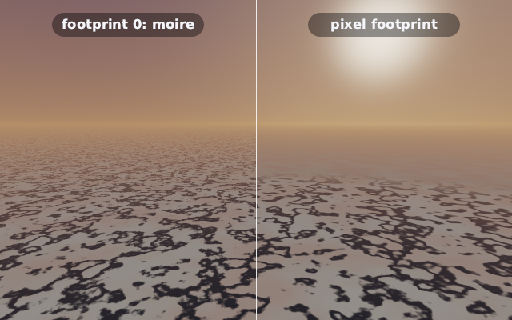

Left: the marble floor with footprint 0; right: with the pixel footprint. Without it, octaves finer than a pixel alias into crawling noise and stripes near the horizon, and supersampling only moves the problem further away. Pass the size of a pixel in noise units: on a flat image =noise_scale / zoom=; on a surface =scale x distance x pixel_angle=, divided by the cosine of the viewing angle on a grazing plane; for a raymarched heightfield compute it inside the field from the distance to the camera. Periodic patterns you add yourself (sine veins, stripes, grids) need the same fade: =contrast *= 1 - smoothstep (0.25, 0.5, cycles_per_unit x footprint)=, mixing towards the pattern's average.

*** Thin dark detail lost to the tone map
:PROPERTIES:
:CUSTOM_ID: pitfall-thin-detail
:END:
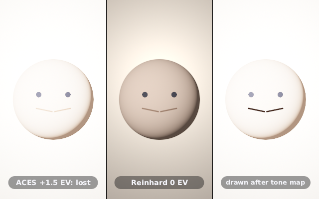

A brightly lit face with a 3-pixel dark mustache. Left: ACES at +1.5 EV. Skin and mustache both land on ACES's shoulder (radiance 5 and 2 both map close to white) and the mustache, half covered at its edges, vanishes. Middle: Reinhard at 0 EV keeps a wide range below white, so the mustache reads. Right: the face tone-mapped as on the left, the mustache drawn /after/ the tone map with =lrg_image_canvas_fill_sdf()= on the 8-bit image: exact and crisp. The fixes, in order of preference:

1. Lower the exposure (=to_image (..., exposure < 0, ...)=) until the brightest surface that carries detail sits below about 1.0 before the curve.
2. Use =LRG_TONEMAP_OPERATOR_REINHARD= (white point 4 in =to_image=; another white point with =lrg_tonemap_operator_apply_rgb()=) for scenes where the mid-tones matter more than punch.
3. Draw thin graphic detail (outlines, mustaches, text, UI) after the tone map on the 8-bit image, not into the HDR shading.

*** Distance estimates, not distances
:PROPERTIES:
:CUSTOM_ID: pitfall-estimates
:END:
Ellipsoids, smooth unions, displacements and heightfields return estimates that can exceed the true distance. Symptoms: contour bands on curved surfaces, holes, dark arcs in shadows. Multiply the scene's field by 0.75..0.8 (0.5 for a heightfield) in the function you pass to =raymarch=, =normal=, =soft_shadow= and =ambient_occlusion=. Do not return a bounding-sphere distance that jumps to the real one at a threshold: since 0.14 =lrg_sdf3_soft_shadow()= no longer turns such jumps into black arcs, but the marcher still wastes steps around the seam.

*** Coordinates on a supersampled canvas
:PROPERTIES:
:CUSTOM_ID: pitfall-coordinates
:END:
Gradients, text and =fill_sdf= ignore the transform stack: give them large pixels (times the factor). Geometry primitives follow =scale (f, f)=. Line thickness and radii are in transformed units, so 1 stays 1 final pixel.

*** Post stack input
:PROPERTIES:
:CUSTOM_ID: pitfall-post-input
:END:
On an 8-bit image the stack sees display-encoded values; =LrgTonemap= decodes them with gamma 2.2 first. On an HDR canvas's float data the values are linear: run bloom and blur there, then tone-map with =to_image=, or set =LrgTonemap:linear-input= if the tonemap is part of the float stack. The HDR data is premultiplied: fine for opaque canvases, unpremultiply first otherwise. See [[file:../modules/postprocess/cpu.org][post-processing on the CPU]].

*** Cost
:PROPERTIES:
:CUSTOM_ID: pitfall-cost
:END:
=shade= calls your function width x height x samples^2 times, and a raymarched sample calls the field about a hundred times (march, normal, shadow, occlusion). Iterate at =samples = 1= and a quarter size; render the final at 2 or 3. Keep the field cheap: evaluate expensive noise only near the surface that uses it (=sdf-portrait.c= evaluates the hair noise only within 0.05 of the hair).

** Headless GPU
:PROPERTIES:
:CUSTOM_ID: headless-gpu
:END:
Everything above is CPU-only and needs no display: =LrgImageCanvas=, =LrgHdrCanvas=, the SDF and noise functions, =lrg_post_processor_apply_to_image()= / =apply_to_buffer()= and =LrgFrameLayout= never open a window or a GL context (=env -u DISPLAY -u WAYLAND_DISPLAY= is how the tests run them).

The GPU path - GLSL post shaders through =lrg_post_processor_begin_capture()= / =end_capture()=, render textures, the 3D renderer - needs a GL context, which raylib creates with a window. It works headless on a server or in CI through =build-aux/xrun.sh=, which starts a private X server (Xvfb, or Xwayland on a headless compositor) that never touches your session, and renders with Mesa's software rasterizer, llvmpipe, when there is no GPU:

#+begin_src sh
build-aux/xrun.sh tests/build/release/tests/test-post-stack         # includes the GPU post tests
build-aux/xrun.sh -t 300 my-offline-renderer --out frames/
#+end_src

llvmpipe runs the same shaders as a GPU, multi-threaded, at a few full-screen passes per second at 1080p (see the measured costs in [[file:../modules/postprocess/post-stack.org][post stacks]]): right for offline renders and tests, not for real time. The CPU post stack produces the same results within a few 1/255 ([[file:../modules/postprocess/cpu.org::#post-cpu-differences][differences]]), so the cookbook scenes stay on the CPU and need neither a display nor Mesa.

** What you still write by hand
:PROPERTIES:
:CUSTOM_ID: by-hand
:END:
The library does the distance functions, marching, normals, shadows, occlusion, noise, blending, resampling, tone mapping, post effects and layout checks. A scene still brings its own:

- a look-at camera (=cb_camera_init()= / =cb_camera_ray()=, about 50 lines in the scenes file);
- the lighting model of a raymarched scene: key, fill, rim, Fresnel, highlight and fog (40 to 60 lines per scene);
- materials (which part was hit, what colour it is);
- text fitting into a box (measure at 100 px and scale, 20 lines).

The raymarched scenes are the longest (=sdf-character-bust= about 230 lines with comments, =product-shot= 200, =noise-terrain= 160); most of that is the lighting model. A shared "studio lighting" helper and a camera-ray helper are the next candidates for the library.

** Testing your own scene
:PROPERTIES:
:CUSTOM_ID: testing
:END:
Build the scene as a function the program and a GTest share (like =lrg-cookbook-scenes.c=, which =tests/Makefile= compiles into =test-cookbook=). Render it small, count the distinct colours of =grl_image_get_pixels()=, assert opacity, and assert the layout validates:

#+begin_src C
image = my_scene (256, 160, &layout);
g_assert_cmpuint (count_colors (image), >=, 2000);     /* smooth shading, not flat fills */
lrg_frame_layout_validate (layout, &error);
g_assert_no_error (error);                              /* names every overlap */
#+end_src

** See also
:PROPERTIES:
:CUSTOM_ID: see-also
:END:
- [[file:../examples/image-quality-showcase.org][Image quality showcase]], [[file:../examples/sdf-portrait.org][SDF portrait]], [[file:../examples/frame-layout-poster.org][Frame layout poster]] - the standalone examples
- [[file:../modules/graphics/image-canvas.org][LrgImageCanvas]] (quality preset, supersampling, =fill_sdf=), [[file:../modules/graphics/image-resample.org][image resampling]], [[file:../modules/graphics/hdr-canvas.org][LrgHdrCanvas]], [[file:../modules/graphics/frame-layout.org][LrgFrameLayout]]
- [[file:../modules/shading/sdf.org][Signed distance functions]], [[file:../modules/shading/noise.org][band-limited noise]]
- [[file:../modules/postprocess/cpu.org][Post-processing on the CPU]], [[file:../modules/postprocess/effects.org][built-in effects]]
