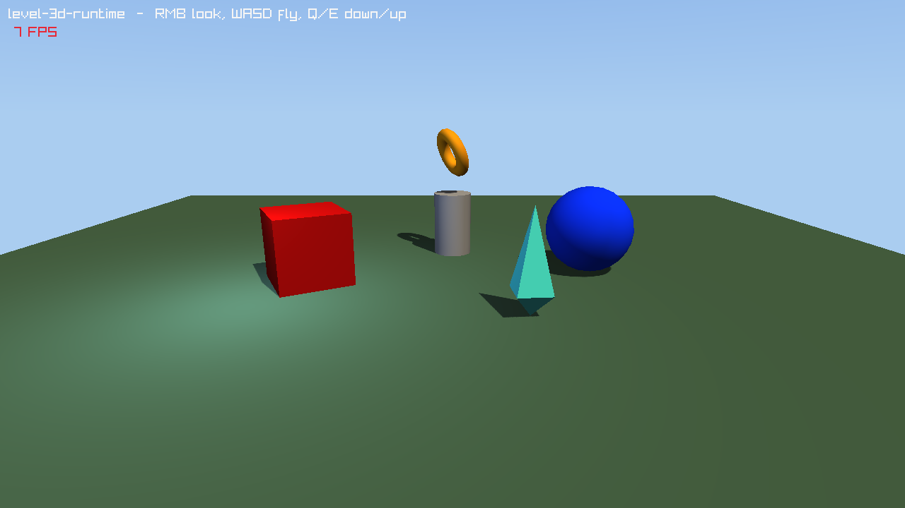

#+title: Load a level in your game
#+description: Playing a level authored in lrgeditor in a standalone 3D game: loading the .rlevel into an LrgWorld3D, game components, the camera, the renderer, the game loop, finding entities by GUID, spawning prefabs and shipping without the editor
#+authors: Zach Podbielniak
#+categories: libregnum guide level world3d runtime
#+created: 2026-11-07T01:00:00-05:00
#+updated: 2026-11-07T01:00:00-05:00
#+version: 0.1

* Load a level in your game
:PROPERTIES:
:CUSTOM_ID: load-level-guide
:END:
#+begin_quote
*[[file:../index.org][Home]]* > *Guides* > Load a level in your game
#+end_quote

You build a level in =lrgeditor= (or by hand in YAML) and want your game to play it: the same objects in the same places, lit the same way, with your own gameplay code attached. Since 0.9.0 that is three calls: load the =.rlevel= into an =LrgWorld3D= (=lrg_level_load_world3d()=), step the world every frame (=lrg_world3d_step()=) and draw it (=lrg_world3d_renderer_render()=). The editor's Play button does exactly the same thing, so what you test in the editor is what ships.

This guide builds a complete game step by step. The finished program is =examples/level-3d-runtime.c= ([[file:../examples/level-3d-runtime.org][example page]]); its level is =examples/data/levels/level-3d-runtime.rlevel=.

** The pieces
:PROPERTIES:
:CUSTOM_ID: load-level-pieces
:END:
| Piece | What it is | Where it comes from |
|-------+------------+---------------------|
| =LrgLevel= | The authored data: a tree of =LrgNode=s with transforms, visuals, component descriptions and scripts | =.rlevel= file, =LrgLevelSerializer= |
| =LrgWorld3D= | The running scene: a tree of =LrgEntity3D=s under a root, a GUID map, an octree, lights and cameras, the frame phases | =lrg_world3d_new()= |
| =LrgEntity3D= | One runtime object: GUID, name, local TRS, children, ordered =LrgComponent=s | one per node, made by =lrg_level_instantiate_3d()= |
| Components | Behaviour: =LrgMeshRendererComponent=, =LrgLightComponent=, =LrgCameraComponent=, =LrgAudioSourceComponent=, =LrgBillboardComponent=, =LrgTilemapComponent=, and yours | the node's visual, its =components:= list (through the engine registry) and its =scripts:= |
| =LrgWorld3DRenderer= | Draws a world through a camera: lights, shadows, sky, opaque / cutout / transparent passes | =lrg_world3d_renderer_new()=; the editor viewport uses the same one |

The level stays data; the world is what runs. Nothing in the world points back at the level, so you can drop the =LrgLevel= after loading.

** The level file
:PROPERTIES:
:CUSTOM_ID: load-level-format
:END:
The full schema is [[file:../editor/yaml-format.org][.rlevel YAML Format]]; this is the part a game cares about, annotated with what each line becomes at runtime (see [[file:../modules/level/index.org::#level-visual-map][the visual to component map]] for every param).

#+begin_src yaml
type: level
name: level-3d-runtime
default_view: 3d                 # the editor plays 3D levels in an LrgWorld3D
nodes:
  - name: Camera                 # -> LrgEntity3D "Camera"
    guid: 7a000000-0000-4000-8000-000000000003   # -> the entity's GUID
    transform:
      location: [0.0, 4.5, 13.0] # -> local position
      rotation: [-0.28, 0.0, 0.0]# -> local rotation (Euler XYZ radians, kept exactly)
    visual:
      kind: camera               # -> LrgCameraComponent (looks down local -Z)
      params: { fov: 55.0, near: 0.1, far: 200.0 }

  - name: Pedestal               # no visual: a group entity
    guid: 7a000000-0000-4000-8000-000000000007
    transform:
      location: [0.0, 0.0, -3.0]
    children:                    # -> child entities, same order
      - name: RingPivot
        guid: 7a000000-0000-4000-8000-00000000000c
        transform:
          location: [0.0, 3.3, 0.0]
        components:              # -> created through the engine registry
          - type: spinner        #    (your game registers "spinner")
            props:
              speed: 1.2         #    -> the component's "speed" property
        children:
          - name: Ring
            guid: 7a000000-0000-4000-8000-000000000009
            transform:
              rotation: [1.2, 0.0, 0.0]
              scale: [1.6, 1.6, 1.6]
            visual:
              kind: primitive    # -> LrgMeshRendererComponent
              primitive: torus   #    -> primitive
              material:          #    -> color-r..a, roughness, metallic
                color: [0.95, 0.72, 0.2, 1.0]
                roughness: 0.25
                metallic: 0.8

  - name: Crystal
    guid: 7a000000-0000-4000-8000-00000000000a
    visual:
      kind: mesh-asset
      asset: assets/crystal.obj  # -> mesh-asset, resolved by the renderer's base dir

  - name: Hum
    guid: 7a000000-0000-4000-8000-00000000000b
    visual:
      kind: audio-emitter        # -> LrgAudioSourceComponent
      asset: assets/hum.wav      # -> sound-path
      params: { loop: true, autoplay: true, volume: 0.5, min_distance: 2.0, max_distance: 25.0 }
#+end_src

** Step 1: register your components
:PROPERTIES:
:CUSTOM_ID: load-level-register
:END:
A node's =components:= entries name registry types. Register every type the level uses before loading it; unregistered types are skipped silently (=lrgeditor --validate= reports them at authoring time). A component is an ordinary =LrgComponent= subclass with GObject properties for its settings; the level's =props= set those properties, so anything the editor's inspector can edit, the level can store.

#+begin_src C
#define GAME_TYPE_SPINNER (game_spinner_get_type ())
G_DECLARE_FINAL_TYPE (GameSpinner, game_spinner, GAME, SPINNER, LrgComponent)

struct _GameSpinner
{
	LrgComponent parent_instance;
	gfloat       speed;      /* radians per second ("speed" property) */
	gfloat       angle;
	gfloat       base[4];    /* the authored rotation */
	gboolean     have_base;
};

G_DEFINE_FINAL_TYPE (GameSpinner, game_spinner, LRG_TYPE_COMPONENT)

/* attached_entity: the 3D counterpart of attached; the entity already has
 * its authored transform here */
static void
game_spinner_attached_entity (LrgComponent *component,
                              LrgEntity3D  *entity)
{
	GameSpinner *self = GAME_SPINNER (component);

	lrg_entity3d_get_rotation (entity, self->base);
	self->have_base = TRUE;
}

/* update: called by lrg_world3d_update() every frame while enabled */
static void
game_spinner_update (LrgComponent *component,
                     gfloat        delta)
{
	GameSpinner  *self = GAME_SPINNER (component);
	LrgEntity3D  *entity = lrg_component_get_entity (component);
	const gfloat  axis[3] = { 0.0f, 1.0f, 0.0f };
	gfloat        turn[4], q[4];

	if (entity == NULL || !self->have_base)
		return;
	self->angle += self->speed * delta;
	lrg_math3d_quat_from_axis_angle (axis, self->angle, turn);
	lrg_math3d_quat_multiply (self->base, turn, q);   /* spin about local Y */
	lrg_entity3d_set_rotation (entity, q);
}

/* ... get_property / set_property for "speed", class_init installing it and
 * setting component_class->attached_entity and ->update ... */

lrg_engine_startup (lrg_engine_get_default (), &error);
lrg_registry_register (lrg_engine_get_registry (lrg_engine_get_default ()),
                       "spinner", GAME_TYPE_SPINNER);
#+end_src

Which hook runs when (all on =LrgComponentClass=, see [[file:../modules/world3d/world3d.org][LrgWorld3D]]):

| Hook | When |
|------+------|
| =attached_entity= | right after =lrg_entity3d_add_component()=; during instantiation the entity already has its GUID, name, transform and parent, and is in the world |
| =fixed_update= | zero or more times per frame at the world's fixed step (1/60 s by default), before =update= |
| =update= | once per frame |
| =late_update= | once per frame after every =update=; cameras and lights sync here |
| =collect_render= | when the renderer collects the world (renderable components) |

** Step 2: load the level into a world
:PROPERTIES:
:CUSTOM_ID: load-level-load
:END:
#+begin_src C
g_autoptr(LrgWorld3D) world = lrg_world3d_new ();
g_autoptr(LrgLevel)   level = NULL;
g_autoptr(GError)     error = NULL;

level = lrg_level_load_world3d ("data/levels/level-3d-runtime.rlevel", world, &error);
if (level == NULL)
	g_error ("cannot load the level: %s", error->message);
#+end_src

=lrg_level_load_world3d()= is =lrg_level_serializer_load_from_file()= followed by =lrg_level_instantiate_3d (level, world, NULL, error)= with the default engine. Call those two yourself to use another engine's registry, to edit the level data before instantiating it, or to instantiate several levels into one world (each call appends its top-level nodes under the world root; GUIDs already in the world get fresh ones).

Every node now has an entity with the same GUID:

#+begin_src C
LrgEntity3D *ring = lrg_world3d_find_by_guid (world, "7a000000-0000-4000-8000-000000000009");
LrgEntity3D *pivot = lrg_world3d_find_by_path (world, "Pedestal/RingPivot");
g_autoptr(GPtrArray) lights = lrg_world3d_find_with_component (world, LRG_TYPE_LIGHT_COMPONENT);
gfloat m[16];

lrg_entity3d_get_world_matrix (ring, m);   /* == lrg_node_get_world_matrix() of the node */
#+end_src

** Step 3: asset paths
:PROPERTIES:
:CUSTOM_ID: load-level-assets
:END:
Visual assets are stored as the author wrote them, normally relative to the project root (=lrgeditor= stores paths relative to the project). The renderer resolves mesh and texture paths against its base directory; audio emitters open their =sound-path= directly.

#+begin_src C
g_autofree gchar *level_dir = g_path_get_dirname (level_path);

lrg_world3d_renderer_set_base_dir (renderer, project_root);   /* or level_dir */

/* Audio: make the paths absolute (autoplay already fired with the
 * relative one when the emitter entered the world, so start it again) */
{
	g_autoptr(GPtrArray) sources = lrg_world3d_get_components_of_type (world, LRG_TYPE_AUDIO_SOURCE_COMPONENT);
	guint                i;

	for (i = 0; i < sources->len; i++)
	{
		LrgAudioSourceComponent *src = g_ptr_array_index (sources, i);
		const gchar             *path = lrg_audio_source_component_get_sound_path (src);
		g_autofree gchar        *abs = NULL;

		if (path == NULL || g_path_is_absolute (path))
			continue;
		abs = g_build_filename (project_root, path, NULL);
		lrg_audio_source_component_set_sound_path (src, abs);
		if (!lrg_audio_source_component_is_playing (src))
			lrg_audio_source_component_play (src);
	}
}
#+end_src

For packaged games, install an asset resolver (=lrg_world3d_renderer_set_asset_resolver()=) or give the components an =LrgAssetManager= (=lrg_mesh_renderer_component_set_asset_manager()= and friends) instead.

** Step 4: the camera
:PROPERTIES:
:CUSTOM_ID: load-level-camera
:END:
A camera node becomes an =LrgCameraComponent= that keeps an =LrgCamera3D= on its entity's world transform (eye at the entity, looking down local -Z) and registers it with the world; =lrg_world3d_get_active_camera()= is the one with the highest priority. Moving the camera is moving its entity:

#+begin_src C
g_autoptr(GPtrArray) cams = lrg_world3d_find_with_component (world, LRG_TYPE_CAMERA_COMPONENT);
LrgEntity3D         *cam = cams->len > 0 ? g_ptr_array_index (cams, 0) : NULL;
gfloat               pos[3], fwd[3], euler[3] = { pitch, yaw, 0.0f };

lrg_entity3d_set_rotation_euler (cam, euler);   /* mouse look */
lrg_entity3d_get_position (cam, pos);
lrg_entity3d_get_forward (cam, fwd);            /* world-space -Z of the entity */
pos[0] += fwd[0] * speed * delta;               /* W */
pos[1] += fwd[1] * speed * delta;
pos[2] += fwd[2] * speed * delta;
lrg_entity3d_set_position (cam, pos);
#+end_src

Add an =LrgAudioListenerComponent= to the camera entity so 3D sounds are heard from there.

** Step 5: the game loop
:PROPERTIES:
:CUSTOM_ID: load-level-loop
:END:
#+begin_src C
g_autoptr(LrgWorld3DRenderer) renderer = lrg_world3d_renderer_new ();

lrg_world3d_renderer_set_base_dir (renderer, level_dir);
while (!grl_window_should_close (window))
{
	gfloat delta = GetFrameTime ();

	handle_input (world, delta);
	lrg_world3d_step (world, delta);   /* fixed steps, update, late update */

	grl_window_begin_drawing (window);
	lrg_world3d_renderer_render (renderer, world, NULL, NULL, 0, 0);   /* the active camera, the screen */
	draw_hud ();
	grl_window_end_drawing (window);
}
lrg_world3d_renderer_release (renderer);   /* GPU resources, before the window closes */
#+end_src

=lrg_world3d_step()= runs =lrg_world3d_fixed_update()= (zero or more fixed steps), =lrg_world3d_update()= and =lrg_world3d_late_update()=; call them separately when you need something in between (physics, input). =lrg_world3d_renderer_render()= collects the world's render list for the camera (layer mask, frustum culling, sorting, the registered lights) and draws it; pass a =GrlRenderTexture= to render off-screen.

** Step 6: spawning at runtime
:PROPERTIES:
:CUSTOM_ID: load-level-spawn
:END:
Prefabs (=.rprefab=) are levels too. Instantiate one subtree under any entity:

#+begin_src C
static LrgEntity3D *
spawn_crate (LrgWorld3D   *world,
             LrgNode      *crate_prefab,   /* cached lrg_prefab_load_resolved () result */
             const gfloat *position,
             GError      **error)
{
	g_autoptr(LrgNode) crate = lrg_prefab_instantiate (crate_prefab);   /* fresh GUIDs */

	lrg_node_set_location_xyz (crate, position[0], position[1], position[2]);
	return lrg_level_instantiate_node_3d (crate, NULL, world, NULL, error);
}
#+end_src

Or build entities in code: =lrg_entity3d_new_with_name()=, =lrg_entity3d_add_component()=, =lrg_world3d_add_entity()=. Remove one with =lrg_world3d_remove_entity()=.

** Step 7: custom node kinds
:PROPERTIES:
:CUSTOM_ID: load-level-custom-nodes
:END:
Tools that subclass =LrgNode= can give their nodes a runtime form with the =LrgNodeClass.instantiate_3d= vfunc; it runs after the entity got its standard components and joined the world. See [[file:../modules/level/index.org::#level-instantiate-3d-vfunc][Custom node kinds]].

** Building without the editor
:PROPERTIES:
:CUSTOM_ID: load-level-build
:END:
Everything above is in the always-built runtime: =src/level/= and =src/world3d/=. A game can link a library built with =make BUILD_EDITOR=0 BUILD_EDITOR_UI=0= (smaller, no IPC server or editor UI). =tests/test-level-instantiate-3d.c= uses only runtime API.

#+begin_src sh
cc -o mygame mygame.c $(pkg-config --cflags --libs libregnum)
#+end_src

** Using it from the editor
:PROPERTIES:
:CUSTOM_ID: load-level-from-editor
:END:
- Author the level with /2D view/ off in the inspector's level section (=default_view: 3d=, the default of a new level). Play (F5, =lrgeditorctl play start=) then instantiates it with =lrg_level_instantiate_3d()= into an =LrgWorld3D= and the viewport draws that runtime world through =LrgWorld3DRenderer=: the same entities, components and lights your game gets.
- Register your game components where the editor can see them (an editor plugin or project module calling =lrg_registry_register()=), so they run during play and show in the Add Component picker.
- While playing, the hierarchy's Live tab shows the entity tree and the inspector shows the picked entity's transform and component properties. "Apply to Level" on a component row writes the value back into the node (a registry component's description, or the visual for a light, camera, mesh renderer, ...). See [[file:../editor/view-model.org::#play-3d][Play session: 2D or 3D]].
- Transforms your components change during play flow back into the nodes while playing (only the changed fields; authored rotations stay exact) and are restored on Stop.

** Performance
:PROPERTIES:
:CUSTOM_ID: load-level-performance
:END:
- Loading parses YAML and creates one GObject per node, component and script; load behind a loading screen. Instantiation does no GPU work: meshes and textures load on their first draw (or through an asset manager), so the first frame after a load can be slower; render one frame off-screen to warm the caches.
- =lrg_world3d_find_by_guid()= is a hash lookup; =lrg_world3d_find_by_name()= and =find_by_path()= walk the tree. Cache entity pointers you use every frame.
- World matrices are cached per entity and recomputed lazily; moving a parent invalidates its subtree only.
- Mark entities that never move static (=lrg_entity3d_set_static()=) so the renderer can batch them.

** Pitfalls
:PROPERTIES:
:CUSTOM_ID: load-level-pitfalls
:END:
- *Register components before loading.* A type registered after =lrg_level_load_world3d()= does not retroactively appear on the entities.
- *2D levels.* A level saved with =default_view: 2d= still instantiates in 3D with =lrg_level_instantiate_3d()= (Z = 0); the editor plays it with the 2D =LrgWorld= instead. Use =lrg_level_instantiate()= for the 2D runtime.
- *Relative asset paths* resolve against the renderer's base directory (meshes, textures) or the working directory (audio); see [[#load-level-assets][Step 3]].
- *Autoplay sounds fire during instantiation*, before you can fix paths; restart them after.
- *A level without a camera node* draws nothing with =camera = NULL=; add a camera node or pass your own =LrgCamera3D=.
- *Instantiating twice* gives the second copy fresh GUIDs; find its entities by path.
- *The editor's /visible/ eye* is saved as =visible: false= and makes the entity invisible at runtime too.

** See also
:PROPERTIES:
:CUSTOM_ID: load-level-see-also
:END:
- [[file:../modules/level/index.org::#level-instantiate-3d][Runtime level module: 3D instantiation]]
- [[file:../modules/world3d/world3d.org][LrgWorld3D]] · [[file:../modules/world3d/entity3d.org][LrgEntity3D]] · [[file:../modules/world3d/renderer.org][LrgWorld3DRenderer]]
- [[file:../examples/level-3d-runtime.org][Example: level-3d-runtime]]
- [[file:../editor/view-model.org::#play-session][Play-in-editor (LrgEditorPlaySession)]]
- [[file:migration-0-8-to-0-9.org][Migrating from 0.8 to 0.9]]
