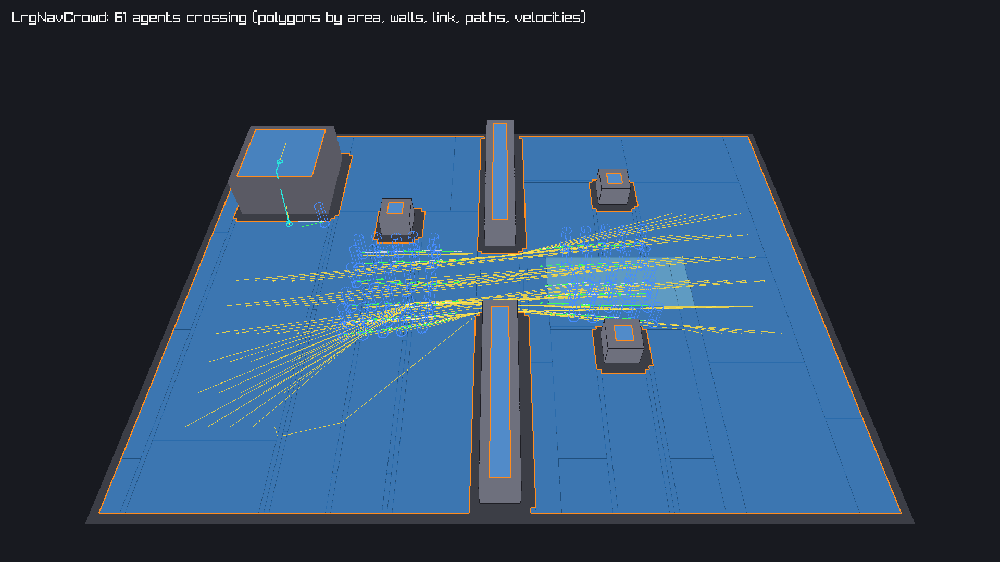

#+title: Navigation
#+description: Navigation in libregnum 0.9: bake a navigation mesh from a level (.rnav settings), load it onto the world, and walk it with agents that follow paths, cross off-mesh links and avoid each other with ORCA.
#+authors: Zach Podbielniak
#+created: 2026-11-07
#+version: 0.9.0

* Navigation
:PROPERTIES:
:CUSTOM_ID: navigation
:END:
#+begin_quote
*[[file:../index.org][Home]]* > Guides > Navigation
#+end_quote

This guide takes a 3D level from geometry to a crowd walking it. The pieces:

| Piece | Page |
|-+-|
| =LrgNavBake=, the =.rnav= bake settings and the bake from a world | [[file:../modules/pathfinding/nav-bake.org][nav-bake]] |
| =LrgNavPolyMesh=, the baked mesh: paths, raycasts, areas, links, the binary form | [[file:../modules/pathfinding/nav-poly-mesh.org][nav-poly-mesh]] |
| =LrgNavAgent=, =LrgNavCrowd=, =LrgNavAgentComponent=: walking and avoidance | [[file:../modules/pathfinding/nav-agent.org][nav-agent]] |
| the level's =navigation:= block | [[file:../editor/yaml-format.org::#navigation][.rlevel format]] |
| =lrg_world3d_set_navigation()=, =lrg_world3d_get_nav_crowd()= | [[file:../modules/world3d/world3d.org::#navigation][LrgWorld3D]] |

The grid pathfinder (=LrgNavGrid=, =LrgPathfinder=) and the triangle mesh =LrgNavMesh= remain for 2D and hand-made meshes; this guide is about 3D levels.

** 1. Decide the agent
:PROPERTIES:
:CUSTOM_ID: agent
:END:
A navigation mesh is baked for one agent size: the walkable surface is shrunk by the agent's radius, spaces lower than its height disappear, slopes steeper than its limit and steps higher than its step are not walkable. Pick the largest walker that has to fit everywhere (often the player-sized NPC: radius 0.3 to 0.4 m, height 1.8 m, slope 45 to 50 degrees, step 0.3 to 0.45 m). A crowd of mixed sizes either shares the largest radius or gets one mesh per size.

** 2. Write the .rnav
:PROPERTIES:
:CUSTOM_ID: rnav
:END:
Next to the level, =nav/castle.rnav=:

#+begin_src yaml
version: 1
name: castle
agent: { radius: 0.35, height: 1.8, max_slope: 45, max_step: 0.4, max_drop: 1.2 }
voxel: { cell_size: 0.2, cell_height: 0.1 }
regions: { min_area: 1.5, corner_margin: 0.1 }
sources:
  exclude_tags: [no-nav]         # tag moving platforms and decoration that must not count
areas:
  - name: mud
    tag: 2
    cost: 3
    boxes: [ { min: [4, -1, -2], max: [12, 1, 2] } ]
  - name: gate
    tag: 7
    cost: 1
    boxes: [ { min: [-1, -1, 8], max: [1, 1, 10] } ]
links:
  - { start: [-14.5, 0, -5], end: [-15, 3, -8], bidirectional: true, cost: 2 }
output: castle.rnavmesh
#+end_src

What counts as geometry: mesh renderers and static colliders of active entities, filtered by the =sources= section. Closed convex shapes (boxes, spheres, capsules, cubes, cylinders) are filled, so nothing is walkable inside a wall or a crate; models are surfaces. =min_area= disables islands such as table tops and the inside of closed models.

** 3. Bake
:PROPERTIES:
:CUSTOM_ID: bake
:END:
Load the level into a world headless, bake, and save the bytes the level will reference:

#+begin_src c
g_autoptr(GError)         error = NULL;
g_autoptr(LrgWorld3D)     world = lrg_world3d_new ();
g_autoptr(LrgLevel)       level = lrg_level_load_world3d ("levels/castle.rlevel", world, &error);
g_autoptr(LrgNavBake)     settings = lrg_nav_bake_new_from_file ("levels/nav/castle.rnav", &error);
g_autoptr(LrgNavPolyMesh) mesh = lrg_nav_bake_bake (settings, world, NULL, &error);
g_autoptr(GBytes)         bytes = lrg_nav_poly_mesh_save (mesh);

g_file_set_contents ("levels/nav/castle.rnavmesh", g_bytes_get_data (bytes, NULL),
                     (gssize) g_bytes_get_size (bytes), &error);
#+end_src

Check the result: =lrg_nav_poly_mesh_get_region_count()= (one region per connected area; more than you expect means a gap the agent cannot cross), =lrg_nav_poly_mesh_to_obj()= for a modelling tool, or the debug draw below.

** 4. Reference it from the level
:PROPERTIES:
:CUSTOM_ID: level
:END:
#+begin_src yaml
navigation:
  settings: nav/castle.rnav
  data: nav/castle.rnavmesh
#+end_src

or in code: =lrg_level_set_nav_settings_ref()=, =lrg_level_set_nav_data_ref()=, then save the level. =lrg_level_instantiate_3d()= (and =lrg_level_load_world3d()=) loads the data, gives it the area costs of the settings and calls =lrg_world3d_set_navigation()=. For procedural or prototype levels set =bake_on_load: true= (=lrg_level_set_nav_bake_on_load()=) and leave out =data=: the mesh is baked from the instantiated world when the level loads. A reference that does not load is a warning, never a failed level.

** 5. Walk it
:PROPERTIES:
:CUSTOM_ID: walk
:END:
Give walkers an =LrgNavAgentComponent= (in the level's components, or in code) and send them somewhere:

#+begin_src c
LrgNavAgentComponent *walker = LRG_NAV_AGENT_COMPONENT (
	lrg_entity3d_get_component (guard, LRG_TYPE_NAV_AGENT_COMPONENT));
const gfloat          post[3] = { 12.0f, 0.0f, -4.0f };

lrg_nav_agent_component_set_destination (walker, post);
g_signal_connect (walker, "arrived", G_CALLBACK (on_guard_arrived), guard);
#+end_src

The world steps its crowd every fixed update (after the components' =fixed_update=, before physics) and the component moves its entity. =lrg_nav_agent_component_get_state()= and the =arrived= / =path-failed= signals tell how it goes; =lrg_nav_agent_component_get_agent()= gives the agent for its path, velocity and filter. Without entities, drive an =LrgNavCrowd= directly with =lrg_nav_crowd_step()=.

** 6. Doors, costs and changing worlds
:PROPERTIES:
:CUSTOM_ID: dynamic
:END:
- *A door* is an area (=gate= above). Close it for everyone with =lrg_nav_poly_mesh_set_tag_enabled (mesh, 7, FALSE)=; agents whose way it blocks plan again within half a second. Let only some agents through with =lrg_nav_agent_set_filter()=.
- *Costs* change without a rebake: =lrg_nav_poly_mesh_set_tag_cost (mesh, 2, 10.0f)= makes mud worse; new paths avoid it (call =lrg_nav_agent_request_repath()= for agents already walking).
- *Rebaking* a changed level into the world's mesh (=lrg_nav_bake_bake_into (settings, lrg_world3d_get_navigation (world), world, NULL, &error)=) changes its serial; every agent plans again on its next step.

** 7. Look at it
:PROPERTIES:
:CUSTOM_ID: debug
:END:
#+begin_src c
LrgDebugDraw *draw = lrg_debug_draw_get_default ();

lrg_world3d_debug_draw_navigation (world, draw, LRG_NAV_DEBUG_DEFAULT);
#+end_src

and draw the batch with the renderer (=lrg_world3d_renderer_set_debug_draw()= and =LRG_WORLD3D_RENDER_FLAG_DEBUG_DRAW=) or =lrg_debug_draw_draw_3d()= inside your 3D mode. Polygons are coloured by region (=LRG_NAV_DEBUG_AREAS= by area), the walls agents avoid are orange, links cyan, agents coloured by state, paths yellow, velocities green. Add =LRG_NAV_DEBUG_ORCA | LRG_NAV_DEBUG_NEIGHBOURS= with =lrg_nav_crowd_set_debug_agent()= to see why one agent moves the way it does.

#+caption: 61 agents crossing a gap in a wall; the climber at the top left took the off-mesh link.

** Troubleshooting
:PROPERTIES:
:CUSTOM_ID: troubleshooting
:END:
| Symptom | Likely cause |
|-+-|
| =path-failed= everywhere | no mesh on the world (check =lrg_world3d_get_navigation()=), or the agents stand off it: =lrg_nav_agent_warp()= snaps within 1 m + radius only |
| a corridor is missing | narrower than twice the bake radius plus a cell, or lower than the agent height |
| agents walk through a prop | the prop is dynamic/kinematic (never baked), excluded by a tag or layer filter, or outside the bounds |
| agents walk into a solid model | a closed model is a surface: give it a box collider or raise =regions.min_area= |
| agents scrape walls | their radius is larger than the bake radius |
| a crowd jams at a door | narrow doors cap the flow; raise =time-horizon= for earlier reactions, lower =max-neighbours= in very dense crowds, or widen the door |
| runs differ | variable step lengths: step the world (and so the crowd) with a fixed step |

** See also
:PROPERTIES:
:CUSTOM_ID: see-also
:END:
- [[file:physics.org][Physics guide]]: the colliders and bodies the bake reads, kinematic bodies that agents drive
- [[file:load-a-level-in-your-game.org][Load a level in your game]]
- [[file:../modules/debug/debug-draw.org][LrgDebugDraw]]
