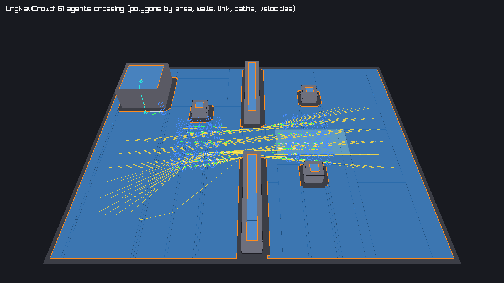
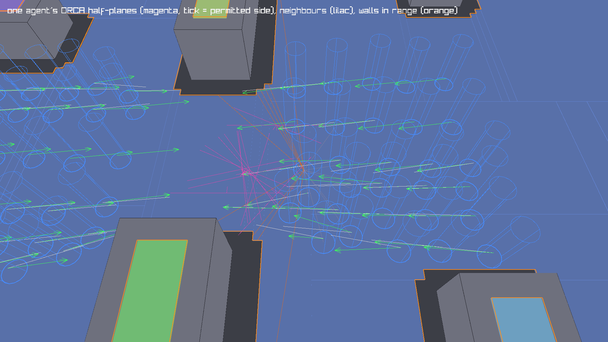

#+title: Navigation agents and crowds
#+description: LrgNavAgent (path following, steering, off-mesh links), LrgNavCrowd (deterministic stepping with ORCA / RVO2 local avoidance against agents and walls) and LrgNavAgentComponent (agents on LrgEntity3D entities), with debug draw.
#+authors: Zach Podbielniak
#+created: 2026-11-07
#+version: 0.9.0

* Navigation agents and crowds
:PROPERTIES:
:CUSTOM_ID: nav-agent
:END:
#+begin_quote
*[[file:../../index.org][Home]]* > *[[file:index.org][Pathfinding]]* > Navigation agents and crowds
#+end_quote

** Overview
:PROPERTIES:
:CUSTOM_ID: overview
:END:
Three types walk an [[file:nav-poly-mesh.org][LrgNavPolyMesh]]:

| Type | Header | What it does |
|-+-+-|
| =LrgNavAgent= | =src/pathfinding/lrg-nav-agent.h= | one walker: plans a string-pulled path to its destination, follows the corners with arrive steering, crosses off-mesh links, keeps itself on the mesh |
| =LrgNavCrowd= | =src/pathfinding/lrg-nav-agent.h= | the agents of one mesh, stepped together and deterministically with ORCA local avoidance (the RVO2 algorithm) against each other and against the mesh's walls |
| =LrgNavAgentComponent= | =src/world3d/components/lrg-nav-agent-component.h= | an agent on an [[file:../world3d/entity3d.org][LrgEntity3D]]: it joins the world's crowd (=lrg_world3d_get_nav_crowd()=), moves the entity (or steers its dynamic body) and turns it to face its velocity |

Everything is headless, single-threaded and reproducible: the same mesh, agents, destinations and step lengths give the same positions, bit for bit, on every run (tested).

** Concepts
:PROPERTIES:
:CUSTOM_ID: concepts
:END:
*** States
:PROPERTIES:
:CUSTOM_ID: concepts-states
:END:
| =LrgNavAgentState= | Meaning |
|-+-|
| =LRG_NAV_AGENT_STATE_IDLE= | no destination (new agents, after =lrg_nav_agent_stop()=) |
| =LRG_NAV_AGENT_STATE_MOVING= | following a path |
| =LRG_NAV_AGENT_STATE_ON_LINK= | crossing an off-mesh link: moved straight from its start to its end at =max-speed=, avoidance off (others avoid it) |
| =LRG_NAV_AGENT_STATE_ARRIVED= | within =stopping-distance= (X/Z) of the destination; it keeps avoiding others, so a crowd can push it a little |
| =LRG_NAV_AGENT_STATE_FAILED= | no path: no mesh, the start or goal off the mesh, the goal in another region or behind a closed tag; planned again when the mesh changes |

The enum is registered as =LRG_TYPE_NAV_AGENT_STATE= (=lrg_nav_agent_state_get_type()=); the =state= property notifies on every change.

*** Paths and corners
:PROPERTIES:
:CUSTOM_ID: concepts-paths
:END:
=lrg_nav_agent_set_destination()= plans at once with the mesh's A* and funnel (=lrg_nav_poly_mesh_find_path()=, at most 8192 polygons expanded, through the agent's filter). The path's points are the corners the funnel left; the agent steers to one corner at a time (=lrg_nav_agent_get_corner_index()=) and moves on when it is within half its radius of it. Two checks keep crowds flowing:

- *corner skipping* (every 0.1 s): when the corner after the current one is in plain sight (=lrg_nav_poly_mesh_raycast()= reaches it), the current corner is dropped. An agent pushed off its line by others never has to touch the exact corner, so crowds do not pile up at the ends of walls;
- *blocked corners* (every 0.5 s): when the walk to the current corner stops well short of it (a tag was switched off, a polygon disabled), the path is planned again.

Paths are also planned again when the mesh is rebaked or reloaded (=lrg_nav_poly_mesh_get_serial()= changed), when =repath-interval= seconds passed, after =lrg_nav_agent_warp()= and =lrg_nav_agent_set_filter()=, and on =lrg_nav_agent_request_repath()=.

*** Steering
:PROPERTIES:
:CUSTOM_ID: concepts-steering
:END:
The preferred velocity points at the current corner at =max-speed=; towards the last corner (and a link's start) the speed falls linearly inside =slowing-distance= (arrive steering, never below 15 % so agents do not crawl) and never overshoots the corner in one step. With =separation-weight= above 0 a separation push is added: away from every neighbour closer than twice the combined radii, weighted by closeness. The velocity then changes by at most =max-acceleration= x step, and the position is kept on the mesh: the agent's next position is snapped to the nearest point of its own region (=lrg_nav_poly_mesh_find_nearest_in_region()=), so it slides along walls and never hops onto an island nearby.

*** Local avoidance (ORCA)
:PROPERTIES:
:CUSTOM_ID: concepts-orca
:END:
Inside a crowd every agent with =avoidance-enabled= solves the optimal reciprocal collision avoidance problem of van den Berg et al. each step, with code ported from the RVO2 Library (Apache-2.0, see [[#third-party][third-party code]]):

1. *Walls*: the mesh's boundary segments within =obstacle-time-horizon= x =max-speed= + radius (=lrg_nav_poly_mesh_get_boundary_segments()=) become two-vertex obstacles; each adds a half-plane of velocities that keep the agent clear of it for =obstacle-time-horizon= seconds. Because the mesh is already eroded by the bake radius, walls are avoided with a quarter of the agent's radius (at least 2 cm): the centre stays on the mesh, the body stays off the real wall.
2. *Agents*: the =max-neighbours= nearest agents within =neighbour-distance= (and within the taller height vertically, so other floors do not count) each add a half-plane of velocities collision-free for =time-horizon= seconds. Each side takes a share of the avoidance: 0.5 when the priorities are equal, shifted by half their difference (=avoidance-priority= 1 against 0 never yields), all of it against an agent that does not avoid (avoidance off, or crossing a link).
3. *Solve*: the velocity closest to the preferred one inside every half-plane and the =max-speed= circle (RVO2's =linearProgram2=); when the constraints leave nothing, the velocity that violates the agent half-planes least while keeping the wall ones (=linearProgram3=).

All agents solve from the state before the step (the order does not matter), then integrate. The acceleration limit can still let two agents touch, so an overlap pass pushes overlapping pairs apart (four iterations, shares as above, kept on the mesh): agents never overlap after a step (tested within 1 mm).

*** The crowd step
:PROPERTIES:
:CUSTOM_ID: concepts-step
:END:
=lrg_nav_crowd_step (crowd, dt)= runs, each phase over the agents in insertion order:

1. plan and steer (paths, corners, arrival, links started),
2. neighbours from a dense uniform grid (counting sort, cells of four times the largest radius, at least 2 m), separation, ORCA,
3. acceleration limit and integration (links advanced),
4. the overlap pass,
5. the signals queued during the step: =path-failed=, =link-entered=, =link-exited=, =arrived= per agent, then =LrgNavCrowd::stepped=.

Agents queue their signals during a step, so handlers may add, remove and redirect agents safely. Use fixed step lengths for reproducible runs; =LrgWorld3D= steps its crowd with its fixed step.

*** Agents on entities
:PROPERTIES:
:CUSTOM_ID: concepts-component
:END:
=LrgNavAgentComponent= owns an agent. While its entity is in a world, the agent is in the world's crowd (=lrg_world3d_get_nav_crowd()=), which walks the world's mesh (=lrg_world3d_set_navigation()=). Every fixed update of =lrg_world3d_fixed_update()=:

1. the components' =fixed_update()= runs: the component warps the agent to the entity when game code moved the entity since the component last wrote it (a teleport), applies a destination that was waiting for the mesh, or, with a dynamic =LrgRigidBodyComponent= on the entity, moves the agent to where the body carried it;
2. the world steps the crowd with its fixed step;
3. on =LrgNavCrowd::stepped= the component writes back: the entity's world position becomes the agent's feet plus =base-offset= and, with =update-rotation=, it turns about +Y (+Z forward) towards the velocity at =angular-speed= degrees per second; with a dynamic body it sets the body's horizontal velocity instead (gravity and collisions stay physical);
4. physics runs; a kinematic body on the entity follows the entity, so the agent pushes dynamic bodies.

The component's =speed=, =acceleration=, =radius=, =height=, =avoidance-priority=, =avoidance-enabled= and =stopping-distance= properties are the agent's; set them in a level's component params like any other component property.

** API reference
:PROPERTIES:
:CUSTOM_ID: api
:END:
*** LrgNavAgent
:PROPERTIES:
:CUSTOM_ID: api-agent
:END:
| Function | Purpose |
|-+-|
| =lrg_nav_agent_new()= | an agent at the origin with the defaults below |
| =lrg_nav_agent_get_mesh()= / =lrg_nav_agent_set_mesh()= | the mesh it walks (a crowd sets its own) |
| =lrg_nav_agent_get_position (agent, out)= | its feet |
| =lrg_nav_agent_warp (agent, position)= | teleport (snapped to the mesh within 1 m + radius), stop, plan again |
| =lrg_nav_agent_get_velocity()= / =lrg_nav_agent_get_desired_velocity()= | actual velocity / what steering wanted last step (Y is 0) |
| =lrg_nav_agent_set_destination (agent, destination)= | plan; =FALSE= and =path-failed= without a path |
| =lrg_nav_agent_get_destination (agent, out)= | the destination, snapped to the mesh once planned |
| =lrg_nav_agent_stop()= | drop the destination, brake to =IDLE= |
| =lrg_nav_agent_request_repath()= | plan again on the next update |
| =lrg_nav_agent_get_state()= | =LrgNavAgentState= |
| =lrg_nav_agent_get_path (agent, &n_floats)= | the path, three floats per point (borrowed) |
| =lrg_nav_agent_get_corner_index()= | the point it steers to |
| =lrg_nav_agent_get_remaining_distance()= | length of the rest of the path (0 unless moving) |
| =lrg_nav_agent_set_filter (agent, filter, data, destroy)= | which tagged polygons and links it may use (=LrgNavPolyFilterFunc=) |
| =lrg_nav_agent_get_radius()= / =lrg_nav_agent_set_radius()= | =radius= |
| =lrg_nav_agent_get_height()= / =lrg_nav_agent_set_height()= | =height= |
| =lrg_nav_agent_get_max_speed()= / =lrg_nav_agent_set_max_speed()= | =max-speed= |
| =lrg_nav_agent_get_max_acceleration()= / =lrg_nav_agent_set_max_acceleration()= | =max-acceleration= |
| =lrg_nav_agent_get_avoidance_priority()= / =lrg_nav_agent_set_avoidance_priority()= | =avoidance-priority= (clamped to 0 .. 1) |
| =lrg_nav_agent_get_avoidance_enabled()= / =lrg_nav_agent_set_avoidance_enabled()= | =avoidance-enabled= |
| =lrg_nav_agent_update (agent, dt)= | step an agent that is in no crowd (no avoidance) |
| =lrg_nav_agent_get_crowd()= | its crowd |

| Property | Default | Meaning |
|-+-+-|
| =radius= | 0.3 | avoidance radius (bake the mesh with the same or the largest) |
| =height= | 1.8 | agents further apart vertically than the taller one ignore each other |
| =max-speed= | 3.5 | m/s |
| =max-acceleration= | 8 | m/s² |
| =avoidance-priority= | 0.5 | 0 .. 1, higher yields less |
| =avoidance-enabled= | =TRUE= | runs ORCA in a crowd |
| =neighbour-distance= | 8 | neighbour search radius (advisable: at least =max-speed= x =time-horizon=) |
| =max-neighbours= | 10 | nearest agents considered |
| =time-horizon= | 2 | seconds of collision-free motion against agents |
| =obstacle-time-horizon= | 1 | seconds against walls |
| =stopping-distance= | 0.1 | arrival distance (X/Z) |
| =slowing-distance= | 1 | arrive steering distance |
| =separation-weight= | 0 | separation steering (0: ORCA alone) |
| =repath-interval= | 0 | seconds between automatic replans (0: only on demand) |
| =state= | =IDLE= | read-only |

| Signal | When |
|-+-|
| =LrgNavAgent::arrived= | reached the destination (after the crowd step) |
| =LrgNavAgent::path-failed= | no path (at once from =lrg_nav_agent_set_destination()=, else after the step) |
| =LrgNavAgent::link-entered= / =LrgNavAgent::link-exited= | started / finished crossing an off-mesh link (play a climb animation) |

*** LrgNavCrowd
:PROPERTIES:
:CUSTOM_ID: api-crowd
:END:
| Function | Purpose |
|-+-|
| =lrg_nav_crowd_new (mesh)= | an empty crowd on a mesh (or none yet) |
| =lrg_nav_crowd_get_mesh()= / =lrg_nav_crowd_set_mesh()= | =LrgNavCrowd:mesh=; every agent moves to it and plans again |
| =lrg_nav_crowd_add_agent()= / =lrg_nav_crowd_remove_agent()= | membership (an agent belongs to one crowd; the crowd holds a reference) |
| =lrg_nav_crowd_get_n_agents()=, =lrg_nav_crowd_get_agent (crowd, i)=, =lrg_nav_crowd_clear()= | the agents in step order |
| =lrg_nav_crowd_step (crowd, dt)= | one deterministic step |
| =lrg_nav_crowd_get_step_count()=, =lrg_nav_crowd_get_last_step_seconds()= | counters for profiling |
| =lrg_nav_crowd_debug_draw (crowd, draw, flags)= | the mesh and the agents into an =LrgDebugDraw= |
| =lrg_nav_crowd_set_debug_agent()= / =lrg_nav_crowd_get_debug_agent()= | draw the ORCA and neighbour detail for one agent only |

=LrgNavCrowd::stepped (crowd, dt)= is emitted at the end of every step.

*** LrgNavAgentComponent
:PROPERTIES:
:CUSTOM_ID: api-component
:END:
| Function | Purpose |
|-+-|
| =lrg_nav_agent_component_new()= | a component with the agent defaults |
| =lrg_nav_agent_component_get_agent()= | the agent (state, path, filter, ...) |
| =lrg_nav_agent_component_set_destination (comp, xyz)= | go there; kept until the entity is in a world with a mesh |
| =lrg_nav_agent_component_get_destination()= | the pending or current destination |
| =lrg_nav_agent_component_stop()= | stop |
| =lrg_nav_agent_component_get_state()=, =lrg_nav_agent_component_has_arrived()=, =lrg_nav_agent_component_get_remaining_distance()= | progress |
| =lrg_nav_agent_component_get_speed()= / =lrg_nav_agent_component_set_speed()= | =speed= |
| =lrg_nav_agent_component_get_acceleration()= / =lrg_nav_agent_component_set_acceleration()= | =acceleration= |
| =lrg_nav_agent_component_get_radius()= / =lrg_nav_agent_component_set_radius()= | =radius= |
| =lrg_nav_agent_component_get_height()= / =lrg_nav_agent_component_set_height()= | =height= |
| =lrg_nav_agent_component_get_avoidance_priority()= / =lrg_nav_agent_component_set_avoidance_priority()= | =avoidance-priority= |

| Property | Default | Meaning |
|-+-+-|
| =speed=, =acceleration=, =radius=, =height=, =avoidance-priority=, =avoidance-enabled=, =stopping-distance= | the agent's | forwarded to the agent |
| =base-offset= | 0 | height of the entity's pivot above the agent's feet (half the height for a capsule centred on its pivot) |
| =update-rotation= | =TRUE= | turn to face the velocity (+Z forward) |
| =angular-speed= | 720 | degrees per second (0 turns at once) |

Signals: =LrgNavAgentComponent::arrived= and =LrgNavAgentComponent::path-failed= (forwarded from the agent).

*** Debug draw
:PROPERTIES:
:CUSTOM_ID: api-debug-draw
:END:
=LrgNavDebugFlags= (=LRG_TYPE_NAV_DEBUG_FLAGS=, =lrg_nav_debug_flags_get_type()=, declared in =lrg-nav-poly-mesh.h=) selects what =lrg_nav_poly_mesh_debug_draw()=, =lrg_nav_crowd_debug_draw()= and =lrg_world3d_debug_draw_navigation()= record, always into =LRG_DEBUG_CATEGORY_NAVIGATION=:

| Flag | Draws |
|-+-|
| =LRG_NAV_DEBUG_POLYGONS= | polygons as translucent slabs (diagonals on slopes), one colour per region; red when disabled or their tag is off |
| =LRG_NAV_DEBUG_POLYGON_EDGES= | polygon outlines |
| =LRG_NAV_DEBUG_BOUNDARIES= | the walls ORCA avoids (orange, 2 px) |
| =LRG_NAV_DEBUG_PORTALS= | the shared edges between polygons |
| =LRG_NAV_DEBUG_LINKS= | off-mesh links as arcs with arrow heads (cyan added, yellow drops, grey off) |
| =LRG_NAV_DEBUG_AREAS= | colour polygons by area tag instead of region |
| =LRG_NAV_DEBUG_AGENTS= | agents as cylinders coloured by state (moving blue, link cyan, arrived green, failed red, idle grey) |
| =LRG_NAV_DEBUG_PATHS= | the remaining path (yellow) and the steer target |
| =LRG_NAV_DEBUG_VELOCITIES= | preferred (white line) and actual (green arrow) velocity, at 0.5 s |
| =LRG_NAV_DEBUG_ORCA= | the last step's ORCA half-planes in velocity space around the agent (0.5 s scale), a tick on the permitted side |
| =LRG_NAV_DEBUG_NEIGHBOURS= | lines to the agents and walls the last step avoided |
| =LRG_NAV_DEBUG_DEFAULT= | polygons, boundaries, links, agents, paths, velocities |
| =LRG_NAV_DEBUG_NONE= / =LRG_NAV_DEBUG_ALL= | nothing / everything |

#+caption: A crowd of 61 crossing a wall gap (polygons by area: the mud strip lighter, boundaries orange, the ladder link cyan, paths yellow, velocities green); 1920x1080 under build-aux/xrun.sh.

#+caption: The ORCA detail of one agent (lrg_nav_crowd_set_debug_agent()): its half-planes in magenta, the walls in range in orange, neighbours in lilac.

** Worked examples
:PROPERTIES:
:CUSTOM_ID: examples
:END:
*** A crowd without a world
:PROPERTIES:
:CUSTOM_ID: example-crowd
:END:
#+begin_src c
g_autoptr(LrgNavCrowd) crowd = lrg_nav_crowd_new (mesh);
guint                  i;

for (i = 0; i < 50; i++)
{
	g_autoptr(LrgNavAgent) agent = lrg_nav_agent_new ();
	const gfloat           start[3] = { -16.0f, 0.0f, (gfloat) i * 0.8f - 20.0f };
	const gfloat           goal[3] = { 16.0f, 0.0f, (gfloat) i * 0.8f - 20.0f };

	lrg_nav_crowd_add_agent (crowd, agent);   /* the crowd holds a reference */
	lrg_nav_agent_warp (agent, start);
	lrg_nav_agent_set_destination (agent, goal);
}

/* every fixed step */
lrg_nav_crowd_step (crowd, 1.0f / 60.0f);
#+end_src

*** A walker entity
:PROPERTIES:
:CUSTOM_ID: example-component
:END:
#+begin_src c
static void
on_arrived (LrgNavAgentComponent *agent,
            gpointer              user_data)
{
	g_message ("%s is there", lrg_entity3d_get_name (lrg_component_get_entity (LRG_COMPONENT (agent))));
}

LrgEntity3D                     *guard = lrg_entity3d_new_with_name ("guard");
g_autoptr(LrgNavAgentComponent)  walker = lrg_nav_agent_component_new ();
const gfloat                     post[3] = { 12.0f, 0.0f, -4.0f };

g_object_set (walker, "speed", 2.0f, "base-offset", 0.9f, NULL);
g_signal_connect (walker, "arrived", G_CALLBACK (on_arrived), NULL);
lrg_entity3d_add_component (guard, LRG_COMPONENT (walker));
lrg_world3d_add_entity (world, guard);
g_object_unref (guard);

lrg_nav_agent_component_set_destination (walker, post);
/* lrg_world3d_step() does the rest */
#+end_src

*** Doors with a filter
:PROPERTIES:
:CUSTOM_ID: example-filter
:END:
#+begin_src c
/* tags 100.. are doors; this guard has the keys of doors 100 and 101 */
static gboolean
has_key (guint32  tag,
         gpointer user_data)
{
	return tag < 100 || tag == 100 || tag == 101;
}

lrg_nav_agent_set_filter (lrg_nav_agent_component_get_agent (walker), has_key, NULL, NULL);
#+end_src

*** Debug draw in a game
:PROPERTIES:
:CUSTOM_ID: example-debug
:END:
#+begin_src c
LrgDebugDraw *draw = lrg_debug_draw_get_default ();

lrg_nav_crowd_set_debug_agent (lrg_world3d_get_nav_crowd (world),
                               lrg_nav_agent_component_get_agent (selected));
lrg_world3d_debug_draw_navigation (world, draw, LRG_NAV_DEBUG_DEFAULT | LRG_NAV_DEBUG_ORCA);
/* the renderer draws the batch with LRG_WORLD3D_RENDER_FLAG_DEBUG_DRAW */
#+end_src

** Performance
:PROPERTIES:
:CUSTOM_ID: performance
:END:
Measured on an i7-1280P pinned with =taskset -c 0=, while parallel builds kept the load average around 22: the ranges are several runs, the low ends are closer to an idle machine.

| Scenario | Mean step | Worst step |
|-+-+-|
| 100 agents walking head-on through each other on 40 x 40 m (=tests/test-nav-agent= =/nav-agent/crowd/perf=, 600 steps of 1/60 s) | 0.32 .. 0.34 ms | 0.6 .. 3.2 ms |
| 100 agents crossing through the centre to mirrored points, 40 x 40 m with 40 blocks | 1.3 .. 2.3 ms | |
| 500 agents, the same on 80 x 80 m | 5.3 .. 9.5 ms | |
| 1000 agents, the same on 120 x 120 m | 8.0 .. 14.6 ms | |

The step is O(n) in agents for the neighbour grid and O(n x k) for ORCA (k = =max-neighbours= plus the walls in range); dense jams cost more (=linearProgram3=). Path planning is per agent and only on demand. Lower =max-neighbours=, =neighbour-distance= and =obstacle-time-horizon= for very large crowds; give far-away agents =avoidance-enabled= =FALSE=.

** Pitfalls
:PROPERTIES:
:CUSTOM_ID: pitfalls
:END:
- *Do not call =lrg_nav_agent_update()= for agents in a crowd*: the crowd steps them.
- *Radius vs bake radius*: walls only keep the centre on the mesh; an agent larger than the bake radius scrapes walls.
- *Arrived agents still avoid*: a crowd may push an arrived agent; check =lrg_nav_agent_get_state()=, not distance alone, and send it back if needed.
- *Links ignore avoidance*: an agent on a link moves straight and others avoid it; long links in busy places look like ghosts.
- *Teleports*: move an agent entity with =lrg_entity3d_set_world_position()= (detected) or =lrg_nav_agent_warp()=; changing the agent's position any other way is not possible.
- *One mesh per crowd*: agents of different sizes on different meshes need different crowds (the world has one; make others with =lrg_nav_crowd_new()=).
- *Determinism* needs fixed step lengths and the same insertion order.

** Third-party code
:PROPERTIES:
:CUSTOM_ID: third-party
:END:
The ORCA routines in =src/pathfinding/lrg-nav-agent.c= (obstacle and agent half-planes of =Agent::computeNewVelocity()=, =linearProgram1/2/3=) are a C port of the RVO2 Library 2.0, Copyright 2008 University of North Carolina at Chapel Hill, licensed under the Apache License, Version 2.0 (https://gamma.cs.unc.edu/RVO2/). The notice is kept in the file header with the list of changes.

** Using it from the editor
:PROPERTIES:
:CUSTOM_ID: editor
:END:
=LrgNavAgentComponent= is a regular component: add it to a node's components in the inspector (or a level's =components:= list) and set =speed=, =radius=, =base-offset= and the rest as params; in play-in-editor the agents walk the level's mesh. The agent debug view (paths, velocities, the selected agent's ORCA lines) and the bake-and-test loop come with the next 0.9.0 editor wave and are built on =lrg_world3d_debug_draw_navigation()= and =lrg_nav_crowd_set_debug_agent()=.

** Tests
:PROPERTIES:
:CUSTOM_ID: tests
:END:
=tests/test-nav-agent.c=: following a path around a wall and arriving (never off the mesh, one =arrived=), failures (another region, no mesh, then planning once a mesh arrives), crossing a ladder link (=link-entered= / =link-exited=, arriving on the upper floor), ORCA (two agents head-on never overlap and side-step; priority 1 against 0 does not yield; six agents through a corridor with a pillar stay on the mesh and never overlap), a crowd of 100 walking head-on through each other all arriving, bit-identical determinism of two crowds, step timing, crowd membership and debug draw, and the component in a world (a destination set before the mesh, arriving, base offset, facing, teleports, accessors, leaving the crowd).

** See also
:PROPERTIES:
:CUSTOM_ID: see-also
:END:
- [[file:nav-bake.org][LrgNavBake]]: baking the mesh
- [[file:nav-poly-mesh.org][LrgNavPolyMesh]]: the mesh and its queries
- [[file:../../guides/navigation.org][Navigation guide]]
- [[file:../world3d/world3d.org::#navigation][LrgWorld3D navigation]] and [[file:../world3d/components.org][3D components]]
- [[file:../debug/debug-draw.org][LrgDebugDraw]]
